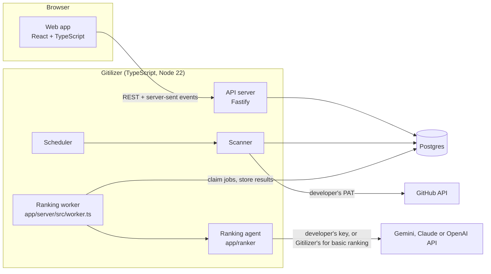

# Gitilizer design

| | |
|---|---|
| **Status** | Draft, with a working prototype of the end-to-end slice (see [Prototype status](#prototype-status)). The prototype follows the 2026-11-01 PRD except where [Changes from the 2026-11-01 PRD](#changes-from-the-2026-11-01-prd) says otherwise. |
| **Author** | brian@sweetapp.com (drafted with Claude) |
| **Last updated** | 2026-11-26 (a list that stays current, PRD `LIVE-4`, `LIVE-5`, `LIVE-10`, `LIVE-27` to `LIVE-30`, `LIST-24`, `LIST-47`, `SCAN-6`, `SCAN-7`, `METRIC-4`, `METRIC-6`, [Q-109](PRD.md#q-109) to [Q-111](PRD.md#q-111): `live/holds.ts` with the 30-second limit and what counts as activity in the table, focus kept on moved rows, the popup closing when its link is followed or the tab is hidden, catching up from `GET /api/list?known=` on reconnecting or seeing a gap in versions, instead of replaying from `Last-Event-ID`, [Live updates](#live-updates), [D-30](#d-30); `lastSyncedAt` and "Synced {time}", [Web app](#web-app); scans due from the last successful one, retries after a failure, `scans.retry_at` for GitHub's rate limits, a 150-second presence window and presence reported on reconnecting, [Scheduler](#scheduler); each token's own search pacing and a wait for the search limit, [Scanner](#scanner); the "list staleness" line, its metrics, charts and alert, [Logging](#logging), [D-31](#d-31)); 2026-11-23 (filtering by next step, PRD `LIST-44` to `LIST-46`, `LIST-38` to `LIST-40`, `ICE-8`, [Q-108](PRD.md#q-108): `step` in the URL, read by `parseSteps()` and written by `stepsParam()`, `NextStepMenu` in the strip with counts from `ListPage`, "Show only" in `RankWhy`, and the Icebox ignoring `step`, [Web app](#web-app); `live/filter.test.ts`, [Testing](#testing)); 2026-11-22 (Settings in sections, PRD `SET-57` to `SET-60`, `NAV-3`, `NAV-8`, `NAV-9`, `SET-14`, [Q-107](PRD.md#q-107): one `SettingsPage` with every section mounted and the ones not chosen hidden, the section from `/settings/{section}`, links to a control resolved by `sectionOf()`, a navigation guard that lets moves within Settings through, the save bar and footer, and "Save changes" staying on the section, [Web app](#web-app), [D-29](#d-29); `SettingsPage.sections.dom.test.tsx`, [Testing](#testing)); 2026-11-22 (review requests to the developer's teams, PRD `SET-51` to `SET-56`, `LIST-1`, `LIST-3`, `LIST-21`, `LIST-42`, `SCAN-1`, `RANK-23`, `RANK-25`, [Q-106](PRD.md#q-106): the `teams` table, the `team_review_requested` reason and `user_items.team_handle`, team searches with `advanced_search` and the personal review request search typed as a PR search, `POST /api/teams/check` and `POST /api/teams/find`, team notes in the ranking context, the Teams section and the "Team" chip prefix, [Teams](#teams), [D-27](#d-27), [D-28](#d-28)); 2026-11-21 (no sign-in page, PRD `AUTH-4`, `AUTH-10`, `HOME-3`, `NAV-10`, [Q-105](PRD.md#q-105): a failed sign-in's notice travels to the home page in a one-time cookie, the app's pages send signed-out visitors to `/?next=`, the development sign-in is a plain form on the home page, and `GET /api/auth/config` is gone, [Public pages](#public-pages), [Sign-in and sessions](#sign-in-and-sessions)); 2026-11-20 (the home page and the privacy policy, sent by the server as finished HTML, `/` choosing between the home page and the web app by the session cookie, and fonts served from gitilizer.com, PRD `HOME-1` to `HOME-7`, `PRIV-6`, [Public pages](#public-pages); `app/server/src/site.ts`, `app/web/public/site.css`, `app/web/public/fonts/`); 2026-11-20 (row indicators stay for 10 s on a clock that stops while the tab is hidden, then fade over 2.5 s, and only items whose own score changed get them, PRD `LIVE-18`, [Live updates](#live-updates); `live/visibleClock.ts`); 2026-11-20 (row animations take 0.7 s, and row indicators fade out over 2.5 s once the row is in place, PRD `LIVE-11` to `LIVE-18`, `LIVE-22`, [Live updates](#live-updates); `live/indicators.ts` and its tests); 2026-11-20 (a repository's prioritization prompt is edited in place, PRD `SET-7`, `SET-9`: `RepoPrompt` on each row, with the field's text in the page's draft while it is open, and no prompt field in the add form, [Web app](#web-app); `SettingsPage.repos.dom.test.tsx`, [Testing](#testing)); 2026-11-19 (the next step chip opens the rank reasoning popup, PRD `LIST-24`, `LIST-42`: `NextStepChip` is a button when the row has a popup, the popup sits in `.next-step-cell` and leads with a `.rank-why-next` panel tinted per next step, and the rank is plain text, [Web app](#web-app); `ListPage.dom.test.tsx` runs the popup in jsdom, the first web test with a DOM, [Testing](#testing)); 2026-11-19 (next step chips, PRD `LIST-42`: a class and colors for each next step, in place of `NEXT_STEP_TONE`, [Web app](#web-app)); 2026-11-18 (Sync now while GitHub can't be read, PRD `LIST-43` and `NOTIF-24`: `scanBlocker()` and `withoutCovered()` in the shared notification module; the button is disabled with a link to the fix, and `shownNotifications()` leaves out `stale` while an error that stops every scan shows, [Web app](#web-app), [Notifications](#notifications), [D-26](#d-26)); 2026-11-18 (next steps, PRD `RANK-23`, `RANK-24`, `LIST-42`, `LIST-24`: the agent's output asks for `next_step` in place of `actionable`, basic ranking asks a `choice` question, `user_items.next_step`, the chip on each row and the "Next" block in the rank reasoning popup, and the harness measures next steps against `next_step` in the eval set, [Next steps](#the-ranking-agent), [D-25](#d-25)); 2026-11-16 (an alert for a `LISTEN` connection that keeps dropping or can't be restored, [Monitoring](#hosting-on-google-cloud)); 2026-11-16 (the `LISTEN` connection checks itself every 30 seconds and reconnects when Postgres doesn't answer, [F28](#findings-from-the-prototype)); 2026-11-15 (search and the type filter, PRD `LIST-34` to `LIST-41`: done in the browser, with the URL as their only state, [D-24](#d-24); keyboard shortcuts, PRD `KEY-1` to `KEY-3` and `SET-50`: `useShortcut`, the `settings.keyboard_shortcuts` column and `PUT /api/preferences`); 2026-11-15 (an issue response that isn't an issue fails the scan instead of being stored as a snapshot; the worker's `internal` code for its own failures, logged with the stack); 2026-11-15 (simplified setup and basic ranking, PRD `WEL-2` to `WEL-6`, `SET-15`, `SET-38` to `SET-40`, `RANK-13`, `RANK-21`, `RANK-22`, `METRIC-5`: the Decisions API client in the ranker, [D-20](#d-20); `users.ranking_agent` may be `basic`, `users.ranking_chosen_at`, and setup completes when GitHub is connected and the ranking is chosen; Gemini falls back to `gemini-3.5-flash-lite` and then to basic ranking, for new and changed items only; basic ranking's pause, `basic_pause` and the `basic_paused` warning, which replaces `gemini_daily_quota`, [D-21](#d-21); `ranking_volume`, the "ranking volume" log line and two dashboard charts, [D-22](#d-22); `BASIC_RANKING_API_KEY`; the two-step Warm Welcome and `POST /api/setup` with an optional Gemini key); 2026-11-15 (`GITHUB_APP_SLUG` may be the app's public link); 2026-11-14 (GitHub connection, PRD `SET-42` to `SET-49`, `WEL-6`: a GitHub App whose user tokens the scanner reads GitHub with, beside the PAT, [GitHub connection](#github-connection), [D-17](#d-17) to [D-19](#d-19); `credentials` gains the `github_app` kind with its refresh token; `GET /api/connect/github/start` and `callback`, `GET /api/github/connection`; the codes `github_connection_ended` and `github_app_permission`; the `GITHUB_APP_*` settings); 2026-11-14 (Gemini is the recommended agent: one `AgentPicker` component for Warm Welcome and Settings, PRD `WEL-5` and `SET-38`; the billing and cost notes are gone, `SET-41`; Claude and OpenAI rank with `claude-sonnet-5-5` and `gpt-6.1-sol`, `RANK-19`); 2026-11-07 (OpenAI answers whose first message is a garbled draft, and prompts its content filter refuses; prompt v5 measured for all three agents); 2026-11-07 (ranking agents, PRD `SET-38` to `SET-41`, `WEL-5`, `RANK-19`, `RANK-20`: Claude and OpenAI clients in the ranker, called with `fetch`, [D-15](#d-15); `users.ranking_agent`, `user_items.ranked_agent` and `rank_jobs.agent`; a key per agent, kept while another is in use; per-agent error codes and notifications; ranking pauses for every key-level failure, and tries again every 15 minutes after credits or billing fail, [D-16](#d-16); switching agents); 2026-11-07 (only the newest release running claims scans and ranking jobs, because Cloud Run kept the previous revision working for over 15 minutes after a release: `releases` and `processes`, [D-14](#d-14); repositories show their owner's avatar, `SET-8` and `SET-36`, from the `owner` in GitHub's repository response; excluded repositories, `SET-33` to `SET-37`: the `excluded_repos` table, exclusions stored by GitHub ID, negated qualifiers on the personal searches, the reason searches again for additional repositories inside an excluded owner, and the `excluded` leave reason; [D-13](#d-13)); 2026-11-06 (a worker that can't reach the database to record a failure logs it and leaves the job to its lease, instead of stopping the process); 2026-11-04 (the eye button's icon and label name what a click does, with no `aria-pressed`, `SET-21`; "PRs" and "issues and PRs" in the UI text, and the missing GitHub permission named in lowercase, `SET-28`; credential cards in Settings titled "GitHub" and "Gemini", with no description under the titles, `SET-1`; rank reasoning popup holds updates and returns focus, `LIVE-27`, `LIST-24`; credentials entered and checked on Warm Welcome, `WEL-2` to `WEL-4`, `POST /api/setup`, D-12; rank reasoning popup, `LIST-24`, not clipped on short pages; sync progress, `LIST-33`; "Save and re-rank" is a sync; a Gemini request can't outlive its ranking lease, and expired leases are logged, GitHub issue #3); 2026-11-03 (relative times, `LIST-22`); 2026-11-02 (production: Google and GitHub sign-in, several processes on one database, the container image, pipeline and infrastructure scripts; D-10 and D-11) |
| **Address** | [gitilizer.com](https://gitilizer.com) |
| **Google Cloud project** | `gitilizer` |
| **Source** | [github.com/brianquinlan/gitilizer](https://github.com/brianquinlan/gitilizer) |
| **Requirements** | [PRD](PRD.md) |
| **Design** | [Gitilizer Figma file](https://www.figma.com/design/J94JKJLNCcFUovvwfaFaqb/Gitilizer?node-id=0-1) |

This document explains how Gitilizer is built. It refers to requirements in the [PRD](PRD.md) by ID (for example `LIST-4`) and to the PRD's questions by number (for example [Q-28](PRD.md#q-28)). The decisions this design depends on are summarized in [PRD decisions](#prd-decisions). [README.md](README.md) explains where everything is in the repository.

Questions about the design itself are marked the same way as in the PRD: **TODO:** marks missing information, or a choice this design has made that the owner should confirm. Each links to a row in [Open questions](#open-questions), numbered D-1, D-2 and so on so they can't be confused with the PRD's.

## Contents

1. [Scope](#scope)
2. [PRD decisions](#prd-decisions)
3. [Architecture](#architecture)
4. [The ranking agent](#the-ranking-agent)
5. [Hosting on Google Cloud](#hosting-on-google-cloud)
6. [Sign-in and sessions](#sign-in-and-sessions)
7. [Public pages](#public-pages)
8. [GitHub connection](#github-connection)
9. [Repository layout](#repository-layout)
10. [Data model](#data-model)
11. [HTTP API](#http-api)
12. [Live updates](#live-updates)
13. [Web app](#web-app)
14. [Scanner](#scanner)
15. [Scheduler](#scheduler)
16. [Ranking worker](#ranking-worker)
17. [Notifications](#notifications)
18. [Security](#security)
19. [Scale](#scale)
20. [Testing](#testing)
21. [Logging](#logging)
22. [Deployment](#deployment)
23. [Prototype status](#prototype-status)
24. [Changes from the 2026-11-01 PRD](#changes-from-the-2026-11-01-prd)
25. [Findings from the prototype](#findings-from-the-prototype)
26. [Local development](#local-development)
27. [Open questions](#open-questions)

---

## Scope

The design covers the whole product in the PRD. The prototype implements an end-to-end slice of it (see [Prototype status](#prototype-status)): Google and GitHub sign-in (with a development form on a developer's own computer), credentials and settings, scanning, ranking with the existing agent, the Prioritized list and Icebox with live updates, and notifications.

Not designed here: a full cost estimate for the hosting. The domain's cost is estimated in [Hosting on Google Cloud](#hosting-on-google-cloud); the live-update streams are the main cost risk, with polling as the fallback.

---

## PRD decisions

The product owner's answers to the PRD questions this design depends on. The PRD has the full list.

| PRD question | Decision |
|---|---|
| [Q-2](PRD.md#q-2) Scale | 10,000 developers with the app visible, up to 100,000 accounts, up to 1,000 items each (`NFR-1`). |
| [Q-1](PRD.md#q-1) Hosting | Google Cloud; best performance in North America and Western Europe; at most US$200 a month; served at `gitilizer.com`. |
| [Q-3](PRD.md#q-3) Metrics | Users, users who completed setup, daily/weekly/monthly actives (`METRIC-1`), and system health (`METRIC-3`). |
| [Q-8](PRD.md#q-8) Warm Welcome | Until GitHub is connected and the developer has chosen how their items are ranked, usually on Warm Welcome itself; afterwards, notifications. |
| [Q-82](PRD.md#q-82) Setup on Warm Welcome | Step 2 has the optional Gemini key and one button; a typed key is checked, and nothing is saved unless it passes (`WEL-4`). |
| [Q-9](PRD.md#q-9), [Q-11](PRD.md#q-11) Accounts and sessions | One account per sign-in provider account; 30-day sliding sessions; signing out ends only the current session (`AUTH-7` to `AUTH-9`). |
| [Q-17](PRD.md#q-17) Thresholds | Short-lived problems are retried for 15 minutes, then shown as warnings; stale-list error after 3 hours; expiry warning 7 days ahead. |
| [Q-21](PRD.md#q-21), [Q-65](PRD.md#q-65) Inclusion | Personal review requests, assigned, mentioned by name, created, commented on, additional repositories; drafts and bot items included; archived repositories, team reviews and team mentions excluded. |
| [Q-22](PRD.md#q-22), [Q-67](PRD.md#q-67) Reason precedence | Review requested, Assigned, @handle, Created, Commented, repository name. |
| [Q-27](PRD.md#q-27), [Q-66](PRD.md#q-66) List size | The 1,000 most recently updated items, Prioritized list only; no notice; dropped items slide off the bottom. |
| [Q-28](PRD.md#q-28), [Q-29](PRD.md#q-29) First sync and Sync now | Pulsing skeleton rows; unranked items hidden; failed items at the end with "–"; Sync now spins for any sync, is never disabled and isn't throttled. |
| [Q-35](PRD.md#q-35), [Q-72](PRD.md#q-72) Icebox return | A separate Icebox check prompt decides, leaning toward bringing items back. The developer can't see or change that prompt (`ICE-14`). |
| [Q-39](PRD.md#q-39), [Q-74](PRD.md#q-74) Model | Gitilizer chooses the models (`GITILIZER_MODELS`, default `gemini-3.8-flash,gemini-3.5-flash-lite`, the first being the primary; basic ranking comes after them, `RANK-13`) with the lowest thinking level each allows, for cost (`RANK-11`); Settings doesn't show it. |
| [Q-40](PRD.md#q-40) Token kinds | Fine-grained and classic tokens, one per developer; no organization permissions needed. |
| [Q-44](PRD.md#q-44) Default prompt | `prompts/v4.md`, at most 20,000 characters, new defaults followed automatically. |
| [Q-45](PRD.md#q-45), [Q-64](PRD.md#q-64), [Q-71](PRD.md#q-71), [Q-107](PRD.md#q-107) Saving | "Save changes" and "Save and re-rank" in a save bar at the bottom of every section, covering every section and credentials; "Save changes" stays on Settings and "Save and re-rank" goes to the list; "Discard changes" stays; "Back to list" asks first if anything is unsaved, as leaving does (`NAV-8`, `NAV-9`, `SET-60`). |
| [Q-46](PRD.md#q-46) Deletion | Immediate, after a simple confirmation; backups kept for 6 months (`PRIV-4`). |
| [Q-47](PRD.md#q-47) Background scans | Every 2 hours for developers seen in the last 7 days; otherwise only on the next visit. |
| [Q-48](PRD.md#q-48), [Q-49](PRD.md#q-49) Re-ranking | Every item re-ranked at least every 24 hours; a change also re-ranks the items it links to. |
| [Q-51](PRD.md#q-51) Concurrency | 4 calls to the ranking agent at once per developer. |
| [Q-57](PRD.md#q-57) Additional repositories | "keep an eye on", not "responsible for"; the agent's wording changes to match (`SET-31`). |
| [Q-41](PRD.md#q-41) Repositories | `owner/name` or a GitHub URL; duplicates and bad formats are errors; at most 25; prioritization prompts up to 500 characters, edited in place on the repository's row ([Q-103](PRD.md#q-103)). Access states "Checking…", "Access confirmed", "Archived" and "Can't access", with the reason on hover (`SET-8`). |
| [Q-52](PRD.md#q-52), [Q-68](PRD.md#q-68) Item data | No privacy note in Settings; an item's data is deleted 30 days after no developer has it (`PRIV-5`). The documentation's privacy section covers storage, deletion and what is sent to Gemini (`FOOT-4`). |
| [Q-58](PRD.md#q-58), [Q-37](PRD.md#q-37), [Q-38](PRD.md#q-38) Validate | Checks the typed value; disabled when the field is empty, including for a saved credential; the result states in `SET-28`; saving in Settings doesn't validate (`SET-29`). |
| [Q-63](PRD.md#q-63), [Q-75](PRD.md#q-75), [Q-96](PRD.md#q-96) Free tier | Must work on the free tier, falling back through the steps in `RANK-13` as each daily quota runs out: the primary model, the backup model, then basic ranking for new and changed items; one item per call; scores from different models share the list; the primary model's quota goes to new and changed items first; the backup-model warning shows for as long as a backup step is in use. |
| [Q-91](PRD.md#q-91), [Q-93](PRD.md#q-93) Basic ranking | An API key is optional. Without one, Gitilizer ranks with `gemini-decision-1` and its own key, on a paid tier: a score with no reasoning, no daily re-rank and no "Save and re-rank" (`RANK-21`). |
| [Q-92](PRD.md#q-92), [Q-94](PRD.md#q-94) Setup and Settings | Warm Welcome in two steps: connect GitHub, then an optional Gemini key and one button (`WEL-2` to `WEL-6`). "Basic ranking" is a fourth choice in the Settings picker (`SET-38`). |
| [Q-97](PRD.md#q-97) Gitilizer's own limits | Basic ranking pauses, with a warning, whenever Google refuses Gitilizer's key for a quota or spending limit, and tries again every 15 minutes. Whether it stops for the budget is the owner's configuration with Google (`RANK-22`). |
| [Q-98](PRD.md#q-98), [Q-99](PRD.md#q-99) Search and shortcuts | A search field and an "All" / "PRs" / "Issues" filter above the column headings, kept in the URL and not on the account (`LIST-34` to `LIST-41`). "/" moves focus to the search field, and one switch in Settings turns every shortcut off without changing ordinary keyboard operation (`KEY-1` to `KEY-3`, `SET-50`). |
| [Q-106](PRD.md#q-106) Team review requests | Teams the developer adds in Settings, checked and searched without listing the developer's teams, which the app can't; "Find my teams" infers them from searches ([Teams](#teams), [D-27](#d-27), [D-28](#d-28)). |
| [Q-70](PRD.md#q-70) Alerts | Email alerts to the owner from Cloud Monitoring (`METRIC-4`). |
| [Q-73](PRD.md#q-73) Settings errors | Red border and a message under the field; saving disabled while errors show (`SET-27`). |
| [Q-50](PRD.md#q-50), [Q-53](PRD.md#q-53) to [Q-56](PRD.md#q-56) Other | Ties as in `RANK-4`; 2 s to a usable list, 100 ms sorts, 99.5% availability; latest two versions of Chrome, Edge, Firefox and Safari at 1024 px and wider, no touch; WCAG 2.2 AA; English and a light theme only. |

---

## Architecture

Gitilizer is one TypeScript code base: the web app, the API, the scanner, the scheduler, the ranking worker and the ranking agent itself. (The agent and its evaluation harness started in Python, and were ported to TypeScript on 2026-11-02; see [The ranking agent](#the-ranking-agent).)



| Component | Where | Responsibility |
|---|---|---|
| Web app | `app/web` (React, Vite) | All screens. Holds the developer's whole list in memory, so sorting and paging are instant (`LIST-10`, `LIST-13`), and applies live updates under the PRD's holding and animation rules. |
| API server | `app/server` (Fastify) | Sign-in, sessions, settings, credentials, list queries and server-sent events. |
| Scheduler | `app/server` | Decides when each developer is due a scan (`SCAN-5`, `SCAN-6`) from presence reported by the web app. |
| Scanner | `app/server` (Octokit) | Finds items, fetches snapshots of new and changed items, detects removals, applies the 1,000-item limit, classifies GitHub errors into notifications, and queues ranking jobs. |
| Ranking worker | `app/server/src/worker.ts` | Claims ranking jobs from the queue, asks the agent to score each item (or to make an Icebox check), stores the result, and turns the agent's failures into notifications and pauses. |
| Ranking agent | `app/ranker` | Turns a snapshot into the text the model reads, calls the developer's chosen agent (Gemini, Claude or OpenAI) or basic ranking's decision model, and holds the evaluation harness. Knows nothing about the database or HTTP, so the worker and the harness use exactly the same code. |
| Database | Postgres | All state. The job queue is a table (`rank_jobs`) claimed with `FOR UPDATE SKIP LOCKED`. |

**The worker runs inside the server and reads the queue directly.** While the agent was in Python, the worker was a separate Python process that reached the queue through four internal HTTP endpoints, so that it needed no database driver. With everything in TypeScript that boundary costs more than it saves: the worker now calls the same queue functions the rest of the server uses (`claimJobs`, `completeJob`, `failJob`), a Gemini key never crosses the network, and local development needs no Python. Every server process runs a worker loop; the queue is in Postgres, so several processes share the work without coordinating, and the per-developer limit of 4 (`RANK-11`) is enforced by the claim query. `WORKER=off` leaves the worker out of a process.

**Why snapshots are fetched by the scanner.** All GitHub access (and so all GitHub error handling and notifications) stays in one place, and the agent never sees the developer's PAT. The scanner produces snapshots in the same JSON format as `eval/fixtures/`, so the evaluation harness and the production worker read identical input.

Any number of processes can share one database: the API server and the scheduler/scanner can run as separate deployments of the same image, so scanning load doesn't affect request latency, and each can have several instances ([Hosting on Google Cloud](#hosting-on-google-cloud), "Several processes"). Production starts with everything in one process ([D-10](#d-10)).

---

## The ranking agent

`app/ranker` (`@gitilizer/ranker`) is the agent and its evaluation harness:

| Path | Used for |
|---|---|
| `src/context.ts` | `buildContext()` turns a snapshot into the text the agent reads: header facts, derived signals (roles, who acted last, review state, mentions, draft state, the PR stack), related items, the description and the activity log, trimmed to at most 60,000 characters. `UserSettings` holds the login, additional repositories (each `{repo, filter}`, where `filter` carries the prioritization prompt) and collaborators. |
| `src/prioritizer.ts` | `systemInstruction()` (the prompt, the "About me" block and the output contract), the output schemas, the seven next steps (`NEXT_STEPS`, `NEXT_STEP_PRECEDENCE`, `isOnMe()`, below), and `prioritize()`, which scores a set of items `pointwise` (one call per item, `RANK-18`), `listwise` (one call for all, for comparison) or by `recency` (no model, the floor). |
| `src/agent.ts` | What the worker asks for one job: `scoreItem()` and `iceboxCheck()` (`ICE-6`). |
| `src/agents.ts` | The three agents a developer can choose (`SET-38`), and `basic`, which is basic ranking (`RANK-21`): `createLLM()` and `classifyFor()` pick the client and the error classifier for each, `DEFAULT_AGENT_MODELS` names Claude's, OpenAI's and basic ranking's models (`RANK-19`, `RANK-21`), `agentForModel()` lets the eval CLI pick the agent from `--model` (`gemini-decision-…` is basic ranking), and `checkAgentKey()` checks a Claude or OpenAI key with `GET /v1/models/{model}`, which uses no tokens (`SET-28`). |
| `src/decision.ts` | Basic ranking's client: `DecisionLLM` (the Gemini Decisions API, below), `scaleBands()`, which reads the score ranges from a ranking prompt, and `classifyDecision()`. |
| `src/anthropic.ts`, `src/openai.ts` | `ClaudeLLM` (the Messages API with `output_config.format` set to the JSON schema, no extended thinking) and `OpenAILLM` (the Responses API with a strict JSON schema, `reasoning.effort: "low"`, the lowest that `gpt-6.1-sol` accepts, and `store: false`), and `classifyClaude()` and `classifyOpenAI()`, which map each provider's statuses and error codes to the worker's codes ([Ranking worker](#ranking-worker)). `OpenAILLM` reads the last message of an answer that parses, because `gpt-6-luna`, the model used at first, sometimes sent a garbled draft as a first message, and a prompt OpenAI's content filter refuses is `blocked`, like a refusal. |
| `src/http.ts` | What the two share: `ProviderHttpError`, `strictSchema()` (every property required, no others, as both structured-output modes ask) and `withRetries()`, the same deadline and backoff as `GeminiLLM`. |
| `src/gemini.ts` | `GeminiLLM` (structured JSON output, the thinking level, retries), `classifyGemini()` (the error codes in [Ranking worker](#ranking-worker)) and `FakeLLM` for tests and fixture mode. |
| `src/rewind.ts` | Rebuilds a snapshot as it was at an earlier time, for eval items with `as_of`. |
| `src/evaluate.ts`, `src/metrics.ts` | The evaluation harness (`npm run evaluate`), its ranking metrics, and `nextStepMetrics()`, which measures next steps (below). |
| `src/snapshot.ts`, `src/rankingSheet.ts` | Downloading eval fixtures (`npm run snapshot`) and building the ranking page's data (`npm run ranking-sheet`). |
| `src/labelSheet.ts` | The next-step labelling page (`npm run label-sheet`, `eval/labeler_template.html`) and writing its labels into the eval files (`npm run set-next-steps`), for `RANK-24`. `eval/next_steps.yaml` is a labels-only file: production items with a next step and no rank, which `evaluate()` measures on next steps alone. |
| `prompts/v4.md` | The default ranking prompt; `prompts/icebox_check_v1.md` is the Icebox check's. |
| `eval/` | The 36 hand-ranked items, each with its next step, their snapshots and past runs. Any change to the default prompt or model is measured here first (PRD `RANK-7`). |

**The port is exact.** The TypeScript agent produces, character for character, the text the Python one did: the same contexts for all 36 fixtures, the same system prompts for v1 to v4, the same requests in an eval run (including rewound and thumbs-down items) and the same ranking-page data. `app/ranker/test/golden.test.ts` checks this against hashes of the Python output, so evaluation results measured before the port (including the [model comparison](../eval/model-comparison-2026-11-01.md)) still compare with results measured after it. The system prompts are the exception since 2026-11-18, when their output section began asking for a next step: `golden.json` holds hashes of the current ones, and the contexts and messages still match the Python output. Python's formatting rules that the prompts depend on (`repr()` of strings and lists, round-half-to-even, lengths in code points) are reproduced in `src/py.ts`.

**What changed with the port.** Nothing in the prompts. Gemini is called through `@google/genai` with a JSON schema instead of Pydantic models, and the eval CLIs are npm scripts (`npm run evaluate`, `npm run snapshot`, `npm run ranking-sheet`, `npm run check`) instead of `python -m gitilizer.…`. The eval's own data (`eval/ground_truth.yaml`, `eval/fixtures/`, `eval/runs/`) is unchanged. The design no longer depends on Python anywhere, so the Python virtual environment, `requirements.txt` and `pyproject.toml` are gone.

**Claude and OpenAI** (`RANK-19`, [D-15](#d-15)). Both are called with plain `fetch`, one POST each, not their SDKs. Both take the same system prompt, context and JSON schema as Gemini, so `scoreItem()` and `iceboxCheck()` don't know which agent they use, and the evaluation harness measures any of them: `npm run evaluate -- --model claude-sonnet-5-5` or `--model gpt-6.1-sol --thinking low`, with `ANTHROPIC_API_KEY` or `OPENAI_API_KEY` in `.env`. Gemini's requests are unchanged, so `golden.test.ts` still passes. With `prompts/v4.md` (tuned on Gemini), 3 trials on 2026-11-07 measured Kendall tau 0.39 for `claude-haiku-5-5` and 0.48 for `gpt-6-luna`, against 0.71 for `gemini-3.8-flash` at low thinking. `prompts/v5.md`, which makes v4's rules on actionability and recency explicit, measured 0.58 and 0.60, and 0.72 for Gemini, at about US$0.0009, US$0.0006 and US$0.0046 an item ([prompt v5 comparison](../eval/prompt-v5-2026-11-07.md)). The default prompt is still v4 (`SET-24`). Because those two models ranked so much worse than Gemini, ten prompts were then measured on `claude-sonnet-5-5` and `gpt-6.1-sol` as well: their mean tau was 0.69 each, against 0.52 and 0.57 for the cheaper models and 0.72 for Gemini, at about US$0.017 and US$0.011 an item ([prompt variants](../eval/prompt-variants-2026-11-07.md)). So Claude and OpenAI now rank with those two ([Q-85](PRD.md#q-85)), and the interface recommends Gemini (`WEL-5`, `SET-38`). `gpt-6.1-sol` refuses `reasoning.effort: "none"`, so `OpenAILLM` asks for "low" unless told otherwise.

**Next steps** (`RANK-23`, `RANK-24`, [D-25](#d-25)). Every assessment has a
`next_step`, one of `review`, `respond`, `todo`, `backlog`, `waiting`,
`elsewhere` and `not_yours`, in place of the `actionable` the agent used to
return. `NEXT_STEPS` in `prioritizer.ts` holds what each means, in the words of
`RANK-23`, and `NEXT_STEP_PRECEDENCE` the order that settles an item that fits
more than one. The output section that `systemInstruction()` adds to every
prompt (`SET-13`), pointwise and listwise, lists the seven with those words and
ends with that order, so a custom prompt gets them too. In the JSON schema
`next_step` is a string with an `enum` of the seven, first among the
properties, and zod rejects anything else as `invalid_output`. Whether an item
is on the developer follows from it: `isOnMe()` is true for the first four. The
web app's names for them are `NextStep`, `NEXT_STEP_LABEL` and `NEXT_STEP_TONE`
in `app/shared`, which doesn't depend on the ranker; a server test checks that
both lists are the same seven, in the same order.

The harness measures next steps on every run (`RANK-24`). Each item in
`eval/ground_truth.yaml` has a `next_step`, and `nextStepMetrics()` reports,
over the labelled items each trial scored, how often the agent's was the same
(`exact`) and how often it was on the same side of "on me" (`same side`), as a
mean and sd across trials. The report has a "Next steps" table, and its per-item
table gives each item's next steps with a ⚠️ and the label where they differ;
`results.json` has both, and the CLI prints them. `index.tsv` is unchanged. The
first measurement, made with an adapter before this was built in, is in
[next-step-2026-11-18.md](../eval/next-step-2026-11-18.md); the harness gives
the same numbers for basic ranking (75% exact, 89% same side). The runs named
`…-next-step-v2-…` measure the wording in use, without the thumbs-down clause in
"Not yours" ([D-25](#d-25)).

**Basic ranking** (`RANK-21`, [D-20](#d-20)). `gemini-decision-1` is a decision
model: it answers questions about its input with probabilities and writes no
text, and it is reached only through the Decisions API (`POST
/v1beta/decisions`), which the `@google/genai` version in use doesn't have. So
`DecisionLLM` calls it with plain `fetch` and the shared retry loop, as the
Claude and OpenAI clients do. The request's `input` is the same system prompt
and context every agent gets, in two text blocks, and `questions` is what the
output schema asks for:

- For an item (`ItemAssessment`): `priority`, a `score` question whose
  `criteria` are the ranges of the prompt's scale, lowest first, and
  `next_step`, a `choice` question. The answer gives a probability for each
  range. The score is the middle of each range weighted by its probability, so
  it is continuous, and items in the same range still differ. A `choice`
  question is the Decisions API's question with named options: its `criteria`
  are `NEXT_STEPS`, so the model reads the same words for each next step as the
  agents do, and its instructions ask for the first in `NEXT_STEP_PRECEDENCE`
  when more than one applies. The answer's `choice` is the next step, however
  likely the model thinks it (`RANK-24`); one that wasn't offered is
  `invalid_output`. `next_action` and `reasoning` are empty (`RANK-2`), and the
  worker stores them empty whatever a client returns, so the row's chip is a
  label that opens no popup (`LIST-42`, `LIST-24`).
- For the Icebox check (`IceboxDecision`): one yes-or-no question, "should this
  change bring the item back?", after the Icebox prompt and the changes.
  `bring_back` is yes at 0.5 or more, and `reason` is empty. It hasn't been
  measured: `eval/icebox/` doesn't exist yet (`ICE-13`).

`scaleBands()` finds the ranges in whichever prompt is in use: list items such
as "- 0.65–0.8: Reviews waiting on me…", with their wrapped lines, as the
"Scale" section of `prompts/v4.md` has. For the default prompt that gives the
eight ranges, word for word the ones the
[evaluation](../eval/decision-model-2026-11-15.md) used, so the request is the
one that was measured: Kendall tau 0.55 with v4 and 0.58 with v5, against 0.71
for `gemini-3.8-flash`, with the same first five items, at about US$0.0006 an
item, an eighth of the cost. A custom prompt (`SET-24`) keeps working: its own
ranges are used if it has at least two, and otherwise five generic levels from
"nothing for me to do" to "urgent", with the prompt still read as the
instructions. The default prompt without its Scale section measured 0.56 that
way, with four of the true first five in its first five ([D-23](#d-23)).

`classifyDecision()` maps the API's failures to the worker's codes as
`classifyGemini()` does, from the status and the `quotaId`, and a 429 about a
spending cap or budget to `credits_exhausted`, because waiting a minute won't
lift it ([Ranking worker](#ranking-worker), "Basic ranking"). `npm run evaluate
-- --model gemini-decision-1` measures it, with `BASIC_RANKING_API_KEY` or
`GEMINI_API_KEY` in `.env`.

**Prompt changes the PRD now asks for.** Two changes to the agent's text, each measured with the evaluation harness before it ships (`RANK-7`):

- **Additional repositories mean "keep an eye on"** (`SET-31`). `prompts/v4.md` describes them as "repositories I am responsible for", where "I am the default reviewer", and the "About me" block written by `prioritizer.ts` introduces them the same way. Both change to "repositories I follow", and the scoring that rewards "repositories I'm responsible for" moves to the per-repository prioritization prompt ("I'm responsible for this one"). The eval's ground truth (`eval/ground_truth.yaml`) assumed the old meaning, so some labels may need revisiting.
- **Drafts score lower** (`RANK-8`). v4 already scores the developer's own drafts at 0.15–0.35. Extend that to other people's draft PRs, whose review isn't wanted yet. `context.ts` already exposes `draft`.

---

## Hosting on Google Cloud

Everything runs in the Google Cloud project `gitilizer`.

| Component | Google Cloud service | Notes |
|---|---|---|
| API server and web app | Cloud Run service | Serves the built web app as static files and the API at `https://gitilizer.com`. Server-sent events are ordinary long requests; Cloud Run ends a request after at most 60 minutes, and the browser's `EventSource` reconnects; the web app then checks for changes it missed ([Live updates](#live-updates)). |
| Scheduler, scanner and ranking worker | Cloud Run service with minimum 1 instance and always-allocated CPU | The same container image as the API, so a release deploys one build. Its instances scale with the scan and ranking load; the API service runs with `SCHEDULER=off` and `WORKER=off`, so request latency doesn't depend on that load. At launch, production runs all of this in the API service's one instance ([D-10](#d-10)); splitting is a change of settings ([DEPLOYMENT.md](DEPLOYMENT.md#splitting-production)). |
| Database | Cloud SQL for PostgreSQL | Smallest shared-core tier to start. Automated daily backups kept for 180 days (`PRIV-4`); Cloud SQL allows up to 365. |
| Secrets | Secret Manager for the database URL, the credential key, `WORKER_TOKEN` (which protects the operator endpoints) the OAuth client secrets and the basic ranking key (`BASIC_RANKING_API_KEY`, a Gemini API key of Gitilizer's own on a paid tier, `RANK-21`), one set per environment, each readable only by its environment's service account | Cloud KMS for the credential key is a later option ([D-11](#d-11)). |
| Metrics (`METRIC-1`, `METRIC-2`, `METRIC-5`) | Looker Studio dashboard on Cloud SQL, plus Cloud Monitoring for operations | User counts come from `users`, the `user_activity` table (one row per developer per day with a visit), so daily, weekly and monthly actives are available for past days, and `deleted_users` (accounts deleted, in total and per month). The internal `GET /internal/metrics` endpoint returns the same numbers. Ranking volume (`METRIC-5`) comes from `ranking_volume`, one row per day, choice, agent and model, which the same endpoint returns for the last 30 days, and from two charts on the Cloud Monitoring dashboard ([Logging](#logging), [D-22](#d-22)). |

**Monitoring (`METRIC-3`, `NFR-6`).** Cloud Run already records request latency and response codes for every request, so API latency by endpoint and status codes for page loads and API calls come from Cloud Monitoring without extra code. Browser-side load time can't be seen from the server: the web app measures the time from navigation to a usable list (and the standard web vitals) and sends it to `POST /api/telemetry`, which writes it as a structured log line that a log-based metric turns into a distribution. Scan and ranking durations, and error and notification counts, are log-based metrics on the scanner's and worker's structured log lines ([Logging](#logging)), so they need no metrics client in the code. One Cloud Monitoring dashboard shows them all. Alerting policies email the owner (`METRIC-4`) when an uptime check on `https://gitilizer.com` fails, when more than 5% of API calls fail for 10 minutes, or when no scan has finished for 30 minutes. A further alert watches the `LISTEN` connection that live updates travel on: the `pubsub` lines for a lost connection and a failed reconnection are a log-based metric, and the owner is emailed when a process fails to reconnect 3 times in 10 minutes or loses the connection more than 5 times in an hour, since open tabs get no live updates meanwhile ([DEPLOYMENT.md](DEPLOYMENT.md#monitoring-and-alerts)).

**Several processes.** Nothing that one process must see from another is kept in memory, so instances can be added and removed freely, and two revisions run side by side during a deployment:

- **Live updates** go through Postgres `LISTEN/NOTIFY` on the channel `gitilizer_events` (`app/server/src/pubsub.ts`). Every process listens, and passes events for developers with a tab open on it to its own tabs. An event over NOTIFY's 8,000-byte limit (a bulk re-rank) is stored in `relay_events` and the notification carries its ID. Events from one process go out in order. If a process's `LISTEN` connection drops, it reconnects and tells its open tabs to reload, since they may have missed something ([Live updates](#live-updates)). The connection can also end without its socket closing, which a connection that only waits never notices, so the process runs `select 1` on it every 30 seconds; a check that fails, or that Postgres hasn't answered after 10 seconds, counts as a drop ([F28](#findings-from-the-prototype)).
- **Presence and scan requests** are tables (`presence`, `scan_requests`), so an API process that receives a presence report or a Sync now can hand the scan to any scanner ([Scheduler](#scheduler)).
- **The scheduler's periodic pass** runs in one process at a time: the holder of the `scheduler` row in `leases`, renewed every tick and given up when the process stops.
- **Schema upgrades** at startup hold a Postgres advisory lock, so two processes starting together take turns.
- **Only the newest release does background work** ([D-14](#d-14), `app/server/src/release.ts`). After a release, Cloud Run can keep the previous revision's instance running for a quarter of an hour or more, and its scheduler and ranking worker would go on claiming work with the old code. So each process records its release, the commit its image was built from (`GITILIZER_RELEASE`, which Cloud Build passes to the image), in `processes`, with a heartbeat every 15 s, and each release's first start in `releases`. The release with the latest first start among those with a process heard from in the last 60 s is current. A process of any other release stands down: its scheduler gives up the periodic pass and claims no scans, and its worker claims no ranking jobs; it finishes what it already has, and still answers any request that reaches it. The answer is cached for 5 s. Because a release's first start never changes, an old revision whose instance Cloud Run restarts doesn't take the work back. A process without a release (local mode, tests, an image built elsewhere) always works.

With PGlite (a developer's computer) there is only ever one process, and events go straight to its tabs. `app/server/test/postgres.test.ts` runs two processes against a real Postgres.

**Region.** `us-east4` (Northern Virginia), decided in [D-3](#d-3). One region in the eastern United States is the best single choice for North America and Western Europe together (`PLAT-3`). A second region in Europe would double the fixed cost.

**Domain (`PLAT-5`).** `gitilizer.com` (the apex, with `www.gitilizer.com` redirecting to it) points at the API service. The OAuth redirect URLs ([Sign-in and sessions](#sign-in-and-sessions)) and the session cookie are tied to this domain, so preview deployments sign in with the development stub.

`gitilizer.com` reaches Cloud Run through a **global external Application Load Balancer** with a Google-managed certificate and a serverless network endpoint group for the API service, decided in [D-2](#d-2). It is Google's recommended way to put a custom domain in front of Cloud Run, and unlike Firebase Hosting it doesn't cut requests off at 60 seconds, which the live-update stream needs.

| Charge | Price | Estimate |
|---|---|---|
| Forwarding rules | US$0.025 an hour for the first 5 together | Two rules (HTTPS, and HTTP redirecting to HTTPS): about **US$18.25 a month**, whatever the traffic |
| Data processed | US$0.008 per GiB in, and per GiB out | A few cents a month for a few dozen developers; about **US$8–16 a month** at the scale in `NFR-1` (roughly 1–2 TiB, mostly presence reports, live-update keepalives and list downloads) |
| Google-managed certificate (Certificate Manager) | Free for the first 100 certificates in a project | US$0 |
| Serverless network endpoint group | No separate charge | US$0 |
| **Total** | | **About US$18–20 a month** at small scale, **about US$30–40 a month** at full scale |

Internet egress to browsers is charged the same with or without the load balancer, so it isn't counted here. Prices are from [Cloud Load Balancing pricing](https://cloud.google.com/load-balancing/pricing) and [Certificate Manager pricing](https://cloud.google.com/certificate-manager/pricing) as of 2026-11-01. The other options were a Cloud Run domain mapping (no cost, but a Preview feature that Google doesn't recommend for production) and Firebase Hosting (little or no cost, but its 60-second limit would make the live-update stream reconnect every minute).

**Budget (`PLAT-4`) is the main design risk.** US$200 a month has to cover Cloud SQL, the always-on scanner and worker, the domain, and enough API instances to hold 10,000 open event streams.

**Live-update streams stay, for now** ([D-1](#d-1)). The web app keeps one server-sent event stream open per tab ([Live updates](#live-updates)), which meets the 5-second target in `LIVE-23`.

> **Cost risk.** Cloud Run bills an instance for as long as a request is open, so 10,000 open streams keep API instances running all the time. The streams are mostly idle, but an instance holds at most 1,000 requests at once (Cloud Run's concurrency limit), so 10,000 tabs need at least 10 instances running around the clock. This may be the largest single cost. If it does, the fallback is polling: the web app asks `GET /api/list?since={version}` every 15–30 seconds, the stream and its keepalives go away, and instances run only while answering. Polling still updates the list without a page reload, but changes take up to 30 seconds to appear, so `LIVE-23` would have to change. Only the transport changes: the browser's update rules ([Live updates](#live-updates)) stay the same.

---

## Sign-in and sessions

| | Google | GitHub |
|---|---|---|
| Protocol | OpenID Connect, authorization code flow with PKCE | OAuth app (not a GitHub App), authorization code flow with PKCE |
| Scopes | `openid email profile` | `user:email` only, to read a private primary email. No repository scopes (`AUTH-5`). |
| Redirect URL | `https://gitilizer.com/api/auth/google/callback` | `https://gitilizer.com/api/auth/github/callback` |
| Account key | `sub` | Numeric user `id` |

GitHub sign-in uses an OAuth app with only the `user:email` scope, decided in [D-4](#d-4). GitHub now recommends GitHub Apps for new integrations, and a GitHub App can also sign people in, but its user tokens expire after 8 hours and it adds an app installation concept that sign-in doesn't need. Since Gitilizer discards the token right after sign-in and never uses it to read items (`AUTH-5`), the simpler OAuth app is enough. Reading items is a separate step with its own GitHub App, which a developer who signed in with Google uses too ([GitHub connection](#github-connection), [D-17](#d-17)).

**How a sign-in runs** (`app/server/src/auth.ts`). `start` makes a random `state`, PKCE verifier and (for Google) nonce, stores them in `oauth_states`, puts the state in a `__Host-gitilizer_oauth` cookie for 10 minutes, and redirects to the provider. The callback accepts the state only if it is in the table, under 10 minutes old, for this provider and the same as the cookie (so a sign-in finishes only in the browser that started it), and deletes it. Google's ID token comes straight from its token endpoint over TLS, so its issuer, audience, expiry and nonce are checked without verifying its signature, as OpenID Connect allows. GitHub's profile comes from `GET /user`, and a private email from `GET /user/emails` (the primary, verified address; GitHub's no-reply address if there is none). After that, `next` (a path on this site only) is where the browser goes. Each failure becomes one of the categories below.

- **Accounts (`AUTH-3`, `AUTH-7`).** `users` has a unique index on `(provider, provider_user_id)`. Email is stored for display only and is never used to merge accounts, so the same person signing in with both providers gets two accounts. `METRIC-1` counts them as two users.
- **Provider tokens.** The callback reads the profile (name, email, avatar) and then discards the provider's tokens. Gitilizer keeps no Google or GitHub sign-in token, which is why revoking access at the provider doesn't sign the developer out ([Q-11](PRD.md#q-11)).

  This is what developers expect from "Sign in with Google/GitHub" elsewhere. Signing in asks for authorization only the first time: after signing out, "Continue with Google" or "Continue with GitHub" goes straight through (Google shows its account chooser; GitHub redirects back at once if the developer is signed in to GitHub and has already authorized the app), so signing in again is one or two clicks. Keeping the providers' tokens would only let Gitilizer notice a revocation, and would mean storing more credentials that it never otherwise uses (`PRIV-1`). A developer who wants to cut Gitilizer off entirely deletes the account (`SET-17`), which ends every session.

- **Sessions (`AUTH-8`).** A random 32-byte session ID in a `__Host-gitilizer_session` cookie (`HttpOnly`, `Secure`, `SameSite=Lax`, no `Domain`). `sessions.expires_at` is 30 days after the last use; to avoid a write on every request, it is pushed forward only when less than 29 days remain, so at most once a day.
- **Sign out (`ACCT-3`, `AUTH-9`).** Deletes the current session row only. Deleting the account deletes every session.
- **Allowlist (development only, `NFR-12`, [Q-80](PRD.md#q-80)).** `SIGN_IN_ALLOWLIST` lists who may sign in, as `google:<email>`, `github:<username>` or `github-id:<number>` entries separated by spaces ([DEPLOYMENT.md](DEPLOYMENT.md#who-can-sign-in-to-development) explains how to change it). It is a setting on the Cloud Run service, not a file in the repository, so testers' addresses stay out of Git and changing the list needs no release.
  - **Matching.** Google accounts match by email, ignoring case, and only when the ID token's `email_verified` is true. GitHub accounts match by username, ignoring case, or by numeric ID. Anyone can claim a username after its owner renames, so the ID is the safer entry. Both come from `GET /user` with the sign-in token, which needs no scope.
  - **At sign-in.** `completeSignIn()` (`app/server/src/signin.ts`) checks the
    list before it creates or updates anything. A refused sign-in creates no
    account, settings or session; it returns to the home page with the
    `not_allowed` notice ([Public pages](#public-pages)) and logs `sign-in
    refused` with the provider only, because the logs name people only by
    account ID ([Logging](#logging)).
  - **On every request.** The session lookup already joins `users`, and the list is in memory, so checking the account again costs nothing. A changed setting starts a new revision, so someone removed from the list is signed out at their next request: their sessions are deleted and the API answers 401 `not_allowed`, which the web app turns into the same notice. Their account and data stay. The check needs the GitHub username from sign-in, which `users.sign_in_login` keeps (`github_login` is the connected account, which may differ).
  - **Failing closed.** With `GITILIZER_ENV=development` the server refuses to start without a list, and any entry it can't read stops it too, naming the entry. A lost or mistyped setting therefore leaves the previous revision serving rather than opening development to everyone. Without `GITILIZER_ENV=development` and without a list, everyone can sign in. Local mode ignores the list.
- **Failed sign-in (`AUTH-10` to `AUTH-14`).** The callback sorts every failure
  into one of five categories, `cancelled`, `provider_unavailable`, `expired`,
  `not_allowed` or `gitilizer_error`, and returns to the home page with it
  ([Public pages](#public-pages)):
  - `cancelled`: the provider returned `error=access_denied`;
  - `provider_unavailable`: the provider returned `server_error` or `temporarily_unavailable`, or the code exchange or profile request timed out or returned 5xx;
  - `expired`: the `state` value is missing, unknown or older than 10 minutes, or the PKCE verifier cookie is missing (often blocked cookies);
  - `not_allowed`: only in development, the account isn't on the allowlist (below);
  - `gitilizer_error`: anything else, including other provider error codes and Gitilizer's own failures.

  The provider's `error`, `error_description` and `error_uri`, and any
  exception, are logged with the category; none of them reach the page. The home
  page shows the matching message once ([Public pages](#public-pages)).

---

## Public pages

Two pages work without signing in: the home page at `/` (PRD
[Home page](PRD.md#home-page)) and the privacy policy at `/docs/privacy`
(`PRIV-6`). Google's checker reads them without running JavaScript (`HOME-4`),
so the server sends them as finished HTML, rather than the web app drawing
them. `app/server/src/site.ts` makes both: the privacy policy once, when the
server starts, and the home page for each request, since it can carry a
notice, a remembered address and the development form.

- **The home page** is a template in `site.ts`. Below 900 px the preview moves
  under the description, the blocks stack and the preview shows its first five
  rows (`HOME-5`).
- **The privacy policy** is [docs/privacy-policy.md](../docs/privacy-policy.md),
  turned into HTML with `marked` (the file is Gitilizer's own, so nothing is
  sanitized). Its date is the "Last updated" line in the file. The Dockerfile
  copies the file into the image.
- **Styles** are `app/web/public/site.css`, a small stylesheet for these two
  pages only, with the app's colors. They load no script.

**Signing in from the home page (`HOME-3`, `AUTH-4`).** There is no sign-in
page. Each provider's button is a link to
`/api/auth/{provider}/start?next=...`, where `next` is the address the home
page remembered (`NAV-10`), or `/`. A provider whose sign-in app isn't
configured is a disabled button, except where the development sign-in is on
(a developer's computer): there the button links to `/?dev={provider}`, and the
home page shows a plain HTML form under the buttons. The form posts to
`POST /api/auth/dev/form` (URL-encoded, which the server parses only when the
development sign-in is on), which signs in as `POST /api/auth/dev` does and
answers with a redirect, like a provider's callback. A plain form can't send
the `X-Gitilizer` header ([Security](#security)), so that one route doesn't
need it: it signs anyone in as anyone anyway, and doesn't exist on a deployed
server.

**A failed sign-in's notice (`AUTH-10` to `AUTH-15`).** The callback, the
development form and the allowlist check on API requests leave the failure's
category (and provider) in a `gitilizer_signin_notice` cookie for 5 minutes
(`__Host-` when deployed, like the session cookie) and go to `/`, with the
`next` the sign-in started with (`oauth_states.next`, or the form's), so a
retry still goes there. The home page
shows the matching message above the buttons, grey for `cancelled` and red for
the rest, and clears the cookie in the same response, so a reload shows the
plain page (`AUTH-13`) with no script. An unknown value shows the
`gitilizer_error` message.

**What `/` and the app's pages serve (`HOME-1`, `NAV-10`).** The server checks
the session cookie as the API does: a valid session whose account is allowed
(`NFR-12`) is signed in. Local mode signs everyone in
([Local development](#local-development)).

- `/` gives a signed-in developer the web app's `index.html`, or, with a
  `next` that is a path on this site (`safeNext`), a redirect there. Anyone
  else gets the home page.
- Any other page of the app (a `GET` outside `/api/`, `/docs` and files) gives
  a signed-in developer `index.html`, and redirects anyone else to
  `/?next={the address}`.
- `/sign-in`, the old sign-in page's address, redirects to `/`, keeping its
  `next`.
- A tab of the web app whose session ends while it's open replaces itself
  with `/?next={its address}`: when an API call answers 401, and when the live
  update stream fails and the check after its grace period gets a 401 from
  `GET /api/me`. After `not_allowed`, it goes to `/`, where the notice says
  why.

These answers depend on the cookie, so they are sent with `Cache-Control:
private, no-cache` and `Vary: Cookie`, and no cache can give one visitor's page
to another. `@fastify/static` is told not to serve `index.html` at `/` itself
(`index: false`). `/docs/privacy` is the same for everyone, and is sent with
`Cache-Control: no-cache` like `index.html`. `/docs` still redirects to the
user guide on GitHub.

**Fonts (`HOME-7`).** Inter and IBM Plex Mono are served from gitilizer.com:
`app/web/public/fonts/` holds the WOFF2 files from Fontsource (Inter as one
variable font, IBM Plex Mono at weights 400 and 500, each in the Latin and
Latin Extended subsets, which `unicode-range` loads only when a page needs
them), their SIL Open Font License, and `fonts.css`, which declares them. The
web app's `index.html` and both public pages link `/fonts/fonts.css`. Like the
rest of `public/`, they are copied into the build unchanged and sent with
`Cache-Control: no-cache`, so a browser checks them with a conditional request
and gets a 304. The files are committed rather than installed, so the image
needs no font package; `fonts.css` says which Fontsource version they came
from.

---

## GitHub connection

The scanner reads GitHub as the developer, with one of two credentials
(`SET-42`): a personal access token the developer pasted, or a user access
token of the **Gitilizer GitHub App**, which "Connect GitHub" obtains in one
click. The app is the default; the token stays for developers whose private repositories are
in an organization that won't install the app ([Q-87](PRD.md#q-87)). Everything
after the token is the same code: the searches, snapshots and checks in
[Scanner](#scanner) don't know which kind they were given.

**Why a GitHub App, and why separate from sign-in** ([D-17](#d-17)). An OAuth
app can only ask for the `repo` scope, which can write to every repository the
developer can reach. A GitHub App's permissions are set on the app (issues,
pull requests and metadata, read-only, `SET-44`), its user token reads every
public repository with nothing installed, and private repositories are added
account by account by installing it (`SET-45`). A spike on 2026-11-13 ran the
scanner's ten searches and every snapshot request with such a token and with a
PAT, and the results matched. Sign-in keeps its OAuth app: a developer who
signs in with Google connects GitHub the same way, and the connected account
may differ from the sign-in account (`AUTH-5`).

**The app on GitHub.** One per environment, because each has its own callback
URL ([DEPLOYMENT.md](DEPLOYMENT.md#the-gitilizer-github-app)). Repository
permissions: Issues, Pull requests and Metadata, read-only. "Expire user
authorization tokens" is on, "Request user authorization (OAuth) during
installation" is off, no webhook, and it can be installed on any account. The
server needs the app's client ID and secret and its URL name
(`GITHUB_APP_SLUG`, for the installation link; the app's whole public link is
accepted too); the app ID and a private key are optional and only serve the
pending-approval rows below. Without the client ID, secret and slug
the server offers the token only (`Me.github.app` is false, and the web app
shows the token field as before), so the app is not among the settings a
deployed server refuses to start without.

**Connecting** (`app/server/src/connect.ts`, `SET-43`). The same flow as
sign-in, with three differences: it needs a session; the `oauth_states` row
carries the `user_id` that started it, and the callback refuses a state from
another account; and the tokens are kept.

1. `GET /api/connect/github/start?next=` stores a state and PKCE verifier,
   sets the `gitilizer_connect` cookie for 10 minutes and redirects to
   `https://github.com/login/oauth/authorize` with the app's client ID. There
   is no `scope`: a GitHub App's permissions aren't chosen per request.
2. `GET /api/connect/github/callback` checks the state (issued by us, to this
   account and this browser, under 10 minutes old, used once), exchanges the
   code, reads `GET /user` for the account's login and numeric ID, and saves
   the connection with `saveAppConnection()`. In one transaction that deletes
   a saved PAT ([Q-88](PRD.md#q-88)), upserts the `github_app` row and sets
   `users.github_login`.
3. It then clears every notification with a GitHub connection code
   (`NOTIF-13`), triggers a scan if setup is complete (`SET-5`), and redirects
   to `next`: `/` from Warm Welcome, `/settings/connections` from Settings.

A cancel on GitHub (`error=access_denied`) or any failure redirects to `next`
with `?connect=cancelled` or `?connect=failed` and changes nothing; GitHub's
own words go to the log only. Connecting doesn't complete setup: Warm
Welcome's Save still does, and `POST /api/setup` needs no token when the app is
connected (`WEL-4`). Saving a PAT, from Settings or Warm Welcome, deletes the
app's row (`saveCredential()`), so there is never more than one connection; if
both rows ever exist, the app's is used.

**Storage.** The connection is a `credentials` row of kind `github_app`: the
access token in `ciphertext`, its expiry in `expires_at`, the refresh token in
`refresh_ciphertext` with `refresh_expires_at`, and the account's ID in
`account_id` (for its avatar). Both tokens are encrypted like every other
credential ([Security](#security)). `github_app` is not a `CredentialKind`: it
has no field, Validate or `PUT /api/settings` entry, so the code that handles
typed credentials never sees it.

**Renewing** (`getGitHubToken()` in `app/server/src/connection.ts`, `SET-46`).
The access token lasts 8 hours and the refresh token about six months; GitHub
replaces both at each renewal, and a refresh token works once. Whoever needs to
read GitHub asks `getGitHubToken(userId)`, which returns the stored token
unless it expires within 5 minutes, and otherwise renews it:

- Two renewals with the same refresh token would break each other: the second
  fails, and the first has already ended the old access token. So a renewal
  runs in a transaction that locks the row (`select … for update`), and a
  caller that waited for the lock finds a current token and takes it. Within a
  process, callers for the same developer also share one promise. The request
  to GitHub is made while the lock is held, with a 10 s timeout ([D-18](#d-18)).
- An access token can be refused before its expiry, because another process
  renewed it mid-scan or a clock is off. On `invalid` with the app, the scan
  calls `getGitHubToken(userId, { stale: token })` and runs once more: the
  stored token is taken if it is no longer the refused one, and renewed if it
  is.
- When GitHub won't renew (the developer revoked the app, or the refresh token
  lapsed after six months without a scan, `SCAN-5`), the row's refresh token is
  cleared, so later scans don't ask again, and `getGitHubToken` throws the
  problem `connection_ended`. The scanner raises `github_connection_ended`
  and the scan ends as an error; scheduled scans continue to end that way
  until the developer reconnects, which replaces the row. GitHub being
  unreachable during a renewal is `unavailable`, as for any request.

The app's token also carries GitHub's token-expiry header; `OctokitGitHub`
ignores it for tokens starting `ghu_`, so the PAT expiry warning never shows
for the app (`NOTIF-22`).

**What Gitilizer can read** (`SET-45`, `SET-47`). `GET /api/github/connection`
returns what the Settings card shows. For the app it reads
`GET /user/installations` with the developer's token: each installation the
developer can see, with its account, `repository_selection`, the count from
`GET /user/installations/{id}/repositories?per_page=1` when repositories are
selected, and which of `issues` and `pull_requests` its `permissions` lack.
An account that installed the app before a permission was added keeps the old
set until an owner approves, which is how a permission goes missing.
`syncPermissionWarnings()` then keeps one `github_app_permission` warning per
account and missing permission, and clears those that no longer apply. The
same runs at the end of each full scan, so the warnings are right without a
visit to Settings. The web app calls the endpoint when Settings opens and
whenever its tab becomes visible or focused, then reloads `GET /api/me` for
the chip.

During a scan, a 403 "Resource not accessible by integration" is classified
as `permission`, and with the app it raises nothing: the warning above
already says which account and what, where the PAT's "missing permission"
error would tell the developer to edit a token they don't have.

**Waiting for an owner** ([Q-89](PRD.md#q-89), [D-19](#d-19)). GitHub tells
only the app itself, not a user token, about installation requests that an
organization's owner hasn't answered: `GET /app/installation-requests`,
authorized with a JWT signed by the app's private key (`appJwt()`, RS256, 9
minutes). With `GITHUB_APP_ID` and `GITHUB_APP_PRIVATE_KEY` set, the endpoint
adds the requests whose requester is the connected account, less any account
that is now installed, as `pending`. Without them, or if the request fails,
there are none, and the user guide explains the wait.

**Elsewhere.**

- `GET /api/me` carries `github: { method, login, avatarUrl, chip, app,
  installUrl }`. The chip (`SET-30`) is the PAT's for a token; for the app it
  is "Not working" while `github_connection_ended` shows, "Needs attention"
  while a `github_app_permission` warning shows, and otherwise "Connected".
- The check endpoints for repositories, exclusions and collaborators use
  whichever connection there is, and answer "checking" if it can't be used.
- Deleting the account asks GitHub to revoke the developer's authorization
  (`DELETE /applications/{client_id}/grant`), best effort, before the rows go
  (`PRIV-3`). Installations stay: they belong to their accounts.
- Local mode doesn't seed a PAT from `.env` over an existing connection.
- **Fixture mode** has a stand-in so the interface can be tried and tested
  without GitHub: `start` connects at once as the fixtures' account, the
  token never expires, and the card lists that account with "all". There is no
  installation page, so those links are left out.
- Single sign-on with the app is out of scope for now
  ([Q-90](PRD.md#q-90)). The PAT's messages about single sign-on and token
  policies tell the developer to change a token, so with the app those
  problems raise nothing (`SET-49`): they are logged, and the scan carries on
  without that organization's items.

---

## Repository layout

```
gitilizer/
├── README.md             what Gitilizer is, and where to start
├── docs/                 user documentation, published through the footer (FOOT-2 to FOOT-4): user-guide.md
├── contributor/          documentation for people working on Gitilizer: README.md, PRD.md, DESIGN.md, LOCAL_DEVELOPMENT.md
├── scripts/local.mjs     npm run local: the whole app on one computer (Local development)
├── .local/               local mode's databases and keys (gitignored)
├── prompts/              ranking prompts (v4.md is the default) and the Icebox check's prompt
├── eval/                 the eval set, its snapshots and past runs
├── package.json          npm workspaces root
└── app/
    ├── shared/           types and zod schemas used by server and web
    ├── ranker/           the ranking agent and the evaluation harness (The ranking agent)
    ├── server/           API, scheduler, scanner and ranking worker
    └── web/              React app
```

Files in `contributor/` have upper-case names, so they stand out from code and from the user documentation. The footer's "Documentation" link (`FOOT-2`) points at `docs/user-guide.md` on GitHub.

---

## Data model

Postgres. Times are `timestamptz`. IDs are text UUIDs unless stated.

| Table | Key columns | Notes |
|---|---|---|
| `users` | `id`, `provider`, `provider_user_id`, `name`, `email`, `avatar_url`, `github_login`, `sign_in_login`, `created_at`, `last_seen_at`, `setup_completed_at`, `ranking_agent` (`gemini`, `claude`, `openai`, `basic`), `ranking_chosen_at`, `ranking_paused_until`, `ranking_paused_code` | Unique on `(provider, provider_user_id)` (`AUTH-7`). `github_login` comes from the GitHub connection (`GET /user` with the PAT or the app's token), not from sign-in (`AUTH-5`); `sign_in_login` is the GitHub username at sign-in, kept for the development allowlist. `last_seen_at` drives [Q-47](PRD.md#q-47). `setup_completed_at` decides Warm Welcome ([Q-8](PRD.md#q-8)); see the note below. `ranking_agent` is the agent in use, or `basic` for basic ranking (`SET-38`, `RANK-21`); `ranking_chosen_at` is when the developer first chose it, on Warm Welcome or by saving Settings, and until then the value is only the picker's starting point. While `ranking_paused_until` is in the future, the developer's jobs aren't claimed (`RANK-20`); `ranking_paused_code` says why: an agent's error code, or `basic_paused` (`RANK-22`). |
| `user_activity` | `user_id`, `day` | One row per developer per day with a visit, for `METRIC-1`; see the note below. Rows older than 13 months are deleted by the daily clean-up. |
| `sessions` | `id` (random 32 bytes, base64url), `user_id`, `expires_at` | Sliding 30-day expiry ([Sign-in and sessions](#sign-in-and-sessions)). |
| `credentials` | `user_id`, `kind` (`github_pat`, `github_app`, `gemini_key`, `anthropic_key`, `openai_key`), `ciphertext`, `nonce`, `expires_at`, `token_login`, `token_type`, `refresh_ciphertext`, `refresh_nonce`, `refresh_expires_at`, `account_id` | AES-256-GCM ([Security](#security)). A developer has `github_pat` or `github_app`, never both; the last four columns are the app's refresh token and the connected account's ID ([GitHub connection](#github-connection)). Saved from Settings without being checked (`SET-29`); Warm Welcome saves only checked values (`WEL-4`). `expires_at` from GitHub's `GitHub-Authentication-Token-Expiration` header (`SET-6`). The scanner fills in `token_login` (the PAT's account) and `token_type` (`classic` or `fine-grained`, from the token's prefix). The status chip (`SET-30`) isn't stored: it comes from the shown notifications. A key stays saved while another agent is in use, until the developer removes it (`SET-39`). |
| `settings` | `user_id`, `custom_prompt` (null = default), `sort_prioritized`, `sort_icebox`, `keyboard_shortcuts` | `keyboard_shortcuts` is the "Keyboard shortcuts" switch (`SET-50`), true for a new account. |
| `additional_repos` | `user_id`, `full_name`, `prioritization_prompt`, `access` (`checking`, `ok`, `not_found`, `sso_required`, `token_type_blocked`, `archived`), `owner_avatar_url`, `owner_type` (`Organization`, `User`), `position` | `access` drives the state and hover text in `SET-8`. `owner_avatar_url` and `owner_type` come from the `owner` in `GET /repos/{owner}/{name}`, for the avatar at the start of the row (`SET-8`). Called `interested_repos`, with a `filter` column, in the prototype. |
| `excluded_repos` | `user_id`, `name`, `kind` (`repo`, `owner`), `github_id`, `owner_type` (`Organization`, `User`), `status` (`checking`, `ok`, `not_found`), `avatar_url`, `checked_at`, `position` | `SET-33` to `SET-37`. `name` is the current name, as shown; `github_id` (null until GitHub has found it) is what identifies the exclusion, because GitHub doesn't redirect a renamed account and lets someone else take the old name ([D-13](#d-13)). `owner_type` and `avatar_url` are the excluded owner's, or a repository's owner's, and pick the avatar and its shape (`SET-36`). |
| `teams` | `user_id`, `name` (`org/slug`), `prioritization_prompt`, `status` (`checking`, `ok`, `not_found`), `avatar_url`, `checked_at`, `position` | `SET-51` to `SET-53`. `name` is as typed (a team's slug), compared without regard to case. `status` comes from a search ([Teams](#teams)); `avatar_url` is the organization's. |
| `collaborators` | `user_id`, `login`, `status` (`ok`, `not_found`, `unknown`), `avatar_url`, `checked_at`, `position` | Added without a check (`SET-18`); the scanner looks each one up (`GET /users/{login}`) and records the result for `SET-19`. |
| `items` | `key` (`owner/repo#number`), `kind`, `title`, `html_url`, `state`, `draft`, `archived`, `updated_at`, `snapshot` (jsonb), `snapshot_fetched_at` | Shared by every developer who has the item; `PRIV-3` limits retention. |
| `user_items` | `user_id`, `item_key`, `reasons` (text[]: `review_requested`, `assigned`, `mentioned`, `created`, `commented`, `team_review_requested`, `additional_repo`), `mention_handle`, `team_handle` (`@org/slug`, for `team_review_requested`), `status` (`active`, `iceboxed`, `gone`), `iceboxed_at`, `score`, `next_step`, `actionable`, `next_action`, `reasoning`, `ranked_at`, `ranked_model`, `ranked_agent`, `ranked_updated_at`, `rank_error`, `gone_reason`, `gone_at` | One row per developer and item. **Rank is not stored**: it is the position when active items are ordered by `score DESC, items.updated_at DESC, item_key` (`RANK-3`, `RANK-4`). Storing ranks would mean rewriting many rows whenever one item moves. `gone_reason` is `closed`, `merged`, `no_longer_matches`, `excluded` (`SET-37`) or `over_limit` (`LIST-19`); `gone_at` starts the 30 days in `PRIV-5`. `ranked_agent` and `ranked_model` say who scored the item (`RANK-16`): the agent, or `basic`, also when basic ranking stepped in for a Gemini key; the switch dialog counts the active items scored by the agent in use (`SET-40`). `next_step` is one of the seven next steps (`RANK-23`), null for an item last ranked before they existed; `actionable` is stored with it, true for the first four (`isOnMe()`), and isn't asked of the agent any more. |
| `scans` | `user_id`, `started_at`, `finished_at`, `kind` (`full`, `incremental`), `trigger`, `outcome`, `error_code`, `heartbeat_at`, `found`, `to_queue`, `retry_at` | One running scan per developer (`SCAN-4`), enforced by a partial unique index on unfinished rows. `retry_at` is when GitHub said its rate limit ends, on a scan that hit one; no automatic scan starts before it (`SCAN-7`). Two indexes on `(user_id, finished_at)`, one of them for successful scans only, keep the scheduler's look at each developer's recent scans cheap ([Scheduler](#scheduler)). `found` and `to_queue` feed the progress text while the scan runs (`LIST-33`, [Scanner](#scanner)): `found` is null until the first search returns, and `to_queue` is null until discovery has finished. |
| `rank_jobs` | `id`, `user_id`, `item_key`, `kind` (`rank`, `icebox_check`), `reason` (`new`, `changed`, `linked`, `rerank`, `ageing`, `restore`), `priority`, `batch_id`, `state` (`queued`, `leased`, `done`, `failed`), `lease_expires_at`, `attempts`, `agent`, `model`, `item_updated_at` | One open job per developer, item and kind (unique index on queued and leased rows), so repeated changes coalesce; a more urgent job takes over a queued bulk one and leaves its batch. `batch_id` groups the jobs of one bulk re-rank (`LIVE-24`). `priority` orders the queue when quota is short ([Ranking worker](#ranking-worker)). `agent` and `model` are set when the job is claimed; `agent` is what runs the job, which is `basic` for a Gemini developer's job that fell back to basic ranking. `item_updated_at` is the item's `updated_at` when the job was claimed; it becomes `ranked_updated_at`, so a change made while the job runs is ranked again by the next scan. |
| `rank_batches` | `id`, `user_id`, `reason` (`first_sync`, `rerank`, `ageing`), `created_at`, `finished_at` | One row per bulk re-rank (`LIVE-24`). When its last job is done or failed, a `rerank` or `ageing` batch publishes every row at once. A `first_sync` batch publishes as it goes, and closes when the first sync finishes (`LIST-32`), not when its queue runs dry: ranking can catch up with a scan that is still downloading. |
| `notifications` | `user_id`, `code`, `subject` (org, repo or empty), `params` (jsonb), `first_detected_at`, `shown`, `seen_at` | Severity comes from `code`. For short-lived codes, `first_detected_at` is when the problem started and `shown` flips after 15 minutes (`NOTIF-21`). `seen_at` is set when the developer opens the popover (`NOTIF-17`). |
| `list_versions` | `user_id`, `version` (bigint) | Incremented on every change to the developer's list; carried in every live-update event. |
| `gemini_quota` | `user_id`, `model`, `exhausted_until` | Gemini only. Set when Gemini reports a per-day quota for that model (`RANK-13`): `exhausted_until` is the next midnight Pacific time, or the time the error gives. The model used for a job is the first in `GITILIZER_MODELS` that isn't exhausted; with none left, basic ranking steps in. Quotas belong to the key's Google Cloud project, so the rows are cleared when a new key is saved. |
| `basic_pause` | `id` (always 1), `paused_until`, `reset_at` | At most one row: basic ranking is paused for everyone until `paused_until`, 15 minutes after Google last refused Gitilizer's own key (`RANK-22`, [D-21](#d-21)). `reset_at` is when a daily quota resets, or null for a limit with no known end. |
| `ranking_volume` | `day`, `choice`, `agent`, `model`, `items` | Items ranked each day (`METRIC-5`): `choice` is the developer's (`users.ranking_agent`), `agent` and `model` what scored them. Each worker adds its counts once a minute. Rows older than 13 months are deleted by the daily clean-up. |
| `presence` | `user_id`, `tab_id`, `visible`, `at` | One row per open tab ([Scheduler](#scheduler)); rows older than 5 minutes are deleted. |
| `scan_requests` | `user_id`, `trigger`, `requested_at`, `not_before` | Scans asked for and not yet started, one per developer; claimed by any scanner ([Scheduler](#scheduler)). |
| `releases` | `release` (a commit SHA), `first_started_at` | When each release first started; the latest one with a running process does the background work ([D-14](#d-14)). |
| `processes` | `id`, `release`, `started_at`, `heartbeat_at` | One row per running server process, with a heartbeat every 15 s; rows a day old are deleted. |
| `leases` | `name`, `holder`, `expires_at` | Work one process does at a time: the scheduler's periodic pass. |
| `relay_events` | `id`, `payload`, `created_at` | Live-update events too large for a NOTIFY payload; kept 10 minutes. |
| `oauth_states` | `state`, `provider`, `verifier`, `nonce`, `next`, `user_id`, `created_at` | Sign-ins in progress, used once, valid for 10 minutes ([Sign-in and sessions](#sign-in-and-sessions)). Also GitHub connections in progress (provider `github_app`), which carry the `user_id` that started them. |
| `deleted_users` | `id`, `deleted_at` | Only the IDs of deleted accounts. After a backup is restored, every account in this table deleted after the backup was taken is deleted again (`PRIV-4`). The table itself must be copied out before the restore and put back afterwards. |

Notes on three tables:

- **Why `users.setup_completed_at` instead of checking for credentials.** It records an event, not a state. Warm Welcome is shown until setup is first completed and never again (`NAV-2`): a developer who later loses a credential (today only through a fault, because Settings can't remove the GitHub connection or the key of the agent in use, `NOTIF-16`) sees the list with an error notification, not Warm Welcome. Checking "is everything there?" would get that case wrong. `METRIC-1` also counts users who completed setup, and the timestamp shows when. It is set by `completeSetupIfReady()`, the first time GitHub is connected and `ranking_chosen_at` is set, whichever comes second: connecting GitHub, Warm Welcome's button or saving Settings ("Which screen is shown" in the PRD). A database from before basic ranking gets `ranking_chosen_at` from `setup_completed_at`, or from a saved key for the agent in use.
- **Why `user_activity` instead of a time-series database.** `METRIC-1` needs distinct-user counts per day, week and month, including for past days, and that is a `count(distinct user_id)` over one small row per developer per day. Cloud Monitoring's metrics can't count distinct users, and a separate time-series database would be another service to run and pay for in the US$200 budget (`PLAT-4`), for data that already fits in Postgres: at 100,000 accounts it is at most 100,000 rows a day, kept for 13 months. Operational metrics (latency, errors, durations) do go to Cloud Monitoring ([Hosting on Google Cloud](#hosting-on-google-cloud)).
- **`deleted_users` doubles as a metric.** `GET /internal/metrics` and the dashboard report the number of deleted accounts, in total and per month (`METRIC-1`).

---

## HTTP API

JSON over HTTPS. Every request and response body is defined by a zod schema in `app/shared`, used for validation on the server and for types in the web app. Browser endpoints need the session cookie; the operator endpoint on the internal port needs `Authorization: Bearer $WORKER_TOKEN`.

| Method and path | Purpose |
|---|---|
| `GET /api/auth/{google,github}/start?next=`, `GET /api/auth/{google,github}/callback` | Sign-in ([Sign-in and sessions](#sign-in-and-sessions)). No session needed. |
| `POST /api/auth/dev` | A developer's own computer only (local mode, fixture mode, `--dev-sign-in`): sign in as a named test user. A deployed server doesn't have it. |
| `POST /api/auth/dev/form` | The same, from the home page's plain HTML form ([Public pages](#public-pages)): URL-encoded, without the `X-Gitilizer` header, answered with a redirect. |
| `GET /api/health` | The uptime check: answers `{ ok: true }` when the database does. No session needed. |
| `GET /`, `GET /docs/privacy` | The home page, or the web app for a signed-in developer, and the privacy policy, which the Google consent screen links to ([Public pages](#public-pages)). |
| `GET /docs` | Redirects to the user guide on GitHub (`FOOT-3`), so gitilizer.com has a stable address for it. |
| `POST /api/auth/logout` | "Sign out" (`ACCT-3`). Ends the current session. |
| `GET /api/me` | Account, which screen to show (`NAV-1`), the status of each credential (`SET-30`), the GitHub connection (`github`: which method, the account, its chip, and whether this server offers the app), the agent in use or `basic` (`rankingAgent`), whether the developer has chosen it yet (`rankingChosen`), whether the first sync has finished. |
| `GET /api/connect/github/start?next=`, `GET /api/connect/github/callback` | "Connect GitHub" (`SET-43`): GitHub's authorization page for the Gitilizer app and back, saving the connection ([GitHub connection](#github-connection)). `start` answers 404 where the app isn't configured. |
| `GET /api/github/connection` | What the Settings GitHub card shows (`SET-46`, `SET-47`): `{ method, login, avatarUrl, app, ended, installUrl, installations, pending }`. For the app it reads the installations from GitHub and brings the permission warnings up to date. |
| `GET /api/list` | Every active, iceboxed and recently gone item for the developer, plus `version`. The web app sorts and pages locally. With `?known={version}`, a list still at that version answers `{ version, items: [], unchanged: true }`, so a tab checking for changes it missed (`LIVE-30`) usually gets a few bytes. |
| `POST /api/items/icebox`, `POST /api/items/restore` | `LIST-18`, `ICE-5`. Body `{ key }` (keys contain `/` and `#`, so they aren't path segments). Return the new `version`. |
| `POST /api/sync` | `LIST-16`. Always returns 202; a request while a sync runs joins it (the button is disabled then, `LIST-28`, but another tab may not know yet). |
| `POST /api/presence` | `{ visible: boolean }` from each tab on load, on `visibilitychange`, when its event stream reconnects, and every 60 s ([Scheduler](#scheduler)). |
| `GET /api/events` | Server-sent events ([Live updates](#live-updates)). |
| `GET /api/notifications` | Shown notifications, with `seen`. |
| `POST /api/notifications/seen` | The popover was opened: sets `seen_at` on every shown notification, which stops the bell swinging on all of the developer's devices (`NOTIF-17`). |
| `GET /api/settings`, `PUT /api/settings` | Additional repositories with prioritization prompts, excluded repositories (`{ name, kind, status, ownerType, avatarUrl }`; `PUT` takes just the names), collaborators with their status and avatar, ranking prompt, sort preferences. `GET` also returns `rankingAgent`, `rankingChosen` and `rankedBy`, the active items each agent and basic ranking scored, for the switch dialog (`SET-40`). `PUT` takes everything on the page, `{ …, credentials?: { github_pat?, gemini_key?, anthropic_key?, openai_key? }, rankingAgent?, removeCredentials: [], rerank: boolean }`: "Save changes" sends `rerank: false`, "Save and re-rank" sends `true`, which queues a full re-rank (`SET-15`), except with `rankingAgent: "basic"`, where it is ignored (`RANK-21`). Credentials are stored without being validated (`SET-29`); Warm Welcome uses `POST /api/setup` instead. Returns per-field errors for anything that breaks the rules in `SET-27`, which keep the developer on Settings (`NAV-8`), including a chosen agent with no key, saved or typed; `basic` needs none. A removal of the key of the agent in use, before or after the save, is ignored (`SET-39`); with basic ranking no agent is in use. A successful save records that the ranking is chosen, which completes setup if GitHub is connected. Choosing a different agent switches after the save ([Ranking worker](#ranking-worker), "Switching agents"). The switch dialog is the browser's: the server only sees which button sent `rerank`. |
| `POST /api/exclusions/check` | Look up an exclusion as soon as it is added (`SET-36`): `GET /repos/{owner}/{name}` for `owner/name`, `GET /users/{login}` for an owner. Returns `{ name, kind, status, ownerType, avatarUrl }`, with GitHub's spelling of the name. Like the other check endpoints it uses the saved PAT and stores nothing ([D-6](#d-6)). |
| `POST /api/teams/check` | Check a team as soon as it is added (`SET-52`): one search ([Teams](#teams)). Body `{ name }`; returns `{ name, status, avatarUrl }`. |
| `POST /api/teams/find` | "Find my teams" (`SET-54`). Returns `{ status: "ok", teams: [{ name, prs, avatarUrl }] }`, or `{ status: "busy" }` or `{ status: "unreachable" }` for the two messages. Teams already in the developer's list are left out by the page, which knows the unsaved ones too. |
| `PUT /api/sort` | Saves one view's sort order (`LIST-9`). |
| `PUT /api/preferences` | Saves the Preferences block as soon as it changes, apart from the rest of Settings (`SET-50`, `SET-14`). Body `{ keyboardShortcuts }`; `GET /api/settings` returns the same field. |
| `POST /api/repos/check`, `POST /api/collaborators/check` | Look up a repository (`{ access, fullName, tokenType, ownerAvatarUrl, ownerType }`) or a collaborator (`{ status, avatarUrl }`) as soon as it is added in Settings, before saving, with the saved PAT. Nothing is stored; the scan after saving records the same results ([D-6](#d-6)). |
| `POST /api/credentials/:kind/check` | Check a typed value without saving it (`SET-2`, `SET-28`). Returns `{ ok, code, login?, expires_at?, permission? }`, where `code` selects the message. For a GitHub token: `GET /user` (login, expiry header) and one search, which shows a missing permission through `X-Accepted-GitHub-Permissions`. The first permission it names is shown in lowercase, with `pull_requests` as "PRs", because the messages use it mid-sentence ("This token can't read PRs."). For a Gemini key: `GET /v1beta/models/{model}`, which checks the key and access to the model without using the developer's request quota. For a Claude or OpenAI key: `GET /v1/models/{model}` with the model Gitilizer ranks with, which uses no tokens; a 401 is `not_accepted`, a 403 or 404 `permission_denied`, and a billing answer `no_credits`, though these endpoints don't usually report credits (`SET-28`). |
| `POST /api/setup` | Warm Welcome's button (`WEL-4`). Body `{ credentials: { gemini_key? } }`, the key typed on step 2, if any. 422 until GitHub is connected, by the app or by a token saved in Settings. A typed key is checked with the same code as `POST /api/credentials/:kind/check`, even if the developer has already validated it ([D-12](#d-12)); if it fails, the answer is `{ ok: false, results: { gemini_key } }` and nothing is saved. Otherwise it saves the typed key, sets the ranking to `gemini` when a key was typed or is already saved and to `basic` when there is none, records the choice, completes setup, clears the key's notifications and starts a sync, as `PUT /api/settings` does. Returns `{ ok, results, rankingAgent }`. 409 once setup is complete, because Warm Welcome is never shown again (`NAV-2`). |
| `DELETE /api/account` | `SET-17`. Sent after the confirmation dialog; requires `{ confirm: true }` so a stray request can't delete an account. |
| `POST /api/telemetry` | Browser timings for `METRIC-3` (time to a usable list, web vitals). Accepts small JSON bodies only, rate-limited per session. |
| `GET /internal/metrics` | `METRIC-1` counts, including deleted accounts, and `ranking`, the rows of `ranking_volume` for the last 30 days (`METRIC-5`). On the internal port, not exposed to the internet. |
| `POST /api/dev/fixtures/touch`, `…/close`, `POST /api/dev/notify` | Fixture mode only: simulate GitHub activity, a closed item or a notification. In fixture mode, Sync now (`POST /api/sync`) also touches 3 items in the list at random, so the fake model ranks them again and they move. |

---

## Live updates

The server pushes changes; the web app decides when to show them.

**Transport.** Server-sent events on `GET /api/events`. They are one-way, work through proxies and reconnect automatically, which is all the list needs. Each event carries the developer's list `version`:

| Event | Payload |
|---|---|
| `list` | `{ version, bulk: boolean, upserts: ItemRow[], removals: { key, reason }[] }`, where `reason` is `closed`, `merged`, `iceboxed`, `restored`, `no_longer_matches` or `over_limit`. |
| `notifications` | The full list of shown notifications. |
| `sync` | `{ running: boolean, lastSyncedAt, progress }`, for the Sync now button, the progress text next to it and, when there is none, the time of the last sync (`LIST-17`, `LIST-33`, `LIST-47`). `lastSyncedAt` is when the last successful scan started, or null before the first. `progress` is null, `{ phase: "finding", found: number \| null }` or `{ phase: "ranking", left: number, waiting: boolean }`; see below. |

**Missed events (`LIVE-30`).** Events aren't kept for replay, and carry no `id`,
so a tab doesn't send `Last-Event-ID` (one loaded before this design does, and
is answered with `resync`). A tab catches up from `GET /api/list` instead, in
three cases: when its event stream reconnects (the store's `onReconnect`),
asking with `?known={version}` so that a reconnect with nothing missed costs a
few bytes; when a `list` event's version is more than one past the tab's,
because versions go up by one per event, so a jump means events were lost on the
way, which also covers events from two processes arriving out of order; and when
the server sends `{ resync: true }`, which a process does for every tab
connected to it after its `LISTEN` connection comes back, because events sent
meanwhile are lost. Until the list has first loaded, and while a catch-up is on
its way, events are noted rather than applied, and another catch-up follows if
one of them is newer than the list that arrives ([D-30](#d-30)). Events reach
every process through Postgres `LISTEN/NOTIFY` ([Hosting on Google
Cloud](#hosting-on-google-cloud), "Several processes"). A ranked change is
published as soon as its result is stored, which keeps within the 5-second
target (`LIVE-23`).

**Bulk re-ranks (`LIVE-24`).** The first sync, "Save and re-rank" and the daily ageing pass queue their jobs with one `batch_id`. Results with a `batch_id` are stored but not published one by one. When the batch's last job is done or failed, the server sends one `list` event with `bulk: true` and every changed row. Changes caused by GitHub activity during the batch still publish normally. The first sync is the exception: its rows are published as they are ranked, so the table fills in (`LIST-15`), but with `bulk: true`, so they appear without indicators.

**Applying updates in the browser.** `app/web/src/live/` holds a pure, unit-tested state machine with two lists: `shown` (what is on screen) and `latest` (the server's current state). Incoming events update `latest` and append to a queue. A separate controller drains the queue under the PRD's rules:

- hold while the pointer is over the table, until it has been outside for 1 s
  (`LIVE-4`), and while focus is in the table (`LIVE-5`), but neither for more
  than 30 s after the developer last did something in the table (`LIVE-28`);
  while the rank reasoning popup is open, until it has been closed for 1 s,
  however long it was open (`LIVE-27`, reported by `Rows` through
  `holdForPopup()`); while the tab is hidden or the Icebox is shown (`LIVE-6`).
  `held()` in `live/holds.ts` is the rule, as a pure function of the holds, the
  time and whether focus is in the table, which the controller reads from
  `document.activeElement` on every tick rather than from focus events, so focus
  on a row that has gone can't hold anything. `trackActivity()` records the
  activity: `pointermove`, `pointerdown`, `keydown`, `wheel` and `focusin` on
  the row group. It ignores a pointer event at the same screen position as the
  last, which browsers send when rows slide under a still pointer; focus coming
  back to the element that had it when the window lost focus or the tab was
  hidden, which is the browser restoring focus, not the developer acting (after
  clicking a title and coming back from GitHub the list catches up at once);
  and `focusin` while a step is being drawn (`setApplying()`), when React puts
  focus back on a moved row. The strip and the pager are outside the row group,
  so using them isn't activity (`LIST-41`);
- the developer's own actions skip the queue and apply to both lists at once (`LIVE-7`);
- keep keyboard focus on a row that moves (`LIVE-29`). Moving a row moves its
  element in the DOM, which takes focus off it in browsers; React notes the
  focused element before it changes the DOM and focuses it again afterwards, if
  it is still in the document, so nothing extra is needed beyond not counting
  that `focusin` as activity. A row that leaves the page unmounts, and focus
  goes to the page, as `LIVE-29` asks;
- catch up from a list (`catchUp()` in `engine.ts`, `LIVE-30`): everything that
  differs from `shown` becomes one queued `bulk` change, replacing the queue,
  so it waits under the same rules and plays in one step without indicators; a
  removal it finds goes without a label, because its reason isn't known;
- play one queued change at a time, 0.7 s each (`LIVE-8`); more than 5 waiting play as one step (`LIVE-9`); a `bulk` event always plays as one step, without indicators (`LIVE-24`);
- after each step, compute the rows on the current page from `shown`, which keeps every page except the last full (`LIVE-3`), and move to the last page if the current one no longer exists (`LIVE-2`);
- compare each visible row's rank before and after to produce the "↑5", "↓3" and
  "New" indicators (`LIVE-18`), for the items in the step whose own score
  changed, or that are new: an item that only moved because another in the same
  step passed it gets none. `live/indicators.ts` holds their timing and the pure
  functions that add and expire them. Each carries a sequence number, so a row
  that changes again starts over, and the time it was applied on a clock that
  stops while the tab is hidden (`live/visibleClock.ts`). The 100 ms timer that
  drains the queue also drops indicators 12.5 s after they were applied on that
  clock: the 10 s hold and then the 2.5 s fade;
- show the leave label for each removal reason (`LIVE-25`): `closed` → "Closed", `merged` → "Merged", `iceboxed` → "Moved to Icebox", `no_longer_matches` → "No longer yours"; an `over_limit` removal has no label and animates like a move to a later page (`LIVE-26`).

**Sync state and progress (`LIST-17`, `LIST-28`, `LIST-32`, `LIST-33`).** `syncState()` in `jobs.ts` builds the `sync` event, which `GET /api/me` also returns:

- `running` is true while the developer's scan is open, or while they have queued or leased jobs that belong to a sync: jobs with no batch (GitHub activity), the `first_sync` batch, and `rerank` batches ("Save and re-rank", `SET-15`). Jobs in `ageing` batches, the daily re-rank (`RANK-9`), don't count, so it never disables Sync now. "Save and re-rank" takes over the open jobs of a daily re-rank that is still running, so they count, and the daily batch publishes the rows it had already ranked. Nothing counts while the developer's queue is paused (a key-level error, or every model's daily quota used up), which is how items waiting for quota let the sync finish.
- `progress` is null when `running` is false. While a full scan hasn't finished discovery (`scans.to_queue` is null), it is `{ phase: "finding", found }`, with `found` from `scans.found`. Otherwise it is `{ phase: "ranking", left, waiting }`. `left` is the running scan's `to_queue` (jobs it hasn't queued yet) plus the open sync jobs, so every item is counted exactly once, before and after its download. `waiting` is true when there are open sync jobs, none of them is leased and the earliest `not_before` is still to come: everything left is waiting out a per-minute limit or a retry.

`pushSync()` is called when a scan starts and finishes, after each search, when discovery finishes, after each job, and when a job is put back with a delay. Per developer and process, it sends at most one event every 2 s: the first at once, then one at the end of each 2-second window with the state at that moment. That keeps `syncState()`'s query from running after every job at the scale in `NFR-1`. Only the calls when a scan starts and finishes skip the limit, so the button can stop turning up to 2 s after the last job.

In the web app, `app/web/src/live/syncProgress.ts` (pure functions of the events and the time, with unit tests, like the rest of `live/`) turns the sequence of `sync` events into the text. It shows the first text at once and then changes it at most every 2 s, but clears it at once when `running` becomes false. It adds "· waiting for Gemini" once `waiting` has been true for 5 s, and drops it when `left` changes. The texts are "Finding issues and PRs…", "Finding issues and PRs… {found} so far" and "{left} left to rank", and nothing when `left` is 0.

Animation uses the FLIP technique on table rows (measure, apply the new order,
animate the difference), over 700 ms; rows expand and collapse over 700 ms too
(`LIVE-11` to `LIVE-16`). With reduced motion the movement is replaced by a 150
ms cross-fade (`LIVE-22`). The indicator and the row's highlight stay at full
strength for 10 s and then fade out over 2.5 s with ease-in, with reduced motion
too, because nothing moves. Both are Web Animations API animations started in
the same layout effect as FLIP: the row's background from `--highlight`, and the
indicator's opacity. Their delay is counted on the visible clock from when the
change was applied, so a row that comes into view part-way through, after the
developer changes page, search or filter, picks up where it would be; `Rows`
pauses them while the tab is hidden and plays them again when it is shown
(`LIVE-18`). The Icebox uses the same leave animation, without the holding rules
(`ICE-9`).

---

## Web app

React 19 with Vite. No component library: the Figma file is the design system, so colors, type and spacing are CSS custom properties taken from it (Inter, accent `#315BDE`, error `#B74439`, warning `#D4A017`, borders `#E2E6EB`). Routes follow `NAV-3`.

The app keeps one store per signed-in developer: the account, the full item
list, notifications and sync state, fed by `GET /api/me`, `GET /api/list` and
the event stream. Screens are thin views over that store. "Can't connect to
Gitilizer" (`NOTIF-12`) is raised by the store when the event stream has been
disconnected for 30 s and `GET /api/me` fails. When the stream reconnects, the
store reports presence at once and tells its `onReconnect` listeners, so the
list catches up ([Live updates](#live-updates)).

Details that need more than markup:

- **Ranks** are plain numbers, never padded ([Columns](PRD.md#columns)).
- **Rank reasoning popup** (`LIST-24`). `GET /api/list` and the `list` event
  carry each item's stored `reasoning` on `ItemRow` (null until ranked). In the
  Prioritized list, a row with a next step and reasoning shows its chip as a
  button (`hasWhy()` in `Rows`), and the rank is plain text. `Rows` in
  `ListPage.tsx` keeps the key of the one open popup; the chip toggles it, and
  Esc or a `mousedown` outside the open `.next-step-cell` closes it. The popup
  (`RankWhy`) is absolutely positioned in `.next-step-cell`, which wraps the
  chip, and opens below the chip. In the last three rows of a page it opens
  above, if at least three rows are above it
  (`.tr:nth-child(n+4):nth-last-child(-n+3)`), so it stays near the rows. The
  table has no `overflow: hidden`, so the popup is never clipped, even on a page
  of one to three rows; its header and pager round their own corners instead.
  Esc moves focus back to the chip; a click on the chip leaves it there, and a
  `mousedown` outside doesn't move it. If the popup's row is no longer among the
  visible rows, `Rows` clears the open key, so the hold in `LIVE-27` can't
  outlast the popup. `RankWhy` shows the item's `nextAction` in
  `.rank-why-next`, whose next step class (as on the chip) sets four custom
  properties, `--tint`, `--tint-line`, `--tint-label` and `--tint-text`, to the
  colors of Figma's "Shared / Next action panel"; then "Why rank #{n}?" and the
  reasoning; then the repository and the type and number, a link to `htmlUrl` in
  a new tab. It has no close button. Following that link (`click`, or
  `auxclick` with the middle button) closes it, through `onFollow`, and so does
  the tab being hidden (`visibilitychange`), because an open popup holds updates
  however long it is open (`LIVE-27`) and mustn't do so while the developer is
  away.
- **Next steps** (`LIST-42`). `GET /api/list` and the `list` event carry
  `nextStep` (null when `user_items.next_step` is null or not one of the seven)
  and `nextAction` on `ItemRow`. `NextStepChip` in `ListPage.tsx` renders the
  chip first in `.issue-meta`, only in the Prioritized list (`ICE-3`), with
  `NEXT_STEP_LABEL`'s text and the classes `next-step` and the next step
  (`not-yours` for `not_yours`), which give each next step its colors from
  Figma's "Shared / Next step chip". Given `onToggle`, it is a `button` with a
  caret (`ChevronDown`), `aria-expanded`, `aria-haspopup="dialog"` and the
  accessible name "{next step}, why rank #{n}?"; `button.next-step` rules give
  it a darker hover color for each next step (darker text too for "Not yours",
  to keep 4.5:1) and, while `aria-expanded`, the accent outline and the caret
  turned up. Otherwise it is a `span`, read with the line: rows without
  reasoning, and the sign-in preview (`AUTH-4`).
  The line is `white-space: nowrap`, and the chip, the number and the dot are
  `flex: none`, so only the inclusion reason (`.reason`, with a `title`) is cut
  off with "…".
- **Relative times** (`LIST-5`, `LIST-22`). `relativeTime()` in `app/web/src/time.ts` formats every relative time: the Modified column, the Icebox line (`ICE-3`) and notifications (`NOTIF-8`). Past 30 days it gives the month and day in the current year, then "{n}y ago" once at least one whole 365.25-day year has passed, and "last year" for an earlier calendar year less than that ago. Each one's `title` is `fullDate()`, the full date and time in the viewer's locale. `useNow(60_000)` re-renders the list every minute. `time.test.ts` covers the thresholds.
- **Repository names cut off at the start** (`LIST-23`). The cell uses `direction: rtl; text-align: left; white-space: nowrap; overflow: hidden; text-overflow: ellipsis`, with a left-to-right mark appended to the name so trailing punctuation stays in place, and `title` holds the full name. Titles are cut off at the end in the usual way.
- **Settings links** (`NOTIF-9`, `LIST-14`, `SET-58`). Every control that can
  fix a problem has a stable `id` (`github-pat`, `gemini-key`,
  `add-repository`, `repo-{owner}-{name}`, `ranking-prompt`, and so on). Each
  notification carries its target `id`, and its Settings link goes to
  `/settings#{id}`, without the section: notifications and the list don't need
  to know which section holds a control. Settings works it out with
  `sectionOf()`: from the element itself, since every section is mounted
  (`[data-section]` on its `<section>`), or, for a control that isn't drawn
  (the token field while the app is connected), from the shape of its id
  (`github-*`, `*-key`, `repo-*`, `team-*` and so on). It then replaces the
  address with `/settings/{section}#{id}`, and `navigate()` focuses the
  control. The section anchors of the one-page Settings (`#connections`,
  `#teams` and the rest) are kept as `OLD_ANCHORS`. This runs whenever the
  address changes, so a link followed while Settings is open on another section
  works too.
- **Settings sections** (`SET-57`, `SET-59`, [D-29](#d-29)). `SettingsPage`
  reads the section from the path (`/settings/{section}`; `/settings` and any
  other address under it become `/settings/connections`) and draws all five
  sections, with `hidden` on all but that one. The draft, typed credentials,
  open prompt fields and "Find my teams" results therefore survive moving
  between sections. The left column's links are ordinary `Link`s; the current
  one has `aria-current="page"`. `changed` holds which sections differ from
  what is saved, and the sections of the fields with errors (found with
  `sectionOf()`) get the red mark instead. A section opens at the top unless
  the address names a control. "Discard changes" and "Save changes" reload the
  saved settings and bump a counter that is part of each section's `key`, so
  the sections are drawn again from scratch: open prompt fields close and "Add
  …" fields empty.
- **Bell.** Swings while any shown error has no `seen_at`; opening the popover calls `POST /api/notifications/seen` (`NOTIF-17`). Amber and still when there are only warnings (`NOTIF-5`).
- **Synced {time}** (`LIST-47`). When there is no progress text and no note
  (below), `#sync-time` in the same place says "Synced " and `relativeTime()` of
  the `sync` event's `lastSyncedAt`, with `fullDate()` as its `title`; the
  button's `title` is "Synced " and the full date, and its `aria-describedby`
  names `#sync-time`. `useNow(60_000)` in `ListPage` keeps it current; a `sync`
  event brings a new time when a scan succeeds. Nothing shows while
  `lastSyncedAt` is null. As in Figma's "Inbox controls · Last synced".
- **Sync now** spins and is disabled whenever the `sync` event says `running` (`LIST-17`, `LIST-28`). The progress text (`LIST-33`) sits to its left, as in Figma's "Inbox controls · Sync Progress", in `--muted` with `font-variant-numeric: tabular-nums` so the digits don't jitter as they count. It isn't a live region, which would read it out every 2 seconds; the button's `aria-describedby` points at it.
- **Sync now while GitHub can't be read** (`LIST-43`). `scanBlocker()` picks
  the first of `SCAN_BLOCKERS` among the shown notifications:
  `github_connection_ended`, `github_missing`, `github_expired` and
  `github_invalid`, the errors that stop every scan. While there is one, the
  button is disabled, and the note `#sync-note` takes the progress text's place,
  with a link to the Settings control that fixes it (`/settings#github-connect`
  or `#github-pat`, focused as in `NOTIF-9`). The button's `aria-describedby`
  names the note. It ignores `running` while blocked, so an automatic scan that
  fails at once doesn't turn the icon or flash "Finding issues and PRs…". As in
  Figma's "Inbox controls · GitHub can't be read".
- **Saving Settings** (`SET-14`, `SET-60`, `NAV-8`). While `changed` has
  anything, `.save-bar` (`position: sticky; bottom: 16px`) follows the section,
  naming the changed sections as links; `html:has(.save-bar)` gets
  `scroll-padding-bottom` so focused fields aren't hidden under it. Otherwise
  each section but Account ends with `.save-footer` and "Re-rank everything",
  which sends `PUT /api/settings` with nothing changed and `rerank: true`.
  "Save changes" stays and shows "Changes saved" for 4 seconds; "Save and
  re-rank", "Re-rank everything" and the save that completes setup navigate to
  `/`; a save completed setup when `me.screen` was `welcome` and the account
  `refreshMe()` returns after it says `app`. Per-field errors keep the page open and are shown under their fields;
  the first one's section opens, and every save button is disabled while any
  error shows (`SET-27`). Duplicate and format checks run in the browser as
  well, so most errors appear before saving. The router's navigation guard is
  given the destination: moves within `/settings/` pass, and leaving with
  unsaved changes asks first, as does closing the tab, through
  `beforeunload` (`SET-26`).
- **Teams** (`SET-51` to `SET-56`). `TeamList` in `SettingsPage.tsx` works
  like `RepoList`: rows with the organization's avatar (a team icon until
  GitHub has found it), "Checking…" or "Not found", a `RepoPrompt` whose
  controls are `team-{org}-{slug}-prompt`, and an add field (`add-team`) that
  accepts `org/slug`, `@org/slug` or a team's URL (`parseTeam()`). "Find my
  teams" calls `POST /api/teams/find` and lists what it returns, minus the
  teams already on the page; "Add" adds a row as the add field does and drops
  the suggestion.
- **Prioritization prompts** (`SET-7`, `SET-9`). The add form has only the
  repository field, and a new repository starts with an empty prompt. Each row
  has a `RepoPrompt`: the prompt is a `<button class="prompt-text">`, so Enter
  and Space open it with no key handling of our own, and a repository without
  one has an "Add prioritization prompt" button. Both carry hidden text with
  the repository's name for screen readers. Opening one swaps in a `<textarea>`
  that grows with its text, with the cursor at the end. Every keystroke goes
  into the page's draft, untrimmed, so the save buttons, "Edited" and the
  question on leaving (`SET-26`) see what is typed without the field having to
  close first; the comparisons with the saved prompt trim it, as the server
  does when saving. Leaving the field (`blur`) stores the trimmed text and
  closes it, unless it is over 500 characters. Escape puts back the text from
  when it opened, closes the field and returns focus to the button; a flag
  stops the `blur` that follows from closing it a second time. The length error
  is in the page's errors, under `repo-{owner}-{name}-prompt`, so it disables
  the save buttons (`SET-27`). "Edited" is shown when a repository the server
  returned has a prompt, trimmed, that differs from the saved one; a repository
  added since then has no saved prompt and is never marked. The server already
  saved every repository's prompt on each `PUT`, so it needed no change.
- **Excluded repositories** (`SET-33` to `SET-37`). The input takes `owner/name`, an owner's name or a GitHub URL; `parseExclusion()` in `app/shared` strips a leading "@" and decides the kind, and `exclusionErrors()` there makes the duplicate and conflict checks for both the browser and the server. Each row starts with a 24 px slot holding the owner's avatar, for an owner or for a repository's owner, square with 6 px corners for an organization and round for a personal account; until GitHub has found it, the repository icon for a repository and the generic avatar for an owner. Additional repositories use the same `OwnerAvatar` component (`SET-8`), and their prioritization prompts start under the name. The note under an owner names the additional repositories it owns from the page's unsaved state, so it changes as soon as one is added or removed; each name is a link to `#repo-{owner}-{name}`, which scrolls to that row and focuses it like the notification links. The note wraps rather than being cut off, and appears only once GitHub has found the owner. Removing a repository from either list clears the errors about it being in both (`conflictFields()` in `app/shared`), wherever they show.
- **Checking what was just added.** A repository, exclusion or collaborator is looked up as soon as it is added, so its access state or avatar shows before saving ([D-6](#d-6)). Two check endpoints use the saved PAT and store nothing; the scan after saving records the same results. Without a saved PAT the row shows "Checking…" until then.

- **Credentials.** Saved credentials are shown as dots; "Validate" is disabled until something is typed, and the eye icon shows only typed text (`SET-21`). The eye button names what a click does: an open eye labelled "Show" while the value is masked, a slashed eye labelled "Hide" while it shows. It has no `aria-pressed`, which would contradict the changing label.
- **Warm Welcome** (`WEL-2` to `WEL-6`; `pages/WelcomePage.tsx`). Two steps,
  chosen from `me.github.method`: step 1 while it is null, step 2 once GitHub is
  connected, by the app or by a token saved in Settings. Step 1 has the "Connect
  GitHub" link and, under a rule, "Advanced setup", a link to
  `/settings/connections` (`NAV-5`); it has no token field. On a server with no
  Gitilizer app (`me.github.app` false, a developer's own computer), a line
  pointing to Advanced setup replaces the button. Step 2 shows the connection
  box and the Gemini key in `CredentialField`, the component Settings' cards
  use, so the two behave alike; Warm Welcome passes it the two pills beside the
  label, the placeholder, and "Compare ↗" in place of "Learn more ↗", which
  opens the user guide's `#basic-ranking`. The button's label follows the field:
  "Continue with basic ranking", with its note, while the field is empty and no
  key is saved, "Save and start" otherwise. It sends `POST /api/setup` with the
  typed key, if any, showing "Checking…" under the field for a value that hasn't
  passed Validate; a failed result replaces it. On success the store reloads
  `GET /api/me`, whose `screen` is now `app`, and the app navigates to `/`,
  which shows the first-sync state. A developer whose ranking is already chosen
  never reaches step 2: connecting completes setup on the server.
- **The ranking picker** (`SET-38`; `components/AgentPicker.tsx`). A radio group
  of four: the recommended agent first, across the full width, the other two in
  a row under "Or use an API account you already have", and "Basic ranking"
  across the full width under "Or rank without a key". Arrow keys move between
  the choices, and a notification's link to the card (`ranking-agent`) puts
  focus on the checked one. The agents' names, links, documentation anchors and
  pills come from `AGENT_INFO` in `app/shared`, and basic ranking's texts from
  `BASIC_INFO`. Choosing an agent remounts the key field, so a typed value, its
  Validate result and any error go with the previous choice. Choosing "Basic
  ranking" shows no field: the card has the "nothing to set up" text with
  "Compare with your own key ↗", its chip reads "Basic" (`SET-30`), "Save and
  re-rank" is disabled, and the note beside that button, which the button is
  described by (`aria-describedby`), gives the reason (`SET-15`).
- **Connecting GitHub** (`WEL-6`, `SET-43`, `SET-46`, `SET-47`;
  `components/GitHubConnection.tsx`). "Connect GitHub", "Reconnect" and
  "Reconnect GitHub" are links to `/api/connect/github/start?next=…`, not
  buttons with handlers: the browser leaves for GitHub in the same tab, and
  Settings' `beforeunload` guard asks first if there are unsaved changes
  (`SET-26`). The page GitHub returns to is loaded afresh, so it shows the
  connection from `GET /api/me`; `?connect=cancelled` or `failed` is read
  once, shown under the button and removed with `history.replaceState`. Whether the token field shows in place of the
  connection is local state of the page: it starts shown when a token is in
  use or the server has no app (`me.github.app`), and the links that swap it
  clear a typed token. The token field is Settings' only: Warm Welcome has none
  (`WEL-6`). The Settings card (`GitHubCard`) picks its state from
  `me.github`, and gets its list from `GET /api/github/connection`, called on
  mount and on `visibilitychange` and `focus`. The link control has the id
  `github-connect`, which the connection's notifications link to (`NOTIF-9`);
  where only a token can be used, Settings focuses the token field instead.
- **Account menu.** Closes on a click outside, on Esc and when an item is chosen (`ACCT-4`). The action is "Sign out" everywhere (`ACCT-5`).
- **Delete account.** A simple confirmation dialog, then `DELETE /api/account`
  and a redirect to the home page (`SET-17`). Signing out goes there too
  (`ACCT-3`).
- **Switching agents** (`SET-39`, `SET-40`). "Remove {agent} key" only marks the
  key for removal: the line goes at once, the key goes when Settings is saved,
  and "Discard changes" keeps it. "Save changes" with a different agent first
  checks that it has a key, then opens the switch dialog when `rankedBy` for
  what is in use isn't 0, naming it ("basic ranking" for a developer on basic
  ranking); "Switch" and "Switch and re-rank" send `PUT /api/settings` with
  `rerank` false or true. Choosing "Basic ranking" saves without the dialog,
  because it can't rank the items again.
- **Screens and browsers.** Layouts are for 1024 px and wider; there are no touch handlers (`PLAT-6`). Everything meets WCAG 2.2 AA (`NFR-10`); the Playwright run includes an automated accessibility check.
- **First sync.** Three skeleton rows whose placeholders pulse with a CSS opacity animation (0.8 s each way), turned off under `prefers-reduced-motion` (`LIST-15`).
- **Search, the type filter and next steps** (`LIST-34` to `LIST-41`, `LIST-44`
  to `LIST-46`; `live/filter.ts`, `Filters` and `NextStepMenu` in
  `ListPage.tsx`). Done in the browser, over the list the web app already has
  ([D-24](#d-24)). The URL is their only state: `parseFilter()`
  reads `q` and `type` from it, and `listUrl()` writes them back with `page`,
  leaving out whatever isn't in use. The page clamp (`LIVE-2`), the pager and
  a change of sort all build their URLs with `listUrl()`, so none of them
  drops the search and filter. The field keeps its own copy of what was typed,
  so spaces at the ends survive, and takes the URL's value when that changes
  some other way (Back, "Clear filters", the view toggle). Typing and the
  clear button call `navigate()` with `replace`; choosing a type and "Clear
  filters" add a history entry (`LIST-40`). `ListPage` filters the sorted rows
  with `matches()` and pages what is left, while `ranks()` still runs over the
  whole list, which is what keeps the numbers in the Priority column
  (`LIST-37`). The table body is chosen in this order: the first-sync state
  while that sync runs and no row is shown; the empty state when the view has
  no rows at all; "No matching issues or PRs" when it has rows and none
  match; otherwise the rows (`LIST-39`). "Clear filters" goes with that
  state, so it moves focus to the search field. The strip is in the table's
  card but outside its row group, the element the holding rules watch, so the
  pointer or focus on it doesn't hold live updates (`LIST-41`), and a change
  of filter doesn't play the row animations, which only follow a live update.
  `role="table"` is on a wrapper around the headings and the rows; the strip,
  a `role="search"` region, and the pager are beside it, not inside it.

  The next steps chosen (`LIST-44`, `LIST-45`) are a third part of the same
  `Filter`, `steps`, in the order of `ALL_STEPS`. `parseSteps()` reads `step`,
  expanding `on_you` and `not_on_you` to `ON_YOU` and `NOT_ON_YOU` and ignoring
  names it doesn't know; `stepsParam()` writes a whole group by its name and the
  rest by theirs, and nothing for none. `filtersSteps()` is true only for one to
  six next steps, so seven, like none, matches every row, those without a
  `nextStep` too; with one to six, `matches()` needs the row's `nextStep` among
  them. `nextStep` has no "Team" prefix, which is only the chip's text, so a
  team review matches `review`. `ListPage` counts the rows for the menu
  (`stepCounts`) with `matches()` and only the search and type, leaving out
  rows that are leaving, so each count follows the search and type but not the
  menu. In the Icebox, `ListPage` empties `steps` after `parseFilter()` and
  passes no counts, which leaves out the menu (`ICE-8`). Choosing next steps, in
  the menu or with "Show only", goes through `chooseSteps()`, a `navigate()`
  that adds a history entry and drops `page`.

  `NextStepMenu` (in `ListPage.tsx`) is a `button` with `aria-haspopup="menu"`
  and `aria-expanded`, whose text comes from `stepsSummary()`, and a
  `role="menu"` below it, drawn only while open. Each group is a `role="group"`
  holding a `menuitemcheckbox` for the group, whose `aria-checked` is `"mixed"`
  when some of its next steps are chosen, then one for each next step, with its
  chip (`.next-step`) and count. The menu has its own arrow, Home and End
  handling; opening it focuses its first item. A `mousedown` outside, Esc (focus
  back to the button) and a `blur` whose `relatedTarget` is outside the menu
  close it; a `blur` with no `relatedTarget`, such as a click on the menu's
  padding, doesn't. While open it is a `role="menu"` in the page, so
  `shortcutBlocked()` holds "/" (`KEY-2`). `RankWhy` takes an `onOnly`, which
  `Rows` passes unless the filter's `steps` is already the row's next step
  alone; it puts "Show only {`NEXT_STEP_LABEL`}" at the end of `.rank-why-foot`,
  which then becomes a wrapping flex row, its text a `span` with `min-width: 0`
  and `overflow-wrap: anywhere`, so a long repository name pushes the button
  onto its own line (`LIST-46`). The click closes the popup and focuses the
  menu's button.
- **Keyboard shortcuts** (`KEY-1` to `KEY-3`, `SET-50`; `shortcuts.ts`).
  `useShortcut(key, run)` is the only way a shortcut is registered, so the
  switch covers any added later without more work. It listens for `keydown`
  on the document while the store's `shortcuts` is true, and
  `shortcutBlocked()` applies `KEY-2`: a modifier held, focus in an input,
  textarea, select or editable element, or an element with `role="dialog"` or
  `role="menu"` in the page, which the popups and menus are only while open.
  `shortcuts` is null until `GET /api/settings` answers and counts as off
  until then, so a shortcut that is turned off never acts while the page
  loads; the "/" key cap follows the same value. "/" remembers the element
  that had focus, and Esc in the empty search field goes back to it if it is
  still in the page (`LIST-35`); the field forgets it on blur. Esc there is
  the field's own handler, not a shortcut, so it works with shortcuts off.
  The switch (`components/Preferences.tsx`) is a `button` with
  `role="switch"`, named by its label and described by its hint. The store
  changes `shortcuts` at once and sends `PUT /api/preferences`; if that fails,
  the switch goes back. It isn't in the Settings page's draft, so it is never
  an unsaved change (`SET-26`).

---

## Scanner

There are two kinds of scan. A **full** scan reads every matching item and can detect every kind of removal. An **incremental** scan reads only what changed since the last scan, which usually takes one request per search. The scheduler decides which to run ([Scheduler](#scheduler)).

A scan for one developer:

1. **Load context.** Get the token of the developer's GitHub connection: the decrypted PAT, or the app's token, renewed first if it is about to expire ([GitHub connection](#github-connection)). Refresh `github_login` if it is older than a day, and look up any collaborator whose status is older than a day. A full scan also looks up every exclusion, and every scan looks up any exclusion never looked up before, such as one saved while a scan was running ([D-13](#d-13)): by ID once GitHub has found it (`GET /repositories/{id}` or `GET /user/{id}`, which return the current name after a rename), and otherwise by name (`GET /repos/{owner}/{name}` or `GET /users/{login}`), storing the ID, the current name, the owner type and the avatar. A 404 makes it `not_found`; if GitHub can't be reached it keeps its last state. If a rename makes an excluded repository the same as an additional repository, in either table, the exclusion is deleted: the additional repository wins (`SET-35`), and `exclusionsFrom()` ignores such an exclusion in the meantime.
2. **Discover.** Run these GitHub searches. Each is sorted by `updated` (newest first) and reads 100 results per page. GitHub's issue search refuses a query that doesn't say whether it wants issues or PRs (422 "Query must include 'is:issue' or 'is:pull-request'"), so `OctokitGitHub.search()` runs each query below twice, with `is:issue` and with `is:pull-request`, and merges the two result lists newest first. A query that already names its kind runs once.
   - `is:pull-request is:open archived:false user-review-requested:{login}` (review requests to the developer personally; only PRs have them, so it runs once);
   - `is:pull-request is:open archived:false (team-review-requested:{org/slug} OR …)` with `advanced_search=true`, for the developer's teams that are `ok`, up to 8 to a search ([Teams](#teams), [D-27](#d-27));
   - `is:open archived:false` with each of `assignee:{login}`, `mentions:{login}`, `author:{login}` and `commenter:{login}`;
   - `is:open archived:false repo:{owner}/{name}` for each additional repository. Before the search, `GET /repos/{owner}/{name}` checks access (`SET-8`): a 404 means `not_found`, a 403 with `X-GitHub-SSO` means `sso_required`, a 403 naming the token type means `token_type_blocked`, and `archived: true` means `archived`. GitHub follows renames, so the response's `full_name` replaces the stored name, which keeps `repo:` searches working. The response's `owner` gives the avatar and account type for the row (`SET-8`).

   **Exclusions** (`SET-34`, `SET-35`). The five personal searches carry `-repo:{owner}/{name}` for each excluded repository and `-user:{owner}` for each excluded owner, leaving out any exclusion that is `not_found`. The searches for additional repositories carry none: GitHub combines a positive `repo:` with a negated `-user:` unpredictably ([D-13](#d-13)), and an additional repository can't be an excluded one. When an excluded owner owns additional repositories, the five personal searches run again with only `repo:{owner}/{name}` for each of those repositories that is accessible (GitHub ORs several positive `repo:` qualifiers), so their items keep their inclusion reasons (`LIST-21`) instead of showing only the repository's name. Results are filtered by the same rules afterwards, so a qualifier GitHub ignored can't let an excluded item through.

   A search can also answer `X-GitHub-SSO: partial-results; organizations={ids}`: GitHub left out results from organizations the token isn't authorized for, and names them only by numeric ID. The scanner looks each name up with `GET /organizations/{id}` (public, and cached for the process) and raises "Your token isn't authorized for {org}" ([D-7](#d-7)).

   Each result contributes a reason to that item. Team mentions (`team:`) are not searched ([Q-65](PRD.md#q-65)). For mentions the scanner records the handle `@{login}`, or none ("@-mentioned") when it can't tell.

   - **Full scan:** each search reads until it runs out of results or has read 1,000. That is always enough: any item among the developer's 1,000 most recently updated is among the first 1,000 results of every search it matches (`SCAN-1`). No search is ever split.
   - **Incremental scan:** the same searches without `is:open`, plus `updated:>={since}`, where `since` is the start of the last successful scan minus 2 minutes. Because closing an item updates it, closed and merged items show up here too. Paging stops at the first result older than `since`.
3. **Apply the limit (`LIST-19`).** Merge the results with the developer's current active items, order by `updated_at` (newest first) and keep the first 1,000. Icebox items don't count (`LIST-19`).
4. **Diff.** Compare with the developer's `user_items`:
   - not seen before, and within the limit → insert, fetch a snapshot, queue a `new` job;
   - `updated_at` later than `ranked_updated_at` → fetch a snapshot, queue a `changed` job;
   - closed or merged (seen in an incremental scan, or checked directly with `GET /repos/{o}/{r}/issues/{n}` after a full scan) → `gone` with reason `closed` or `merged`;
   - pushed past the 1,000 → `gone` with reason `over_limit`;
   - in an excluded repository or owner (`SET-34`) → `gone` with reason `excluded`, without asking GitHub. Saving Settings does the same at once (`SET-37`), so this catches only items the save couldn't name;
   - previously active, still open, but not found by a full scan → `gone` with reason `no_longer_matches`. Only a full scan can tell this (an unassignment, a removed repository, an archived repository).

   Each job is queued as soon as its item and snapshot are stored, not when the scan ends. The worker ranks while the scanner is still downloading, so a first sync's list starts filling in within a minute instead of after the last download (`LIST-15`). A scan that fails partway keeps the jobs it queued, and the next scan doesn't queue items that are already ranked.
5. **Icebox (`ICE-6`, `ICE-11`).** An iceboxed item that changed gets an `icebox_check` job, not a ranking job ([Ranking worker](#ranking-worker)). An iceboxed item that is closed, merged or no longer matches is removed from the Icebox.
   **Linked items (`RANK-10`).** For each changed item, the scanner reads the issues and PRs its snapshot links to (closing references, cross-references and the PR stack) and queues a `linked` ranking job for each one that is active in the developer's list and wasn't itself changed. These jobs are queued during the download, as each changed item's snapshot is stored, so the count of items left to rank (`LIST-33`) rises a little while it is already falling instead of jumping at the end. A linked item that the scan later finds changed itself is queued again as `changed`, which takes over the `linked` job (one open job per item and kind).
6. **Snapshot.** The format of `app/ranker/src/snapshot.ts` (schema version 2, the eval's fixtures), plus two limits:
   - the PRs stacked *above* are looked up only when the head branch is in the same repository, which fixes the bug that made `dart-lang/http#579` a 20 MB snapshot ([Findings](#findings-from-the-prototype));
   - `timeline`, `comments` and `files` are capped (first 50 and last 250 entries), with a `fetch_warnings` entry when they are cut.

   Snapshots are stored once per item and reused for every developer who has it, while younger than the item's `updated_at`. An issue response that isn't an issue (GitHub has answered 200 with an empty body) is a GitHub `unexpected` failure, not a snapshot: stored, it would not be fetched again until the item changed, and ranking it would fail every time. Before they are stored, `pgJson()` replaces any character Postgres can't hold (U+0000, or half of a UTF-16 surrogate pair) with U+FFFD, and titles get the same treatment with `pgText()` ([F27](#findings-from-the-prototype)).

   **Requests per snapshot.** An issue takes 3 REST requests (the issue, its comments and its timeline, more for long ones) and one GraphQL query. A PR adds 5 (the PR, reviews, review comments, commits and files), plus 2 or more per level of the PR stack. Every linked item costs 1, or 2 if it is a PR. The repository (`GET /repos/{o}/{r}`) is looked up once per scan and shared by all of its items: the scan's `OctokitGitHub` client caches it, and a new client is made for each scan. GitHub allows 5,000 REST requests an hour per token, so a first sync of several hundred items, mostly PRs, can reach the limit ([F26](#findings-from-the-prototype)). The scan then ends with `rate_limited`; the items already stored keep their snapshots and jobs, and the next scan continues from there (in local mode, the next Sync now).
7. **Finish.** Record the scan. Clear notifications whose condition is gone; raise or keep those observed ([Notifications](#notifications)).

**Search budget.** GitHub's search allows 30 requests a minute per token.
Because most queries run once for issues and once for PRs (step 2), a full scan
makes about 9 + 2 × (number of additional repositories) searches, one more for
every 8 teams, 10 more when an excluded owner owns an additional repository,
plus a page for every further 100 results, up to 10 pages per search. An
incremental scan usually makes one request per search. Full scans therefore run
less often (see [Scheduler](#scheduler)). The throttling plugin spaces each
token's searches 2 s apart, which is GitHub's 30 a minute; another tool using
the same token can still use the limit up, and then the search waits for it to
reset, once, if that is within 65 s, rather than failing the scan.

**Octokit.** `@octokit/core` with the `paginate-rest`, `retry` and `throttling`
plugins, set up by `throttleFor()` in `github/octokit.ts`. The plugin paces
requests with limiters that every client in the process shares, keyed by the
`id` it is given; each token's `id` is a hash of the token, so each token has
its own pacing, as GitHub's limits are per token (without one, every developer's
searches would queue behind one limit of 30 a minute). The plugin retries
secondary rate limits. A primary rate limit ends the scan with `rate_limited`,
except a search waiting for the per-minute search limit as above; the scan
records GitHub's reset time in `scans.retry_at`, and the scheduler starts
nothing for that developer before it (`SCAN-7`).


**Interrupted scans.** A scan can stop without finishing: the process crashes, a deployment replaces it, or a developer presses Ctrl+C in local mode. Its `scans` row would then stay open, and because one developer has at most one running scan (`SCAN-4`, a unique index on open rows), it would show a sync that never ends, keep Sync now disabled and block every later scan. So a running scan writes `scans.heartbeat_at` every 30 seconds, and the scheduler's tick closes any open scan silent for 2 minutes as `outcome = 'error'`, `error_code = 'interrupted'`, with no notification; the next scheduled scan starts over. Local mode, the only scanner on its machine, closes every open scan at startup, and starts the first sync again if none has finished, because its automatic scans are off.

**Progress for the developer (`LIST-33`).** Two counts on the `scans` row drive the progress text ([Live updates](#live-updates)):

- `found`. The scanner reads the developer's stored items before discovery rather than after it, so after each search it can count the distinct open items found so far that aren't in the Icebox, at most 1,000. It stores the count and pushes a `sync` event.
- `to_queue`. After the limit (step 3) and before the first download, the scanner counts the jobs it will queue: the `new` and `changed` items and the Icebox checks, found by comparing each search result's `updatedAt` with the stored `ranked_updated_at`, which needs no download. It leaves out items that already have an open job of the same kind, such as a queued "Save and re-rank" job that the new one will take over, so they aren't counted twice. It lowers `to_queue` by one as each job is queued, and also when an item is skipped because its snapshot is gone (404). It doesn't count linked items, which can't be known before the downloads; they join the count as they are queued.

**Logging progress.** A scan logs one `info` line when it finishes ([Logging](#logging)). At `debug` it also logs when discovery finishes and every 25 items fetched, so a long first scan visibly moves.

### Teams

Review requests to the developer's teams (`SET-51` to `SET-56`,
[Q-106](PRD.md#q-106)). The Gitilizer app can't read a team, or list a
developer's teams, in an organization where it isn't installed: `GET
/user/teams` returns nothing and `GET /orgs/{org}/teams/{slug}` 404s. Searches
work everywhere, so everything here is done with them, as the spikes of
2026-11-22 showed through the app ([D-28](#d-28)).

- **Checking a team** (`SET-52`). One search, `is:pull-request
  team-review-requested:{org/slug}` with one result: GitHub answers 422
  `"{name}" is not a valid team name` for a team it doesn't know or the
  connection can't see, which `classify()` turns into the `invalid_team`
  problem (`not_found`), and 200 for a real team, even with no PRs (`ok`). The
  organization's avatar comes from `GET /users/{org}`. `POST /api/teams/check`
  does this when a team is added, and saving keeps its answer (or the one "Find
  my teams" gave), so the scan needn't search again. A scan checks every team still
  `checking`, such as one saved before the check answered, and so does the
  Settings page when it opens, since local mode has no automatic scans. A team that is `ok`
  isn't checked again, to save searches. If a team search answers 422 for a
  team GitHub no longer knows, the error names it: it is marked `not_found`
  and the search runs again without it (if GitHub doesn't name it, each team
  in the batch is checked once). A search GitHub refuses with 422 for another
  reason, such as its length, is split in two (`searchTeams()`). A team whose
  organization GitHub won't answer for (single sign-on, a token policy, a
  missing permission) stays `checking` and the scan goes on.
- **Searching** (`SCAN-1`, [D-27](#d-27)). The teams that are `ok` are searched
  together, up to 8 to a search, with `advanced_search=true`, which OR needs:
  `is:pull-request {base} (team-review-requested:a OR team-review-requested:b)`
  plus the exclusions, which combine with OR as they do elsewhere. When the
  personal searches run again for additional repositories in an excluded owner
  (`SET-35`), so does the team search, with `(repo:a OR repo:b)`: under
  `advanced_search` a space between two `repo:` filters means both, so `repo:a
  repo:b` matches nothing. Each result gets the reason
  `team_review_requested`.
- **Which team** (`LIST-3`, `LIST-21`). Search results don't say which team was
  asked. The scanner reads it from the item's snapshot (`pull.requested_teams`,
  each `{repo owner}/{slug}`), fetched in the same scan or stored, and keeps the
  developer's first team in alphabetical order as `user_items.team_handle`,
  "@org/slug". `reasonLabel()` shows "Review requested from {team_handle}".
- **"Team" prefix** (`LIST-42`). `teamOnly()` in the shared module is true when
  an item's reasons include `team_review_requested` and none of
  `review_requested`, `assigned`, `mentioned`, `created` and `commented`;
  `nextStepLabel()` then puts "Team " before Review, Respond, To do and
  Backlog. The chip keeps its next step's class and colors. No new state is
  stored: it follows the reasons.
- **Ranking** (`RANK-25`). The worker sends the agent the developer's teams
  that are `ok` and have a prompt (`job.user.teams`). `buildContext()` adds a
  line `My teams: {org/slug} — my note: "{prompt}"` under "requested teams"
  for each of them the item asks for review, and marks the role
  `requested_reviewer_via_team`. Teams without a prompt aren't sent. The eval
  set's `review_teams`, which have no notes, work as before, so the golden
  contexts don't change. `prompts/v4.md` says what the line means, in its
  review-request rules and in the Scale list, which basic ranking reads
  (`scaleBands()`), and `NEXT_STEPS` uses the words of `RANK-23`.
- **"Find my teams"** (`SET-54`). `POST /api/teams/find`:
  1. `GET /rate_limit` (not counted against search). With fewer than 6 searches
     left in the minute, it answers `busy` and checks nothing. It leaves 6
     unused for what comes next: checking a team as it is added, and the scan
     after saving.
  2. Two searches: `is:pull-request is:open archived:false
     review-requested:{login}` and the same with `user-review-requested:`. The
     PRs in the first and not the second ask the developer only through a team.
  3. `GET /repos/{repo}/pulls/{n}` for each of those PRs (at most 100, in
     parallel), for `requested_teams`. Each team counts the PRs it is on ("{n}
     open PRs", what adding it would bring in). A team that is the only one on a PR is the developer's.
  4. Each other team, most PRs first, at most 10 and as many as the searches
     left allow, three teams at a time, gets two counts, run together:
     `is:pull-request archived:false team-review-requested:{t}` (A) and the same with
     `review-requested:{login}` (B), over closed PRs too: a team with few open
     PRs may have only ones that also ask the developer. A > B means it isn't
     the developer's and it is left out. Every other team is shown, including
     any the searches left couldn't check, including when GitHub's limit is
     reached partway: the developer knows their teams.
  5. Avatars with `GET /users/{org}`, once per organization.

  Nothing is stored: the page keeps the result until it is left.

---

## Scheduler

Each web app tab reports presence (`POST /api/presence`) on load, on every
`visibilitychange`, when its event stream reconnects (after the computer sleeps,
say) and every 60 s, into the `presence` table (one row per tab). A developer is
**visible** if any tab reported `visible: true` within the last 150 s, and
**open** if any tab reported anything within that time. That is two and a half
reports: browsers run a hidden tab's timers late, and 90 s let one late report
turn an open tab into one that is away, with 2 hours between scans.

| State | Interval (`SCAN-5`) |
|---|---|
| Visible | 5 minutes |
| Open, not visible | 30 minutes |
| Neither | 2 hours for developers seen in the last 7 days; otherwise none until the next visit (`SCAN-5`) |

A scan is **full** if it is the developer's first, if Sync now or saving Settings started it, or if the last full scan finished more than 1 hour ago; otherwise it is **incremental** ([D-5](#d-5)). Removals that only a full scan can see (`no_longer_matches`) therefore reach the list within about an hour, or at once after Sync now. Full scans aren't more frequent because one can use many of the 30 search requests a minute that GitHub allows each token, which other tools using the same token share.

Sync now is disabled while a sync runs (`LIST-28`). Saving Settings or credentials while any scan is running joins it (`SCAN-4`), and a full scan follows as soon as it finishes, because the running scan searches with the settings from before the save (`SET-37`). Sync now during a full scan just joins it.

A presence report that changes the developer to visible starts a scan at once if
the last successful one finished more than 5 minutes ago (`SCAN-6`), even while
a failed scan is waiting to be tried again, but not before `retry_at`.

**When a scan is due** (`SCAN-5`, `SCAN-7`, `scanDue()` in `scheduler.ts`). The
interval for the developer's state counts from the end of their last successful
scan, not their last scan: a failed or interrupted scan doesn't put the next one
off by a whole interval. That was the case before, so a scan that a release cut
off (every release cuts off the scans that are running) meant 30 minutes for a
hidden tab and 2 hours with the app closed. A scan that failed is tried again 1
minute after it finished, then 2, 4 and so on after each further failure in a
row (`retryDelaySeconds()`), never longer than the interval; and nothing starts
before the latest `retry_at` among those failures. One query gets each
developer's last successful scan and their failures since, the latest 8 of them,
since 1 minute doubled 7 times is longer than every interval (`SCAN_HISTORY`).
Failures that stop every scan, such as a GitHub connection that has ended, back
off the same way, to the interval. Sync now and saving Settings are never held
back.

**Asking for a scan and running it are separate**, so they can happen in different processes. Sync now, saving Settings, becoming visible and the periodic pass all add a row to `scan_requests` (one per developer: a request that needs a full scan replaces a waiting scheduled one), and wake the scanners: at once in the same process, through `NOTIFY gitilizer_scan` in another. Each scanner process claims waiting requests with `DELETE … WHERE user_id IN (SELECT … FOR UPDATE SKIP LOCKED LIMIT n)`, up to 200 running scans of its own. A request for a developer whose scan is already running joins it (`SCAN-4`); if it needs a full scan and the running one is incremental, or the request comes from saving Settings or credentials, it waits 10 s and tries again, so Sync now always sees "No longer yours" removals and a save always gets a scan with its settings.

**The periodic pass** runs every 5 s in the process holding the `scheduler`
lease: it requests the scans that are due, closes interrupted scans and expired
ranking leases, shows short-lived notifications that have lasted 15 minutes,
raises the stale-list notification, deletes old presence rows, relay events and
sign-in states, and once a minute logs how stale lists are in each state
(`METRIC-6`, [Logging](#logging)). Hourly, it queues an `ageing` batch for every
active item not ranked in the last 24 hours (`RANK-9`), except for developers on
basic ranking and for Gemini developers whose own models are all out of quota,
because the daily re-rank never uses basic ranking (`RANK-17`), and deletes item
data no one has had for 30 days (`PRIV-5`).

---

## Ranking worker

`app/server/src/worker.ts` runs in every server process (`WORKER=off` leaves it out):

```
loop:
  jobs = claimJobs(max: room left, lease: 120 s)      # at most 4 leased per developer (RANK-11)
  for each job, concurrently:
      llm = createLLM(job.agent, model: job.model, key: job.apiKey, thinking: "low" for Gemini, retries: 2, timeout: 90 s)   # job.agent may be "basic"; FakeLLM in fixture mode
      if job.kind == "icebox_check":  completeJob(job, iceboxCheck(job, llm))
      else:                           completeJob(job, scoreItem(job, llm))   # one item, as of now
      on failure:                     failJob(job, classifyFor(job.agent, error))
  if nothing was claimed: wait 1 s
```

A claimed job carries everything needed for one item: the snapshot, the developer's settings, the custom prompt (or null), the developer's choice (`choice`), what runs the job (`agent`), its key and the model: for Gemini the first model whose quota isn't used up (below), for Claude and OpenAI `GITILIZER_CLAUDE_MODEL` and `GITILIZER_OPENAI_MODEL`, by default `claude-sonnet-5-5` and `gpt-6.1-sol` (`RANK-19`), and for basic ranking `GITILIZER_BASIC_MODEL`, by default `gemini-decision-1`, with Gitilizer's own key. A job is claimed only when the developer has a key for the agent in use, or is on basic ranking. The key is decrypted only for the job and never leaves the process ([Security](#security)). Ranking uses the lowest thinking level the model allows (`RANK-11`).

**Icebox check (`ICE-6`, `ICE-12`).** An `icebox_check` job carries the snapshot and the time the item was iceboxed. The agent sends a short, fixed prompt (`prompts/icebox_check_v1.md`) that describes what happened since then and asks whether it should bring the item back, with the output `{ bring_back: boolean, reason: string }`. The prompt tells the agent to answer yes unless the change is clearly unimportant (a bot's comment, a label or milestone edit, a CI result), and to treat the developer's own changes like anyone else's. Only the events since the item was iceboxed are sent, so the call is small. On `bring_back: true`, or if the job fails after its retries, the server makes the item active again and queues a `changed` ranking job. On `false`, the item stays in the Icebox and `ranked_updated_at` is advanced. Changes to the prompt are measured against the labelled examples in `eval/icebox/` (`ICE-13`).

**Spending quota well (`RANK-12` to `RANK-16`).** The claim query takes a developer's jobs in this order: Icebox checks, then `new` and `changed` items (most recently updated first), then `linked`, then `rerank` and `ageing` batches, so the primary model's small quota goes to the work most likely to matter (`RANK-17`). Each claimed job names the model to use: the first in `GITILIZER_MODELS` without a current `gemini_quota` row. The score is stored with that model (`ranked_model`, `RANK-16`).

**Running out of quota** (`RANK-13`). `classifyGemini()` reads the `quotaId` in each 429's error details. A per-minute quota (`…PerMinute…`) means wait and retry on the same model (`RANK-14`). A per-day quota (`…PerDay…`) is reported as `daily_quota` with the model: the server writes a `gemini_quota` row and puts the job back in the queue, and the next claim gets the next step. While the primary model is exhausted and the backup isn't, the server raises the `gemini_backup_model` warning naming the model in use. When both are exhausted, the step is basic ranking: a claimed Icebox check, or a job for a new, changed, linked or restored item, runs as a basic ranking job (`agent` is `basic`, the key Gitilizer's), and the same warning is raised with `basic` set, which changes its heading and text. A job of a full re-rank (`rerank`, `ageing`) isn't run with basic ranking: the first one claimed with no model left deletes the developer's queued bulk jobs and closes their batches, which publish what they finished, so the items not reached keep their scores until a later daily re-rank (`RANK-17`). At reset, the rows expire, the next claim gets the primary model again and the warning clears. Every call scores one item (`RANK-18`).

**Error codes.** The worker classifies every failure of the developer's agent, using the status codes in the PRD's catalogue (`classifyGemini()`, `classifyClaude()`, `classifyOpenAI()`): `key_invalid`, `key_leaked`, `permission_denied`, `credits_exhausted`, `billing_required`, `daily_quota`, `rate_limited`, `unavailable`, `model_not_found`, `blocked` (safety, recitation), `invalid_output`, `unknown`. A failure in Gitilizer's own code while it builds what the agent is sent, such as a snapshot it can't read, is `internal` (`InternalError`, checked by `classifyFor()` before the agent's classifier): it fails the item like the other item-level codes, without the agent's "sent an unexpected response" notification, which is for `unknown`. The `job failed` log line carries the stack for `internal` and `unknown`. Key-level codes (`key_*`, `permission_denied`, `credits_exhausted`, `billing_required`, `model_not_found`) make the server pause that developer's other jobs until the key changes or `retry_after` passes, instead of failing every item one by one. `daily_quota` is per model and handled as above.

Claude and OpenAI map onto the same codes. For Claude: 401 is `key_invalid`, 403 `permission_denied`, 402 and a 400 about the credit balance or a spend limit `credits_exhausted`, a 429 about a spend cap with no `retry-after` `credits_exhausted` too, any other 429 `rate_limited`, 404 `model_not_found`, and 500, 504 and 529 `unavailable`. For OpenAI: 401 is `key_invalid`, 403 `permission_denied` (including an unsupported region), a 429 with `insufficient_quota`, `credit_balance_exhausted` or a spend or usage limit code `credits_exhausted`, any other 429 `rate_limited`, 404 `model_not_found`, and 5xx `unavailable`. A refusal is `blocked`; an answer cut off or not matching the schema is `invalid_output`. Each agent has its own notification for each code (`claude_credits`, `openai_invalid` and so on); `daily_quota` exists only for Gemini and for basic ranking.

**Basic ranking** (`RANK-21`, `RANK-22`, [D-21](#d-21)). A basic ranking job is
claimed, run and stored like any other; its failures are handled apart, because
the key is Gitilizer's and one refusal concerns every developer who uses it:

- **A quota or spending limit** (`daily_quota`, `credits_exhausted`,
  `billing_required`) pauses basic ranking for everyone: `failJob()` writes the
  `basic_pause` row, 15 minutes long, with the reset time when the limit is a
  daily quota, and holds the developer: `ranking_paused_until` with the code
  `basic_paused`, the "Basic ranking is paused" warning, and the waiting items
  published with "–", as for any pause. While the row lasts, no basic ranking
  job is sent: a job claimed for another developer goes back to the queue and
  holds that developer the same way, so each is told when they first have an
  item waiting. A developer with a Gemini key is held only until their own quota
  resets, the warning says so (`ownQuota`) and replaces the backup-model
  warning.
- **Trying again.** When the 15 minutes end, the next job asks Google. A refusal
  renews the pause. A success deletes the row, ends every `basic_paused` hold at
  once, and clears the developer's warning; a Gemini developer gets the
  backup-model warning back.
- **The warning also clears** when the developer's own Gemini quota resets, when
  they save a new Gemini key, which has its own quota (`NOTIF-13`), when they
  switch to a ranking agent, and, in the periodic pass, when they have no open
  job left, for example because the waiting item was closed.
- **A per-minute limit or an outage** (`rate_limited`, `unavailable`) waits and
  retries with no notification: there is nothing for the developer to do.
- **A key Google no longer accepts**, or none configured, pauses the same way
  and is logged as an error, because only the owner can fix it; the "Basic
  ranking can't use its key" alert emails them (`METRIC-4`).
- **Item-level failures** (`blocked`, `invalid_output`, `unknown`) retry and
  then fail the item as for an agent (`RANK-6`).

**Storing a result.** `completeJob()` writes the score, `next_step`,
`actionable` (`isOnMe(next_step)`), `next_action` and `reasoning` together. For
basic ranking the worker blanks `next_action` and `reasoning` first, and keeps
the next step (`RANK-21`).

**Pauses** (`RANK-20`). A key-level code pauses ranking for the developer: `ranking_paused_until` is set, queued jobs stay queued, the items waiting are published with `waiting: true` and shown with "–" (`LIST-30`), and `syncState()` stops counting them, so Sync now stops turning (`LIST-32`). An invalid or leaked key, or one without permission, pauses until a new key is saved. Credits and billing can be fixed outside Gitilizer, so they pause for 15 minutes; the next job then tries again, and the error clears when it succeeds ([D-16](#d-16)). A missing model pauses for an hour. Saving a new key for the agent in use ends the pause at once, and the waiting items are published again without their "–" once the save has committed, as after a switch.

**Switching agents** (`SET-40`, `NOTIF-23`). Saving Settings with a different agent sets `users.ranking_agent`, ends any pause and makes queued jobs ready, and clears every notification of the previous agent. Jobs already leased finish with the agent they were claimed with; a result is stored with that agent's name, and a failure is re-queued without pausing the new agent or raising a notification for the old one. The sync that the save starts ranks new and changed items with the new agent; the rest are scored again by the daily re-rank, or at once after "Switch and re-rank". `rankedBy` counts active items by `ranked_agent` for the dialog's {n}. Basic ranking is switched to and from the same way; switching to it also deletes the developer's queued bulk re-rank jobs, since basic ranking never ranks everything again (`RANK-21`). A job that basic ranking ran for a Gemini key counts as the current agent's while Gemini is still the choice.

**Leases.** A claimed job is leased for 120 s. If no result arrives, it returns
to the queue; after 3 attempts it is marked failed and the item shows "–"
([Q-28](PRD.md#q-28)). Each expired lease is logged as a warning, since it means
a worker stopped, a job overran, or the worker couldn't reach the database to
record a failure. In that last case the worker logs an error and leaves the job
to its lease, rather than letting the error stop the process.

**Timeouts.** Gemini sometimes takes minutes to answer, or never does, so a
job's request to the agent, retries included, is abandoned after 90 s (for
every agent): inside the
lease, so the job always reports back before its lease runs out. A timeout is
`unavailable`, so the job waits 30 s and is tried again without using up an
attempt, and the item isn't marked failed. A retry that wouldn't fit before the
deadline isn't attempted; the job is re-queued instead. Without the timeout, a
slow Gemini let leases expire while requests were still running: the job ran
again alongside the first request, outside the per-developer limit, and after 3
expiries the item failed with nothing in the log (GitHub issue #3).

---

## Notifications

Each catalogue row in the PRD has a `code`, and each code has a fixed severity. The scanner and the worker report observations (`raise(code, subject, params)` and `clear(code, subject)`); the notification service stores them:

- a **persistent** problem (invalid token, leaked key) is shown at once, as an error;
- a **short-lived** problem (`github_rate_limited`, `github_unavailable`, `gemini_rate_limited`, `gemini_unavailable`) is stored with `first_detected_at` and shown only after 15 minutes, as a **warning** (`NOTIF-21`). The popover shows `first_detected_at`, so a warning that has just appeared says "15 min ago";
- saving a credential clears every notification with that credential's codes immediately (`NOTIF-13`). The GitHub connection's codes are one group whichever way GitHub is connected, so saving a token or connecting the app clears them all;
- `github_connection_ended` (error) and `github_app_permission` (warning, one
  per account and permission) belong to the app's connection ([GitHub
  connection](#github-connection)); `github_missing` links to "Connect GitHub";
- the stale-list check ("Your issues and PRs haven't updated since {time}", 3 hours) and the PAT expiry warning (7 days ahead, `NOTIF-22`) run in the scheduler loop;
- `shownNotifications()` leaves `stale` out while an error that stops every
  scan is shown (`withoutCovered()`, `NOTIF-24`). The row is kept, so it shows
  again if it still applies when that error clears;
- every notification carries the `id` of the Settings control that fixes it, for the link in its body (`NOTIF-9`).

`gemini_backup_model` is a warning naming the step in use, the backup model or, with its `basic` parameter, basic ranking, and gives the reset time and the time left (`RANK-13`). `basic_paused` ("Basic ranking is paused", a warning) replaces the earlier `gemini_daily_quota` error: its `resetAt` parameter is absent when the limit has no known end, and `ownQuota` marks a developer with a Gemini key, for whom the text and the reset time are about their own quota (`RANK-22`). It links to the ranking card (`ranking-agent`). Claude and OpenAI have the codes `claude_invalid`, `claude_permission_denied`, `claude_credits`, `claude_rate_limited` and `claude_unavailable` (short-lived), `claude_model_unavailable` and `claude_unexpected`, and the same with `openai_`; each clears with its own key (`anthropic_key`, `openai_key`). Only the agent in use raises notifications, and switching clears the previous agent's, and `basic_paused` (`agentNotificationCodes()`, `NOTIF-23`). The codes added in the third PRD revision are `github_permission_missing`, `github_sso_required`, `github_unexpected`, `repo_inaccessible`, `gemini_permission_denied`, `gemini_model_unavailable`, `gemini_unexpected`, `items_unranked` (a warning) and `scan_failed`. A collaborator who doesn't exist is not a notification; Settings shows it (`SET-19`).

Changes are pushed to the browser as `notifications` events.

---

## Security

- **Credentials.** AES-256-GCM, with a random 96-bit nonce per value and the user ID as associated data, so a ciphertext can't be moved to another user. The key comes from `CREDENTIAL_KEY` (32 bytes, base64), which the deployed environments read from Secret Manager, each its own ([D-11](#d-11)). Values are decrypted only where GitHub is read (the PAT, or the Gitilizer app's access and refresh tokens) and when the worker claims a job (the agent's key), and never leave the process (`PRIV-1`).
- **Tokens that can write.** A classic PAT with the `repo` scope can write to every repository the developer can reach ([Q-40](PRD.md#q-40)). Gitilizer only ever sends `GET` requests and searches with it, and the Octokit wrapper rejects any other method, so a bug can't turn into a write.
- **The Gitilizer app.** Its user tokens can't write: the app has read-only
  permissions, so unlike a classic PAT the limit is GitHub's, not only
  Gitilizer's. The connect flow's `state` is bound to the account and the
  browser that started it, so a callback can't attach someone else's GitHub
  account to a session. The app's client secret and optional private key are
  secrets like the sign-in apps'.
- **Operator endpoint.** `GET /internal/metrics` is on a separate port that isn't exposed to the internet and needs a bearer token.
- **Sessions.** See [Sign-in and sessions](#sign-in-and-sessions).
  State-changing requests also need an `X-Gitilizer: 1` header, which a
  cross-site form can't send. The one exception is the development sign-in's
  form, which exists only on a developer's computer
  ([Public pages](#public-pages)).
- **Logging.** Log fields whose names look like secrets are replaced with `[redacted]`, and request bodies aren't logged ([Logging](#logging)).
- **Deployed servers fail closed.** With `GITILIZER_ENV` set, the server refuses to start without its database, credential key, worker token, `https://` address and both sign-in apps, and refuses local mode, fixtures and the development sign-in form, which signs anyone in as anyone ([DEPLOYMENT.md](DEPLOYMENT.md#settings)).
- **Headers.** The deployed server sends `Strict-Transport-Security`, a Content Security Policy (scripts, styles and fonts from Gitilizer only; images also from GitHub and Google avatars; no framing) and `X-Frame-Options: DENY`; every response sends `X-Content-Type-Options: nosniff`, and API responses `Cache-Control: no-store`.

---

## Scale

At 10,000 visible developers scanning every 5 minutes there are about **33 scans a second**, most of them incremental. An incremental scan makes about 5–25 GitHub search calls with the developer's own token, usually one page each, plus 10–20 calls per changed item. GitHub limits are per token, so they don't add up across developers. Gitilizer's own load is:

| Load | Estimate | Handled by |
|---|---|---|
| Scan jobs | ~33 a second, mostly waiting on GitHub | Scanner processes; ~200 concurrent scans each |
| Snapshot writes | Only changed items; typically 0–3 per scan | Postgres; snapshots are deduplicated across developers |
| Ranking | One call to the ranking agent per changed item | Worker processes; an agent's limits are per developer key, and basic ranking's are Gitilizer's own (below) |
| Event streams | 10,000+ open connections | 2–4 API processes; Node handles tens of thousands of idle SSE connections each |
| Storage | 100,000 accounts × up to 1,000 items (`LIST-19`), typical snapshot 100 KB, heavily shared | Up to about a hundred GB of snapshots; move snapshots to object storage if Postgres size becomes a problem |

**Basic ranking's share.** Every other agent is paid for and limited by the
developer's own key. Basic ranking is the one load on Gitilizer's account: about
US$0.0006 an item, so a first sync of 390 items costs about US$0.23, and US$10
ranks about 17,000 items. It also has one key's limits for every developer:
1,500 requests a minute and 50,000 a day on Google's first paid tier, 5,000 a
minute and no daily limit on the second. So the scale in `NFR-1` assumes that
most ranking stays on developers' own keys, and basic ranking is kept cheap by
design: only new and changed items, no daily re-rank and no "Save and re-rank"
(`RANK-21`). When its limit is reached it pauses and says so (`RANK-22`); how
much it may spend is the owner's budget and quota configuration with Google
([DEPLOYMENT.md](DEPLOYMENT.md#the-basic-ranking-key)), and `METRIC-5` shows how
much it is used.

---

## Testing

| Layer | What | Tool |
|---|---|---|
| Live-update state machine | Every PRD case: holding, pairs, page disappearing, batching above 5, bulk re-ranks, catching up (`catchUp()`), indicators and their timing (`indicators.ts`), other sort orders | Vitest, pure functions (`app/web`) |
| Holding updates and catching up | `held()` for every hold, and what `trackActivity()` counts as activity, with jsdom (`live/holds.dom.test.ts`); the list with the real `useLive` in jsdom (`live/useLive.dom.test.tsx`): focus left on a title, activity restarting the 30 s, a resting pointer, focus restored on coming back, focus kept on a moved row (with jsdom made to drop focus from moved elements, as browsers do) and the step after it not held, and catching up after a gap, a reconnect and a `resync` | Vitest, with jsdom (`app/web`) |
| Keeping lists current | When a scan is due after failures and rate limits, becoming visible, `retry_at`, the presence window, `lastSyncedAt`, the staleness figures and their log line, each token's search pacing, and `GET /api/list?known=` (`test/scheduling.test.ts`); "Synced {time}" beside Sync now (`ListPage.test.tsx`) | Vitest (`app/server`, `app/web`) |
| Scanner, queue, notifications | Discovery, the 1,000-item limit, full and incremental scans, removal reasons, Icebox checks, model fallback, the HTTP API, against a fake GitHub and in-memory Postgres | Vitest (`app/server`) |
| GitHub connection | The connect flow against a stand-in for GitHub (state, PKCE, cancel and failures, another account's state), replacing and deleting the other connection, renewal (once for concurrent callers, rotation, a refused token, a connection that has ended), installations, permission warnings and pending requests (`test/connection.test.ts`); two processes renewing at once on a real Postgres (`test/postgres.test.ts`); the Settings card's states as static markup (`app/web`, `GitHubConnection.test.tsx`) | Vitest (`app/server`, `app/web`) |
| Worker | The worker loop with the fake model; failures of each agent turned into pauses and notifications; claiming with each agent's key and model, and switching agents (`test/agents.test.ts`); basic ranking: its key and model, the fallback from a Gemini key, the pause and its warning for both kinds of developer, no daily re-rank, choosing it in Settings, and the daily counts (`test/basic.test.ts`) | Vitest (`app/server`) |
| Warm Welcome and the picker | The two steps, the button's two labels and the picker's four choices, as static markup (`WelcomePage.test.tsx`, `AgentPicker.test.tsx`) | Vitest (`app/web`) |
| Search, the type filter, next steps and shortcuts | Matching, the URL in both directions, the `step` parameter and the item count (`live/filter.test.ts`); the list with a search and filter in the URL: the rows and ranks shown, each state of the table body and the "/" key cap, and with next steps chosen: the rows, the menu button's text and the Icebox ignoring them, as static markup (`ListPage.test.tsx`); in a browser DOM, the next step menu's choices, partial ticks, URLs, arrow keys and ways of closing (`ListPage.dom.test.tsx`); when a shortcut must not act (`shortcuts.test.ts`); the Preferences block (`Preferences.test.tsx`); the stored switch (`test/server.test.ts`) | Vitest (`app/web`, `app/server`) |
| Settings sections | In a browser DOM, the whole page with the GitHub card stood in: each section at its own address, unknown addresses, links to a control from another section, for an old anchor and for a control that isn't drawn, one draft across sections with the marks and the save bar, "Discard changes", "Save changes" staying, "Save and re-rank" and "Re-rank everything" going to the list, and the question before leaving (`SettingsPage.sections.dom.test.tsx`) | Vitest, with jsdom (`app/web`) |
| Prioritization prompts | Editing in place in a browser DOM: opening, the count, the live and trimmed text, Escape and focus, "Add prioritization prompt", the error over 500 characters, "Edited", and the add form without a prompt field (`SettingsPage.repos.dom.test.tsx`) | Vitest, with jsdom (`app/web`) |
| Next steps and the rank reasoning popup | The chip as a button or a label, plain ranks, and the popup's contents, tints and link, as static markup (`ListPage.test.tsx`); in a browser DOM: opening and closing from the chip, one popup at a time, Esc and focus back on the chip, clicks inside and outside, closing when its link is followed or the tab is hidden, the hold while it is open (`LIVE-27`), and "Show only" (`LIST-46`) (`ListPage.dom.test.tsx`) | Vitest, with jsdom for the DOM tests (`app/web`) |
| Agent | Signals, context trimming, rewinding, the strategies, error classification for each agent, Claude's, OpenAI's and the decision model's requests and answers against a fake `fetch`, and the ranges read from a prompt (`test/providers.test.ts`), the Icebox check's input | Vitest with synthetic snapshots (`app/ranker`) |
| Agent, against the Python original | The exact text built for every eval item, system prompt and request, compared with hashes of the Python agent's output (`test/golden.json`) | Vitest (`app/ranker`) |
| Icebox check quality | Labelled examples of changes to iceboxed items, each marked "bring back" or "keep", in `eval/icebox/`. The harness reports how many "bring back" cases were missed, which matters more than false returns (`ICE-12`). | Not built yet |
| End to end | **Fixture mode**: `eval/fixtures/` serves as the developer's GitHub, and the fake model scores without Gemini. The web app, API, scanner and worker run together with no external access. | Playwright |
| Ranking quality | `npm run evaluate`. Run before and after the prompt changes in [The ranking agent](#the-ranking-agent). | The evaluation harness |

`npm test` runs every Vitest suite and `npm run typecheck` the type checks; continuous integration runs both, and the end-to-end run, on every PR ([Deployment](#deployment)).

---

## Logging

The goal (`NFR-11`) is a log that answers "what went wrong for this developer?" without wading through routine success. `app/server/src/log.ts` writes one line per event, with a component, a message and fields:

- **Format.** In production (`LOG_FORMAT=json`) each line is a JSON object with `severity`, `component`, `message` and the fields, which Cloud Logging reads as a structured entry, so entries can be filtered by severity, component, developer or error code. Locally it is plain text.
- **Levels.** `error`: something Gitilizer must fix (an unhandled error, a scan
  that crashed). `warn`: a problem a developer may see (an unexpected GitHub or
  Gemini response, a ranking job that failed for a reason other than a rate
  limit, an expired ranking lease). `info`: one line per scan (trigger, full or
  incremental, outcome, items queued, duration), one summary a minute from each
  worker (jobs done, failures by code, median and 95th-percentile duration),
  with one "ranking volume" line for each choice, agent and model it ranked for
  (`METRIC-5`), one "list staleness" line a minute for each presence state from
  the scheduler (`METRIC-6`), startup, and browser timings. `debug`: one line
  per ranked item and per expected, short-lived failure. Production runs at
  `info`; local mode at `debug`.
- **What is never logged.** Credentials (fields whose names look like secrets are replaced with `[redacted]`), request bodies and item content. Developers appear by ID, not by email.
- **Requests.** Cloud Run logs every HTTP request with its status and latency, so the server doesn't log requests itself.
- **Metrics from logs.** The scan lines and the worker summaries become
  log-based metrics for scan and ranking durations and error rates (`NFR-6`),
  the browser timings a distribution for `METRIC-3`, and the "ranking volume"
  lines a distribution whose sum is the number of items ranked, charted by
  choice and, for Gemini keys, by model (`METRIC-5`, [D-22](#d-22)), so the code
  needs no metrics client. The "list staleness" lines (`state`, `developers`,
  and `medianSeconds` and `maxSeconds` when there are any) become three
  distributions by state, `list_staleness_median`, `list_staleness_max` and
  `list_staleness_developers`, with buckets 10% apart so a chart reads close to
  the logged value. The dashboard has a chart for each state, the median and
  greatest against its interval, and one of the developers in each; the "lists
  going stale" alert fires when the greatest for visible developers has been
  over 2 hours for 15 minutes (`METRIC-4`, [D-31](#d-31)).

Cloud Logging keeps logs for 30 days by default, which is enough to look into a report.

---

## Deployment

`NFR-12` asks for a development environment that every change runs in before it reaches gitilizer.com. [DEPLOYMENT.md](DEPLOYMENT.md) is the how-to: releasing, rolling back and managing who can sign in to development.

| | Development | Production |
|---|---|---|
| Address | `dev.gitilizer.com` | `gitilizer.com` |
| Deployed | Automatically, after every merge to `main` whose checks pass | Deliberately: a release deploys a build that is already running in development |
| Cloud Run | `gitilizer-dev`: one service running everything (API, scheduler, scanner, worker), scaling to zero when unused | `gitilizer-api`, one always-on instance running everything at launch ([D-10](#d-10)); later `gitilizer-api` and `gitilizer-worker`, as in [Hosting on Google Cloud](#hosting-on-google-cloud) |
| Database | Its own database, `gitilizer_dev`, on the same Cloud SQL instance | `gitilizer` |
| Credential key, basic ranking key, OAuth apps, Gitilizer GitHub App | Its own (separate secrets; OAuth apps and a GitHub App whose redirect URLs are on `dev.gitilizer.com`) | Its own |
| Who can sign in | The accounts on `SIGN_IN_ALLOWLIST` ([Sign-in and sessions](#sign-in-and-sessions), PRD [Q-80](PRD.md#q-80)) | Everyone |
| `GITILIZER_ENV` | `development` | `production` |

**The pipeline.**

1. **Every PR:** GitHub Actions (`.github/workflows/ci.yml`) runs `npm run typecheck`, `npm test` (with a real Postgres for the tests of several processes), the web app build and the image build. Merging needs them to pass. The Playwright run in fixture mode joins it once it exists as a script.
2. **Every merge to `main`:** a Cloud Build trigger (`cloudbuild.yaml`) builds one container image (`Dockerfile`), tagged with the commit, pushes it to Artifact Registry and deploys it to development.
3. **A release:** pushing a tag `release-YYYY-MM-DD` runs a GitHub Actions workflow (`.github/workflows/release.yml`) that deploys the image already built for that commit to production. Because it is the same image, what was tested in development is exactly what ships. GitHub's environment protection makes the owner approve the run.
4. **Rolling back:** Cloud Run keeps earlier revisions, so moving traffic back to the previous one takes seconds. Background work stays with the newer release until its instance stops, or until its revision is deleted ([D-14](#d-14), [DEPLOYMENT.md](DEPLOYMENT.md#rolling-back)).

GitHub Actions reaches Google Cloud with Workload Identity Federation, so no long-lived service-account key is stored in GitHub.

**Database changes.** The server upgrades the schema when it starts, with statements that can run any number of times (`create … if not exists`, `add column if not exists`), as it does for local databases today. During a deployment the old and new revisions run side by side, for a quarter of an hour or more (only the new one claims background work, [D-14](#d-14)), so a change must work with both: add a column in one release and stop using an old one in a later release, never rename or drop in one step.

**Cost.** Development adds little: the service scales to zero, its database shares the Cloud SQL instance, and `dev.gitilizer.com` shares the load balancer (one more host rule and a free certificate), so it adds no forwarding-rule charge. Scaling to zero means development scans only while someone has it open.

**One Google Cloud project** ([D-8](#d-8)). Development and production share the `gitilizer` project, as separate services, databases and keys. Separate projects would make the boundary structural, but would double the setup (load balancer, Cloud SQL instance, monitoring) and add roughly US$25–30 a month. In one project the boundary comes from permissions, so they are granted on individual resources, never project-wide:

- Each environment's Cloud Run services run as their own service account. The development account can't use the production credential key and can't sign in to the production database; the production account likewise can't reach development's.
- The identity that Cloud Build uses after a merge to `main` can deploy only the development service.
- Only the release workflow can deploy to production, and it runs only after the owner approves it in GitHub.
- No person or automation holds a broad project-wide role such as Editor or Owner; the owner's own access is the exception.

What remains shared is the Cloud SQL instance: an upgrade, restart or flag change affects both environments, and a runaway query in development can slow production. That is acceptable at this scale, and maintenance runs in a window the owner chooses. Move development to its own project when someone besides the owner can deploy or administer, when production has enough users that a development mistake reaching it would be costly, or when infrastructure changes need trying in development first. The move is small, because the pipeline already deploys one image to each environment by name.

**Releases are tags** ([D-9](#d-9)). A release starts when the owner pushes a tag `release-YYYY-MM-DD` (`.2`, `.3` for another release that day) on a commit development has already run. A manually started "Deploy to production" workflow would be just as safe, but a tag leaves a record in Git of what was released and when, and its message is the release note. [DEPLOYMENT.md](DEPLOYMENT.md) is the step-by-step guide.

---

## Prototype status

The prototype implements the slice end to end, following the PRD as revised on 2026-11-02. It runs on one machine with no external services in **fixture mode**: `eval/fixtures/` stands in for GitHub (as @brianquinlan, with search qualifiers, sorting and `updated:>=` evaluated against the snapshots), and a fake model gives deterministic scores and Icebox answers. Drop `--fixtures` to use real GitHub and Gemini. [LOCAL_DEVELOPMENT.md](LOCAL_DEVELOPMENT.md) explains how to run it.

| Area | Status |
|---|---|
| Sign-in | Google (OpenID Connect) and GitHub (OAuth app) with PKCE, `state` and a nonce; the five failure categories; the development allowlist; `__Host-` cookies when deployed. Tested against stand-ins for Google and GitHub; not yet against the real ones, which need the OAuth apps ([LAUNCH_PLAN.md](LAUNCH_PLAN.md), Phase 5). On a developer's computer without OAuth apps, both buttons open the development form (name, email, and a username for GitHub), which a deployed server doesn't have. |
| GitHub connection | Done in code and tested against a stand-in for GitHub: connecting with the Gitilizer app, renewal, the Settings card and Warm Welcome's states, the two notifications. The spike ran against the real GitHub; the implementation hasn't yet, which needs the two GitHub Apps ([DEPLOYMENT.md](DEPLOYMENT.md#the-gitilizer-github-app)). Single sign-on and organization installs are untested. |
| Warm Welcome, screen selection | Done: the two steps, the Gemini key field shared with Settings, the one button and `POST /api/setup` (`WEL-2` to `WEL-6`); setup completes when GitHub is connected and the ranking is chosen. |
| App bar, account menu, footer | Done: "Sign out" in red with icons, real Documentation and GitHub URLs, and the Gitilizer symbol as the favicon (`BAR-3`). |
| Notifications | The whole catalogue (28 codes) with its severities; short-lived problems become warnings after 15 minutes; the backup-model warning, also for basic ranking, and "Basic ranking is paused"; `seen_at`, so the bell swings only for unseen errors and stops on every device once the popover opens; amber, still bell for warnings; links that open Settings and focus the control (`github-pat`, `gemini-key`, `repo-{owner}-{name}`, `ranking-prompt`, `add-repository`); focus moves into the popover and back to the bell. |
| Prioritized list | Columns with unpadded ranks and "–" for unranked items; repository names cut off at the start; full dates on hover; inclusion reasons with the PRD's precedence and repository names; "{N} issues and PRs"; pages with "…"; the empty state's link to "Add repository"; the first-sync state as in Figma (three pulsing skeleton rows and "Scanning your issues and PRs…"); Sync now disabled and turning while any sync runs. |
| Live updates | Holding rules (pointer, focus, hidden tab, Icebox), one at a time and batches above 5, bulk events in one step without indicators, page boundaries, leave labels, FLIP animations, row indicators, reduced-motion cross-fade, screen-reader announcements ("3 issues changed rank"). **Not done:** the fade toward the top or bottom for rows moving to another page (`LIVE-12`, `LIVE-13`, and the over-limit removal in `LIVE-26`); those rows disappear instead. |
| Icebox | View, Restore (keeps the score unless the item changed), the Icebox check job and prompt (`prompts/icebox_check_v1.md`), automatic return with the leave animation, removal of ineligible items. **Not done:** the labelled examples in `eval/icebox/` (`ICE-13`). |
| Settings | Rebuilt from Figma: five sections, each its own screen chosen in the left column, with the account details, Preferences and Delete account in Account, credential cards with chips, Validate (typed values only) with the `SET-28` messages, repositories by name or URL with prioritization prompts edited in place and the four access states, excluded repositories and owners with avatars and the note naming the additional repositories they own, collaborators with avatars and the not-found icon, the 20,000-character prompt with its count, inline errors (in the browser, and from the server's 422 response), the save bar and footer, and a confirmation before leaving with unsaved changes. |
| Scanner | Full and incremental scans; the five personal searches plus one per repository, with exclusions as negated qualifiers and the extra searches for additional repositories inside an excluded owner, newest first, up to 1,000 results each; the 1,000-item limit with `over_limit`; closed, merged and no-longer-matching removals; repository access states and renames; collaborator lookups; linked-item re-ranks; Icebox checks; the GitHub error classification for the whole catalogue. `X-GitHub-SSO: partial-results` on searches, with the organizations' names looked up ([D-7](#d-7)). |
| Scheduler | Presence, intervals, scan on becoming visible, the 7-day background cut-off, full scans at most hourly (and for Sync now and saving Settings, including after a running incremental scan), the stale-list check, the daily re-rank as one bulk batch per developer, quota resets, and the 30-day clean-up (`PRIV-5`). Presence and scan requests in the database, scans claimed by any scanner process, and the periodic pass in one process at a time (a lease). The periodic pass still loops over every developer with a token, which is fine at launch and worth replacing with a `next_scan_at` index at the scale in `NFR-1`. |
| Ranking worker and agent | In TypeScript, in the server process. One item per call at the "low" thinking level; claims in queue order with at most 4 jobs per developer; model fallback (`gemini_quota`, `ranked_model`); key-level pauses; retries and failure after 3 attempts; Icebox checks. The agent's prompts are identical to the Python agent's. Not yet run against real Gemini. Basic ranking: the Decisions API client, the fallback to it, its pause and warning. The client's request for the default prompt is the one the evaluation sent; the server's path to it has run only against fakes. |
| Evaluation harness | In TypeScript: `npm run evaluate`, `npm run snapshot`, `npm run ranking-sheet`, `npm run check`. The recency baseline gives the same Kendall tau (0.114) as before the port, and `eval/ranking.json` rebuilds identically. |
| Logging | `log.ts`: structured JSON in production, levels, one line per scan, a worker summary a minute, secrets redacted. |
| Account deletion | Simple confirmation; `{ confirm: true }`; the account's ID kept in `deleted_users`. |
| Metrics | `user_activity`, `GET /internal/metrics` (including deleted accounts and ranking volume, `METRIC-5`), `ranking_volume`, and `POST /api/telemetry`, which logs the time to a usable list. The log-based metrics, uptime check, alert policies and dashboard are written (`infra/monitoring/`, `infra/monitoring.sh`) and are created with the hosting. The two ranking-volume charts are on that dashboard, untried against a live project. **Not done:** the Looker Studio usage dashboard (`METRIC-1`). |
| Deployment | The container image (`Dockerfile`, which serves the built web app), the startup checks for deployed environments, `/api/health`, several processes on one database, the CI and Release workflows, the Cloud Build config, and `gcloud` scripts for every Google Cloud resource (`infra/`). **Not done:** creating them in the `gitilizer` project ([LAUNCH_PLAN.md](LAUNCH_PLAN.md)). |
| Documentation | [docs/user-guide.md](../docs/user-guide.md): getting started, GitHub tokens and Gemini keys with the free tier's limits (the two "Learn more" pages), basic ranking compared with a key of your own (the page "Compare" opens), every notification, and the privacy section (`FOOT-3`, `FOOT-4`). |
| Upgrades | A database made by an earlier prototype (for example in `.local/`) is upgraded in place when the server starts: `interested_repos` becomes `additional_repos`, and new columns are added. |

**Tests.** 14 web tests, 17 production tests (the startup checks; Google and GitHub sign-in against stand-ins, including every failure category; the web app's files and headers; presence, scan requests and the lease shared between schedulers), 8 tests of two processes on a real Postgres (live updates between processes, large events, the Gitilizer app's token renewed once when two processes need it, Sync now handed from an API process to a scanner, a dropped `LISTEN` connection and one that goes quiet behind a relay, the lease; they run when `TEST_DATABASE_URL` is set, as in CI), (the live-update state machine, including bulk events, waiting and failed items, over-limit removals and the Icebox return), 47 server tests (error classification, storing text Postgres can't hold, the separate issue and PR searches, the per-scan repository lookup, snapshot limits, discovery, ranking while a first sync is still downloading, the Settings rules, quota resets, local mode, a full scan → rank → change → close → Icebox → over-limit → bulk re-rank → quota fallback → key-failure cycle on in-memory Postgres, the in-process worker and a database that drops while it records a failure, and the HTTP API for Settings, Validate, Warm Welcome's Save, Sync now, notifications and deletion, the development allowlist, and closing interrupted scans) and 48 agent tests (the original Python tests and the worker's, ported, plus the comparison with the Python agent's output). A browser run in fixture mode covered Warm Welcome (Validate, a failed Save that saves nothing, and a Save that opens the first-sync state), the list, the first-sync state, notifications and their Settings links, the Settings rules and errors, Validate, saving, Delete account's dialog, the account menu and the sign-in notices, and a second run with an allowlist covered a refused GitHub sign-in, its notice and an allowed one.

---

## Changes from the 2026-11-01 PRD

What the prototype had to change to match the third PRD revision, and where each change stands.

| Area | Change | PRD | Status |
|---|---|---|---|
| Terminology | Interested repositories are additional repositories, with a prioritization prompt; the inclusion label is the repository's name. | `LIST-3`, `SET-9` | Done |
| Inclusion | `user-review-requested:` and `commenter:`; no team searches; the new order of precedence. | `LIST-1`, `LIST-21` | Done |
| List size | Searches sorted by `updated`, the 1,000-item cap, `over_limit`, incremental scans. | `LIST-19`, `SCAN-1` | Done |
| List | Unpadded ranks; "{N} issues and PRs"; repository names cut off at the start; "You can choose more repositories in the settings." | `LIST-12`, `LIST-14`, `LIST-23`, `LIST-27` | Done |
| Sync now | No throttle; turns for automatic syncs too; disabled while any sync runs (`LIST-28` as corrected on 2026-11-02). | `LIST-17`, `LIST-28` | Done |
| Bulk re-ranks | `batch_id`, `rank_batches` and `bulk` list events. | `LIVE-24` | Done |
| Icebox | The Icebox check job and prompt; ineligible items removed. | `ICE-6`, `ICE-11` to `ICE-13` | Done, except the labelled examples (`ICE-13`) |
| Notifications | Warnings for short-lived problems, the quota notifications, the still amber bell, `seen_at`, the nine new codes, links that focus controls. | `NOTIF-5`, `NOTIF-9`, `NOTIF-17`, `NOTIF-21`, `RANK-13` | Done. A short-lived Gemini warning clears on the first success, not after 15 minutes without 429s. |
| Settings | The three save buttons returning to the list; Validate states and chips; saving without validating; repository URLs and the limits; inline errors; collaborators with avatars; the Delete account panel; the section order; Validate only for typed values. | `SET-14` to `SET-31`, `NAV-8`, `NAV-9` | Done |
| Account menu | "Sign out". | `ACCT-5` | Done |
| First sync | Pulsing skeleton rows and the message; items hidden until ranked. | `LIST-15`, `LIST-30` | Done |
| Ranking | Linked-item re-ranks; queue order; at most 4 at a time per developer. | `RANK-10` to `RANK-13` | Done |
| Scheduler | Background scans only for developers seen in the last 7 days. | `SCAN-5` | Done |
| Monitoring | Telemetry endpoint, dashboard and email alerts. | `METRIC-3`, `METRIC-4` | Endpoint done; dashboard and alerts written as scripts (`infra/monitoring.sh`), created with the hosting |
| Live updates | No hold after a tap. | `LIVE-5` | Done |
| Ranking model | Low thinking; model fallback with `gemini_quota` and `ranked_model`. | `RANK-11`, `RANK-13` to `RANK-16` | Done |
| Deletion | `deleted_users`; 180-day backups. | `PRIV-4` | Table done; backups need the hosting |
| Sign-in | Real Google and GitHub OAuth; sliding 30-day sessions; the four failed-sign-in messages. | `AUTH-7` to `AUTH-15` | Done; needs the OAuth apps and the domain to try for real |
| Footer | Real URLs; the user documentation with its privacy section. | `FOOT-2` to `FOOT-4` | Done |
| Prompt | "Keep an eye on" wording for additional repositories; lower scores for drafts. | `SET-31`, `RANK-8` | Not done: both need measuring with the evaluation harness against real Gemini first (`RANK-7`) |
| Hosting | The `gitilizer.com` domain (through a load balancer, [D-2](#d-2)) and the OAuth redirect URLs. | `PLAT-5` | Scripts and pipeline done; the setup in [LAUNCH_PLAN.md](LAUNCH_PLAN.md) is next |

---

## Findings from the prototype

Building the slice turned up these gaps. Those that need a product decision are questions in the PRD.

| # | Finding | Where it goes |
|---|---|---|
| F1 | **Validate before save.** Figma's Validate button sits beside the input, but nothing said whether it checks the typed value or the saved one. The API needed a separate check-only endpoint. | Decided: `SET-2`, `SET-28` |
| F2 | **Real titles and repository names are long.** Figma uses short ones; `googleapis/google-cloud-dart` wrapped onto two lines. | Decided: `LIST-23` |
| F3 | **Bulk re-ranks are noisy.** The first sync, a settings save and the daily ageing pass each change most ranks at once, which the live-update rules turn into a long run of animations and "New"/"↑n" indicators. | Decided: `LIVE-24` |
| F4 | **A bell that swings for days** likely fails WCAG 2.2.2 (Pause, Stop, Hide) if WCAG 2.2 AA is the standard. | Decided: `NOTIF-17` |
| F5 | **"N issues" includes PRs.** | Decided: `LIST-27` |
| F6 | **Gemini quota.** One call per item means a first sync or a full re-rank of up to 1,000 items can use up a free-tier daily quota in minutes. | Decided: fall back to cheaper models as each model's daily quota runs out (`RANK-13` to `RANK-18`) |
| F7 | **Snapshot bug in `snapshot.py`.** For a PR whose head branch is in a fork, the "stacked above" lookup returns every PR in the repository that targets the same branch name (usually `master`). That is why `dart-lang/http#579` is a 20 MB fixture, 17.8 MB of it in `stack.above`. Fixed in both scanners (`snapshot.py` now has a test for it), and `limitSnapshot()` drops the entries from existing fixtures. Refresh that fixture with `--force` to shrink it. | Fixed |
| F8 | **The agent needs real "now".** `prioritize()` uses the snapshot's `fetched_at` as the current time, which suits the eval but would stop scores from ageing in production. The worker passes the real time. | Done in `worker.py` |
| F9 | **Key-level failures must pause, not fail.** An invalid or exhausted Gemini key would otherwise fail every queued item one by one and mark them all "–". The server pauses the developer's queue and shows one notification. | Done; [Ranking worker](#ranking-worker) |
| F10 | **Timestamps have one-second precision.** Two changes within a second look like one. That's harmless for real GitHub activity, but tests must step the clock. | Done in the fixture store |
| F11 | **Credentials can't be removed**, only replaced, so the "No GitHub token is set" error can happen only through a fault. | Noted in PRD `NOTIF-16` |
| F12 | **Hosting cost.** Holding 10,000 event streams on Cloud Run within US$200 a month needs a cost estimate before the design is approved. | [Hosting on Google Cloud](#hosting-on-google-cloud) |
| F13 | **"First sync finished"** needed a definition (scan done and every queued item ranked or failed) before the empty state could be chosen. | Decided: `LIST-32` |
| F14 | **Item data is shared between developers** (one `items` row per GitHub item), so deleting an account (`PRIV-3`) leaves items another developer still has. A daily clean-up job deletes `items` rows, and `gone` `user_items` rows, once no developer has had the item as active or iceboxed for 30 days (`PRIV-5`). | Designed; to do |
| F15 | **The 1,000-item limit makes search splitting unnecessary**, and sorting by `updated` makes incremental scans cheap. A full scan is still needed now and then to see items that stop matching without being closed. | [Scanner](#scanner) |
| F16 | **An expired token can't be recognized before it is saved.** GitHub answers 401 "Bad credentials" for an expired token and sends the expiry date only on success, so Validate can't show "This token expired on {date}" for a typed token. | PRD [Q-78](PRD.md#q-78) |
| F17 | **Waiting for quota would keep Sync now turning for hours** under `LIST-32`. Items waiting for quota now count as finished. | Decided: `LIST-32` ([Q-79](PRD.md#q-79)) |
| F18 | **No leave label for an automatic return from the Icebox** (`LIVE-25`). The row shows "Back in your list". | Decided: `LIVE-25` ([Q-77](PRD.md#q-77)) |
| F19 | **A change while an item is being ranked** would be lost if the job stored the item's current `updated_at`. Jobs record `item_updated_at` when claimed. | Done; [Data model](#data-model) |
| F20 | **Sync now during an incremental scan** would only join it and so miss "No longer yours" removals. A full scan follows straight after. | Done; [Scheduler](#scheduler) |
| F21 | **React development mode runs state initializers twice**, which made the sign-in notice read and remove `?error=` on the first run and find nothing on the second. The page reads it once per page load. | Done in `Simple.tsx`; since 2026-11-21 there is no sign-in page, and the home page gets the notice from a cookie |
| F22 | **The agent moved to TypeScript.** Matching the Python prompts exactly needed Python's `repr()`, round-half-to-even and code-point string lengths (`app/ranker/src/py.ts`). Without them, the "Derived signals" block would have differed in small ways (`3.0` versus `3`, `None` versus `null`), which would have made earlier evaluation results incomparable. | Done; [The ranking agent](#the-ranking-agent) |
| F23 | **One log line per ranked item would drown everything else** at the scale in `NFR-1` (thousands of items a minute). The worker logs a summary a minute instead, and per-item lines only at `debug`. | Done; [Logging](#logging) |
| F24 | **GitHub's issue search now needs `is:issue` or `is:pull-request`.** A query without one gets a 422, which failed every scan at its first search. Each search now runs once per kind and the results are merged, which doubles the search requests. | Done; [Scanner](#scanner) |
| F25 | **A first sync showed nothing until every item was downloaded.** Ranking jobs were queued only at the end of the scan, so with real GitHub (695 items, several requests each) the skeleton rows stayed for many minutes, against `LIST-15`. Jobs are now queued as each item is stored, and each repository is looked up once per scan instead of once per item. | Done; [Scanner](#scanner) |
| F26 | **A busy developer's first sync can use up GitHub's 5,000 requests an hour.** Several hundred items at 4 to 10 or more requests each can reach the limit, and the rest of the sync waits up to an hour. Needs a way to download less per item. | Open |
| F27 | **Postgres can't store every string GitHub sends.** A comment, commit message or diff can contain U+0000, which `jsonb` and `text` refuse ("unsupported Unicode escape sequence"), and one such item failed a 695-item first sync after 8 minutes. Those characters, and lone surrogates, are replaced with U+FFFD before storing. | Done; [Scanner](#scanner) |
| F28 | **Live updates stopped in production until the instance was replaced** ([#46](https://github.com/brianquinlan/gitilizer/issues/46)). Through Cloud SQL's connector, a connection to Postgres can end without the application's end of it closing. Connections that send queries get an error and are replaced, but the `LISTEN` connection only waits, so it stayed open with nobody at the other end, and no `list`, `notifications` or `sync` event reached a tab: Sync now started its scan and never turned. The listener now checks its connection every 30 seconds and reconnects when the check fails. | Done; [Hosting on Google Cloud](#hosting-on-google-cloud) |


---

## Local development

Developers run the whole application on their own computer with one command; [LOCAL_DEVELOPMENT.md](LOCAL_DEVELOPMENT.md) is the how-to. The choice of approach:

| Option | Notes |
|---|---|
| **Embedded Postgres (PGlite), chosen** | Real Postgres compiled to WebAssembly and stored in a folder, so it runs with no install, keeps data between runs and uses exactly the production SQL. It has one connection at a time, which is fine for one developer. |
| Docker Compose with Postgres | Docker Desktop needs WSL 2 on Windows, hot reload through mounted folders is slow there, and dependency changes mean rebuilding images. Worth adding later for CI. |
| Postgres installed locally | One more service to install and run, with no gain over PGlite for one developer. Still supported through `DATABASE_URL`. |
| SQLite | The schema relies on `jsonb`, `text[]`, `timestamptz`, `FOR UPDATE SKIP LOCKED`, partial unique indexes and `LISTEN/NOTIFY`. A second SQL dialect would hide bugs until production. |

**`npm run local`** (`scripts/local.mjs`, plain Node with no extra packages) starts two processes in one terminal and stops them both on Ctrl+C:

1. the server (`app/server/src/main.ts --local`, through `tsx`), which also runs the ranking worker, with `LOCAL_MODE=1`, `PGLITE_DIR=.local/{real|fixtures}/db`, `AUTO_SCAN=off` (unless `--scheduler`), `LOG_LEVEL=debug` and a `CREDENTIAL_KEY` generated once and kept in `.local/{real|fixtures}/credential-key`;
2. the Vite dev server for the web app on port 5173, which proxies `/api` and
   `/docs` to the server. Outside `npm run local` (with `npm run dev:server`
   and `npm run dev:web`), it also proxies `/` to the server when the browser
   has no session cookie, so the home page can be seen there
   ([Public pages](#public-pages)); `npm run local` signs in automatically, so
   `/` is always the web app.

Only Node is needed. `--fixtures` adds `--fixtures` to the server, which serves `eval/fixtures/` as GitHub and uses the fake model, and keeps its data in a separate folder. `--reset` deletes the mode's data folder first.

**Local mode in the server** (`config.localMode`, `app/server/src/local.ts`):

- There is one account, provider `local`. The session hook signs any request
  without a session in as that account, and `POST /api/auth/dev` always signs in
  as it, so signing out returns straight to the same account: `/` is always the
  web app.
- At startup, any credential the account doesn't have is saved from `LOCAL_GITHUB_TOKEN` and `LOCAL_GEMINI_API_KEY`, which the launcher fills from `.env` (`GITHUB_TOKEN`, `GEMINI_API_KEY`), or with placeholder values in fixture mode. A saved credential is never replaced, so Settings stays in charge after the first run. A key for a ranking agent chooses the ranking; with a token and a key, setup is complete and the first sync starts (`SET-5`). With a token and no key, Warm Welcome opens at step 2. Basic ranking uses `BASIC_RANKING_API_KEY` from `.env`, or the Gemini key there if it isn't set; with neither it stays paused.
- With `config.autoScan` off, the scheduler still promotes short-lived notifications and resets quotas, but doesn't start scans on its own, doesn't scan when a tab becomes visible, and skips the daily re-rank and the stale-list check. Only Sync now and saving Settings scan.

Nothing changes outside local mode: production never sets `LOCAL_MODE`, and `AUTO_SCAN` defaults to on. Tests in `app/server/test/local.test.ts` cover automatic sign-in, seeding (once, never overwriting), and scanning with `autoScan` on and off.

---

## Open questions

Questions about the design itself; each is marked **TODO:** where it comes up. There are none open at the moment, and the PRD has none either.

### Answered design questions

| ID | Question | Decision |
|---|---|---|
| <a id="d-1"></a>D-1 | Does the design fit in US$200 a month, or should the web app poll instead of holding event streams? | Keep the event streams for now, noting the cost risk and the polling fallback ([Hosting on Google Cloud](#hosting-on-google-cloud)). |
| <a id="d-2"></a>D-2 | How does `gitilizer.com` reach Cloud Run? | A global external Application Load Balancer, about US$18–20 a month at small scale and US$30–40 at full scale. |
| <a id="d-3"></a>D-3 | Which region? | `us-east4`. |
| <a id="d-4"></a>D-4 | OAuth app or GitHub App for GitHub sign-in? | An OAuth app with the `user:email` scope only. |
| <a id="d-5"></a>D-5 | How often does a full scan run? | At most once an hour, plus Sync now and saving Settings. |
| <a id="d-6"></a>D-6 | Look up a repository or collaborator as soon as it is added, before saving? | Yes, with two check endpoints that use the saved PAT and store nothing. |
| <a id="d-7"></a>D-7 | How does an organization named only by ID in `X-GitHub-SSO: partial-results` get its name? | `GET /organizations/{id}`, cached. |
| <a id="d-8"></a>D-8 | One Google Cloud project for development and production, or two? | One project, with permissions granted per service, key and database ([Deployment](#deployment)). |
| <a id="d-9"></a>D-9 | How is a release to production started? | A `release-YYYY-MM-DD` tag on a commit development has already run, approved by the owner in GitHub ([DEPLOYMENT.md](DEPLOYMENT.md#releasing-to-production)). |
| <a id="d-10"></a>D-10 | How does production start: `gitilizer-api` and `gitilizer-worker`, or one service? | One service, `gitilizer-api`, with exactly one always-on instance running everything; split when it gets busy, which is now a change of settings ([LAUNCH_PLAN.md](LAUNCH_PLAN.md) L-1, [DEPLOYMENT.md](DEPLOYMENT.md#splitting-production)). |
| <a id="d-11"></a>D-11 | Where does the credential key live? | Secret Manager, one secret per environment, readable only by that environment's service account. Cloud KMS envelope encryption is a later option ([LAUNCH_PLAN.md](LAUNCH_PLAN.md) L-2). |
| <a id="d-12"></a>D-12 | Where is Warm Welcome's "nothing is saved unless both pass" (`WEL-4`) enforced? | On the server: `POST /api/setup` checks every typed value itself and saves only if all pass, in one transaction. Checking in the browser and then calling `PUT /api/settings` would trust the browser to have checked, and `PUT` takes the whole Settings page. The cost is checking again a value the developer has already validated: one GitHub `GET /user` and search, or one Gemini `models.get`. |
| <a id="d-13"></a>D-13 | How are exclusions applied to GitHub's searches, and what identifies them? | As negated qualifiers on the personal searches only, and by GitHub ID. Tested against GitHub on 2026-11-07: a negated `-repo:`, `-org:` or `-user:` naming something that doesn't exist or can't be read is ignored, not refused (a positive one is refused with 422); `-org:` and `-user:` both match any owner; several negated qualifiers all apply; names are matched without regard to case; and a query with 75 of them (2,351 characters) is accepted, so the 256-character limit doesn't count qualifiers. But a positive `repo:` together with a negated `-user:` gave different, wrong answers in different queries (once 59 million results), so the two are never mixed. `GET /user/{id}` and `GET /repositories/{id}` return the current name of an account or repository, organizations included; `GET /users/{login}` doesn't follow a rename. |
| <a id="d-14"></a>D-14 | After a release, the previous revision kept running its scheduler and ranking worker for over 15 minutes, with the old code (found on 2026-11-07: it ran scans that ignored the new excluded repositories, and dropped the scan that saving Settings asked for). Which process should do background work? | Only the newest release running, by its first start in `releases`, with processes heard from in the last 60 s ([Several processes](#hosting-on-google-cloud)). Cloud Run's revision name was not used, because it changes with every setting and differs between services once production is split; the image's commit does neither. Asking Cloud Run which revision has the traffic would need more permissions for the service account. |
| <a id="d-15"></a>D-15 | Call Claude and OpenAI through their SDKs or with plain HTTP? | Plain `fetch` (`app/ranker/src/anthropic.ts`, `openai.ts`). Each call is one POST with a JSON body, and owning it keeps the deadline, retries and error classification the same for both and visible in one place, with no new dependencies; the SDKs would add their own retries and error types to work around. Gemini stays on `@google/genai`, so its requests, and the golden tests, don't change. Checked against both APIs on 2026-11-07 with the default models. |
| <a id="d-16"></a>D-16 | How does ranking resume after the developer adds credits outside Gitilizer, when the PRD says the error clears when a request succeeds? | Credits and billing failures pause ranking for 15 minutes, not until a new key is saved; then the next job tries again. One request every 15 minutes costs nothing while the account is empty and resumes ranking within 15 minutes of the fix. |
| <a id="d-17"></a>D-17 | How does Gitilizer read GitHub without a token the developer creates? | A GitHub App's user access token, obtained by "Connect GitHub", separate from sign-in and beside the PAT ([GitHub connection](#github-connection)). An OAuth app would need the `repo` scope, which can write; the app is read-only, reads public repositories with nothing installed, and matched a PAT in every scanner request in the 2026-11-13 spike. Folding it into sign-in would leave Google sign-ins without it and tie the connected account to the sign-in account ([D-4](#d-4), `AUTH-5`). |
| <a id="d-18"></a>D-18 | GitHub's refresh tokens work once, and several processes may scan for one developer. How is a token renewed safely? | Under a row lock (`select … for update`) held across the request to GitHub, with a per-process shared promise in front of it. A waiting caller takes the token the winner stored. Holding a transaction open for one HTTPS call (10 s at most) is acceptable at one renewal per developer per 8 hours; an advisory lock or a `renewing_until` column would avoid it but add a state to recover from. PGlite has one connection, so in local mode other queries wait for the renewal. |
| <a id="d-19"></a>D-19 | Can the card show an organization that is waiting for an owner to approve the app ([Q-89](PRD.md#q-89))? | Yes, but only with the app's own credentials: `GET /app/installation-requests` needs a JWT signed with the app's private key, and a user token can't see requests. So it is optional (`GITHUB_APP_ID`, `GITHUB_APP_PRIVATE_KEY`): without them the rows are left out, as the PRD allows. The key is one more secret to hold, used for nothing else. |
| <a id="d-20"></a>D-20 | A decision model returns probabilities for fixed questions, not a number or text. How does basic ranking get a score from the ranking prompt (`RANK-21`)? | By offering the prompt's own score ranges as the choices of one `score` question and taking the probability-weighted middle of the ranges, so the score is continuous and follows the same scale as every other agent's. The ranges are read from the prompt in use, not written into the code, so a new default prompt or a custom one changes them with no release; a prompt with no ranges gets five generic levels. The alternatives were a yes-or-no question for each rule, which ties the client to one prompt, and pairwise comparisons, which need many calls for each item (`RANK-18`). |
| <a id="d-21"></a>D-21 | Basic ranking has one key for everyone. Where is its pause kept (`RANK-22`)? | In one shared row (`basic_pause`), so every process stops asking Google within one claim, plus the per-developer pause that every other key-level failure already uses, set when a developer first has a job that would have asked. That reuses the waiting items' "–", the sync state and the claim query unchanged, and tells only the developers who are actually waiting. A per-developer pause alone would send one refused request for each developer every 15 minutes; a shared row alone would need the list and the sync state to learn a second kind of pause. |
| <a id="d-22"></a>D-22 | Where is ranking volume counted (`METRIC-5`)? | In both places the other metrics use. A Postgres table (`ranking_volume`), because past days must stay available and Cloud Monitoring keeps log-based metrics for about six weeks; and "ranking volume" log lines, because the owner's existing dashboard is Cloud Monitoring's and the Looker Studio one isn't built. Each worker flushes its counts once a minute, so a crash loses at most a minute of them. |
| <a id="d-23"></a>D-23 | How well does basic ranking rank with a custom prompt that has no score ranges, where it falls back to five generic levels? | About as well overall, and a little worse at the very top. Measured on 2026-11-15 with the default prompt without its Scale section: Kendall tau 0.56 against 0.55 with the prompt's own ranges, four of the true first five in its first five (five with the ranges) and seven of the first ten (eight). So custom prompts stay available on basic ranking ([evaluation](../eval/decision-model-2026-11-15.md#follow-up-the-production-client-and-a-prompt-with-no-scale)). |
| <a id="d-24"></a>D-24 | Is the list searched in the browser or on the server (`LIST-35`)? | In the browser. `GET /api/list` already sends every item, at most 1,000 (`LIST-19`), and the web app sorts and pages them, so a search is a pass over that array on each keystroke, with no request, and live updates go on applying to the same rows. Searching on the server would add a request for each keystroke and a second home for the paging and holding rules. The search and filter are kept in the URL, not in the store or on the account, so Back, reloading and bookmarks work with no more state (`LIST-40`). |
| <a id="d-25"></a>D-25 | How does ranking give an item its next step (`RANK-23`), and does asking for it change the ranking? | The agent returns `next_step` in place of `actionable`, first in the schema, with the seven listed in the output section; basic ranking answers a `choice` question with the same seven. Measured on all 36 eval items ([evaluation](../eval/next-step-2026-11-18.md)): 87% matched the label with `gpt-6.1-sol`, 82% with `gemini-3.8-flash`, 74% with `claude-sonnet-5-5` and 75% with basic ranking. Kendall tau was unchanged, within the spread between trials, for Claude, OpenAI and basic ranking; for Gemini it fell from 0.707 to 0.647, all of it from one thumbs-down item, and was 0.771 either way without the two thumbs-down items. Keeping `actionable` and asking for `next_step` last, after the reasoning, was tried on Gemini and was worse (0.740 without them, 81% of next steps right). Showing basic ranking's chip only above a probability was considered (0.7 would have shown 22 of 36, 20 of them right) and not chosen. "Not yours" first included "an item I marked not important with nothing new since", which is what moved the thumbs-down item; without it (`…-next-step-v2-…` runs, made with the harness), 84%, 82%, 76% and 72% matched, and Kendall tau was 0.671, 0.679, 0.620 and 0.517 for OpenAI, Gemini, Claude and basic ranking. Against the product owner's own labels (`next_step` in `eval/ground_truth.yaml`), the same runs give 90%, 88%, 76% and 81%; on the 20 hard production items in `eval/next_steps.yaml`, 47%, 55%, 43% and 40%, most misses being "Backlog" given as "To do". |
| <a id="d-26"></a>D-26 | Where does Sync now learn that GitHub can't be read, and where is "haven't updated since" hidden (`LIST-43`, `NOTIF-24`)? | Both follow the shown notifications, the one record of what is wrong. The web app reads them from the store, which the `notifications` event keeps current, so the button changes as soon as the error is raised or cleared. `shownNotifications()` leaves out `stale`, so the bell, the popover and the event agree, and raising and clearing `stale` don't change. The scheduler still starts automatic scans, which fail in milliseconds; the button ignores `running` while blocked, so they don't show. Not chosen: a field in `GET /api/me`, which the web app reads again only after a sync; refusing `POST /api/sync`, since the button is already disabled; and not raising `stale`, which would then have to be raised when the error clears. |
| <a id="d-27"></a>D-27 | How are several teams searched at once, and does that change the other searches (`SCAN-1`)? | With `advanced_search=true` and OR: `(team-review-requested:a OR team-review-requested:b)`, up to 8 teams a search, which the 2026-11-22 spike showed returns exactly the PRs of the separate searches, with or without the exclusions. Without `advanced_search` GitHub rejects the parentheses. Under it a space between two `repo:` filters means both (0 results where 23 were expected), so the team search's repositories are an OR group. The other searches stay as they are; the personal review request search gains `is:pull-request`, which saves the issue search that could never match. |
| <a id="d-28"></a>D-28 | How does Gitilizer know about teams when the app can't read them (`SET-52`, `SET-54`)? | By searching. GitHub refuses (422) a search naming a team it doesn't know or the connection can't see, and answers a real team with 200 even with no PRs, so one search checks a team. "Find my teams" uses `review-requested:` (which includes teams) against `user-review-requested:` (which doesn't) to find the PRs that ask the developer only through a team, and two counts per team to tell the developer's teams from teams asked alongside them: if a team is the developer's, every PR asking it also asks the developer. Measured on 2026-11-22: of 8 candidate teams, 2 came out as the developer's and 6 as not, with no contradictions. |
| <a id="d-29"></a>D-29 | How are the sections of Settings built (`SET-57` to `SET-60`)? | As one page that draws every section and hides all but the one in the address, not as a page per section. Saving covers all of Settings ([Q-107](PRD.md#q-107)), so the draft, the typed keys, the switch dialog and the checks across sections (an exclusion that is an additional repository) need one owner, and keeping the sections mounted keeps component state, such as an open prompt field, without lifting it. The section is only a matter of what is shown; `sectionOf()` finds a control's section from the page, so links keep naming controls alone. |
| <a id="d-30"></a>D-30 | How does a tab get the changes it missed (`LIVE-30`)? | It reads `GET /api/list` when its event stream reconnects (with `?known=`, usually answered "unchanged"), when the versions of the events it receives jump, and when the server sends `resync`, and queues the difference as one bulk change. Before, each process kept the last 200 events of each developer for replay from `Last-Event-ID`, but the browser sends that header only once it has received an event with an `id`, so a tab that lost its connection before its first list change missed what happened meanwhile until it was reloaded. Sending an `id` on the first event of each stream would have fixed that case, but not events lost between processes or arriving out of order, and replayed events play one by one with indicators, where the PRD wants missed changes in one step without them. Reading the list covers every case with one mechanism, and the replay buffers went. The cost is a list read on a reconnect that missed something, at most a few hundred kilobytes; after a release, when every tab reconnects at once, most get "unchanged". |
| <a id="d-31"></a>D-31 | How does the owner see how stale lists are (`METRIC-6`), with no metrics client? | From one log line a minute for each presence state, written by the scheduler's periodic pass, which already reads every developer's presence and last successful scan: the number of developers, and the median and greatest age of their lists. Log-based metrics turn them into distributions, as for the other charts ([Logging](#logging)). A line per developer was considered: it would let Cloud Monitoring compute any percentile, but it is 1,440 lines a day for each developer, and it puts a developer's activity in the log every minute, which `METRIC-6` asks not to do. The figures are approximate, within the 10% buckets, which is plenty for a 2-hour alert. |
