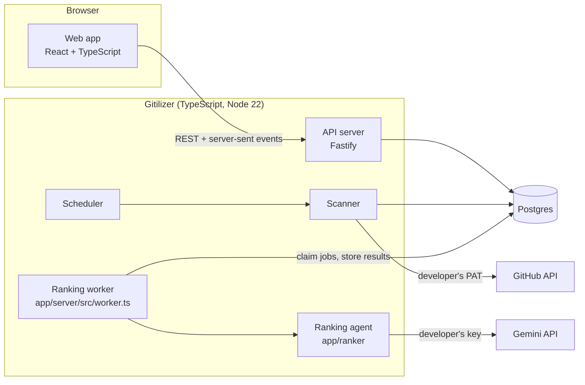

# Gitilizer design

| | |
|---|---|
| **Status** | Draft, with a working prototype of the end-to-end slice (see [Prototype status](#prototype-status)). The prototype follows the 2026-11-01 PRD except where [Changes from the 2026-11-01 PRD](#changes-from-the-2026-11-01-prd) says otherwise. |
| **Author** | brian@sweetapp.com (drafted with Claude) |
| **Last updated** | 2026-11-04 (credentials entered and checked on Warm Welcome, `WEL-2` to `WEL-4`, `POST /api/setup`, D-12; rank reasoning popup, `LIST-24`; sync progress, `LIST-33`; "Save and re-rank" is a sync; a Gemini request can't outlive its ranking lease, and expired leases are logged, GitHub issue #3); 2026-11-03 (relative times, `LIST-22`); 2026-11-02 (production: Google and GitHub sign-in, several processes on one database, the container image, pipeline and infrastructure scripts; D-10 and D-11) |
| **Address** | [gitilizer.com](https://gitilizer.com) |
| **Google Cloud project** | `gitilizer` |
| **Source** | [github.com/brianquinlan/gitilizer](https://github.com/brianquinlan/gitilizer) |
| **Requirements** | [PRD](PRD.md) |
| **Design** | [Gitilizer Figma file](https://www.figma.com/design/J94JKJLNCcFUovvwfaFaqb/Gitilizer?node-id=0-1) |

This document explains how Gitilizer is built. It refers to requirements in the [PRD](PRD.md) by ID (for example `LIST-4`) and to the PRD's questions by number (for example [Q-28](PRD.md#q-28)). The decisions this design depends on are summarized in [PRD decisions](#prd-decisions). [README.md](README.md) explains where everything is in the repository.

Questions about the design itself are marked the same way as in the PRD: **TODO:** marks missing information, or a choice this design has made that the owner should confirm. Each links to a row in [Open questions](#open-questions), numbered D-1, D-2 and so on so they can't be confused with the PRD's.

## Contents

1. [Scope](#scope)
2. [PRD decisions](#prd-decisions)
3. [Architecture](#architecture)
4. [The ranking agent](#the-ranking-agent)
5. [Hosting on Google Cloud](#hosting-on-google-cloud)
6. [Sign-in and sessions](#sign-in-and-sessions)
7. [Repository layout](#repository-layout)
8. [Data model](#data-model)
9. [HTTP API](#http-api)
10. [Live updates](#live-updates)
11. [Web app](#web-app)
12. [Scanner](#scanner)
13. [Scheduler](#scheduler)
14. [Ranking worker](#ranking-worker)
15. [Notifications](#notifications)
16. [Security](#security)
17. [Scale](#scale)
18. [Testing](#testing)
19. [Logging](#logging)
20. [Deployment](#deployment)
21. [Prototype status](#prototype-status)
22. [Changes from the 2026-11-01 PRD](#changes-from-the-2026-11-01-prd)
23. [Findings from the prototype](#findings-from-the-prototype)
24. [Local development](#local-development)
25. [Open questions](#open-questions)

---

## Scope

The design covers the whole product in the PRD. The prototype implements an end-to-end slice of it (see [Prototype status](#prototype-status)): Google and GitHub sign-in (with a development form on a developer's own computer), credentials and settings, scanning, ranking with the existing agent, the Prioritized list and Icebox with live updates, and notifications.

Not designed here: a full cost estimate for the hosting. The domain's cost is estimated in [Hosting on Google Cloud](#hosting-on-google-cloud); the live-update streams are the main cost risk, with polling as the fallback.

---

## PRD decisions

The product owner's answers to the PRD questions this design depends on. The PRD has the full list.

| PRD question | Decision |
|---|---|
| [Q-2](PRD.md#q-2) Scale | 10,000 developers with the app visible, up to 100,000 accounts, up to 1,000 items each (`NFR-1`). |
| [Q-1](PRD.md#q-1) Hosting | Google Cloud; best performance in North America and Western Europe; at most US$200 a month; served at `gitilizer.com`. |
| [Q-3](PRD.md#q-3) Metrics | Users, users who completed setup, daily/weekly/monthly actives (`METRIC-1`), and system health (`METRIC-3`). |
| [Q-8](PRD.md#q-8) Warm Welcome | Until both credentials have been saved once, usually on Warm Welcome itself; afterwards, notifications. |
| [Q-82](PRD.md#q-82) Setup on Warm Welcome | Warm Welcome has both credential fields and a Save button; Save checks the typed values and saves nothing unless both pass (`WEL-4`). |
| [Q-9](PRD.md#q-9), [Q-11](PRD.md#q-11) Accounts and sessions | One account per sign-in provider account; 30-day sliding sessions; signing out ends only the current session (`AUTH-7` to `AUTH-9`). |
| [Q-17](PRD.md#q-17) Thresholds | Short-lived problems are retried for 15 minutes, then shown as warnings; stale-list error after 3 hours; expiry warning 7 days ahead. |
| [Q-21](PRD.md#q-21), [Q-65](PRD.md#q-65) Inclusion | Personal review requests, assigned, mentioned by name, created, commented on, additional repositories; drafts and bot items included; archived repositories, team reviews and team mentions excluded. |
| [Q-22](PRD.md#q-22), [Q-67](PRD.md#q-67) Reason precedence | Review requested, Assigned, @handle, Created, Commented, repository name. |
| [Q-27](PRD.md#q-27), [Q-66](PRD.md#q-66) List size | The 1,000 most recently updated items, Prioritized list only; no notice; dropped items slide off the bottom. |
| [Q-28](PRD.md#q-28), [Q-29](PRD.md#q-29) First sync and Sync now | Pulsing skeleton rows; unranked items hidden; failed items at the end with "–"; Sync now spins for any sync, is never disabled and isn't throttled. |
| [Q-35](PRD.md#q-35), [Q-72](PRD.md#q-72) Icebox return | A separate Icebox check prompt decides, leaning toward bringing items back. The developer can't see or change that prompt (`ICE-14`). |
| [Q-39](PRD.md#q-39), [Q-74](PRD.md#q-74) Model | Gitilizer chooses the models (`GITILIZER_MODELS`, default `gemini-3.8-flash,gemini-3.5-flash-lite,gemini-3.1-flash-lite`, the first being the primary) with the lowest thinking level each allows, for cost (`RANK-11`); Settings doesn't show it. |
| [Q-40](PRD.md#q-40) Token kinds | Fine-grained and classic tokens, one per developer; no organization permissions needed. |
| [Q-44](PRD.md#q-44) Default prompt | `prompts/v4.md`, at most 20,000 characters, new defaults followed automatically. |
| [Q-45](PRD.md#q-45), [Q-64](PRD.md#q-64), [Q-71](PRD.md#q-71) Saving | "Save changes", "Save and re-rank" and "Cancel"; both saves cover credentials; a successful save returns to the list; leaving with unsaved changes asks first. Cancel also returns to the list, or Warm Welcome before setup is complete (`NAV-9`). |
| [Q-46](PRD.md#q-46) Deletion | Immediate, after a simple confirmation; backups kept for 6 months (`PRIV-4`). |
| [Q-47](PRD.md#q-47) Background scans | Every 2 hours for developers seen in the last 7 days; otherwise only on the next visit. |
| [Q-48](PRD.md#q-48), [Q-49](PRD.md#q-49) Re-ranking | Every item re-ranked at least every 24 hours; a change also re-ranks the items it links to. |
| [Q-51](PRD.md#q-51) Concurrency | 4 Gemini calls at once per developer. |
| [Q-57](PRD.md#q-57) Additional repositories | "keep an eye on", not "responsible for"; the agent's wording changes to match (`SET-31`). |
| [Q-41](PRD.md#q-41) Repositories | `owner/name` or a GitHub URL; duplicates and bad formats are errors; at most 25; prioritization prompts up to 500 characters and not editable. Access states "Checking…", "Access confirmed", "Archived" and "Can't access", with the reason on hover (`SET-8`). |
| [Q-52](PRD.md#q-52), [Q-68](PRD.md#q-68) Item data | No privacy note in Settings; an item's data is deleted 30 days after no developer has it (`PRIV-5`). The documentation's privacy section covers storage, deletion and what is sent to Gemini (`FOOT-4`). |
| [Q-58](PRD.md#q-58), [Q-37](PRD.md#q-37), [Q-38](PRD.md#q-38) Validate | Checks the typed value; disabled when the field is empty, including for a saved credential; the result states in `SET-28`; saving in Settings doesn't validate (`SET-29`). |
| [Q-63](PRD.md#q-63), [Q-75](PRD.md#q-75) Free tier | Must work on the free tier, falling back through the models in `RANK-13` as each one's daily quota runs out; items waiting for quota shown at the end with "–"; one item per call; scores from different models share the list; the primary model's quota goes to new and changed items first; the backup-model warning shows for as long as a backup model is in use. |
| [Q-70](PRD.md#q-70) Alerts | Email alerts to the owner from Cloud Monitoring (`METRIC-4`). |
| [Q-73](PRD.md#q-73) Settings errors | Red border and a message under the field; saving disabled while errors show (`SET-27`). |
| [Q-50](PRD.md#q-50), [Q-53](PRD.md#q-53) to [Q-56](PRD.md#q-56) Other | Ties as in `RANK-4`; 2 s to a usable list, 100 ms sorts, 99.5% availability; latest two versions of Chrome, Edge, Firefox and Safari at 1024 px and wider, no touch; WCAG 2.2 AA; English and a light theme only. |

---

## Architecture

Gitilizer is one TypeScript code base: the web app, the API, the scanner, the scheduler, the ranking worker and the ranking agent itself. (The agent and its evaluation harness started in Python, and were ported to TypeScript on 2026-11-02; see [The ranking agent](#the-ranking-agent).)



| Component | Where | Responsibility |
|---|---|---|
| Web app | `app/web` (React, Vite) | All screens. Holds the developer's whole list in memory, so sorting and paging are instant (`LIST-10`, `LIST-13`), and applies live updates under the PRD's holding and animation rules. |
| API server | `app/server` (Fastify) | Sign-in, sessions, settings, credentials, list queries and server-sent events. |
| Scheduler | `app/server` | Decides when each developer is due a scan (`SCAN-5`, `SCAN-6`) from presence reported by the web app. |
| Scanner | `app/server` (Octokit) | Finds items, fetches snapshots of new and changed items, detects removals, applies the 1,000-item limit, classifies GitHub errors into notifications, and queues ranking jobs. |
| Ranking worker | `app/server/src/worker.ts` | Claims ranking jobs from the queue, asks the agent to score each item (or to make an Icebox check), stores the result, and turns Gemini failures into notifications and pauses. |
| Ranking agent | `app/ranker` | Turns a snapshot into the text the model reads, calls Gemini, and holds the evaluation harness. Knows nothing about the database or HTTP, so the worker and the harness use exactly the same code. |
| Database | Postgres | All state. The job queue is a table (`rank_jobs`) claimed with `FOR UPDATE SKIP LOCKED`. |

**The worker runs inside the server and reads the queue directly.** While the agent was in Python, the worker was a separate Python process that reached the queue through four internal HTTP endpoints, so that it needed no database driver. With everything in TypeScript that boundary costs more than it saves: the worker now calls the same queue functions the rest of the server uses (`claimJobs`, `completeJob`, `failJob`), a Gemini key never crosses the network, and local development needs no Python. Every server process runs a worker loop; the queue is in Postgres, so several processes share the work without coordinating, and the per-developer limit of 4 (`RANK-11`) is enforced by the claim query. `WORKER=off` leaves the worker out of a process.

**Why snapshots are fetched by the scanner.** All GitHub access (and so all GitHub error handling and notifications) stays in one place, and the agent never sees the developer's PAT. The scanner produces snapshots in the same JSON format as `eval/fixtures/`, so the evaluation harness and the production worker read identical input.

Any number of processes can share one database: the API server and the scheduler/scanner can run as separate deployments of the same image, so scanning load doesn't affect request latency, and each can have several instances ([Hosting on Google Cloud](#hosting-on-google-cloud), "Several processes"). Production starts with everything in one process ([D-10](#d-10)).

---

## The ranking agent

`app/ranker` (`@gitilizer/ranker`) is the agent and its evaluation harness:

| Path | Used for |
|---|---|
| `src/context.ts` | `buildContext()` turns a snapshot into the text the agent reads: header facts, derived signals (roles, who acted last, review state, mentions, draft state, the PR stack), related items, the description and the activity log, trimmed to at most 60,000 characters. `UserSettings` holds the login, additional repositories (each `{repo, filter}`, where `filter` carries the prioritization prompt) and collaborators. |
| `src/prioritizer.ts` | `systemInstruction()` (the prompt, the "About me" block and the output contract), the output schemas, and `prioritize()`, which scores a set of items `pointwise` (one call per item, `RANK-18`), `listwise` (one call for all, for comparison) or by `recency` (no model, the floor). |
| `src/agent.ts` | What the worker asks for one job: `scoreItem()` and `iceboxCheck()` (`ICE-6`). |
| `src/gemini.ts` | `GeminiLLM` (structured JSON output, the thinking level, retries), `classifyGemini()` (the error codes in [Ranking worker](#ranking-worker)) and `FakeLLM` for tests and fixture mode. |
| `src/rewind.ts` | Rebuilds a snapshot as it was at an earlier time, for eval items with `as_of`. |
| `src/evaluate.ts`, `src/metrics.ts` | The evaluation harness (`npm run evaluate`) and its ranking metrics. |
| `src/snapshot.ts`, `src/rankingSheet.ts` | Downloading eval fixtures (`npm run snapshot`) and building the ranking page's data (`npm run ranking-sheet`). |
| `prompts/v4.md` | The default ranking prompt; `prompts/icebox_check_v1.md` is the Icebox check's. |
| `eval/` | The 36 hand-ranked items, their snapshots and past runs. Any change to the default prompt or model is measured here first (PRD `RANK-7`). |

**The port is exact.** The TypeScript agent produces, character for character, the text the Python one did: the same contexts for all 36 fixtures, the same system prompts for v1 to v4, the same requests in an eval run (including rewound and thumbs-down items) and the same ranking-page data. `app/ranker/test/golden.test.ts` checks this against hashes of the Python output, so evaluation results measured before the port (including the [model comparison](../eval/model-comparison-2026-11-01.md)) still compare with results measured after it. Python's formatting rules that the prompts depend on (`repr()` of strings and lists, round-half-to-even, lengths in code points) are reproduced in `src/py.ts`.

**What changed with the port.** Nothing in the prompts. Gemini is called through `@google/genai` with a JSON schema instead of Pydantic models, and the eval CLIs are npm scripts (`npm run evaluate`, `npm run snapshot`, `npm run ranking-sheet`, `npm run check`) instead of `python -m gitilizer.…`. The eval's own data (`eval/ground_truth.yaml`, `eval/fixtures/`, `eval/runs/`) is unchanged. The design no longer depends on Python anywhere, so the Python virtual environment, `requirements.txt` and `pyproject.toml` are gone.

**Prompt changes the PRD now asks for.** Two changes to the agent's text, each measured with the evaluation harness before it ships (`RANK-7`):

- **Additional repositories mean "keep an eye on"** (`SET-31`). `prompts/v4.md` describes them as "repositories I am responsible for", where "I am the default reviewer", and the "About me" block written by `prioritizer.ts` introduces them the same way. Both change to "repositories I follow", and the scoring that rewards "repositories I'm responsible for" moves to the per-repository prioritization prompt ("I'm responsible for this one"). The eval's ground truth (`eval/ground_truth.yaml`) assumed the old meaning, so some labels may need revisiting.
- **Drafts score lower** (`RANK-8`). v4 already scores the developer's own drafts at 0.15–0.35. Extend that to other people's draft PRs, whose review isn't wanted yet. `context.ts` already exposes `draft`.

---

## Hosting on Google Cloud

Everything runs in the Google Cloud project `gitilizer`.

| Component | Google Cloud service | Notes |
|---|---|---|
| API server and web app | Cloud Run service | Serves the built web app as static files and the API at `https://gitilizer.com`. Server-sent events are ordinary long requests; Cloud Run ends a request after at most 60 minutes, and the browser's `EventSource` reconnects and replays from `Last-Event-ID`. |
| Scheduler, scanner and ranking worker | Cloud Run service with minimum 1 instance and always-allocated CPU | The same container image as the API, so a release deploys one build. Its instances scale with the scan and ranking load; the API service runs with `SCHEDULER=off` and `WORKER=off`, so request latency doesn't depend on that load. At launch, production runs all of this in the API service's one instance ([D-10](#d-10)); splitting is a change of settings ([DEPLOYMENT.md](DEPLOYMENT.md#splitting-production)). |
| Database | Cloud SQL for PostgreSQL | Smallest shared-core tier to start. Automated daily backups kept for 180 days (`PRIV-4`); Cloud SQL allows up to 365. |
| Secrets | Secret Manager for the database URL, the credential key, `WORKER_TOKEN` (which protects the operator endpoints) and the OAuth client secrets, one set per environment, each readable only by its environment's service account | Cloud KMS for the credential key is a later option ([D-11](#d-11)). |
| Metrics (`METRIC-1`, `METRIC-2`) | Looker Studio dashboard on Cloud SQL, plus Cloud Monitoring for operations | User counts come from `users`, the `user_activity` table (one row per developer per day with a visit), so daily, weekly and monthly actives are available for past days, and `deleted_users` (accounts deleted, in total and per month). The internal `GET /internal/metrics` endpoint returns the same numbers. |

**Monitoring (`METRIC-3`, `NFR-6`).** Cloud Run already records request latency and response codes for every request, so API latency by endpoint and status codes for page loads and API calls come from Cloud Monitoring without extra code. Browser-side load time can't be seen from the server: the web app measures the time from navigation to a usable list (and the standard web vitals) and sends it to `POST /api/telemetry`, which writes it as a structured log line that a log-based metric turns into a distribution. Scan and ranking durations, and error and notification counts, are log-based metrics on the scanner's and worker's structured log lines ([Logging](#logging)), so they need no metrics client in the code. One Cloud Monitoring dashboard shows them all. Alerting policies email the owner (`METRIC-4`) when an uptime check on `https://gitilizer.com` fails, when more than 5% of API calls fail for 10 minutes, or when no scan has finished for 30 minutes.

**Several processes.** Nothing that one process must see from another is kept in memory, so instances can be added and removed freely, and two revisions run side by side during a deployment:

- **Live updates** go through Postgres `LISTEN/NOTIFY` on the channel `gitilizer_events` (`app/server/src/pubsub.ts`). Every process listens, and passes events for developers with a tab open on it to its own tabs. An event over NOTIFY's 8,000-byte limit (a bulk re-rank) is stored in `relay_events` and the notification carries its ID. Events from one process go out in order. If a process's `LISTEN` connection drops, it reconnects and tells its open tabs to reload, since they may have missed something ([Live updates](#live-updates)).
- **Presence and scan requests** are tables (`presence`, `scan_requests`), so an API process that receives a presence report or a Sync now can hand the scan to any scanner ([Scheduler](#scheduler)).
- **The scheduler's periodic pass** runs in one process at a time: the holder of the `scheduler` row in `leases`, renewed every tick and given up when the process stops.
- **Schema upgrades** at startup hold a Postgres advisory lock, so two processes starting together take turns.

With PGlite (a developer's computer) there is only ever one process, and events go straight to its tabs. `app/server/test/postgres.test.ts` runs two processes against a real Postgres.

**Region.** `us-east4` (Northern Virginia), decided in [D-3](#d-3). One region in the eastern United States is the best single choice for North America and Western Europe together (`PLAT-3`). A second region in Europe would double the fixed cost.

**Domain (`PLAT-5`).** `gitilizer.com` (the apex, with `www.gitilizer.com` redirecting to it) points at the API service. The OAuth redirect URLs ([Sign-in and sessions](#sign-in-and-sessions)) and the session cookie are tied to this domain, so preview deployments sign in with the development stub.

`gitilizer.com` reaches Cloud Run through a **global external Application Load Balancer** with a Google-managed certificate and a serverless network endpoint group for the API service, decided in [D-2](#d-2). It is Google's recommended way to put a custom domain in front of Cloud Run, and unlike Firebase Hosting it doesn't cut requests off at 60 seconds, which the live-update stream needs.

| Charge | Price | Estimate |
|---|---|---|
| Forwarding rules | US$0.025 an hour for the first 5 together | Two rules (HTTPS, and HTTP redirecting to HTTPS): about **US$18.25 a month**, whatever the traffic |
| Data processed | US$0.008 per GiB in, and per GiB out | A few cents a month for a few dozen developers; about **US$8–16 a month** at the scale in `NFR-1` (roughly 1–2 TiB, mostly presence reports, live-update keepalives and list downloads) |
| Google-managed certificate (Certificate Manager) | Free for the first 100 certificates in a project | US$0 |
| Serverless network endpoint group | No separate charge | US$0 |
| **Total** | | **About US$18–20 a month** at small scale, **about US$30–40 a month** at full scale |

Internet egress to browsers is charged the same with or without the load balancer, so it isn't counted here. Prices are from [Cloud Load Balancing pricing](https://cloud.google.com/load-balancing/pricing) and [Certificate Manager pricing](https://cloud.google.com/certificate-manager/pricing) as of 2026-11-01. The other options were a Cloud Run domain mapping (no cost, but a Preview feature that Google doesn't recommend for production) and Firebase Hosting (little or no cost, but its 60-second limit would make the live-update stream reconnect every minute).

**Budget (`PLAT-4`) is the main design risk.** US$200 a month has to cover Cloud SQL, the always-on scanner and worker, the domain, and enough API instances to hold 10,000 open event streams.

**Live-update streams stay, for now** ([D-1](#d-1)). The web app keeps one server-sent event stream open per tab ([Live updates](#live-updates)), which meets the 5-second target in `LIVE-23`.

> **Cost risk.** Cloud Run bills an instance for as long as a request is open, so 10,000 open streams keep API instances running all the time. The streams are mostly idle, but an instance holds at most 1,000 requests at once (Cloud Run's concurrency limit), so 10,000 tabs need at least 10 instances running around the clock. This may be the largest single cost. If it does, the fallback is polling: the web app asks `GET /api/list?since={version}` every 15–30 seconds, the stream and its keepalives go away, and instances run only while answering. Polling still updates the list without a page reload, but changes take up to 30 seconds to appear, so `LIVE-23` would have to change. Only the transport changes: the browser's update rules ([Live updates](#live-updates)) stay the same.

---

## Sign-in and sessions

| | Google | GitHub |
|---|---|---|
| Protocol | OpenID Connect, authorization code flow with PKCE | OAuth app (not a GitHub App), authorization code flow with PKCE |
| Scopes | `openid email profile` | `user:email` only, to read a private primary email. No repository scopes (`AUTH-5`). |
| Redirect URL | `https://gitilizer.com/api/auth/google/callback` | `https://gitilizer.com/api/auth/github/callback` |
| Account key | `sub` | Numeric user `id` |

GitHub sign-in uses an OAuth app with only the `user:email` scope, decided in [D-4](#d-4). GitHub now recommends GitHub Apps for new integrations, and a GitHub App can also sign people in, but its user tokens expire after 8 hours and it adds an app installation concept that sign-in doesn't need. Since Gitilizer discards the token right after sign-in and never uses it to read items (`AUTH-5`), the simpler OAuth app is enough.

**How a sign-in runs** (`app/server/src/auth.ts`). `start` makes a random `state`, PKCE verifier and (for Google) nonce, stores them in `oauth_states`, puts the state in a `__Host-gitilizer_oauth` cookie for 10 minutes, and redirects to the provider. The callback accepts the state only if it is in the table, under 10 minutes old, for this provider and the same as the cookie (so a sign-in finishes only in the browser that started it), and deletes it. Google's ID token comes straight from its token endpoint over TLS, so its issuer, audience, expiry and nonce are checked without verifying its signature, as OpenID Connect allows. GitHub's profile comes from `GET /user`, and a private email from `GET /user/emails` (the primary, verified address; GitHub's no-reply address if there is none). After that, `next` (a path on this site only) is where the browser goes. Each failure becomes one of the categories below.

- **Accounts (`AUTH-3`, `AUTH-7`).** `users` has a unique index on `(provider, provider_user_id)`. Email is stored for display only and is never used to merge accounts, so the same person signing in with both providers gets two accounts. `METRIC-1` counts them as two users.
- **Provider tokens.** The callback reads the profile (name, email, avatar) and then discards the provider's tokens. Gitilizer keeps no Google or GitHub sign-in token, which is why revoking access at the provider doesn't sign the developer out ([Q-11](PRD.md#q-11)).

  This is what developers expect from "Sign in with Google/GitHub" elsewhere. Signing in asks for authorization only the first time: after signing out, "Continue with Google" or "Continue with GitHub" goes straight through (Google shows its account chooser; GitHub redirects back at once if the developer is signed in to GitHub and has already authorized the app), so signing in again is one or two clicks. Keeping the providers' tokens would only let Gitilizer notice a revocation, and would mean storing more credentials that it never otherwise uses (`PRIV-1`). A developer who wants to cut Gitilizer off entirely deletes the account (`SET-17`), which ends every session.

- **Sessions (`AUTH-8`).** A random 32-byte session ID in a `__Host-gitilizer_session` cookie (`HttpOnly`, `Secure`, `SameSite=Lax`, no `Domain`). `sessions.expires_at` is 30 days after the last use; to avoid a write on every request, it is pushed forward only when less than 29 days remain, so at most once a day.
- **Sign out (`ACCT-3`, `AUTH-9`).** Deletes the current session row only. Deleting the account deletes every session.
- **Allowlist (development only, `NFR-12`, [Q-80](PRD.md#q-80)).** `SIGN_IN_ALLOWLIST` lists who may sign in, as `google:<email>`, `github:<username>` or `github-id:<number>` entries separated by spaces ([DEPLOYMENT.md](DEPLOYMENT.md#who-can-sign-in-to-development) explains how to change it). It is a setting on the Cloud Run service, not a file in the repository, so testers' addresses stay out of Git and changing the list needs no release.
  - **Matching.** Google accounts match by email, ignoring case, and only when the ID token's `email_verified` is true. GitHub accounts match by username, ignoring case, or by numeric ID. Anyone can claim a username after its owner renames, so the ID is the safer entry. Both come from `GET /user` with the sign-in token, which needs no scope.
  - **At sign-in.** `completeSignIn()` (`app/server/src/signin.ts`) checks the list before it creates or updates anything. A refused sign-in creates no account, settings or session; it redirects to `/sign-in?error=not_allowed` and logs `sign-in refused` with the provider only, because the logs name people only by account ID ([Logging](#logging)).
  - **On every request.** The session lookup already joins `users`, and the list is in memory, so checking the account again costs nothing. A changed setting starts a new revision, so someone removed from the list is signed out at their next request: their sessions are deleted and the API answers 401 `not_allowed`, which the web app turns into the same notice. Their account and data stay. The check needs the GitHub username from sign-in, which `users.sign_in_login` keeps (`github_login` is the PAT's account, which may differ).
  - **Failing closed.** With `GITILIZER_ENV=development` the server refuses to start without a list, and any entry it can't read stops it too, naming the entry. A lost or mistyped setting therefore leaves the previous revision serving rather than opening development to everyone. Without `GITILIZER_ENV=development` and without a list, everyone can sign in. Local mode ignores the list.
- **Failed sign-in (`AUTH-10` to `AUTH-14`).** The callback sorts every failure into one of five categories and redirects to `/sign-in?error={cancelled|provider_unavailable|expired|not_allowed|gitilizer_error}`:
  - `cancelled`: the provider returned `error=access_denied`;
  - `provider_unavailable`: the provider returned `server_error` or `temporarily_unavailable`, or the code exchange or profile request timed out or returned 5xx;
  - `expired`: the `state` value is missing, unknown or older than 10 minutes, or the PKCE verifier cookie is missing (often blocked cookies);
  - `not_allowed`: only in development, the account isn't on the allowlist (below);
  - `gitilizer_error`: anything else, including other provider error codes and Gitilizer's own failures.

  The provider's `error`, `error_description` and `error_uri`, and any exception, are logged with the category; none of them reach the page. The sign-in page reads `error`, shows the matching message in the notice above the buttons (grey for `cancelled`, red for the others, `AUTH-15`), and removes the parameter with `history.replaceState`, so a reload shows the plain page (`AUTH-13`). An unknown value is treated as `gitilizer_error`.

---

## Repository layout

```
gitilizer/
├── README.md             what Gitilizer is, and where to start
├── docs/                 user documentation, published through the footer (FOOT-2 to FOOT-4): user-guide.md
├── contributor/          documentation for people working on Gitilizer: README.md, PRD.md, DESIGN.md, LOCAL_DEVELOPMENT.md
├── scripts/local.mjs     npm run local: the whole app on one computer (Local development)
├── .local/               local mode's databases and keys (gitignored)
├── prompts/              ranking prompts (v4.md is the default) and the Icebox check's prompt
├── eval/                 the eval set, its snapshots and past runs
├── package.json          npm workspaces root
└── app/
    ├── shared/           types and zod schemas used by server and web
    ├── ranker/           the ranking agent and the evaluation harness (The ranking agent)
    ├── server/           API, scheduler, scanner and ranking worker
    └── web/              React app
```

Files in `contributor/` have upper-case names, so they stand out from code and from the user documentation. The footer's "Documentation" link (`FOOT-2`) points at `docs/user-guide.md` on GitHub.

---

## Data model

Postgres. Times are `timestamptz`. IDs are text UUIDs unless stated.

| Table | Key columns | Notes |
|---|---|---|
| `users` | `id`, `provider`, `provider_user_id`, `name`, `email`, `avatar_url`, `github_login`, `sign_in_login`, `created_at`, `last_seen_at`, `setup_completed_at`, `ranking_paused_until` | Unique on `(provider, provider_user_id)` (`AUTH-7`). `github_login` comes from the PAT (`GET /user`), not from sign-in (`AUTH-5`); `sign_in_login` is the GitHub username at sign-in, kept for the development allowlist. `last_seen_at` drives [Q-47](PRD.md#q-47). `setup_completed_at` decides Warm Welcome ([Q-8](PRD.md#q-8)); see the note below. |
| `user_activity` | `user_id`, `day` | One row per developer per day with a visit, for `METRIC-1`; see the note below. Rows older than 13 months are deleted by the daily clean-up. |
| `sessions` | `id` (random 32 bytes, base64url), `user_id`, `expires_at` | Sliding 30-day expiry ([Sign-in and sessions](#sign-in-and-sessions)). |
| `credentials` | `user_id`, `kind` (`github_pat`, `gemini_key`), `ciphertext`, `nonce`, `expires_at`, `token_login`, `token_type` | AES-256-GCM ([Security](#security)). Saved from Settings without being checked (`SET-29`); Warm Welcome saves only checked values (`WEL-4`). `expires_at` from GitHub's `GitHub-Authentication-Token-Expiration` header (`SET-6`). The scanner fills in `token_login` (the PAT's account) and `token_type` (`classic` or `fine-grained`, from the token's prefix). The status chip (`SET-30`) isn't stored: it comes from the shown notifications. |
| `settings` | `user_id`, `custom_prompt` (null = default), `sort_prioritized`, `sort_icebox` | |
| `additional_repos` | `user_id`, `full_name`, `prioritization_prompt`, `access` (`checking`, `ok`, `not_found`, `sso_required`, `token_type_blocked`, `archived`), `position` | `access` drives the state and hover text in `SET-8`. Called `interested_repos`, with a `filter` column, in the prototype. |
| `collaborators` | `user_id`, `login`, `status` (`ok`, `not_found`, `unknown`), `avatar_url`, `checked_at`, `position` | Added without a check (`SET-18`); the scanner looks each one up (`GET /users/{login}`) and records the result for `SET-19`. |
| `items` | `key` (`owner/repo#number`), `kind`, `title`, `html_url`, `state`, `draft`, `archived`, `updated_at`, `snapshot` (jsonb), `snapshot_fetched_at` | Shared by every developer who has the item; `PRIV-3` limits retention. |
| `user_items` | `user_id`, `item_key`, `reasons` (text[]: `review_requested`, `assigned`, `mentioned`, `created`, `commented`, `additional_repo`), `mention_handle`, `status` (`active`, `iceboxed`, `gone`), `iceboxed_at`, `score`, `actionable`, `next_action`, `reasoning`, `ranked_at`, `ranked_model`, `ranked_updated_at`, `rank_error`, `gone_reason`, `gone_at` | One row per developer and item. **Rank is not stored**: it is the position when active items are ordered by `score DESC, items.updated_at DESC, item_key` (`RANK-3`, `RANK-4`). Storing ranks would mean rewriting many rows whenever one item moves. `gone_reason` is `closed`, `merged`, `no_longer_matches` or `over_limit` (`LIST-19`); `gone_at` starts the 30 days in `PRIV-5`. |
| `scans` | `user_id`, `started_at`, `finished_at`, `kind` (`full`, `incremental`), `trigger`, `outcome`, `error_code`, `heartbeat_at`, `found`, `to_queue` | One running scan per developer (`SCAN-4`), enforced by a partial unique index on unfinished rows. `found` and `to_queue` feed the progress text while the scan runs (`LIST-33`, [Scanner](#scanner)): `found` is null until the first search returns, and `to_queue` is null until discovery has finished. |
| `rank_jobs` | `id`, `user_id`, `item_key`, `kind` (`rank`, `icebox_check`), `reason` (`new`, `changed`, `linked`, `rerank`, `ageing`, `restore`), `priority`, `batch_id`, `state` (`queued`, `leased`, `done`, `failed`), `lease_expires_at`, `attempts`, `model`, `item_updated_at` | One open job per developer, item and kind (unique index on queued and leased rows), so repeated changes coalesce; a more urgent job takes over a queued bulk one and leaves its batch. `batch_id` groups the jobs of one bulk re-rank (`LIVE-24`). `priority` orders the queue when quota is short ([Ranking worker](#ranking-worker)). `item_updated_at` is the item's `updated_at` when the job was claimed; it becomes `ranked_updated_at`, so a change made while the job runs is ranked again by the next scan. |
| `rank_batches` | `id`, `user_id`, `reason` (`first_sync`, `rerank`, `ageing`), `created_at`, `finished_at` | One row per bulk re-rank (`LIVE-24`). When its last job is done or failed, a `rerank` or `ageing` batch publishes every row at once. A `first_sync` batch publishes as it goes, and closes when the first sync finishes (`LIST-32`), not when its queue runs dry: ranking can catch up with a scan that is still downloading. |
| `notifications` | `user_id`, `code`, `subject` (org, repo or empty), `params` (jsonb), `first_detected_at`, `shown`, `seen_at` | Severity comes from `code`. For short-lived codes, `first_detected_at` is when the problem started and `shown` flips after 15 minutes (`NOTIF-21`). `seen_at` is set when the developer opens the popover (`NOTIF-17`). |
| `list_versions` | `user_id`, `version` (bigint) | Incremented on every change to the developer's list; carried in every live-update event. |
| `gemini_quota` | `user_id`, `model`, `exhausted_until` | Set when Gemini reports a per-day quota for that model (`RANK-13`): `exhausted_until` is the next midnight Pacific time, or the time the error gives. The model used for a job is the first in `GITILIZER_MODELS` that isn't exhausted. Quotas belong to the key's Google Cloud project, so the rows are cleared when a new key is saved. |
| `presence` | `user_id`, `tab_id`, `visible`, `at` | One row per open tab ([Scheduler](#scheduler)); rows older than 3 minutes are deleted. |
| `scan_requests` | `user_id`, `trigger`, `requested_at`, `not_before` | Scans asked for and not yet started, one per developer; claimed by any scanner ([Scheduler](#scheduler)). |
| `leases` | `name`, `holder`, `expires_at` | Work one process does at a time: the scheduler's periodic pass. |
| `relay_events` | `id`, `payload`, `created_at` | Live-update events too large for a NOTIFY payload; kept 10 minutes. |
| `oauth_states` | `state`, `provider`, `verifier`, `nonce`, `next`, `created_at` | Sign-ins in progress, used once, valid for 10 minutes ([Sign-in and sessions](#sign-in-and-sessions)). |
| `deleted_users` | `id`, `deleted_at` | Only the IDs of deleted accounts. After a backup is restored, every account in this table deleted after the backup was taken is deleted again (`PRIV-4`). The table itself must be copied out before the restore and put back afterwards. |

Notes on three tables:

- **Why `users.setup_completed_at` instead of checking for credentials.** It records an event, not a state. Warm Welcome is shown until setup is first completed and never again (`NAV-2`): a developer who later loses a credential (today only through a fault, because Settings can't remove one, `NOTIF-16`) sees the list with an error notification, not Warm Welcome. Checking "are both credentials there?" would get that case wrong. `METRIC-1` also counts users who completed setup, and the timestamp shows when. It costs one column.
- **Why `user_activity` instead of a time-series database.** `METRIC-1` needs distinct-user counts per day, week and month, including for past days, and that is a `count(distinct user_id)` over one small row per developer per day. Cloud Monitoring's metrics can't count distinct users, and a separate time-series database would be another service to run and pay for in the US$200 budget (`PLAT-4`), for data that already fits in Postgres: at 100,000 accounts it is at most 100,000 rows a day, kept for 13 months. Operational metrics (latency, errors, durations) do go to Cloud Monitoring ([Hosting on Google Cloud](#hosting-on-google-cloud)).
- **`deleted_users` doubles as a metric.** `GET /internal/metrics` and the dashboard report the number of deleted accounts, in total and per month (`METRIC-1`).

---

## HTTP API

JSON over HTTPS. Every request and response body is defined by a zod schema in `app/shared`, used for validation on the server and for types in the web app. Browser endpoints need the session cookie; the operator endpoint on the internal port needs `Authorization: Bearer $WORKER_TOKEN`.

| Method and path | Purpose |
|---|---|
| `GET /api/auth/config` | Which sign-in methods this server offers, for the sign-in page. No session needed. |
| `GET /api/auth/{google,github}/start?next=`, `GET /api/auth/{google,github}/callback` | Sign-in ([Sign-in and sessions](#sign-in-and-sessions)). No session needed. |
| `POST /api/auth/dev` | A developer's own computer only (local mode, fixture mode, `--dev-sign-in`): sign in as a named test user. A deployed server doesn't have it. |
| `GET /api/health` | The uptime check: answers `{ ok: true }` when the database does. No session needed. |
| `GET /docs`, `GET /docs/privacy` | Redirect to the user guide on GitHub, and to its Privacy section (`FOOT-3`, `FOOT-4`), so gitilizer.com has stable addresses for them; the Google consent screen links to `/docs/privacy`. |
| `POST /api/auth/logout` | "Sign out" (`ACCT-3`). Ends the current session. |
| `GET /api/me` | Account, which screen to show (`NAV-1`), whether the first sync has finished. |
| `GET /api/list` | Every active, iceboxed and recently gone item for the developer, plus `version`. The web app sorts and pages locally. |
| `POST /api/items/icebox`, `POST /api/items/restore` | `LIST-18`, `ICE-5`. Body `{ key }` (keys contain `/` and `#`, so they aren't path segments). Return the new `version`. |
| `POST /api/sync` | `LIST-16`. Always returns 202; a request while a sync runs joins it (the button is disabled then, `LIST-28`, but another tab may not know yet). |
| `POST /api/presence` | `{ visible: boolean }` from each tab on load, on `visibilitychange` and every 60 s ([Scheduler](#scheduler)). |
| `GET /api/events` | Server-sent events ([Live updates](#live-updates)). |
| `GET /api/notifications` | Shown notifications, with `seen`. |
| `POST /api/notifications/seen` | The popover was opened: sets `seen_at` on every shown notification, which stops the bell swinging on all of the developer's devices (`NOTIF-17`). |
| `GET /api/settings`, `PUT /api/settings` | Additional repositories with prioritization prompts, collaborators with their status and avatar, ranking prompt, sort preferences. `PUT` takes everything on the page, `{ …, credentials?: { github_pat?, gemini_key? }, rerank: boolean }`: "Save changes" sends `rerank: false`, "Save and re-rank" sends `true`, which queues a full re-rank (`SET-15`). Credentials are stored without being validated (`SET-29`); Warm Welcome uses `POST /api/setup` instead. Returns per-field errors for anything that breaks the rules in `SET-27`, which keep the developer on Settings (`NAV-8`). |
| `PUT /api/sort` | Saves one view's sort order (`LIST-9`). |
| `POST /api/repos/check`, `POST /api/collaborators/check` | Look up a repository (`{ access, fullName, tokenType }`) or a collaborator (`{ status, avatarUrl }`) as soon as it is added in Settings, before saving, with the saved PAT. Nothing is stored; the scan after saving records the same results ([D-6](#d-6)). |
| `POST /api/credentials/:kind/check` | Check a typed value without saving it (`SET-2`, `SET-28`). Returns `{ ok, code, login?, expires_at?, permission? }`, where `code` selects the message. For a GitHub token: `GET /user` (login, expiry header) and one search, which shows a missing permission through `X-Accepted-GitHub-Permissions`. For a Gemini key: `GET /v1beta/models/{model}`, which checks the key and access to the model without using the developer's request quota. |
| `POST /api/setup` | Warm Welcome's Save (`WEL-4`). Body `{ credentials: { github_pat?, gemini_key? } }`, the typed values. Checks each one in parallel, with the same code as `POST /api/credentials/:kind/check`, including values the developer has already validated ([D-12](#d-12)). If every check passes and both credentials are then present, typed or already saved, it saves the typed ones in one transaction, completes setup, clears their notifications and starts a sync, as `PUT /api/settings` does. Returns `{ ok, results: { github_pat?, gemini_key? } }`, each a check result; with `ok: false` nothing is saved. 422 if a credential would still be missing; 409 once setup is complete, because Warm Welcome is never shown again (`NAV-2`). |
| `DELETE /api/account` | `SET-17`. Sent after the confirmation dialog; requires `{ confirm: true }` so a stray request can't delete an account. |
| `POST /api/telemetry` | Browser timings for `METRIC-3` (time to a usable list, web vitals). Accepts small JSON bodies only, rate-limited per session. |
| `GET /internal/metrics` | `METRIC-1` counts, including deleted accounts. On the internal port, not exposed to the internet. |
| `POST /api/dev/fixtures/touch`, `…/close`, `POST /api/dev/notify` | Fixture mode only: simulate GitHub activity, a closed item or a notification. |

---

## Live updates

The server pushes changes; the web app decides when to show them.

**Transport.** Server-sent events on `GET /api/events`. They are one-way, work through proxies and reconnect automatically, which is all the list needs. Each event carries the developer's list `version`:

| Event | Payload |
|---|---|
| `list` | `{ version, bulk: boolean, upserts: ItemRow[], removals: { key, reason }[] }`, where `reason` is `closed`, `merged`, `iceboxed`, `restored`, `no_longer_matches` or `over_limit`. |
| `notifications` | The full list of shown notifications. |
| `sync` | `{ running: boolean, lastFinishedAt, progress }`, for the Sync now button and the progress text next to it (`LIST-17`, `LIST-33`). `progress` is null, `{ phase: "finding", found: number \| null }` or `{ phase: "ranking", left: number, waiting: boolean }`; see below. |

The browser sends `Last-Event-ID` on reconnect. If the process it reconnects to can't replay from that version (the gap is too old, the tab was connected to another instance, or the server restarted), it sends `{ resync: true }` and the web app fetches `GET /api/list` again. Each process keeps the last 200 events of the developers with a tab open on it, for 10 minutes after their last tab closes. Events reach every process through Postgres `LISTEN/NOTIFY` ([Hosting on Google Cloud](#hosting-on-google-cloud), "Several processes"). A ranked change is published as soon as its result is stored, which keeps within the 5-second target (`LIVE-23`).

**Bulk re-ranks (`LIVE-24`).** The first sync, "Save and re-rank" and the daily ageing pass queue their jobs with one `batch_id`. Results with a `batch_id` are stored but not published one by one. When the batch's last job is done or failed, the server sends one `list` event with `bulk: true` and every changed row. Changes caused by GitHub activity during the batch still publish normally. The first sync is the exception: its rows are published as they are ranked, so the table fills in (`LIST-15`), but with `bulk: true`, so they appear without indicators.

**Applying updates in the browser.** `app/web/src/live/` holds a pure, unit-tested state machine with two lists: `shown` (what is on screen) and `latest` (the server's current state). Incoming events update `latest` and append to a queue. A separate controller drains the queue under the PRD's rules:

- hold while the pointer is over the table, until it has been outside for 1 s (`LIVE-4`); while focus is in the table (`LIVE-5`); while the tab is hidden or the Icebox is shown (`LIVE-6`);
- the developer's own actions skip the queue and apply to both lists at once (`LIVE-7`);
- play one queued change at a time, 0.4 s each (`LIVE-8`); more than 5 waiting play as one step (`LIVE-9`); a `bulk` event always plays as one step, without indicators (`LIVE-24`);
- after each step, compute the rows on the current page from `shown`, which keeps every page except the last full (`LIVE-3`), and move to the last page if the current one no longer exists (`LIVE-2`);
- compare each visible row's rank before and after to produce the "↑5", "↓3" and "New" indicators for 3 s (`LIVE-18`);
- show the leave label for each removal reason (`LIVE-25`): `closed` → "Closed", `merged` → "Merged", `iceboxed` → "Moved to Icebox", `no_longer_matches` → "No longer yours"; an `over_limit` removal has no label and animates like a move to a later page (`LIVE-26`).

**Sync state and progress (`LIST-17`, `LIST-28`, `LIST-32`, `LIST-33`).** `syncState()` in `jobs.ts` builds the `sync` event, which `GET /api/me` also returns:

- `running` is true while the developer's scan is open, or while they have queued or leased jobs that belong to a sync: jobs with no batch (GitHub activity), the `first_sync` batch, and `rerank` batches ("Save and re-rank", `SET-15`). Jobs in `ageing` batches, the daily re-rank (`RANK-9`), don't count, so it never disables Sync now. "Save and re-rank" takes over the open jobs of a daily re-rank that is still running, so they count, and the daily batch publishes the rows it had already ranked. Nothing counts while the developer's queue is paused (a key-level error, or every model's daily quota used up), which is how items waiting for quota let the sync finish.
- `progress` is null when `running` is false. While a full scan hasn't finished discovery (`scans.to_queue` is null), it is `{ phase: "finding", found }`, with `found` from `scans.found`. Otherwise it is `{ phase: "ranking", left, waiting }`. `left` is the running scan's `to_queue` (jobs it hasn't queued yet) plus the open sync jobs, so every item is counted exactly once, before and after its download. `waiting` is true when there are open sync jobs, none of them is leased and the earliest `not_before` is still to come: everything left is waiting out a per-minute limit or a retry.

`pushSync()` is called when a scan starts and finishes, after each search, when discovery finishes, after each job, and when a job is put back with a delay. Per developer and process, it sends at most one event every 2 s: the first at once, then one at the end of each 2-second window with the state at that moment. That keeps `syncState()`'s query from running after every job at the scale in `NFR-1`. Only the calls when a scan starts and finishes skip the limit, so the button can stop turning up to 2 s after the last job.

In the web app, `app/web/src/live/syncProgress.ts` (pure functions of the events and the time, with unit tests, like the rest of `live/`) turns the sequence of `sync` events into the text. It shows the first text at once and then changes it at most every 2 s, but clears it at once when `running` becomes false. It adds "· waiting for Gemini" once `waiting` has been true for 5 s, and drops it when `left` changes. The texts are "Finding issues and PRs…", "Finding issues and PRs… {found} so far" and "{left} left to rank", and nothing when `left` is 0.

Animation uses the FLIP technique on table rows (measure, apply the new order, animate the difference). With reduced motion it is replaced by a 150 ms cross-fade (`LIVE-22`). The Icebox uses the same leave animation, without the holding rules (`ICE-9`).

---

## Web app

React 19 with Vite. No component library: the Figma file is the design system, so colors, type and spacing are CSS custom properties taken from it (Inter, accent `#315BDE`, error `#B74439`, warning `#D4A017`, borders `#E2E6EB`). Routes follow `NAV-3`.

The app keeps one store per signed-in developer: the account, the full item list, notifications and sync state, fed by `GET /api/me`, `GET /api/list` and the event stream. Screens are thin views over that store. "Can't connect to Gitilizer" (`NOTIF-12`) is raised by the store when the event stream has been disconnected for 30 s and `GET /api/me` fails.

Details that need more than markup:

- **Ranks** are plain numbers, never padded ([Columns](PRD.md#columns)).
- **Rank reasoning popup** (`LIST-24`). `GET /api/list` and the `list` event
  carry each item's stored `reasoning` on `ItemRow` (null until ranked). A rank
  with reasoning is a button; `Rows` in `ListPage.tsx` keeps the key of the one
  open popup, and closes it on the close button, Esc or a `mousedown` outside
  it. The popup is absolutely positioned in the rank cell and opens below the
  rank. In the last three rows it opens above, because the table's
  `overflow: hidden` (for its rounded corners) would clip it. `next_action` is
  never sent.
- **Relative times** (`LIST-5`, `LIST-22`). `relativeTime()` in `app/web/src/time.ts` formats every relative time: the Modified column, the Icebox line (`ICE-3`) and notifications (`NOTIF-8`). Past 30 days it gives the month and day in the current year, then "{n}y ago" once at least one whole 365.25-day year has passed, and "last year" for an earlier calendar year less than that ago. Each one's `title` is `fullDate()`, the full date and time in the viewer's locale. `useNow(60_000)` re-renders the list every minute. `time.test.ts` covers the thresholds.
- **Repository names cut off at the start** (`LIST-23`). The cell uses `direction: rtl; text-align: left; white-space: nowrap; overflow: hidden; text-overflow: ellipsis`, with a left-to-right mark appended to the name so trailing punctuation stays in place, and `title` holds the full name. Titles are cut off at the end in the usual way.
- **Settings links** (`NOTIF-9`, `LIST-14`). Every control that can fix a problem has a stable `id` (`github-pat`, `gemini-key`, `add-repository`, `repo-{owner}-{name}`, `ranking-prompt`, and so on). Each notification carries its target `id`, its Settings link goes to `/settings#{id}`, and Settings scrolls to that element and focuses it. The section fragments (`#connections` and the rest) work the same way.
- **Bell.** Swings while any shown error has no `seen_at`; opening the popover calls `POST /api/notifications/seen` (`NOTIF-17`). Amber and still when there are only warnings (`NOTIF-5`).
- **Sync now** spins and is disabled whenever the `sync` event says `running` (`LIST-17`, `LIST-28`). The progress text (`LIST-33`) sits to its left, as in Figma's "Inbox controls · Sync Progress", in `--muted` with `font-variant-numeric: tabular-nums` so the digits don't jitter as they count. It isn't a live region, which would read it out every 2 seconds; the button's `aria-describedby` points at it.
- **Saving Settings.** A successful save navigates to `/` (`NAV-8`); per-field errors keep the page open and are shown under their fields, and the save buttons are disabled while any error shows (`SET-27`). Duplicate and format checks run in the browser as well, so most errors appear before saving. "Cancel" discards changes and also navigates to `/` (`NAV-9`). Leaving with unsaved changes asks first, through the router and `beforeunload` (`SET-26`).
- **Checking what was just added.** A repository or collaborator is looked up as soon as it is added, so its access state or avatar shows before saving ([D-6](#d-6)). Two check endpoints use the saved PAT and store nothing; the scan after saving records the same results. Without a saved PAT the row shows "Checking…" until then.

- **Credentials.** Saved credentials are shown as dots; "Validate" is disabled until something is typed, and the eye icon shows only typed text (`SET-21`).
- **Warm Welcome** (`WEL-2` to `WEL-4`). The credential field (label and
  link, masked input, eye icon, Validate and its result) is one component,
  `CredentialField`, used by both Warm Welcome and Settings' credential cards,
  so the two behave alike. Settings adds the card, chip and purpose line; Warm
  Welcome passes the shorter link labels. Save is disabled while either field
  is empty (a saved credential counts) or a check is running. It sends the
  typed values to `POST /api/setup`, showing "Checking…" under each field whose
  value hasn't passed Validate; the response's results then replace them. On
  success the store reloads `GET /api/me`, whose `screen` is now `app`, and the
  app navigates to `/`, which shows the first-sync state.
- **Account menu.** Closes on a click outside, on Esc and when an item is chosen (`ACCT-4`). The action is "Sign out" everywhere (`ACCT-5`).
- **Delete account.** A simple confirmation dialog, then `DELETE /api/account` and a redirect to `/sign-in` (`SET-17`).
- **Screens and browsers.** Layouts are for 1024 px and wider; there are no touch handlers (`PLAT-6`). Everything meets WCAG 2.2 AA (`NFR-10`); the Playwright run includes an automated accessibility check.
- **First sync.** Three skeleton rows whose placeholders pulse with a CSS opacity animation (0.8 s each way), turned off under `prefers-reduced-motion` (`LIST-15`).

---

## Scanner

There are two kinds of scan. A **full** scan reads every matching item and can detect every kind of removal. An **incremental** scan reads only what changed since the last scan, which usually takes one request per search. The scheduler decides which to run ([Scheduler](#scheduler)).

A scan for one developer:

1. **Load context.** Decrypt the PAT. Refresh `github_login` if it is older than a day, and look up any collaborator whose status is older than a day.
2. **Discover.** Run these GitHub searches. Each is sorted by `updated` (newest first) and reads 100 results per page. GitHub's issue search refuses a query that doesn't say whether it wants issues or pull requests (422 "Query must include 'is:issue' or 'is:pull-request'"), so `OctokitGitHub.search()` runs each query below twice, with `is:issue` and with `is:pull-request`, and merges the two result lists newest first. A query that already names its kind runs once.
   - `is:open archived:false user-review-requested:{login}` (personal review requests only; no team requests, [Q-43](PRD.md#q-43));
   - `is:open archived:false` with each of `assignee:{login}`, `mentions:{login}`, `author:{login}` and `commenter:{login}`;
   - `is:open archived:false repo:{owner}/{name}` for each additional repository. Before the search, `GET /repos/{owner}/{name}` checks access (`SET-8`): a 404 means `not_found`, a 403 with `X-GitHub-SSO` means `sso_required`, a 403 naming the token type means `token_type_blocked`, and `archived: true` means `archived`. GitHub follows renames, so the response's `full_name` replaces the stored name, which keeps `repo:` searches working.

   A search can also answer `X-GitHub-SSO: partial-results; organizations={ids}`: GitHub left out results from organizations the token isn't authorized for, and names them only by numeric ID. The scanner looks each name up with `GET /organizations/{id}` (public, and cached for the process) and raises "Your token isn't authorized for {org}" ([D-7](#d-7)).

   Each result contributes a reason to that item. Team mentions (`team:`) are not searched ([Q-65](PRD.md#q-65)). For mentions the scanner records the handle `@{login}`, or none ("@-mentioned") when it can't tell.

   - **Full scan:** each search reads until it runs out of results or has read 1,000. That is always enough: any item among the developer's 1,000 most recently updated is among the first 1,000 results of every search it matches (`SCAN-1`). No search is ever split.
   - **Incremental scan:** the same searches without `is:open`, plus `updated:>={since}`, where `since` is the start of the last successful scan minus 2 minutes. Because closing an item updates it, closed and merged items show up here too. Paging stops at the first result older than `since`.
3. **Apply the limit (`LIST-19`).** Merge the results with the developer's current active items, order by `updated_at` (newest first) and keep the first 1,000. Icebox items don't count (`LIST-19`).
4. **Diff.** Compare with the developer's `user_items`:
   - not seen before, and within the limit → insert, fetch a snapshot, queue a `new` job;
   - `updated_at` later than `ranked_updated_at` → fetch a snapshot, queue a `changed` job;
   - closed or merged (seen in an incremental scan, or checked directly with `GET /repos/{o}/{r}/issues/{n}` after a full scan) → `gone` with reason `closed` or `merged`;
   - pushed past the 1,000 → `gone` with reason `over_limit`;
   - previously active, still open, but not found by a full scan → `gone` with reason `no_longer_matches`. Only a full scan can tell this (an unassignment, a removed repository, an archived repository).

   Each job is queued as soon as its item and snapshot are stored, not when the scan ends. The worker ranks while the scanner is still downloading, so a first sync's list starts filling in within a minute instead of after the last download (`LIST-15`). A scan that fails partway keeps the jobs it queued, and the next scan doesn't queue items that are already ranked.
5. **Icebox (`ICE-6`, `ICE-11`).** An iceboxed item that changed gets an `icebox_check` job, not a ranking job ([Ranking worker](#ranking-worker)). An iceboxed item that is closed, merged or no longer matches is removed from the Icebox.
   **Linked items (`RANK-10`).** For each changed item, the scanner reads the issues and PRs its snapshot links to (closing references, cross-references and the PR stack) and queues a `linked` ranking job for each one that is active in the developer's list and wasn't itself changed. These jobs are queued during the download, as each changed item's snapshot is stored, so the count of items left to rank (`LIST-33`) rises a little while it is already falling instead of jumping at the end. A linked item that the scan later finds changed itself is queued again as `changed`, which takes over the `linked` job (one open job per item and kind).
6. **Snapshot.** The format of `app/ranker/src/snapshot.ts` (schema version 2, the eval's fixtures), plus two limits:
   - the PRs stacked *above* are looked up only when the head branch is in the same repository, which fixes the bug that made `dart-lang/http#579` a 20 MB snapshot ([Findings](#findings-from-the-prototype));
   - `timeline`, `comments` and `files` are capped (first 50 and last 250 entries), with a `fetch_warnings` entry when they are cut.

   Snapshots are stored once per item and reused for every developer who has it, while younger than the item's `updated_at`. Before they are stored, `pgJson()` replaces any character Postgres can't hold (U+0000, or half of a UTF-16 surrogate pair) with U+FFFD, and titles get the same treatment with `pgText()` ([F27](#findings-from-the-prototype)).

   **Requests per snapshot.** An issue takes 3 REST requests (the issue, its comments and its timeline, more for long ones) and one GraphQL query. A PR adds 5 (the PR, reviews, review comments, commits and files), plus 2 or more per level of the PR stack. Every linked item costs 1, or 2 if it is a PR. The repository (`GET /repos/{o}/{r}`) is looked up once per scan and shared by all of its items: the scan's `OctokitGitHub` client caches it, and a new client is made for each scan. GitHub allows 5,000 REST requests an hour per token, so a first sync of several hundred items, mostly PRs, can reach the limit ([F26](#findings-from-the-prototype)). The scan then ends with `rate_limited`; the items already stored keep their snapshots and jobs, and the next scan continues from there (in local mode, the next Sync now).
7. **Finish.** Record the scan. Clear notifications whose condition is gone; raise or keep those observed ([Notifications](#notifications)).

**Search budget.** GitHub's search allows 30 requests a minute per token. Because each query runs once for issues and once for PRs (step 2), a full scan makes about 2 × (5 + number of additional repositories) searches, plus a page for every further 100 results, up to 10 pages per search. An incremental scan usually makes one request per search. Full scans therefore run less often (see [Scheduler](#scheduler)), and a full scan that would go over the limit waits for the next minute rather than failing.

**Octokit.** `@octokit/core` with the `paginate-rest`, `retry` and `throttling` plugins. The throttling plugin retries secondary rate limits; primary rate limits end the scan with `rate_limited` and a `reset_at`, which the scheduler respects.


**Interrupted scans.** A scan can stop without finishing: the process crashes, a deployment replaces it, or a developer presses Ctrl+C in local mode. Its `scans` row would then stay open, and because one developer has at most one running scan (`SCAN-4`, a unique index on open rows), it would show a sync that never ends, keep Sync now disabled and block every later scan. So a running scan writes `scans.heartbeat_at` every 30 seconds, and the scheduler's tick closes any open scan silent for 2 minutes as `outcome = 'error'`, `error_code = 'interrupted'`, with no notification; the next scheduled scan starts over. Local mode, the only scanner on its machine, closes every open scan at startup, and starts the first sync again if none has finished, because its automatic scans are off.

**Progress for the developer (`LIST-33`).** Two counts on the `scans` row drive the progress text ([Live updates](#live-updates)):

- `found`. The scanner reads the developer's stored items before discovery rather than after it, so after each search it can count the distinct open items found so far that aren't in the Icebox, at most 1,000. It stores the count and pushes a `sync` event.
- `to_queue`. After the limit (step 3) and before the first download, the scanner counts the jobs it will queue: the `new` and `changed` items and the Icebox checks, found by comparing each search result's `updatedAt` with the stored `ranked_updated_at`, which needs no download. It leaves out items that already have an open job of the same kind, such as a queued "Save and re-rank" job that the new one will take over, so they aren't counted twice. It lowers `to_queue` by one as each job is queued, and also when an item is skipped because its snapshot is gone (404). It doesn't count linked items, which can't be known before the downloads; they join the count as they are queued.

**Logging progress.** A scan logs one `info` line when it finishes ([Logging](#logging)). At `debug` it also logs when discovery finishes and every 25 items fetched, so a long first scan visibly moves.

---

## Scheduler

Each web app tab reports presence (`POST /api/presence`) on load, on every `visibilitychange` and every 60 s, into the `presence` table (one row per tab). A developer is **visible** if any tab reported `visible: true` within the last 90 s, and **open** if any tab reported anything within that time.

| State | Interval (`SCAN-5`) |
|---|---|
| Visible | 5 minutes |
| Open, not visible | 30 minutes |
| Neither | 2 hours for developers seen in the last 7 days; otherwise none until the next visit (`SCAN-5`) |

A scan is **full** if it is the developer's first, if Sync now or saving Settings started it, or if the last full scan finished more than 1 hour ago; otherwise it is **incremental** ([D-5](#d-5)). Removals that only a full scan can see (`no_longer_matches`) therefore reach the list within about an hour, or at once after Sync now. Full scans aren't more frequent because one can use many of the 30 search requests a minute that GitHub allows each token, which other tools using the same token share.

Sync now is disabled while a sync runs (`LIST-28`). Saving Settings while an incremental scan is running joins it (`SCAN-4`), and a full scan follows as soon as it finishes.

A presence report that changes the developer to visible starts a scan at once if the last one finished more than 5 minutes ago (`SCAN-6`).

**Asking for a scan and running it are separate**, so they can happen in different processes. Sync now, saving Settings, becoming visible and the periodic pass all add a row to `scan_requests` (one per developer: a request that needs a full scan replaces a waiting scheduled one), and wake the scanners: at once in the same process, through `NOTIFY gitilizer_scan` in another. Each scanner process claims waiting requests with `DELETE … WHERE user_id IN (SELECT … FOR UPDATE SKIP LOCKED LIMIT n)`, up to 200 running scans of its own. A request for a developer whose scan is already running joins it (`SCAN-4`); if it needs a full scan and the running one is incremental, it waits 10 s and tries again, so Sync now always sees "No longer yours" removals.

**The periodic pass** runs every 5 s in the process holding the `scheduler` lease: it requests the scans that are due, closes interrupted scans and expired ranking leases, shows short-lived notifications that have lasted 15 minutes, raises the stale-list notification, and deletes old presence rows, relay events and sign-in states. Hourly, it queues an `ageing` batch for every active item not ranked in the last 24 hours (`RANK-9`) and deletes item data no one has had for 30 days (`PRIV-5`).

---

## Ranking worker

`app/server/src/worker.ts` runs in every server process (`WORKER=off` leaves it out):

```
loop:
  jobs = claimJobs(max: room left, lease: 120 s)      # at most 4 leased per developer (RANK-11)
  for each job, concurrently:
      llm = GeminiLLM(model: job.model, key: job.geminiKey, thinking: "low", retries: 2, timeout: 90 s)   # FakeLLM in fixture mode
      if job.kind == "icebox_check":  completeJob(job, iceboxCheck(job, llm))
      else:                           completeJob(job, scoreItem(job, llm))   # one item, as of now
      on failure:                     failJob(job, classifyGemini(error))
  if nothing was claimed: wait 1 s
```

A claimed job carries everything needed for one item: the snapshot, the developer's settings, the custom prompt (or null), the Gemini key and the model. The key is decrypted only for the job and never leaves the process ([Security](#security)). Ranking uses the lowest thinking level the model allows (`RANK-11`).

**Icebox check (`ICE-6`, `ICE-12`).** An `icebox_check` job carries the snapshot and the time the item was iceboxed. The agent sends a short, fixed prompt (`prompts/icebox_check_v1.md`) that describes what happened since then and asks whether it should bring the item back, with the output `{ bring_back: boolean, reason: string }`. The prompt tells the agent to answer yes unless the change is clearly unimportant (a bot's comment, a label or milestone edit, a CI result), and to treat the developer's own changes like anyone else's. Only the events since the item was iceboxed are sent, so the call is small. On `bring_back: true`, or if the job fails after its retries, the server makes the item active again and queues a `changed` ranking job. On `false`, the item stays in the Icebox and `ranked_updated_at` is advanced. Changes to the prompt are measured against the labelled examples in `eval/icebox/` (`ICE-13`).

**Spending quota well (`RANK-12` to `RANK-16`).** The claim query takes a developer's jobs in this order: Icebox checks, then `new` and `changed` items (most recently updated first), then `linked`, then `rerank` and `ageing` batches, so the primary model's small quota goes to the work most likely to matter (`RANK-17`). Each claimed job names the model to use: the first in `GITILIZER_MODELS` without a current `gemini_quota` row. The score is stored with that model (`ranked_model`, `RANK-16`).

**Running out of quota.** `classifyGemini()` reads the `quotaId` in each 429's error details. A per-minute quota (`…PerMinute…`) means wait and retry on the same model (`RANK-14`). A per-day quota (`…PerDay…`) is reported as `daily_quota` with the model: the server writes a `gemini_quota` row and puts the job back in the queue, and the next claim gets the next model. While the primary model is exhausted and a backup isn't, the server raises the `gemini_backup_model` warning naming the model in use. When every model is exhausted, it pauses the developer's queue until the earliest reset and raises the `gemini_daily_quota` error. At reset, the rows expire, the next claim gets the primary model again and both notifications clear. Items still waiting are shown at the end of the list with "–" (`LIST-30`). Every call scores one item (`RANK-18`).

**Error codes.** The worker classifies every Gemini failure, using the status codes in the PRD's catalogue: `key_invalid`, `key_leaked`, `permission_denied`, `credits_exhausted`, `billing_required`, `daily_quota`, `rate_limited`, `unavailable`, `model_not_found`, `blocked` (safety, recitation), `invalid_output`, `unknown`. Key-level codes (`key_*`, `permission_denied`, `credits_exhausted`, `billing_required`, `model_not_found`) make the server pause that developer's other jobs until the key changes or `retry_after` passes, instead of failing every item one by one. `daily_quota` is per model and handled as above.

**Leases.** A claimed job is leased for 120 s. If no result arrives, it returns
to the queue; after 3 attempts it is marked failed and the item shows "–"
([Q-28](PRD.md#q-28)). Each expired lease is logged as a warning, since it means
a worker stopped or a job overran.

**Timeouts.** Gemini sometimes takes minutes to answer, or never does, so a
job's Gemini request, retries included, is abandoned after 90 s: inside the
lease, so the job always reports back before its lease runs out. A timeout is
`unavailable`, so the job waits 30 s and is tried again without using up an
attempt, and the item isn't marked failed. A retry that wouldn't fit before the
deadline isn't attempted; the job is re-queued instead. Without the timeout, a
slow Gemini let leases expire while requests were still running: the job ran
again alongside the first request, outside the per-developer limit, and after 3
expiries the item failed with nothing in the log (GitHub issue #3).

---

## Notifications

Each catalogue row in the PRD has a `code`, and each code has a fixed severity. The scanner and the worker report observations (`raise(code, subject, params)` and `clear(code, subject)`); the notification service stores them:

- a **persistent** problem (invalid token, leaked key) is shown at once, as an error;
- a **short-lived** problem (`github_rate_limited`, `github_unavailable`, `gemini_rate_limited`, `gemini_unavailable`) is stored with `first_detected_at` and shown only after 15 minutes, as a **warning** (`NOTIF-21`). The popover shows `first_detected_at`, so a warning that has just appeared says "15 min ago";
- saving a credential clears every notification with that credential's codes immediately (`NOTIF-13`);
- the stale-list check ("Your issues haven't updated since {time}", 3 hours) and the PAT expiry warning (7 days ahead, `NOTIF-22`) run in the scheduler loop;
- every notification carries the `id` of the Settings control that fixes it, for the link in its body (`NOTIF-9`).

`gemini_backup_model` is a warning naming the model in use, and `gemini_daily_quota` is an error raised only when every model is exhausted; both give the reset time and the time left (`RANK-13`, `RANK-15`). The codes added in the third PRD revision are `github_permission_missing`, `github_sso_required`, `github_unexpected`, `repo_inaccessible`, `gemini_permission_denied`, `gemini_model_unavailable`, `gemini_unexpected`, `items_unranked` (a warning) and `scan_failed`. A collaborator who doesn't exist is not a notification; Settings shows it (`SET-19`).

Changes are pushed to the browser as `notifications` events.

---

## Security

- **Credentials.** AES-256-GCM, with a random 96-bit nonce per value and the user ID as associated data, so a ciphertext can't be moved to another user. The key comes from `CREDENTIAL_KEY` (32 bytes, base64), which the deployed environments read from Secret Manager, each its own ([D-11](#d-11)). Values are decrypted only in the scanner (PAT) and when the worker claims a job (Gemini key), and never leave the process (`PRIV-1`).
- **Tokens that can write.** A classic PAT with the `repo` scope can write to every repository the developer can reach ([Q-40](PRD.md#q-40)). Gitilizer only ever sends `GET` requests and searches with it, and the Octokit wrapper rejects any other method, so a bug can't turn into a write.
- **Operator endpoint.** `GET /internal/metrics` is on a separate port that isn't exposed to the internet and needs a bearer token.
- **Sessions.** See [Sign-in and sessions](#sign-in-and-sessions). State-changing requests also need an `X-Gitilizer: 1` header, which a cross-site form can't send.
- **Logging.** Log fields whose names look like secrets are replaced with `[redacted]`, and request bodies aren't logged ([Logging](#logging)).
- **Deployed servers fail closed.** With `GITILIZER_ENV` set, the server refuses to start without its database, credential key, worker token, `https://` address and both sign-in apps, and refuses local mode, fixtures and the development sign-in form, which signs anyone in as anyone ([DEPLOYMENT.md](DEPLOYMENT.md#settings)).
- **Headers.** The deployed server sends `Strict-Transport-Security`, a Content Security Policy (scripts from Gitilizer only; styles also from Google Fonts; images also from GitHub and Google avatars; no framing) and `X-Frame-Options: DENY`; every response sends `X-Content-Type-Options: nosniff`, and API responses `Cache-Control: no-store`.

---

## Scale

At 10,000 visible developers scanning every 5 minutes there are about **33 scans a second**, most of them incremental. An incremental scan makes about 5–25 GitHub search calls with the developer's own token, usually one page each, plus 10–20 calls per changed item. GitHub limits are per token, so they don't add up across developers. Gitilizer's own load is:

| Load | Estimate | Handled by |
|---|---|---|
| Scan jobs | ~33 a second, mostly waiting on GitHub | Scanner processes; ~200 concurrent scans each |
| Snapshot writes | Only changed items; typically 0–3 per scan | Postgres; snapshots are deduplicated across developers |
| Ranking | One Gemini call per changed item | Worker processes; Gemini limits are per developer key |
| Event streams | 10,000+ open connections | 2–4 API processes; Node handles tens of thousands of idle SSE connections each |
| Storage | 100,000 accounts × up to 1,000 items (`LIST-19`), typical snapshot 100 KB, heavily shared | Up to about a hundred GB of snapshots; move snapshots to object storage if Postgres size becomes a problem |

---

## Testing

| Layer | What | Tool |
|---|---|---|
| Live-update state machine | Every PRD case: holding, pairs, page disappearing, batching above 5, bulk re-ranks, indicators, other sort orders | Vitest, pure functions (`app/web`) |
| Scanner, queue, notifications | Discovery, the 1,000-item limit, full and incremental scans, removal reasons, Icebox checks, model fallback, the HTTP API, against a fake GitHub and in-memory Postgres | Vitest (`app/server`) |
| Worker | The worker loop with the fake model; Gemini failures turned into pauses and notifications | Vitest (`app/server`) |
| Agent | Signals, context trimming, rewinding, the strategies, Gemini error classification, the Icebox check's input | Vitest with synthetic snapshots (`app/ranker`) |
| Agent, against the Python original | The exact text built for every eval item, system prompt and request, compared with hashes of the Python agent's output (`test/golden.json`) | Vitest (`app/ranker`) |
| Icebox check quality | Labelled examples of changes to iceboxed items, each marked "bring back" or "keep", in `eval/icebox/`. The harness reports how many "bring back" cases were missed, which matters more than false returns (`ICE-12`). | Not built yet |
| End to end | **Fixture mode**: `eval/fixtures/` serves as the developer's GitHub, and the fake model scores without Gemini. The web app, API, scanner and worker run together with no external access. | Playwright |
| Ranking quality | `npm run evaluate`. Run before and after the prompt changes in [The ranking agent](#the-ranking-agent). | The evaluation harness |

`npm test` runs every Vitest suite and `npm run typecheck` the type checks; continuous integration runs both, and the end-to-end run, on every pull request ([Deployment](#deployment)).

---

## Logging

The goal (`NFR-11`) is a log that answers "what went wrong for this developer?" without wading through routine success. `app/server/src/log.ts` writes one line per event, with a component, a message and fields:

- **Format.** In production (`LOG_FORMAT=json`) each line is a JSON object with `severity`, `component`, `message` and the fields, which Cloud Logging reads as a structured entry, so entries can be filtered by severity, component, developer or error code. Locally it is plain text.
- **Levels.** `error`: something Gitilizer must fix (an unhandled error, a scan that crashed). `warn`: a problem a developer may see (an unexpected GitHub or Gemini response, a ranking job that failed for a reason other than a rate limit, an expired ranking lease). `info`: one line per scan (trigger, full or incremental, outcome, items queued, duration), one summary a minute from each worker (jobs done, failures by code, median and 95th-percentile duration), startup, and browser timings. `debug`: one line per ranked item and per expected, short-lived failure. Production runs at `info`; local mode at `debug`.
- **What is never logged.** Credentials (fields whose names look like secrets are replaced with `[redacted]`), request bodies and item content. Developers appear by ID, not by email.
- **Requests.** Cloud Run logs every HTTP request with its status and latency, so the server doesn't log requests itself.
- **Metrics from logs.** The scan lines and the worker summaries become log-based metrics for scan and ranking durations and error rates (`NFR-6`), and the browser timings a distribution for `METRIC-3`, so the code needs no metrics client.

Cloud Logging keeps logs for 30 days by default, which is enough to look into a report.

---

## Deployment

`NFR-12` asks for a development environment that every change runs in before it reaches gitilizer.com. [DEPLOYMENT.md](DEPLOYMENT.md) is the how-to: releasing, rolling back and managing who can sign in to development.

| | Development | Production |
|---|---|---|
| Address | `dev.gitilizer.com` | `gitilizer.com` |
| Deployed | Automatically, after every merge to `main` whose checks pass | Deliberately: a release deploys a build that is already running in development |
| Cloud Run | `gitilizer-dev`: one service running everything (API, scheduler, scanner, worker), scaling to zero when unused | `gitilizer-api`, one always-on instance running everything at launch ([D-10](#d-10)); later `gitilizer-api` and `gitilizer-worker`, as in [Hosting on Google Cloud](#hosting-on-google-cloud) |
| Database | Its own database, `gitilizer_dev`, on the same Cloud SQL instance | `gitilizer` |
| Credential key, OAuth apps | Its own (a separate secret; OAuth apps whose redirect URLs are on `dev.gitilizer.com`) | Its own |
| Who can sign in | The accounts on `SIGN_IN_ALLOWLIST` ([Sign-in and sessions](#sign-in-and-sessions), PRD [Q-80](PRD.md#q-80)) | Everyone |
| `GITILIZER_ENV` | `development` | `production` |

**The pipeline.**

1. **Every pull request:** GitHub Actions (`.github/workflows/ci.yml`) runs `npm run typecheck`, `npm test` (with a real Postgres for the tests of several processes), the web app build and the image build. Merging needs them to pass. The Playwright run in fixture mode joins it once it exists as a script.
2. **Every merge to `main`:** a Cloud Build trigger (`cloudbuild.yaml`) builds one container image (`Dockerfile`), tagged with the commit, pushes it to Artifact Registry and deploys it to development.
3. **A release:** pushing a tag `release-YYYY-MM-DD` runs a GitHub Actions workflow (`.github/workflows/release.yml`) that deploys the image already built for that commit to production. Because it is the same image, what was tested in development is exactly what ships. GitHub's environment protection makes the owner approve the run.
4. **Rolling back:** Cloud Run keeps earlier revisions, so moving traffic back to the previous one takes seconds.

GitHub Actions reaches Google Cloud with Workload Identity Federation, so no long-lived service-account key is stored in GitHub.

**Database changes.** The server upgrades the schema when it starts, with statements that can run any number of times (`create … if not exists`, `add column if not exists`), as it does for local databases today. During a deployment the old and new revisions run side by side, so a change must work with both: add a column in one release and stop using an old one in a later release, never rename or drop in one step.

**Cost.** Development adds little: the service scales to zero, its database shares the Cloud SQL instance, and `dev.gitilizer.com` shares the load balancer (one more host rule and a free certificate), so it adds no forwarding-rule charge. Scaling to zero means development scans only while someone has it open.

**One Google Cloud project** ([D-8](#d-8)). Development and production share the `gitilizer` project, as separate services, databases and keys. Separate projects would make the boundary structural, but would double the setup (load balancer, Cloud SQL instance, monitoring) and add roughly US$25–30 a month. In one project the boundary comes from permissions, so they are granted on individual resources, never project-wide:

- Each environment's Cloud Run services run as their own service account. The development account can't use the production credential key and can't sign in to the production database; the production account likewise can't reach development's.
- The identity that Cloud Build uses after a merge to `main` can deploy only the development service.
- Only the release workflow can deploy to production, and it runs only after the owner approves it in GitHub.
- No person or automation holds a broad project-wide role such as Editor or Owner; the owner's own access is the exception.

What remains shared is the Cloud SQL instance: an upgrade, restart or flag change affects both environments, and a runaway query in development can slow production. That is acceptable at this scale, and maintenance runs in a window the owner chooses. Move development to its own project when someone besides the owner can deploy or administer, when production has enough users that a development mistake reaching it would be costly, or when infrastructure changes need trying in development first. The move is small, because the pipeline already deploys one image to each environment by name.

**Releases are tags** ([D-9](#d-9)). A release starts when the owner pushes a tag `release-YYYY-MM-DD` (`.2`, `.3` for another release that day) on a commit development has already run. A manually started "Deploy to production" workflow would be just as safe, but a tag leaves a record in Git of what was released and when, and its message is the release note. [DEPLOYMENT.md](DEPLOYMENT.md) is the step-by-step guide.

---

## Prototype status

The prototype implements the slice end to end, following the PRD as revised on 2026-11-02. It runs on one machine with no external services in **fixture mode**: `eval/fixtures/` stands in for GitHub (as @brianquinlan, with search qualifiers, sorting and `updated:>=` evaluated against the snapshots), and a fake model gives deterministic scores and Icebox answers. Drop `--fixtures` to use real GitHub and Gemini. [LOCAL_DEVELOPMENT.md](LOCAL_DEVELOPMENT.md) explains how to run it.

| Area | Status |
|---|---|
| Sign-in | Google (OpenID Connect) and GitHub (OAuth app) with PKCE, `state` and a nonce; the five failure categories; the development allowlist; `__Host-` cookies when deployed. Tested against stand-ins for Google and GitHub; not yet against the real ones, which need the OAuth apps ([LAUNCH_PLAN.md](LAUNCH_PLAN.md), Phase 5). On a developer's computer without OAuth apps, both buttons open the development form (name, email, and a username for GitHub), which a deployed server doesn't have. |
| Warm Welcome, screen selection | Done: the credential fields shared with Settings, Save and `POST /api/setup`, with nothing saved unless both credentials pass (`WEL-2` to `WEL-4`). |
| App bar, account menu, footer | Done: "Sign out" in red with icons, real Documentation and GitHub URLs, and the Gitilizer symbol as the favicon (`BAR-3`). |
| Notifications | The whole catalogue (28 codes) with its severities; short-lived problems become warnings after 15 minutes; the backup-model warning and the all-models error; `seen_at`, so the bell swings only for unseen errors and stops on every device once the popover opens; amber, still bell for warnings; links that open Settings and focus the control (`github-pat`, `gemini-key`, `repo-{owner}-{name}`, `ranking-prompt`, `add-repository`); focus moves into the popover and back to the bell. |
| Prioritized list | Columns with unpadded ranks and "–" for unranked items; repository names cut off at the start; full dates on hover; inclusion reasons with the PRD's precedence and repository names; "{N} issues and PRs"; pages with "…"; the empty state's link to "Add repository"; the first-sync state as in Figma (three pulsing skeleton rows and "Scanning your issues and PRs…"); Sync now disabled and turning while any sync runs. |
| Live updates | Holding rules (pointer, focus, hidden tab, Icebox), one at a time and batches above 5, bulk events in one step without indicators, page boundaries, leave labels, FLIP animations, row indicators, reduced-motion cross-fade, screen-reader announcements ("3 issues changed rank"). **Not done:** the fade toward the top or bottom for rows moving to another page (`LIVE-12`, `LIVE-13`, and the over-limit removal in `LIVE-26`); those rows disappear instead. |
| Icebox | View, Restore (keeps the score unless the item changed), the Icebox check job and prompt (`prompts/icebox_check_v1.md`), automatic return with the leave animation, removal of ineligible items. **Not done:** the labelled examples in `eval/icebox/` (`ICE-13`). |
| Settings | Rebuilt from Figma: sections 01–04, the account panel and Delete account panel in the left column, credential cards with chips, Validate (typed values only) with the `SET-28` messages, repositories by name or URL with prioritization prompts and the four access states, collaborators with avatars and the not-found icon, the 20,000-character prompt with its count, inline errors (in the browser, and from the server's 422 response), the three save buttons, and a confirmation before leaving with unsaved changes. |
| Scanner | Full and incremental scans; the five personal searches plus one per repository, newest first, up to 1,000 results each; the 1,000-item limit with `over_limit`; closed, merged and no-longer-matching removals; repository access states and renames; collaborator lookups; linked-item re-ranks; Icebox checks; the GitHub error classification for the whole catalogue. `X-GitHub-SSO: partial-results` on searches, with the organizations' names looked up ([D-7](#d-7)). |
| Scheduler | Presence, intervals, scan on becoming visible, the 7-day background cut-off, full scans at most hourly (and for Sync now and saving Settings, including after a running incremental scan), the stale-list check, the daily re-rank as one bulk batch per developer, quota resets, and the 30-day clean-up (`PRIV-5`). Presence and scan requests in the database, scans claimed by any scanner process, and the periodic pass in one process at a time (a lease). The periodic pass still loops over every developer with a token, which is fine at launch and worth replacing with a `next_scan_at` index at the scale in `NFR-1`. |
| Ranking worker and agent | In TypeScript, in the server process. One item per call at the "low" thinking level; claims in queue order with at most 4 jobs per developer; model fallback (`gemini_quota`, `ranked_model`); key-level pauses; retries and failure after 3 attempts; Icebox checks. The agent's prompts are identical to the Python agent's. Not yet run against real Gemini. |
| Evaluation harness | In TypeScript: `npm run evaluate`, `npm run snapshot`, `npm run ranking-sheet`, `npm run check`. The recency baseline gives the same Kendall tau (0.114) as before the port, and `eval/ranking.json` rebuilds identically. |
| Logging | `log.ts`: structured JSON in production, levels, one line per scan, a worker summary a minute, secrets redacted. |
| Account deletion | Simple confirmation; `{ confirm: true }`; the account's ID kept in `deleted_users`. |
| Metrics | `user_activity`, `GET /internal/metrics` (including deleted accounts), and `POST /api/telemetry`, which logs the time to a usable list. The log-based metrics, uptime check, alert policies and dashboard are written (`infra/monitoring/`, `infra/monitoring.sh`) and are created with the hosting. **Not done:** the Looker Studio usage dashboard (`METRIC-1`). |
| Deployment | The container image (`Dockerfile`, which serves the built web app), the startup checks for deployed environments, `/api/health`, several processes on one database, the CI and Release workflows, the Cloud Build config, and `gcloud` scripts for every Google Cloud resource (`infra/`). **Not done:** creating them in the `gitilizer` project ([LAUNCH_PLAN.md](LAUNCH_PLAN.md)). |
| Documentation | [docs/user-guide.md](../docs/user-guide.md): getting started, GitHub tokens (the "Learn more" page), Gemini keys and the free tier's limits, every notification, and the privacy section (`FOOT-3`, `FOOT-4`). |
| Upgrades | A database made by an earlier prototype (for example in `.local/`) is upgraded in place when the server starts: `interested_repos` becomes `additional_repos`, and new columns are added. |

**Tests.** 14 web tests, 17 production tests (the startup checks; Google and GitHub sign-in against stand-ins, including every failure category; the web app's files and headers; presence, scan requests and the lease shared between schedulers), 6 tests of two processes on a real Postgres (live updates between processes, large events, Sync now handed from an API process to a scanner, a dropped `LISTEN` connection, the lease; they run when `TEST_DATABASE_URL` is set, as in CI), (the live-update state machine, including bulk events, waiting and failed items, over-limit removals and the Icebox return), 46 server tests (error classification, storing text Postgres can't hold, the separate issue and PR searches, the per-scan repository lookup, snapshot limits, discovery, ranking while a first sync is still downloading, the Settings rules, quota resets, local mode, a full scan → rank → change → close → Icebox → over-limit → bulk re-rank → quota fallback → key-failure cycle on in-memory Postgres, the in-process worker, and the HTTP API for Settings, Validate, Warm Welcome's Save, Sync now, notifications and deletion, the development allowlist, and closing interrupted scans) and 48 agent tests (the original Python tests and the worker's, ported, plus the comparison with the Python agent's output). A browser run in fixture mode covered Warm Welcome (Validate, a failed Save that saves nothing, and a Save that opens the first-sync state), the list, the first-sync state, notifications and their Settings links, the Settings rules and errors, Validate, saving, Delete account's dialog, the account menu and the sign-in notices, and a second run with an allowlist covered a refused GitHub sign-in, its notice and an allowed one.

---

## Changes from the 2026-11-01 PRD

What the prototype had to change to match the third PRD revision, and where each change stands.

| Area | Change | PRD | Status |
|---|---|---|---|
| Terminology | Interested repositories are additional repositories, with a prioritization prompt; the inclusion label is the repository's name. | `LIST-3`, `SET-9` | Done |
| Inclusion | `user-review-requested:` and `commenter:`; no team searches; the new order of precedence. | `LIST-1`, `LIST-21` | Done |
| List size | Searches sorted by `updated`, the 1,000-item cap, `over_limit`, incremental scans. | `LIST-19`, `SCAN-1` | Done |
| List | Unpadded ranks; "{N} issues and PRs"; repository names cut off at the start; "You can choose more repositories in the settings." | `LIST-12`, `LIST-14`, `LIST-23`, `LIST-27` | Done |
| Sync now | No throttle; turns for automatic syncs too; disabled while any sync runs (`LIST-28` as corrected on 2026-11-02). | `LIST-17`, `LIST-28` | Done |
| Bulk re-ranks | `batch_id`, `rank_batches` and `bulk` list events. | `LIVE-24` | Done |
| Icebox | The Icebox check job and prompt; ineligible items removed. | `ICE-6`, `ICE-11` to `ICE-13` | Done, except the labelled examples (`ICE-13`) |
| Notifications | Warnings for short-lived problems, the quota notifications, the still amber bell, `seen_at`, the nine new codes, links that focus controls. | `NOTIF-5`, `NOTIF-9`, `NOTIF-17`, `NOTIF-21`, `RANK-13` | Done. A short-lived Gemini warning clears on the first success, not after 15 minutes without 429s. |
| Settings | The three save buttons returning to the list; Validate states and chips; saving without validating; repository URLs and the limits; inline errors; collaborators with avatars; the Delete account panel; the section order; Validate only for typed values. | `SET-14` to `SET-31`, `NAV-8`, `NAV-9` | Done |
| Account menu | "Sign out". | `ACCT-5` | Done |
| First sync | Pulsing skeleton rows and the message; items hidden until ranked. | `LIST-15`, `LIST-30` | Done |
| Ranking | Linked-item re-ranks; queue order; at most 4 at a time per developer. | `RANK-10` to `RANK-13` | Done |
| Scheduler | Background scans only for developers seen in the last 7 days. | `SCAN-5` | Done |
| Monitoring | Telemetry endpoint, dashboard and email alerts. | `METRIC-3`, `METRIC-4` | Endpoint done; dashboard and alerts written as scripts (`infra/monitoring.sh`), created with the hosting |
| Live updates | No hold after a tap. | `LIVE-5` | Done |
| Ranking model | Low thinking; model fallback with `gemini_quota` and `ranked_model`. | `RANK-11`, `RANK-13` to `RANK-16` | Done |
| Deletion | `deleted_users`; 180-day backups. | `PRIV-4` | Table done; backups need the hosting |
| Sign-in | Real Google and GitHub OAuth; sliding 30-day sessions; the four failed-sign-in messages. | `AUTH-7` to `AUTH-15` | Done; needs the OAuth apps and the domain to try for real |
| Footer | Real URLs; the user documentation with its privacy section. | `FOOT-2` to `FOOT-4` | Done |
| Prompt | "Keep an eye on" wording for additional repositories; lower scores for drafts. | `SET-31`, `RANK-8` | Not done: both need measuring with the evaluation harness against real Gemini first (`RANK-7`) |
| Hosting | The `gitilizer.com` domain (through a load balancer, [D-2](#d-2)) and the OAuth redirect URLs. | `PLAT-5` | Scripts and pipeline done; the setup in [LAUNCH_PLAN.md](LAUNCH_PLAN.md) is next |

---

## Findings from the prototype

Building the slice turned up these gaps. Those that need a product decision are questions in the PRD.

| # | Finding | Where it goes |
|---|---|---|
| F1 | **Validate before save.** Figma's Validate button sits beside the input, but nothing said whether it checks the typed value or the saved one. The API needed a separate check-only endpoint. | Decided: `SET-2`, `SET-28` |
| F2 | **Real titles and repository names are long.** Figma uses short ones; `googleapis/google-cloud-dart` wrapped onto two lines. | Decided: `LIST-23` |
| F3 | **Bulk re-ranks are noisy.** The first sync, a settings save and the daily ageing pass each change most ranks at once, which the live-update rules turn into a long run of animations and "New"/"↑n" indicators. | Decided: `LIVE-24` |
| F4 | **A bell that swings for days** likely fails WCAG 2.2.2 (Pause, Stop, Hide) if WCAG 2.2 AA is the standard. | Decided: `NOTIF-17` |
| F5 | **"N issues" includes PRs.** | Decided: `LIST-27` |
| F6 | **Gemini quota.** One call per item means a first sync or a full re-rank of up to 1,000 items can use up a free-tier daily quota in minutes. | Decided: fall back to cheaper models as each model's daily quota runs out (`RANK-13` to `RANK-18`) |
| F7 | **Snapshot bug in `snapshot.py`.** For a PR whose head branch is in a fork, the "stacked above" lookup returns every PR in the repository that targets the same branch name (usually `master`). That is why `dart-lang/http#579` is a 20 MB fixture, 17.8 MB of it in `stack.above`. Fixed in both scanners (`snapshot.py` now has a test for it), and `limitSnapshot()` drops the entries from existing fixtures. Refresh that fixture with `--force` to shrink it. | Fixed |
| F8 | **The agent needs real "now".** `prioritize()` uses the snapshot's `fetched_at` as the current time, which suits the eval but would stop scores from ageing in production. The worker passes the real time. | Done in `worker.py` |
| F9 | **Key-level failures must pause, not fail.** An invalid or exhausted Gemini key would otherwise fail every queued item one by one and mark them all "–". The server pauses the developer's queue and shows one notification. | Done; [Ranking worker](#ranking-worker) |
| F10 | **Timestamps have one-second precision.** Two changes within a second look like one. That's harmless for real GitHub activity, but tests must step the clock. | Done in the fixture store |
| F11 | **Credentials can't be removed**, only replaced, so the "No GitHub token is set" error can happen only through a fault. | Noted in PRD `NOTIF-16` |
| F12 | **Hosting cost.** Holding 10,000 event streams on Cloud Run within US$200 a month needs a cost estimate before the design is approved. | [Hosting on Google Cloud](#hosting-on-google-cloud) |
| F13 | **"First sync finished"** needed a definition (scan done and every queued item ranked or failed) before the empty state could be chosen. | Decided: `LIST-32` |
| F14 | **Item data is shared between developers** (one `items` row per GitHub item), so deleting an account (`PRIV-3`) leaves items another developer still has. A daily clean-up job deletes `items` rows, and `gone` `user_items` rows, once no developer has had the item as active or iceboxed for 30 days (`PRIV-5`). | Designed; to do |
| F15 | **The 1,000-item limit makes search splitting unnecessary**, and sorting by `updated` makes incremental scans cheap. A full scan is still needed now and then to see items that stop matching without being closed. | [Scanner](#scanner) |
| F16 | **An expired token can't be recognized before it is saved.** GitHub answers 401 "Bad credentials" for an expired token and sends the expiry date only on success, so Validate can't show "This token expired on {date}" for a typed token. | PRD [Q-78](PRD.md#q-78) |
| F17 | **Waiting for quota would keep Sync now turning for hours** under `LIST-32`. Items waiting for quota now count as finished. | Decided: `LIST-32` ([Q-79](PRD.md#q-79)) |
| F18 | **No leave label for an automatic return from the Icebox** (`LIVE-25`). The row shows "Back in your list". | Decided: `LIVE-25` ([Q-77](PRD.md#q-77)) |
| F19 | **A change while an item is being ranked** would be lost if the job stored the item's current `updated_at`. Jobs record `item_updated_at` when claimed. | Done; [Data model](#data-model) |
| F20 | **Sync now during an incremental scan** would only join it and so miss "No longer yours" removals. A full scan follows straight after. | Done; [Scheduler](#scheduler) |
| F21 | **React development mode runs state initializers twice**, which made the sign-in notice read and remove `?error=` on the first run and find nothing on the second. The page reads it once per page load. | Done in `Simple.tsx` |
| F22 | **The agent moved to TypeScript.** Matching the Python prompts exactly needed Python's `repr()`, round-half-to-even and code-point string lengths (`app/ranker/src/py.ts`). Without them, the "Derived signals" block would have differed in small ways (`3.0` versus `3`, `None` versus `null`), which would have made earlier evaluation results incomparable. | Done; [The ranking agent](#the-ranking-agent) |
| F23 | **One log line per ranked item would drown everything else** at the scale in `NFR-1` (thousands of items a minute). The worker logs a summary a minute instead, and per-item lines only at `debug`. | Done; [Logging](#logging) |
| F24 | **GitHub's issue search now needs `is:issue` or `is:pull-request`.** A query without one gets a 422, which failed every scan at its first search. Each search now runs once per kind and the results are merged, which doubles the search requests. | Done; [Scanner](#scanner) |
| F25 | **A first sync showed nothing until every item was downloaded.** Ranking jobs were queued only at the end of the scan, so with real GitHub (695 items, several requests each) the skeleton rows stayed for many minutes, against `LIST-15`. Jobs are now queued as each item is stored, and each repository is looked up once per scan instead of once per item. | Done; [Scanner](#scanner) |
| F26 | **A busy developer's first sync can use up GitHub's 5,000 requests an hour.** Several hundred items at 4 to 10 or more requests each can reach the limit, and the rest of the sync waits up to an hour. Needs a way to download less per item. | Open |
| F27 | **Postgres can't store every string GitHub sends.** A comment, commit message or diff can contain U+0000, which `jsonb` and `text` refuse ("unsupported Unicode escape sequence"), and one such item failed a 695-item first sync after 8 minutes. Those characters, and lone surrogates, are replaced with U+FFFD before storing. | Done; [Scanner](#scanner) |


---

## Local development

Developers run the whole application on their own computer with one command; [LOCAL_DEVELOPMENT.md](LOCAL_DEVELOPMENT.md) is the how-to. The choice of approach:

| Option | Notes |
|---|---|
| **Embedded Postgres (PGlite), chosen** | Real Postgres compiled to WebAssembly and stored in a folder, so it runs with no install, keeps data between runs and uses exactly the production SQL. It has one connection at a time, which is fine for one developer. |
| Docker Compose with Postgres | Docker Desktop needs WSL 2 on Windows, hot reload through mounted folders is slow there, and dependency changes mean rebuilding images. Worth adding later for CI. |
| Postgres installed locally | One more service to install and run, with no gain over PGlite for one developer. Still supported through `DATABASE_URL`. |
| SQLite | The schema relies on `jsonb`, `text[]`, `timestamptz`, `FOR UPDATE SKIP LOCKED`, partial unique indexes and `LISTEN/NOTIFY`. A second SQL dialect would hide bugs until production. |

**`npm run local`** (`scripts/local.mjs`, plain Node with no extra packages) starts two processes in one terminal and stops them both on Ctrl+C:

1. the server (`app/server/src/main.ts --local`, through `tsx`), which also runs the ranking worker, with `LOCAL_MODE=1`, `PGLITE_DIR=.local/{real|fixtures}/db`, `AUTO_SCAN=off` (unless `--scheduler`), `LOG_LEVEL=debug` and a `CREDENTIAL_KEY` generated once and kept in `.local/{real|fixtures}/credential-key`;
2. the Vite dev server for the web app on port 5173, which proxies `/api` to the server.

Only Node is needed. `--fixtures` adds `--fixtures` to the server, which serves `eval/fixtures/` as GitHub and uses the fake model, and keeps its data in a separate folder. `--reset` deletes the mode's data folder first.

**Local mode in the server** (`config.localMode`, `app/server/src/local.ts`):

- There is one account, provider `local`. The session hook signs any request without a session in as that account, and `POST /api/auth/dev` always signs in as it, so signing out and in again returns to the same account.
- At startup, any credential the account doesn't have is saved from `LOCAL_GITHUB_TOKEN` and `LOCAL_GEMINI_API_KEY`, which the launcher fills from `.env` (`GITHUB_TOKEN`, `GEMINI_API_KEY`), or with placeholder values in fixture mode. A saved credential is never replaced, so Settings stays in charge after the first run. If this completes setup, the first sync starts (`SET-5`).
- With `config.autoScan` off, the scheduler still promotes short-lived notifications and resets quotas, but doesn't start scans on its own, doesn't scan when a tab becomes visible, and skips the daily re-rank and the stale-list check. Only Sync now and saving Settings scan.

Nothing changes outside local mode: production never sets `LOCAL_MODE`, and `AUTO_SCAN` defaults to on. Tests in `app/server/test/local.test.ts` cover automatic sign-in, seeding (once, never overwriting), and scanning with `autoScan` on and off.

---

## Open questions

Questions about the design itself; each is marked **TODO:** where it comes up. There are none open at the moment, and the PRD has none either.

### Answered design questions

| ID | Question | Decision |
|---|---|---|
| <a id="d-1"></a>D-1 | Does the design fit in US$200 a month, or should the web app poll instead of holding event streams? | Keep the event streams for now, noting the cost risk and the polling fallback ([Hosting on Google Cloud](#hosting-on-google-cloud)). |
| <a id="d-2"></a>D-2 | How does `gitilizer.com` reach Cloud Run? | A global external Application Load Balancer, about US$18–20 a month at small scale and US$30–40 at full scale. |
| <a id="d-3"></a>D-3 | Which region? | `us-east4`. |
| <a id="d-4"></a>D-4 | OAuth app or GitHub App for GitHub sign-in? | An OAuth app with the `user:email` scope only. |
| <a id="d-5"></a>D-5 | How often does a full scan run? | At most once an hour, plus Sync now and saving Settings. |
| <a id="d-6"></a>D-6 | Look up a repository or collaborator as soon as it is added, before saving? | Yes, with two check endpoints that use the saved PAT and store nothing. |
| <a id="d-7"></a>D-7 | How does an organization named only by ID in `X-GitHub-SSO: partial-results` get its name? | `GET /organizations/{id}`, cached. |
| <a id="d-8"></a>D-8 | One Google Cloud project for development and production, or two? | One project, with permissions granted per service, key and database ([Deployment](#deployment)). |
| <a id="d-9"></a>D-9 | How is a release to production started? | A `release-YYYY-MM-DD` tag on a commit development has already run, approved by the owner in GitHub ([DEPLOYMENT.md](DEPLOYMENT.md#releasing-to-production)). |
| <a id="d-10"></a>D-10 | How does production start: `gitilizer-api` and `gitilizer-worker`, or one service? | One service, `gitilizer-api`, with exactly one always-on instance running everything; split when it gets busy, which is now a change of settings ([LAUNCH_PLAN.md](LAUNCH_PLAN.md) L-1, [DEPLOYMENT.md](DEPLOYMENT.md#splitting-production)). |
| <a id="d-11"></a>D-11 | Where does the credential key live? | Secret Manager, one secret per environment, readable only by that environment's service account. Cloud KMS envelope encryption is a later option ([LAUNCH_PLAN.md](LAUNCH_PLAN.md) L-2). |
| <a id="d-12"></a>D-12 | Where is Warm Welcome's "nothing is saved unless both pass" (`WEL-4`) enforced? | On the server: `POST /api/setup` checks every typed value itself and saves only if all pass, in one transaction. Checking in the browser and then calling `PUT /api/settings` would trust the browser to have checked, and `PUT` takes the whole Settings page. The cost is checking again a value the developer has already validated: one GitHub `GET /user` and search, or one Gemini `models.get`. |
