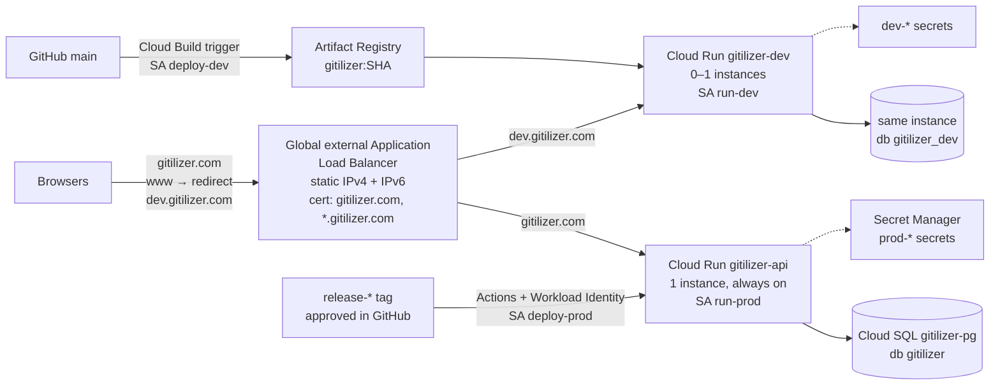

# Launching Gitilizer on Google Cloud

| | |
|---|---|
| **Status** | 2026-11-02. Decisions made; the old configuration is removed (Phase 1), the code changes are done (Phase 2), and the foundation exists (Phase 3). Phase 4 (certificate) is next. |
| **Goal** | `dev.gitilizer.com` and `gitilizer.com` running on Google Cloud as [DESIGN.md](DESIGN.md#hosting-on-google-cloud) and [DEPLOYMENT.md](DEPLOYMENT.md) describe, with the old configuration in the `gitilizer` project removed first. |
| **Region** | `us-east4` ([D-3](DESIGN.md#d-3)) |

This is the one-time setup, step by step. [DEPLOYMENT.md](DEPLOYMENT.md) describes the result and how to run it from day to day. Every task says who does it:

- **You**: needs a person, because it happens in a web console Claude can't reach (GoDaddy, GitHub settings, the Google Auth Platform, Billing), or involves a secret that shouldn't pass through a chat.
- **Claude**: code and scripts, done in a pull request.
- **Either**: running the `infra/` scripts in **Cloud Shell** (bash, already signed in to your account). Claude's sessions so far have had no Google Cloud credentials, so in practice this is you; paste the output back, or save it into the repository's `.local/` folder (ignored by Git) for Claude to read.

## Contents

1. [Where things stand](#where-things-stand)
2. [Decisions](#decisions)
3. [What gets built](#what-gets-built)
4. [Phase 0: access and preparation](#phase-0-access-and-preparation)
5. [Phase 1: inventory and remove the old configuration](#phase-1-inventory-and-remove-the-old-configuration)
6. [Phase 2: code changes](#phase-2-code-changes)
7. [Phase 3: foundation](#phase-3-foundation)
8. [Phase 4: addresses and certificate](#phase-4-addresses-and-certificate)
9. [Phase 5: sign-in apps](#phase-5-sign-in-apps)
10. [Phase 6: development environment](#phase-6-development-environment)
11. [Phase 7: production](#phase-7-production)
12. [Phase 8: monitoring, alerts and budget](#phase-8-monitoring-alerts-and-budget)
13. [Phase 9: launch checks](#phase-9-launch-checks)
14. [Your tasks, in one list](#your-tasks-in-one-list)
15. [Cost](#cost)
16. [Risks](#risks)

---

## Where things stand

### The Google Cloud project

**Cleared on 2026-11-02** ([Phase 1](#phase-1-inventory-and-remove-the-old-configuration)). Billing is on, and you are the only Owner (`brian.k.quinlan@gmail.com`). Firebase stays turned on for the project, with nothing left in it.

### The domain

Checked on 2026-11-02 through public DNS. You've confirmed auto-renew and the domain lock at GoDaddy.

| Record | Value now | Meaning |
|---|---|---|
| `gitilizer.com` NS | `ns13.domaincontrol.com`, `ns14.domaincontrol.com` | DNS is hosted at GoDaddy. |
| `gitilizer.com` A | `3.33.130.190`, `15.197.148.33` | GoDaddy's parked-page / forwarding addresses, not Google. |
| `www.gitilizer.com` | CNAME to `gitilizer.com` | Follows the apex. |
| `dev.gitilizer.com` | none | |
| MX, TXT, CAA | none | No email on the domain and nothing to keep, so the cutover can't break anything. |

### The code

All the problems found in the first version of this plan are fixed ([Phase 2](#phase-2-code-changes)):

| # | Problem | Now |
|---|---|---|
| B-1 | Sign-in was the development stub, which signs anyone in as anyone and gets around the allowlist. | Google and GitHub sign-in. The stub exists only on a developer's computer; a deployed server refuses to start with it. |
| B-2 | No container image; the server didn't serve the web app. | `Dockerfile`; the server serves the built app, with app routes going to `index.html`. |
| B-3 | The server listened only on `127.0.0.1`. | The image sets `HOST=0.0.0.0` and `PORT=8080`. |
| B-4 | Missing settings fell back to PGlite or a built-in key. | With `GITILIZER_ENV` set, missing settings stop the server, naming each one. |
| B-5 | Live updates and the scheduler lived in one process's memory. | Postgres `LISTEN/NOTIFY` for live updates; presence and scan requests in the database; a lease for the periodic pass. Any number of instances can run. |
| B-6 | The credential key came from a setting, not KMS. | Kept as a setting, read from Secret Manager (L-2). |
| B-7 | The session cookie's `__Host-` prefix needs `Secure`. | Deployed servers use `__Host-` cookies with `Secure`. |
| B-8 | 20 database connections per process. | `DATABASE_POOL_MAX`. |
| B-9 | Interrupted scans. | Already handled: a scan that stops sending its heartbeat is closed after 2 minutes. No change needed. |
| B-10 | No CI, Cloud Build config or release workflow. | `.github/workflows/ci.yml`, `cloudbuild.yaml`, `.github/workflows/release.yml`. |

The ranking worker still hasn't run against real Gemini, and sign-in hasn't run against the real Google and GitHub, so development is where both happen first (6.6).

---

## Decisions

You accepted every recommendation except L-8 (2026-11-02).

| ID | Question | Decision |
|---|---|---|
| L-1 | Production as DESIGN.md says, or one service at first? | **One service, `gitilizer-api`, one always-on instance running everything** ([D-10](DESIGN.md#d-10)). Since B-5 is fixed, splitting later is a change of settings ([DEPLOYMENT.md](DEPLOYMENT.md#splitting-production)). |
| L-2 | Where does the credential key live? | **Secret Manager**, one secret per environment ([D-11](DESIGN.md#d-11)). KMS later, if ever. |
| L-3 | DNS at GoDaddy or Cloud DNS? | **GoDaddy.** |
| L-4 | Cloud SQL size? | **`db-g1-small`**, PostgreSQL 17, Enterprise edition, one zone. |
| L-5 | Certificates? | **One Google-managed certificate for `gitilizer.com` and `*.gitilizer.com`**, validated by DNS before any traffic moves. |
| L-6 | How is infrastructure kept? | **`gcloud` scripts in `infra/`**, safe to run again. |
| L-7 | IPv6? | **Yes**, at no extra cost. |
| L-8 | Put development behind Identity-Aware Proxy while sign-in is being built? | **No: fix B-1 first.** Done, so development can go public as soon as its sign-in apps exist. |
| L-9 | Who runs the `gcloud` commands? | **You, in Cloud Shell.** |

---

## What gets built

### Names

| Kind | Name |
|---|---|
| Artifact Registry repository | `gitilizer` (Docker, `us-east4`); image `us-east4-docker.pkg.dev/gitilizer/gitilizer/gitilizer:<commit SHA>` |
| Cloud Run services | `gitilizer-api` (production), `gitilizer-dev` (development); later `gitilizer-worker` |
| Cloud SQL | instance `gitilizer-pg`; databases `gitilizer`, `gitilizer_dev`; users `gitilizer_prod`, `gitilizer_dev` |
| Service accounts | `run-prod`, `run-dev` (what the services run as), `deploy-dev` (Cloud Build), `deploy-prod` (the Release workflow) |
| Secrets | `prod-database-url`, `prod-credential-key`, `prod-worker-token`, `prod-google-client-secret`, `prod-github-client-secret`, and the same five with `dev-` |
| Load balancer | addresses `gitilizer-ipv4`, `gitilizer-ipv6`; NEGs `neg-prod`, `neg-dev`; backend services `be-prod`, `be-dev`; URL maps `gitilizer-https`, `gitilizer-http-redirect`; proxies `gitilizer-https`, `gitilizer-http`; SSL policy `gitilizer-tls`; forwarding rules `gitilizer-{https,http}-{v4,v6}` |
| Certificate Manager | DNS authorization `gitilizer-com`; certificate `gitilizer-cert`; map `gitilizer-map` |
| Workload Identity | pool `github`, provider `gitilizer-repo` |

If the inventory finds any of these names in use, or recently deleted (Cloud SQL instance names can't be reused for about a week, Workload Identity pools for 30 days), change the name in `infra/config.sh` or the script, and in DEPLOYMENT.md.

---

## Phase 0: access and preparation

| # | Who | Task | Status |
|---|---|---|---|
| 0.1 | You | Billing linked to `gitilizer`. | Done |
| 0.2 | You | Answer L-1 to L-9. | Done |
| 0.3 | You | GoDaddy: auto-renew and domain lock on. | Done |
| 0.4 | You | The repository is public, so GitHub's required reviewers are free. | Done |
| 0.5 | You | A day before the cutover in [Phase 7](#phase-7-production), lower the TTL of the `@` A records at GoDaddy to 600 seconds. | |

---

## Phase 1: inventory and remove the old configuration

**Done** (Claude, with your token, 2026-11-02). The project held an earlier, Firebase-based Gitilizer, all in `us-central1` and Firestore's `nam5`, and nothing else: no Cloud SQL, load balancer, Compute Engine or Secret Manager, and no App Engine application. Removed:

| What | Removed |
|---|---|
| Running | 8 Cloud Functions (2nd gen) and their Cloud Run services; the Cloud Scheduler job (every 20 minutes); 3 Cloud Tasks queues; 2 Eventarc triggers and their Pub/Sub topics and subscriptions |
| Data | The Firestore `(default)` database (2 users, 1,090 tasks); Firebase Authentication's accounts and its Google and GitHub sign-in settings |
| Firebase | `gitilizer.web.app` disabled (now 404; a project's default site can't be deleted); the `gitilizer-web` web app; the API key Firebase made for it |
| Build leftovers | The `gcf-artifacts` repository; the functions' two source buckets |
| Permissions | Editor and the deploy roles (Cloud Functions, Run, Firebase, Scheduler, Tasks, Eventarc, service account user) from the default Compute Engine, App Engine and Cloud Build service accounts. Kept: Cloud Build's own builder role, Firebase's `firebase-adminsdk` account and its roles, and Google's service agents. |
| APIs | 18 the old app used, from Cloud Functions to Firestore. Still on, because Firebase depends on them: `firebaseinstallations`, `firebaserules` and `datastore`, with nothing in them. |

The rest of this section is how it was done, kept for reference.

**Don't delete the project.** A deleted project's ID can never be used again, and the design names the project `gitilizer`. Clean it out instead.

| # | Who | Task |
|---|---|---|
| 1.1 | You | In Cloud Shell, clone the repository and run `bash infra/inventory.sh`. Download `gcp-inventory.txt` (Cloud Shell's ⋮ menu → Download) and put it in `.local/` in your copy of the repository, or paste it into the chat. |
| 1.2 | You | In the [Firebase console](https://console.firebase.google.com/), open the `gitilizer` project and note what it uses (Hosting sites, Authentication, Firestore, Functions). `gcloud` doesn't list Firebase Hosting. |
| 1.3 | Claude, then You | Claude turns the inventory into a delete list; you approve it. |
| 1.4 | You | Run the deletions, in the order below. |

**The rules for 1.3:**

- **Delete** everything that Gitilizer's own earlier attempts created: services, load balancer pieces, certificates, databases, images, secrets, triggers, service accounts, schedules, buckets.
- **Keep** Google-managed service agents (`service-<number>@gcp-sa-*.iam.gserviceaccount.com`) and their roles.
- **Keep, but strip** the default service accounts (`<number>-compute@developer.gserviceaccount.com`, `<number>@cloudbuild.gserviceaccount.com`) of project Editor. `infra/foundation.sh` does this.
- **Keep** your own Owner role, and the `default` VPC network unless it has firewall rules you don't recognize.
- **Firebase.** A Firebase project is the same Google Cloud project with Firebase turned on, and Firebase can't be removed from it. Disable any Hosting sites (`firebase hosting:disable`) and delete what else Gitilizer's earlier attempts made there. Leave Firebase itself on: it costs nothing unused, and nothing in this plan conflicts with it. If Firebase Authentication was used, its users aren't Gitilizer accounts, so nothing carries over.
- If a Cloud SQL instance holds anything worth keeping, **export it first** (`gcloud sql export sql ...` to a bucket). Deleting an instance deletes its automated backups.

**Delete in this order** (each step removes what the next depends on; skip empty steps):

| Step | What | Commands (pattern) |
|---|---|---|
| 1 | Anything serving traffic | `gcloud run domain-mappings delete --domain D --region R`; `gcloud compute forwarding-rules delete NAME --global` (and `--region R` for regional ones) |
| 2 | Load balancer pieces | `compute target-https-proxies delete`, `target-http-proxies delete`, `url-maps delete`, `backend-services delete --global`, `backend-buckets delete`, `network-endpoint-groups delete --region R`, `health-checks delete`, `ssl-certificates delete`, `ssl-policies delete`, `security-policies delete` |
| 3 | Certificate Manager | `certificate-manager maps entries delete`, then `maps delete`, `certificates delete`, `dns-authorizations delete` |
| 4 | Reserved addresses | `compute addresses delete NAME --global` (static IPs cost money while unused) |
| 5 | Compute | `run services delete`, `run jobs delete`, `functions delete`, `compute instances delete`, `scheduler jobs delete`, `tasks queues delete`, `pubsub subscriptions delete`, then `pubsub topics delete` |
| 6 | Databases | `gcloud sql instances patch NAME --no-deletion-protection`, then `gcloud sql instances delete NAME`; `redis instances delete` |
| 7 | Build and images | `builds triggers delete`, `builds connections delete`, `artifacts repositories delete`; old Container Registry images live in `artifacts.gitilizer.appspot.com` or `*.artifacts.gitilizer.appspot.com` buckets |
| 8 | Storage | `gcloud storage rm -r gs://BUCKET` for buckets from earlier attempts. **Check each bucket's contents first**, and leave Firebase's own buckets (`gitilizer.appspot.com`, `gitilizer.firebasestorage.app`) unless you know they are unused. |
| 9 | Secrets | `gcloud secrets delete NAME` |
| 10 | KMS | Key rings and keys can't be deleted. Destroy unused key versions (`kms keys versions destroy`, effective after 30 days) and leave the ring. |
| 11 | Identities | `iam service-accounts delete` for user-created accounts (not Firebase's `firebase-adminsdk-*`, unless Firebase is unused); `projects remove-iam-policy-binding` for stale members; `iam workload-identity-pools delete` |
| 12 | Monitoring and logging | `monitoring uptime delete`, `beta monitoring policies delete`, `logging metrics delete`, `logging sinks delete` (never `_Default` or `_Required`) |
| 13 | App Engine | An App Engine application **can't be deleted** from a project. Stop its versions (`gcloud app versions stop`) and disable it under App Engine → Settings. |
| 14 | APIs | Last: `gcloud services disable NAME` for APIs nothing will use. Leave the ones `infra/foundation.sh` enables and Firebase's. |

**Done when** running the inventory again shows only Google-managed and Firebase items, your own Owner role, and the default accounts with no Editor role.

---

## Phase 2: code changes

**Done** (Claude, 2026-11-02). [DESIGN.md](DESIGN.md#prototype-status) has the details; the tests cover each one.

| # | Change | Fixes |
|---|---|---|
| 2.1 | Startup checks for the deployed environments; `DATABASE_POOL_MAX`; `PUBLIC_URL`. | B-4, B-8 |
| 2.2 | The server serves the built web app, with `index.html` for app routes and long caching for hashed files; `GET /api/health`; security headers (HSTS, a Content Security Policy, no framing). | B-2 |
| 2.3 | `Dockerfile` and `.dockerignore`: one image, run as a non-root user, one process so SIGTERM reaches the server, which closes open event streams and stops within Cloud Run's 10 seconds. Built and run here against Postgres with production settings. | B-2, B-3 |
| 2.4 | Google and GitHub sign-in with PKCE, `state` and a nonce, the five failure categories, and `__Host-` cookies; the development stub only on a developer's computer; the sign-in page asks the server which methods it offers. | B-1, B-7 |
| 2.5 | Several processes on one database: live updates through `LISTEN/NOTIFY`, presence and scan requests in tables, scans claimed with `SKIP LOCKED`, a lease for the periodic pass, schema upgrades under a lock; `SCHEDULER=off`. Tested with two processes on a real Postgres. | B-5 |
| 2.6 | `cloudbuild.yaml`. | B-10 |
| 2.7 | `.github/workflows/ci.yml`: typecheck, tests (with a Postgres service for 2.5's tests), the web build and the image build. | B-10 |
| 2.8 | `.github/workflows/release.yml`. | B-10 |
| 2.9 | `infra/`: a script for each phase below, the URL maps, and the monitoring definitions. | L-6 |
| 2.10 | DEPLOYMENT.md, DESIGN.md, LOCAL_DEVELOPMENT.md and this plan. | |

Not done, and not needed for launch: the Playwright run in fixture mode as a CI step (it doesn't exist as a script yet), and KMS (L-2).

**After pulling these changes,** run `npm install` once: the server has a new package (`@fastify/static`).

---

## Phase 3: foundation

**Done** (Claude, with your token, 2026-11-02): `bash infra/foundation.sh`. It enabled the APIs and created:

- the Artifact Registry repository `gitilizer`;
- the service accounts `run-prod`, `run-dev`, `deploy-dev` and `deploy-prod`, each with only the permissions it needs (listed in `infra/foundation.sh`);
- the Cloud SQL instance `gitilizer-pg` (PostgreSQL 17, `db-g1-small`, 180 daily backups, point-in-time recovery, deletion protection) and the databases `gitilizer` and `gitilizer_dev`;
- the users `gitilizer_prod` and `gitilizer_dev`, made with SQL so that neither belongs to `cloudsqlsuperuser`. Checked afterwards from the database: each owns its own database, and can't connect to the other's;
- the secrets `{prod,dev}-database-url`, `{prod,dev}-credential-key` and `{prod,dev}-worker-token`, each readable only by its environment's service account, and the regional secret `sql-admin-password` for `postgres`.

The manual SQL step the first version of this plan had is gone: the script sends the SQL itself (`gcloud sql instances execute-sql`). Run `foundation.sh` once more after 5.5, so each environment can read its OAuth client secrets.

**Never destroy a version of `*-credential-key`.** Without it, every stored GitHub token and Gemini key is unreadable.

---

## Phase 4: addresses and certificate

Start this early: the certificate needs a DNS record at GoDaddy, and issuing it can take a while.

| # | Who | Task |
|---|---|---|
| 4.1 | You | `bash infra/certificate.sh`. It reserves the two addresses, creates the certificate, and prints the records for GoDaddy. |
| 4.2 | You | At GoDaddy → `gitilizer.com` → **DNS** → **Add New Record**: the `CNAME` `_acme-challenge` the script printed (TTL 1 hour). Enter only `_acme-challenge` as the name; GoDaddy adds `.gitilizer.com`. It doesn't affect the website. Leave it in place permanently: renewals use it. |
| 4.3 | You | Run `bash infra/certificate.sh` again until it says `ACTIVE`. |

---

## Phase 5: sign-in apps

All **You**: consoles and client secrets. Development and production have separate apps ([DEPLOYMENT.md](DEPLOYMENT.md#sign-in-apps)).

| # | Task |
|---|---|
| 5.1 | **Verify the domain with Google.** [Google Search Console](https://search.google.com/search-console) → add a **Domain** property for `gitilizer.com` → add its `TXT` record at GoDaddy (name `@`) → **Verify**. Google needs this before it shows `gitilizer.com` as the app's domain on the sign-in screen. |
| 5.2 | **Decide where the privacy policy lives.** The privacy section is in `docs/user-guide.md`. Its page on GitHub works as the URL. |
| 5.3 | **Google sign-in.** Cloud console for `gitilizer` → **Google Auth Platform**. **Branding:** app name "Gitilizer", your support email, home page `https://gitilizer.com`, the privacy policy URL, authorized domain `gitilizer.com` (a logo is optional, and adding one means Google reviews the branding first). **Audience:** External, then **Publish** (while it is "Testing", only listed test users can sign in). **Data access:** `openid`, `.../auth/userinfo.email`, `.../auth/userinfo.profile`; none are sensitive, so no security review. **Clients → Create client → Web application**, twice: "Gitilizer production" with redirect URI `https://gitilizer.com/api/auth/google/callback`, and "Gitilizer development" with `https://dev.gitilizer.com/api/auth/google/callback`. Note both client IDs. If Firebase Authentication already made a consent screen in this project, edit it rather than starting again. |
| 5.4 | **GitHub sign-in.** GitHub → **Settings → Developer settings → OAuth Apps → New OAuth App**, twice (a GitHub OAuth app has one callback URL): "Gitilizer", homepage `https://gitilizer.com`, callback `https://gitilizer.com/api/auth/github/callback`; and "Gitilizer (development)", homepage `https://dev.gitilizer.com`, callback `https://dev.gitilizer.com/api/auth/github/callback`. Leave **Enable Device Flow** off. Generate a client secret for each and note the client IDs. |
| 5.5 | **Store the four secrets:** `bash infra/oauth-secrets.sh`. It asks for each without showing it, and lets only the matching environment read it. |

---

## Phase 6: development environment

| # | Who | Task |
|---|---|---|
| 6.1 | You | **Connect Cloud Build to GitHub.** Cloud console → **Cloud Build → Repositories** → **2nd gen** → **Create host connection**: GitHub, region `us-east4`, name `github`. Install the Cloud Build GitHub App on **only** `brianquinlan/gitilizer`. Then **Link repository** → `brianquinlan/gitilizer`, name `gitilizer`. |
| 6.2 | You | **Create the service** with all its settings, running Google's sample container for now: `GOOGLE_CLIENT_ID=<dev> GITHUB_CLIENT_ID=<dev> SIGN_IN_ALLOWLIST="google:<you> github-id:<your id>" bash infra/services.sh dev placeholder`. The allowlist stays out of Git. |
| 6.3 | You | **The trigger and Workload Identity:** `bash infra/pipeline.sh` (note the two values it prints, for 7.3). Then build and deploy `main` for the first time: `gcloud builds triggers run deploy-dev --region=us-east4 --branch=main`, and watch it under Cloud Build → History. |
| 6.4 | You | **Load balancer:** `bash infra/load-balancer.sh`. |
| 6.5 | You | **GitHub rulesets** (Settings → Rules → Rulesets): for `main`, require a pull request and the `ci` check, and block force pushes; for tags `release-*`, block updates and deletion. |
| 6.6 | You | **Point `dev` at Google** at GoDaddy: `A` `dev` → the IPv4 address and `AAAA` `dev` → the IPv6 address that `certificate.sh` printed. |
| 6.7 | You and Claude | **Try development** at `https://dev.gitilizer.com`, with your real data: the checklist below. |

**6.7 checklist:**

- [ ] Google and GitHub sign-in both work; an account not on the allowlist sees the refusal and no account is created.
- [ ] `POST /api/auth/dev` returns 404.
- [ ] The session cookie is `__Host-gitilizer_session`, `Secure`, `HttpOnly`, `SameSite=Lax`.
- [ ] Saving credentials starts the first sync; items are ranked by real Gemini; the free-tier fallback behaves.
- [ ] Live updates arrive in a second tab; after a deploy, the page reconnects and catches up.
- [ ] Logs are JSON with severities, and contain no tokens, keys or emails.
- [ ] The `*.run.app` address is refused; `http://dev.gitilizer.com` redirects to HTTPS.
- [ ] Merging a small change to `main` reaches development within minutes.

---

## Phase 7: production

| # | Who | Task |
|---|---|---|
| 7.1 | You | **Create the service** with the image development is running: `GOOGLE_CLIENT_ID=<prod> GITHUB_CLIENT_ID=<prod> bash infra/services.sh prod <sha>`, where `<sha>` comes from `gcloud run services describe gitilizer-dev --region us-east4 --format='value(spec.template.spec.containers[0].image)'`. |
| 7.2 | You | `bash infra/load-balancer.sh` again: it adds `gitilizer.com` and `www`. It prints a `curl --resolve` command that tests production through the load balancer before DNS changes. |
| 7.3 | You | **GitHub environment:** Settings → Environments → New environment `production`. **Required reviewers:** you. **Deployment branches and tags:** selected tags, pattern `release-*`. **Environment variables:** `WIF_PROVIDER` and `DEPLOY_SA`, from 6.4. |
| 7.4 | You | **Cutover at GoDaddy** (a day after lowering the TTL, 0.5): (1) `gitilizer.com` → **Forwarding**: delete any forwarding, or GoDaddy puts its own A records back; (2) delete the A records for `@` (`3.33.130.190`, `15.197.148.33`); (3) add `A` `@` → the IPv4 address and `AAAA` `@` → the IPv6 address, TTL 600 seconds, raised to 1 hour after a day; (4) keep `www` as a CNAME to `@`; (5) optionally, CAA records `@ 0 issue "pki.goog"` and `@ 0 issue "letsencrypt.org"` (both are needed if you add any); (6) don't change the nameservers, `_acme-challenge` or the Search Console `TXT` record. Check with `nslookup gitilizer.com 8.8.8.8` and `curl -sSI https://gitilizer.com`. |
| 7.5 | You | **First real release:** follow [DEPLOYMENT.md](DEPLOYMENT.md#releasing-to-production) end to end, so the pipeline is proven before anyone depends on it, then practise a [rollback](DEPLOYMENT.md#rolling-back). |

---

## Phase 8: monitoring, alerts and budget

| # | Who | Task |
|---|---|---|
| 8.1 | You | **Budget.** Billing → **Budgets & alerts** → a budget for project `gitilizer`, US$200 a month, alerts at 50%, 90% and 100% of actual spend and 100% of forecast. |
| 8.2 | You | `ALERT_EMAIL=<you> bash infra/monitoring.sh`: log-based metrics, the uptime check, four alert policies and the dashboard ([DEPLOYMENT.md](DEPLOYMENT.md#monitoring-and-alerts)). Google sends nothing to confirm an email channel, so check that alerts arrive (Phase 9). |
| 8.3 | You, later | **Usage dashboard** (`METRIC-1`). Looker Studio reaching Cloud SQL means opening the instance to Looker Studio's addresses with a read-only user. Decide after launch whether that's worth it, or whether `/internal/metrics` is enough. |

---

## Phase 9: launch checks

Before telling anyone about `gitilizer.com`:

- [ ] Everything in the 6.7 checklist, repeated on `gitilizer.com` (except the allowlist, which production doesn't have).
- [ ] Production and development data are separate: an account on one doesn't exist on the other.
- [ ] `run-dev` can't read any `prod-*` secret: `gcloud secrets get-iam-policy prod-credential-key` lists only `run-prod`.
- [ ] No service account holds Owner or Editor: `gcloud projects get-iam-policy gitilizer`.
- [ ] Backups run, and a restore works: `gcloud sql instances clone gitilizer-pg gitilizer-restore-test --point-in-time=...`, check the data, delete the clone.
- [ ] The uptime alert fires: briefly change the check's path to one that returns 404, confirm the email, change it back.
- [ ] A release and a rollback have each been done once (7.5).
- [ ] The privacy section and the user guide are reachable from the footer.

---

## Your tasks, in one list

1. Run the inventory; check the Firebase console (1.1, 1.2).
2. Approve the delete list and run the deletions (1.3, 1.4).
3. ~~`infra/foundation.sh`~~ Done. Run it again after 5.5.
4. `infra/certificate.sh`; the `_acme-challenge` CNAME at GoDaddy (4.1 to 4.3).
5. Search Console verification, with a `TXT` record at GoDaddy (5.1).
6. Google Auth Platform: branding, audience (publish), scopes, two clients (5.2, 5.3).
7. Two GitHub OAuth apps (5.4); `infra/oauth-secrets.sh`, then `infra/foundation.sh` again (5.5).
8. Cloud Build's GitHub connection (6.1); `services.sh dev placeholder`, `pipeline.sh` and the first build, `load-balancer.sh` (6.2 to 6.4).
9. GitHub rulesets (6.5); the `dev` records at GoDaddy (6.6).
10. Try development with your real data (6.7).
11. `services.sh prod`, `load-balancer.sh` again, the GitHub `production` environment (7.1 to 7.3).
12. Lower the TTLs a day ahead (0.5), then the cutover at GoDaddy (7.4).
13. First release and a practice rollback (7.5).
14. Budget and `monitoring.sh` (8.1, 8.2).
15. Launch checks (Phase 9).

---

## Cost

Rough monthly figures for `us-east4`, before free-tier credits. Check them with the [pricing calculator](https://cloud.google.com/products/calculator) once the services exist; the billing report is the real answer after the first month.

| Item | Estimate |
|---|---|
| Load balancer: forwarding rules (four, inside the flat charge for five) and data processed | about US$18–20 ([Hosting](DESIGN.md#hosting-on-google-cloud)) |
| Cloud SQL `db-g1-small`, 10 GB SSD, backups and transaction logs | about US$30–35 |
| Cloud Run `gitilizer-api`: 1 vCPU and 1 GiB, always on | about US$45–55 |
| Cloud Run `gitilizer-dev`: only while in use | US$0–5 |
| Artifact Registry, Secret Manager, Cloud Build, logging, monitoring | US$1–5 |
| **Total** | **about US$95–120 a month**, within the US$200 budget (`PLAT-4`) |

Splitting production into `gitilizer-api` and `gitilizer-worker` later adds at least one more always-on instance.

---

## Risks

| Risk | What to do about it |
|---|---|
| **One instance has a ceiling**: about 1,000 open tabs, and one vCPU for all scanning and ranking. | The "busy" alert and the dashboard's open-requests chart; then [split production](DEPLOYMENT.md#splitting-production), which needs no code change. |
| **Deploys overlap**: for a minute, two revisions run. | Safe by design: the lease hands the periodic pass over, scans and ranking jobs are claimed with `SKIP LOCKED`, schema upgrades take turns, and tabs reconnect and catch up. |
| **Losing the credential key** makes every stored credential unreadable. | Never destroy a version of `*-credential-key`; only `run-*` and you can read it. |
| **Development shares the Cloud SQL instance** ([D-8](DESIGN.md#d-8)). | Separate databases and users, small pools (5 and 10), maintenance on Sunday nights. |
| **First contact with the real Google, GitHub and Gemini.** Sign-in and the worker have only run against stand-ins. | Development first, with your own data (6.7). |
| **Names from deleted resources can't be reused** for a while. | The inventory shows deleted pools; rename any clash. |
| **GoDaddy forwarding puts its records back** if it isn't turned off first. | 7.4 step 1. |
