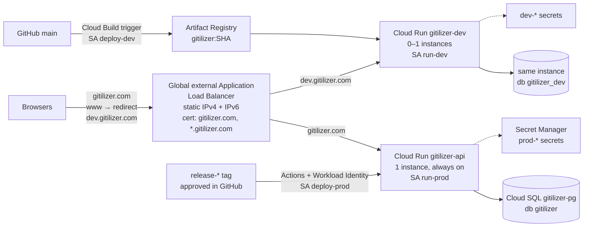

# Launching Gitilizer on Google Cloud

| | |
|---|---|
| **Status** | Plan, 2026-11-02. Nothing in it has been done yet. |
| **Goal** | `dev.gitilizer.com` and `gitilizer.com` running on Google Cloud as [DESIGN.md](DESIGN.md#hosting-on-google-cloud) and [DEPLOYMENT.md](DEPLOYMENT.md) describe, with the old configuration in the `gitilizer` project removed first. |
| **Region** | `us-east4` ([D-3](DESIGN.md#d-3)) |

This is the step-by-step plan for getting from the prototype to a running service. Every task says who does it:

- **You**: needs a person, usually because it happens in a web console Claude can't reach (GoDaddy, GitHub settings, the Google Auth Platform, Billing), or because it involves a secret that shouldn't pass through a chat.
- **Claude**: code and scripts Claude can write in a pull request.
- **Either**: `gcloud` commands. They're written for **Cloud Shell** (bash, already signed in to your account), so either you run them, or you give Claude a signed-in `gcloud` and it runs them.

Decisions for you to confirm are numbered L-1, L-2 and so on ([Decisions](#decisions-to-confirm)).

## Contents

1. [Where things stand](#where-things-stand)
2. [Decisions to confirm](#decisions-to-confirm)
3. [What gets built](#what-gets-built)
4. [Phase 0: access and preparation](#phase-0-access-and-preparation)
5. [Phase 1: inventory and remove the old configuration](#phase-1-inventory-and-remove-the-old-configuration)
6. [Phase 2: code changes needed before anything is deployed](#phase-2-code-changes-needed-before-anything-is-deployed)
7. [Phase 3: foundation](#phase-3-foundation)
8. [Phase 4: IP address and certificate](#phase-4-ip-address-and-certificate)
9. [Phase 5: sign-in apps](#phase-5-sign-in-apps)
10. [Phase 6: development environment](#phase-6-development-environment)
11. [Phase 7: production](#phase-7-production)
12. [Phase 8: monitoring, alerts and budget](#phase-8-monitoring-alerts-and-budget)
13. [Phase 9: launch checks](#phase-9-launch-checks)
14. [Your tasks, in one list](#your-tasks-in-one-list)
15. [Cost](#cost)
16. [Risks](#risks)

---

## Where things stand

### The Google Cloud project

**Not checked yet.** The session that wrote this plan had no Google Cloud credentials, so it couldn't list what the `gitilizer` project contains. [Phase 1](#phase-1-inventory-and-remove-the-old-configuration) starts with a script that lists everything; its output decides what gets deleted.

NEW: Check again

### The domain

Checked on 2026-11-02 through public DNS:

| Record | Value now | Meaning |
|---|---|---|
| `gitilizer.com` NS | `ns13.domaincontrol.com`, `ns14.domaincontrol.com` | DNS is hosted at GoDaddy. |
| `gitilizer.com` A | `3.33.130.190`, `15.197.148.33` | GoDaddy's parked-page / forwarding addresses, not Google. |
| `www.gitilizer.com` | CNAME to `gitilizer.com` | Follows the apex. |
| `dev.gitilizer.com` | none | |
| MX, TXT, CAA | none | No email on the domain and nothing to keep, so the cutover can't break anything. |

### The code

The prototype runs locally, but it isn't safe or able to run on Cloud Run yet. These must be fixed first ([Phase 2](#phase-2-code-changes-needed-before-anything-is-deployed)):

| # | Problem | Why it matters |
|---|---|---|
| B-1 | **Sign-in is the development stub.** `POST /api/auth/dev` signs anyone in as any name and email, with `emailVerified: true`. | On a public URL anyone could sign in as anyone. It also defeats the development allowlist: claiming an allowlisted email is enough. Nothing can be public until real Google and GitHub sign-in replaces it. |
| B-2 | **No container image**, and the server doesn't serve the built web app (no static files, no fallback to `index.html` for app routes). | Nothing to deploy, and `gitilizer.com` would have no pages. |
| B-3 | The server listens on `127.0.0.1` unless `HOST` is set. | Cloud Run can't reach it. Set `HOST=0.0.0.0`. |
| B-4 | Without `DATABASE_URL` the server quietly uses PGlite in the container; without `CREDENTIAL_KEY` it uses a fixed, insecure key and only logs a warning. | A missing setting would lose data on every restart, or encrypt real credentials with a public key. Outside local mode the server must refuse to start instead. |
| B-5 | **Live updates and the scheduler live in one process's memory.** `Hub` keeps the event streams and their replay buffers in memory; `Scheduler` keeps running scans in memory. | Only one instance can run at a time. With two, a scan on one instance never reaches a browser connected to the other, and both schedulers scan the same developers. The API/worker split in DESIGN.md needs Postgres `LISTEN/NOTIFY` for events and database-claimed scans first. See [L-1](#decisions-to-confirm). |
| B-6 | The credential key comes from an environment variable; Cloud KMS isn't wired in. | See [L-2](#decisions-to-confirm). |
| B-7 | The session cookie is `Secure` only when `NODE_ENV=production`, and its name starts with `__Host-`, which browsers reject without `Secure`. | Set `NODE_ENV=production` in **both** environments (`GITILIZER_ENV` tells them apart). |
| B-8 | The Postgres pool is fixed at 20 connections per process. | A small Cloud SQL instance allows only 25–50 connections in total, shared by both environments. Make it a setting. |
| B-9 | Interrupted scans are closed at startup only in local mode. | A deploy or restart mid-scan may leave a scan open. Check what the developer sees, and close them at startup when there is one instance. |
| B-10 | No CI, no Cloud Build config, no release workflow (`.github/` doesn't exist). | The pipeline in DEPLOYMENT.md is designed but not built. |

The ranking worker has also never run against real Gemini ([Prototype status](DESIGN.md#prototype-status)), so the development environment is where that happens first.

---

## Decisions to confirm

Each has a recommendation. The plan assumes the recommendation unless you say otherwise.

| ID | Question | Recommendation | Alternative |
|---|---|---|---|
| L-1 | Production as DESIGN.md says (`gitilizer-api` and `gitilizer-worker`), or one service at first? | **One service, `gitilizer-api`, running everything, with exactly one instance** (`--min-instances=1 --max-instances=1`, CPU always allocated). It's the only shape the code supports today (B-5). The name stays, so splitting out `gitilizer-worker` later doesn't touch the load balancer. Split when open tabs approach ~500 or CPU stays above ~60%. | Do the `LISTEN/NOTIFY` and scan-claiming work first, and launch with the split. Adds a week or so before launch. |
| L-2 | Where does the credential key live? | **Secret Manager at launch**, one secret per environment, readable only by that environment's service account. Same protection boundary as KMS for this threat model, and no code change. | Cloud KMS as DESIGN.md says: envelope encryption, with the data key unwrapped by KMS at startup. A small code change; do it now or later. |
| L-3 | Keep DNS at GoDaddy, or move it to Cloud DNS? | **Keep it at GoDaddy.** Five records, changed rarely. | Cloud DNS (about US$0.20 a month), so DNS lives with everything else. Means changing the nameservers at GoDaddy. |
| L-4 | Cloud SQL size? | **`db-g1-small`** (shared core, 1.7 GB, about 50 connections), PostgreSQL 17, Enterprise edition, one zone. | `db-f1-micro`: about US$17 a month cheaper, but 0.6 GB and 25 connections shared by both environments, which is tight. |
| L-5 | Certificates? | **One Google-managed certificate for `gitilizer.com` and `*.gitilizer.com`**, validated by a DNS record, so it's issued before any traffic moves. | A certificate per hostname validated by load-balancer traffic. It can only be issued after DNS points at Google, so the site shows certificate errors for up to an hour at cutover. |
| L-6 | How is infrastructure kept? | **A `gcloud` script in the repository** (`infra/`), safe to run again, matching the `gcloud` commands DEPLOYMENT.md already uses. | Terraform. Better for drift and teardown, more to learn and maintain for one owner. |
| L-7 | IPv6? | **Yes.** Two more forwarding rules, still within the first five that the flat charge covers, so no extra cost. | IPv4 only. |
| L-8 | Put development behind Identity-Aware Proxy while sign-in is being built? | **Only if you want development running before B-1 is done.** IAP in front of `dev.gitilizer.com` lets only your Google account through, so the stub is safe there. Remove it once OAuth works, since the allowlist does the same job. | Wait for OAuth before anything is public. |
| L-9 | Who runs the `gcloud` commands? | **You, in Cloud Shell**, pasting results back or saving them into the repository's `.local/` folder (ignored by Git) so Claude can read them. | Give Claude a signed-in `gcloud` in a future session. |

Let's go with all of your recommendations except for L-8. For L-8, let's fix B-1 first.

---

## What gets built



### Names

| Kind | Name |
|---|---|
| Artifact Registry repository | `gitilizer` (Docker, `us-east4`); image `us-east4-docker.pkg.dev/gitilizer/gitilizer/gitilizer:<commit SHA>` |
| Cloud Run services | `gitilizer-api` (production), `gitilizer-dev` (development); later `gitilizer-worker` |
| Cloud SQL | instance `gitilizer-pg`; databases `gitilizer`, `gitilizer_dev`; users `gitilizer_prod`, `gitilizer_dev` |
| Service accounts | `run-prod`, `run-dev` (what the services run as), `deploy-dev` (Cloud Build), `deploy-prod` (the release workflow) |
| Secrets | `prod-database-url`, `prod-credential-key`, `prod-worker-token`, `prod-google-client-secret`, `prod-github-client-secret`, and the same five with `dev-` |
| Load balancer | addresses `gitilizer-ipv4`, `gitilizer-ipv6`; NEGs `neg-prod`, `neg-dev`; backend services `be-prod`, `be-dev`; URL maps `gitilizer-https`, `gitilizer-http-redirect`; proxies `gitilizer-https`, `gitilizer-http`; SSL policy `gitilizer-tls`; forwarding rules `gitilizer-{https,http}-{v4,v6}` |
| Certificate Manager | DNS authorization `gitilizer-com`; certificate `gitilizer-cert`; map `gitilizer-map` |
| Workload Identity | pool `github`, provider `gitilizer-repo` |

If the inventory finds any of these names already in use, or recently deleted (Cloud SQL instance names can't be reused for about a week, and Workload Identity pools for 30 days), add a suffix such as `-2`.

---

## Phase 0: access and preparation

| # | Who | Task | Done when |
|---|---|---|---|
| 0.1 | You | Confirm `gitilizer` is linked to a billing account: `gcloud billing projects describe gitilizer`. | `billingEnabled: true` |
| 0.2 | You | Answer L-1 to L-9 (or accept the recommendations). | |
| 0.3 | You | At GoDaddy, make sure the domain has **auto-renew** on and **domain lock** on, and note its expiry date. | |
| 0.4 | You | Confirm the GitHub repository is **public**. Required reviewers on a GitHub environment (the release approval) are free only for public repositories; a private one needs GitHub Pro or Team. | |

It is public

| 0.5 | You | A day before the cutover in [Phase 7](#phase-7-production), lower the TTL of the `@` A records at GoDaddy to 600 seconds, so the change spreads quickly. | |

go daddy info confirmed

> gcloud billing projects describe gitilizer
billingAccountName: billingAccounts/00BDB3-7C0CD6-2AC811
billingEnabled: true
name: projects/gitilizer/billingInfo
projectId: gitilizer

---

## Phase 1: inventory and remove the old configuration

**Don't delete the project.** A deleted project's ID can never be used again, and the design names the project `gitilizer`. Clean it out instead.

### 1.1 Inventory (Either)

Run in Cloud Shell. It lists everything that could be left over, and writes it to `gcp-inventory.txt`. Download the file (Cloud Shell's ⋮ menu → Download) and put it in the repository's `.local/` folder, or paste it into the chat.

```bash
P=gitilizer
cmds=(
  "services list --enabled"
  "run services list" "run jobs list" "run domain-mappings list --region us-east4"
  "functions list" "app describe" "app services list"
  "compute instances list" "compute addresses list"
  "compute forwarding-rules list" "compute target-https-proxies list" "compute target-http-proxies list"
  "compute url-maps list" "compute backend-services list" "compute backend-buckets list"
  "compute network-endpoint-groups list" "compute health-checks list"
  "compute ssl-certificates list" "compute ssl-policies list" "compute security-policies list"
  "compute networks list" "compute firewall-rules list" "compute routers list"
  "certificate-manager certificates list" "certificate-manager maps list"
  "certificate-manager dns-authorizations list"
  "sql instances list" "redis instances list --region us-east4"
  "artifacts repositories list" "secrets list"
  "kms keyrings list --location us-east4" "kms keyrings list --location global"
  "builds triggers list" "builds triggers list --region us-east4"
  "builds connections list --region us-east4"
  "scheduler jobs list --location us-east4" "tasks queues list --location us-east4"
  "pubsub topics list" "pubsub subscriptions list"
  "storage buckets list --format=value(name)" "dns managed-zones list"
  "iam service-accounts list" "iam workload-identity-pools list --location global --show-deleted"
  "logging sinks list" "logging metrics list"
  "monitoring uptime list-configs" "beta monitoring policies list --format=value(displayName)"
  "beta monitoring channels list --format=value(displayName,type)"
  "projects get-iam-policy $P"
)
for c in "${cmds[@]}"; do
  echo "=== gcloud $c"
  eval gcloud $c --project $P 2>&1
done > gcp-inventory.txt
```

Also look in the [Firebase console](https://console.firebase.google.com/) for a `gitilizer` project with Hosting sites, which `gcloud` doesn't list.

Yes, there is a firebase project.

### 1.2 Decide what goes (Claude, then You)

Claude turns the inventory into a delete list; you approve it. The rules:

- **Delete** everything that Gitilizer's own earlier attempts created: services, load balancer pieces, certificates, databases, images, secrets, triggers, service accounts, schedules, buckets.
- **Keep** Google-managed service agents (`service-<number>@gcp-sa-*.iam.gserviceaccount.com`) and their roles. Removing them breaks the services they belong to.
- **Keep, but strip** the default service accounts (`<number>-compute@developer.gserviceaccount.com`, `<number>@cloudbuild.gserviceaccount.com`). They usually hold project **Editor**, which DESIGN.md's [one-project rules](DESIGN.md#deployment) don't allow. Remove their roles; nothing in this plan runs as them.
- **Keep** your own Owner role.
- **Keep** the `default` VPC network unless it has firewall rules you don't recognize. Nothing here needs a VPC (Cloud Run reaches Cloud SQL through the built-in connector), so deleting it is also fine.
- If a Cloud SQL instance holds anything worth keeping, **export it first** (`gcloud sql export sql ...` to a bucket). Deleting an instance deletes its automated backups.

### 1.3 Delete, in this order (Either)

Each step removes things that the next step's resources depend on. Skip any step the inventory shows is empty.

| Step | What | Commands (pattern) |
|---|---|---|
| 1 | Anything serving traffic | `gcloud run domain-mappings delete --domain D --region R`; `gcloud compute forwarding-rules delete NAME --global` (and `--region R` for regional ones) |
| 2 | Load balancer pieces | `compute target-https-proxies delete`, `target-http-proxies delete`, `url-maps delete`, `backend-services delete --global`, `backend-buckets delete`, `network-endpoint-groups delete --region R`, `health-checks delete`, `ssl-certificates delete`, `ssl-policies delete`, `security-policies delete` |
| 3 | Certificate Manager | `certificate-manager maps entries delete`, then `maps delete`, `certificates delete`, `dns-authorizations delete` |
| 4 | Reserved addresses | `compute addresses delete NAME --global` (static IPs cost money while unused) |
| 5 | Compute | `run services delete`, `run jobs delete`, `functions delete`, `compute instances delete`, `scheduler jobs delete`, `tasks queues delete`, `pubsub subscriptions delete`, then `pubsub topics delete` |
| 6 | Databases | `gcloud sql instances patch NAME --no-deletion-protection`, then `gcloud sql instances delete NAME`; `redis instances delete` |
| 7 | Build and images | `builds triggers delete`, `builds connections delete`, `artifacts repositories delete`; old Container Registry images live in `artifacts.gitilizer.appspot.com` or `*.artifacts.gitilizer.appspot.com` buckets |
| 8 | Storage | `gcloud storage rm -r gs://BUCKET` for buckets from earlier attempts (`gitilizer_cloudbuild`, staging buckets). **Check each bucket's contents first.** |
| 9 | Secrets | `gcloud secrets delete NAME` |
| 10 | KMS | Key rings and keys can't be deleted. Destroy unused key versions (`kms keys versions destroy`, which takes effect after 30 days) and leave the ring; a ring named `gitilizer` can simply be reused. |
| 11 | Identities | `iam service-accounts delete` for user-created accounts; `projects remove-iam-policy-binding` for stale members and for Editor on the default accounts; `iam workload-identity-pools delete` |
| 12 | Monitoring and logging | `monitoring uptime delete`, `beta monitoring policies delete`, `logging metrics delete`, `logging sinks delete` (never `_Default` or `_Required`) |
| 13 | App Engine and Firebase | An App Engine application **can't be deleted** from a project. Stop its versions (`gcloud app versions stop`) and disable it under App Engine → Settings. For Firebase Hosting: `firebase hosting:disable`. |
| 14 | APIs | Last: `gcloud services disable NAME` for APIs nothing will use (for example `appengine`, `cloudfunctions`, `redis`). Leave the ones [Phase 3](#phase-3-foundation) enables. |

**Done when** running the inventory again shows only Google-managed items, your own Owner role, and the default accounts with no roles.

---

## Phase 2: code changes needed before anything is deployed

All Claude, as pull requests. Order matters only where noted.

| # | Change | Fixes |
|---|---|---|
| 2.1 | **Startup guards.** When `GITILIZER_ENV` is `development` or `production`, refuse to start without `DATABASE_URL`, `CREDENTIAL_KEY`, `WORKER_TOKEN` and `PUBLIC_URL`; never fall back to PGlite or the built-in key. Add `DATABASE_POOL_MAX` (default 20). | B-4, B-8 |
| 2.2 | **Serve the web app.** `@fastify/static` serves `app/web/dist`; any `GET` that isn't `/api/...` and isn't a file returns `index.html`. Hashed assets get `Cache-Control: immutable`, `index.html` gets `no-cache`. Add `Strict-Transport-Security`. Add `GET /api/health` (checks the database) for the uptime check. Don't use `/healthz`: Cloud Run reserves some paths ending in `z`. | B-2 |
| 2.3 | **Dockerfile** and `.dockerignore`. Build stage: `npm ci`, `npm run build -w app/web`. Runtime stage: `node:22-slim`, the workspaces, `prompts/`, the built web app, `HOST=0.0.0.0`, `CMD ["npm","start","-w","app/server"]`. Exclude `eval/`, `.local/`, `.env`, `.venv/`. Check it runs with `docker run` against a local Postgres. | B-2, B-3 |
| 2.4 | **Real sign-in** ([Sign-in and sessions](DESIGN.md#sign-in-and-sessions)). Google OpenID Connect and the GitHub OAuth app, both with PKCE and `state`; redirect URLs built from `PUBLIC_URL`; client IDs from `GOOGLE_CLIENT_ID` and `GITHUB_CLIENT_ID`, secrets from `GOOGLE_CLIENT_SECRET` and `GITHUB_CLIENT_SECRET`; the five failure categories; both finishing in `completeSignIn()`. `POST /api/auth/dev` exists **only** in local and fixture mode and returns 404 otherwise, with a test that proves it. The sign-in page's buttons start the redirects. This is the largest item. | B-1 |
| 2.5 | **Interrupted scans.** Decide what a developer sees when a scan is cut off by a deploy, and close open scans at startup outside local mode while there is one instance. | B-9 |
| 2.6 | `cloudbuild.yaml` ([Phase 6](#phase-6-development-environment)). | B-10 |
| 2.7 | `.github/workflows/ci.yml`: `npm ci`, `npm run typecheck`, `npm test` on every pull request. The Playwright run in fixture mode follows when it exists as a script. | B-10 |
| 2.8 | `.github/workflows/release.yml` ([Phase 7](#phase-7-production)). | B-10 |
| 2.9 | `infra/`: the commands from Phases 3–8 as scripts that can run again safely, plus `url-map.yaml` and `url-map-http.yaml`. | L-6 |
| 2.10 | Optional, by L-2: KMS envelope encryption for the credential key. | B-6 |
| 2.11 | After launch: update DEPLOYMENT.md (one production service per L-1, and where the secrets live) and DESIGN.md's Prototype status. | |

Phase 2.4 can be built while Phases 3–5 happen. Nothing is made public (Phase 6.6) until 2.1–2.4 are merged, unless L-8 puts development behind IAP.

---

## Phase 3: foundation

All **Either**, in Cloud Shell. Every later phase starts with this block:

```bash
export PROJECT=gitilizer REGION=us-east4
export PROJECT_NUMBER=$(gcloud projects describe $PROJECT --format='value(projectNumber)')
export IMAGE=$REGION-docker.pkg.dev/$PROJECT/gitilizer/gitilizer
export SQL=$PROJECT:$REGION:gitilizer-pg
gcloud config set project $PROJECT
sa() { echo "$1@$PROJECT.iam.gserviceaccount.com"; }
```

### 3.1 APIs

```bash
gcloud services enable run.googleapis.com sqladmin.googleapis.com artifactregistry.googleapis.com \
  cloudbuild.googleapis.com secretmanager.googleapis.com compute.googleapis.com \
  certificatemanager.googleapis.com iam.googleapis.com iamcredentials.googleapis.com sts.googleapis.com \
  monitoring.googleapis.com logging.googleapis.com cloudresourcemanager.googleapis.com
# add cloudkms.googleapis.com if L-2 chooses KMS, iap.googleapis.com if L-8 chooses IAP
```

### 3.2 Artifact Registry

```bash
gcloud artifacts repositories create gitilizer --repository-format=docker --location=$REGION \
  --description="Gitilizer images, tagged with the commit SHA"
```

Don't add a clean-up policy that deletes old images yet: a rollback may need any released image.

### 3.3 Service accounts

```bash
for a in run-prod run-dev deploy-dev deploy-prod; do gcloud iam service-accounts create $a; done

# Both runtimes connect to Cloud SQL through the connector. The database boundary
# is the Postgres user, whose password only that environment can read (3.5).
for a in run-prod run-dev; do
  gcloud projects add-iam-policy-binding $PROJECT --member=serviceAccount:$(sa $a) \
    --role=roles/cloudsql.client --condition=None
done

# Cloud Build, running as deploy-dev, writes images and logs and acts as run-dev.
gcloud artifacts repositories add-iam-policy-binding gitilizer --location=$REGION \
  --member=serviceAccount:$(sa deploy-dev) --role=roles/artifactregistry.writer
gcloud projects add-iam-policy-binding $PROJECT --member=serviceAccount:$(sa deploy-dev) \
  --role=roles/logging.logWriter --condition=None
gcloud iam service-accounts add-iam-policy-binding $(sa run-dev) \
  --member=serviceAccount:$(sa deploy-dev) --role=roles/iam.serviceAccountUser

# The release workflow, running as deploy-prod, reads images and acts as run-prod.
gcloud artifacts repositories add-iam-policy-binding gitilizer --location=$REGION \
  --member=serviceAccount:$(sa deploy-prod) --role=roles/artifactregistry.reader
gcloud iam service-accounts add-iam-policy-binding $(sa run-prod) \
  --member=serviceAccount:$(sa deploy-prod) --role=roles/iam.serviceAccountUser
```

The deployers get `roles/run.developer` on **their one service** once it exists (6.3 and 7.2), never project-wide.

### 3.4 Cloud SQL

```bash
gcloud sql instances create gitilizer-pg \
  --database-version=POSTGRES_17 --edition=ENTERPRISE --tier=db-g1-small \
  --region=$REGION --storage-type=SSD --storage-size=10 --storage-auto-increase \
  --backup-start-time=09:00 --retained-backups-count=180 \
  --enable-point-in-time-recovery --retained-transaction-log-days=7 \
  --maintenance-window-day=SUN --maintenance-window-hour=10 \
  --deletion-protection
gcloud sql databases create gitilizer --instance=gitilizer-pg
gcloud sql databases create gitilizer_dev --instance=gitilizer-pg
```

- `--edition=ENTERPRISE` is required: new PostgreSQL 16+ instances default to Enterprise Plus, which has no shared-core tiers.
- Times are UTC: backups at 1 a.m. Pacific, maintenance Sundays at 2 a.m. Pacific.
- 180 daily backups meet `PRIV-4`.
- The instance has a public IP but no authorized networks, so only the Cloud SQL connector (which checks IAM) can reach it.

### 3.5 Database users and their connection strings

Passwords are generated in Cloud Shell and go straight into Secret Manager; no one needs to see them.

```bash
for env in prod dev; do
  user=gitilizer_$env; db=$([ $env = prod ] && echo gitilizer || echo gitilizer_dev)
  pw=$(openssl rand -hex 24)
  gcloud sql users create $user --instance=gitilizer-pg --password="$pw"
  printf 'postgresql://%s:%s@/%s?host=/cloudsql/%s' $user "$pw" $db $SQL \
    | gcloud secrets create $env-database-url --replication-policy=user-managed --locations=$REGION --data-file=-
done
```

Then give each user its own database and nothing else. `gcloud sql connect gitilizer-pg --user=postgres` (it opens your Cloud Shell IP for five minutes; set the `postgres` password first with `gcloud sql users set-password postgres --instance=gitilizer-pg --prompt-for-password`):

```sql
GRANT gitilizer_prod TO postgres;
GRANT gitilizer_dev TO postgres;
ALTER DATABASE gitilizer OWNER TO gitilizer_prod;
ALTER DATABASE gitilizer_dev OWNER TO gitilizer_dev;
REVOKE ALL ON DATABASE gitilizer FROM PUBLIC;
REVOKE ALL ON DATABASE gitilizer_dev FROM PUBLIC;
```

Owning the database lets the server create its schema at startup, as it does locally. Check the boundary: connecting as `gitilizer_dev` to `gitilizer` must fail with "permission denied".

### 3.6 The other secrets

```bash
for env in prod dev; do
  openssl rand -base64 32 | tr -d '\n' | gcloud secrets create $env-credential-key \
    --replication-policy=user-managed --locations=$REGION --data-file=-
  openssl rand -hex 32 | tr -d '\n' | gcloud secrets create $env-worker-token \
    --replication-policy=user-managed --locations=$REGION --data-file=-
done
```

**Never destroy a credential-key version.** Without it, every stored GitHub token and Gemini key is unreadable and every developer has to enter them again.

The four OAuth client secrets are created in [Phase 5](#phase-5-sign-in-apps). Then each environment's service account gets access to its own secrets only:

```bash
for env in prod dev; do
  for s in database-url credential-key worker-token google-client-secret github-client-secret; do
    gcloud secrets add-iam-policy-binding $env-$s \
      --member=serviceAccount:$(sa run-$env) --role=roles/secretmanager.secretAccessor
  done
done
```

---

## Phase 4: IP address and certificate

Start this early: the certificate needs a DNS record at GoDaddy, and issuing it can take a while.

### 4.1 Addresses and certificate (Either)

```bash
gcloud compute addresses create gitilizer-ipv4 --global --ip-version=IPV4
gcloud compute addresses create gitilizer-ipv6 --global --ip-version=IPV6
gcloud compute addresses list --global          # note both addresses for Phase 6 and 7

gcloud certificate-manager dns-authorizations create gitilizer-com --domain=gitilizer.com
gcloud certificate-manager dns-authorizations describe gitilizer-com \
  --format='value(dnsResourceRecord.name,dnsResourceRecord.data)'
```

The last command prints a record such as `_acme-challenge.gitilizer.com.` → `<id>.<n>.authorize.certificatemanager.goog.`

### 4.2 Add the validation record (You, at GoDaddy)

GoDaddy → **My Products** → `gitilizer.com` → **DNS** → **Add New Record**:

| Type | Name | Value | TTL |
|---|---|---|---|
| CNAME | `_acme-challenge` | the `...authorize.certificatemanager.goog.` value from 4.1 | 1 hour |

Enter only `_acme-challenge` as the name; GoDaddy adds `.gitilizer.com` itself. This record doesn't affect the website, so it's safe to add now. Leave it in place permanently: renewals use it.

### 4.3 Certificate (Either)

```bash
gcloud certificate-manager certificates create gitilizer-cert \
  --domains="gitilizer.com,*.gitilizer.com" --dns-authorizations=gitilizer-com
gcloud certificate-manager maps create gitilizer-map
gcloud certificate-manager maps entries create apex --map=gitilizer-map \
  --certificates=gitilizer-cert --hostname=gitilizer.com
gcloud certificate-manager maps entries create wildcard --map=gitilizer-map \
  --certificates=gitilizer-cert --hostname='*.gitilizer.com'

gcloud certificate-manager certificates describe gitilizer-cert --format='value(managed.state)'
```

**Done when** the state is `ACTIVE`, before any traffic moves.

---

## Phase 5: sign-in apps

All **You**, because these are consoles and client secrets. Development and production get separate apps ([Deployment](DESIGN.md#deployment)). Create each secret yourself in Cloud Shell rather than pasting it into a chat:

```bash
read -rs S && printf %s "$S" | gcloud secrets create prod-google-client-secret \
  --replication-policy=user-managed --locations=us-east4 --data-file=- ; unset S
```

### 5.1 Verify the domain with Google

1. In [Google Search Console](https://search.google.com/search-console), add a **Domain** property for `gitilizer.com`.
2. Add the `TXT` record it shows at GoDaddy (name `@`).
3. Click **Verify**.

Google needs this before it will show `gitilizer.com` as the app's domain on the sign-in screen.

### 5.2 Google sign-in

In the Cloud console for project `gitilizer` → **Google Auth Platform**:

1. **Branding:** app name "Gitilizer", your support email, home page `https://gitilizer.com`, privacy policy URL (see the note below), authorized domain `gitilizer.com`. A logo is optional, and adding one means Google reviews the branding first.
2. **Audience:** External. Publish it (**In production**). While it is "Testing", only listed test users can sign in. Only `openid`, `email` and `profile` are used, which aren't sensitive scopes, so no security review is needed.
3. **Data access:** add `openid`, `.../auth/userinfo.email`, `.../auth/userinfo.profile`.
4. **Clients → Create client → Web application**, twice:

| Client | Authorized redirect URI | Secret goes in |
|---|---|---|
| Gitilizer production | `https://gitilizer.com/api/auth/google/callback` | `prod-google-client-secret` |
| Gitilizer development | `https://dev.gitilizer.com/api/auth/google/callback` | `dev-google-client-secret` |

Note both client IDs: they go in the services' settings, and aren't secret.

**Privacy policy URL.** The privacy section is in `docs/user-guide.md`. It needs a public address, for example its page on GitHub, or a page the server serves at `https://gitilizer.com/docs/...`. Decide which before 5.2.

### 5.3 GitHub sign-in

GitHub → **Settings → Developer settings → OAuth Apps → New OAuth App**, twice. A GitHub OAuth app has only one callback URL, which is why there are two.

| App | Homepage | Authorization callback URL | Secret goes in |
|---|---|---|---|
| Gitilizer | `https://gitilizer.com` | `https://gitilizer.com/api/auth/github/callback` | `prod-github-client-secret` |
| Gitilizer (development) | `https://dev.gitilizer.com` | `https://dev.gitilizer.com/api/auth/github/callback` | `dev-github-client-secret` |

Leave **Enable Device Flow** off. Generate a client secret for each and note the client IDs.

**Done when** all four `*-client-secret` secrets exist, and then the access grants at the end of [3.6](#36-the-other-secrets) are run.

---

## Phase 6: development environment

### 6.1 Connect Cloud Build to GitHub (You)

Cloud console → **Cloud Build → Repositories** → **2nd gen** → **Create host connection**: provider GitHub, region `us-east4`, name `github`. Authorize, and install the Cloud Build GitHub App on **only** `brianquinlan/gitilizer`. Then **Link repository** → `brianquinlan/gitilizer`, name `gitilizer`.

### 6.2 First image and first deploy (Either)

From a clone of the repository in Cloud Shell, with 2.1–2.3 merged:

```bash
SHA=$(git rev-parse HEAD)
gcloud builds submit --region=$REGION --tag=$IMAGE:$SHA \
  --service-account=projects/$PROJECT/serviceAccounts/$(sa deploy-dev) --default-buckets-behavior=regional-user-owned-bucket

gcloud run deploy gitilizer-dev --image=$IMAGE:$SHA --region=$REGION \
  --service-account=$(sa run-dev) \
  --ingress=internal-and-cloud-load-balancing --allow-unauthenticated \
  --min-instances=0 --max-instances=1 --concurrency=1000 --timeout=3600 \
  --cpu=1 --memory=1Gi --cpu-boost \
  --add-cloudsql-instances=$SQL \
  --set-env-vars="^;^GITILIZER_ENV=development;NODE_ENV=production;HOST=0.0.0.0;LOG_FORMAT=json;LOG_LEVEL=info;PUBLIC_URL=https://dev.gitilizer.com;DATABASE_POOL_MAX=5;GOOGLE_CLIENT_ID=<dev client id>;GITHUB_CLIENT_ID=<dev client id>;SIGN_IN_ALLOWLIST=google:<you>@<domain> github-id:<your id>" \
  --set-secrets=DATABASE_URL=dev-database-url:latest,CREDENTIAL_KEY=dev-credential-key:latest,WORKER_TOKEN=dev-worker-token:latest,GOOGLE_CLIENT_SECRET=dev-google-client-secret:latest,GITHUB_CLIENT_SECRET=dev-github-client-secret:latest
```

- `^;^` makes `;` the separator, so the allowlist can contain spaces ([DEPLOYMENT.md](DEPLOYMENT.md#the-setting)). Fill in the real allowlist when you run it; it stays out of Git.
- `--ingress=internal-and-cloud-load-balancing` blocks the `*.run.app` address, so the load balancer is the only way in. `--allow-unauthenticated` lets the load balancer through. (If an organization policy forbids `allUsers`, use `--no-invoker-iam-check` instead.)
- `--timeout=3600` keeps live-update streams open for the full hour Cloud Run allows.
- Request-based billing (no `--no-cpu-throttling`) means development costs almost nothing and scans only while someone has it open, as DEPLOYMENT.md says.

### 6.3 The Cloud Build trigger (Claude writes, Either runs)

`cloudbuild.yaml`:

```yaml
steps:
  - name: gcr.io/cloud-builders/docker
    args: [build, -t, us-east4-docker.pkg.dev/$PROJECT_ID/gitilizer/gitilizer:$COMMIT_SHA, .]
  - name: gcr.io/cloud-builders/docker
    args: [push, us-east4-docker.pkg.dev/$PROJECT_ID/gitilizer/gitilizer:$COMMIT_SHA]
  # Only the image changes, so the service keeps its settings, including the allowlist.
  - name: gcr.io/google.com/cloudsdktool/cloud-sdk:slim
    entrypoint: gcloud
    args: [run, deploy, gitilizer-dev, --region=us-east4,
           --image=us-east4-docker.pkg.dev/$PROJECT_ID/gitilizer/gitilizer:$COMMIT_SHA]
images: [us-east4-docker.pkg.dev/$PROJECT_ID/gitilizer/gitilizer:$COMMIT_SHA]
options:
  logging: CLOUD_LOGGING_ONLY
```

```bash
gcloud run services add-iam-policy-binding gitilizer-dev --region=$REGION \
  --member=serviceAccount:$(sa deploy-dev) --role=roles/run.developer

gcloud builds triggers create github --name=deploy-dev --region=$REGION \
  --repository=projects/$PROJECT/locations/$REGION/connections/github/repositories/gitilizer \
  --branch-pattern='^main$' --build-config=cloudbuild.yaml \
  --service-account=projects/$PROJECT/serviceAccounts/$(sa deploy-dev)
```

The trigger doesn't wait for GitHub Actions; branch protection (6.5) makes sure nothing reaches `main` without passing checks.

### 6.4 Load balancer (Either)

```bash
gcloud compute network-endpoint-groups create neg-dev --region=$REGION \
  --network-endpoint-type=serverless --cloud-run-service=gitilizer-dev
gcloud compute backend-services create be-dev --global --load-balancing-scheme=EXTERNAL_MANAGED
gcloud compute backend-services add-backend be-dev --global \
  --network-endpoint-group=neg-dev --network-endpoint-group-region=$REGION
```

`infra/url-map.yaml`, for now with development only. Any other hostname, including the bare IP, redirects to `gitilizer.com`:

```yaml
name: gitilizer-https
defaultUrlRedirect: { hostRedirect: gitilizer.com, httpsRedirect: true, redirectResponseCode: MOVED_PERMANENTLY_DEFAULT }
hostRules:
  - { hosts: [dev.gitilizer.com], pathMatcher: dev }
pathMatchers:
  - name: dev
    defaultService: https://www.googleapis.com/compute/v1/projects/gitilizer/global/backendServices/be-dev
```

`infra/url-map-http.yaml`, which sends every plain-HTTP request to HTTPS:

```yaml
name: gitilizer-http-redirect
defaultUrlRedirect: { httpsRedirect: true, redirectResponseCode: MOVED_PERMANENTLY_DEFAULT }
```

```bash
gcloud compute url-maps import gitilizer-https --global --source=infra/url-map.yaml --quiet
gcloud compute url-maps import gitilizer-http-redirect --global --source=infra/url-map-http.yaml --quiet
gcloud compute ssl-policies create gitilizer-tls --profile=MODERN --min-tls-version=1.2
gcloud compute target-https-proxies create gitilizer-https --global --url-map=gitilizer-https \
  --certificate-map=gitilizer-map --ssl-policy=gitilizer-tls
gcloud compute target-http-proxies create gitilizer-http --global --url-map=gitilizer-http-redirect
for v in 4 6; do
  gcloud compute forwarding-rules create gitilizer-https-v$v --global --load-balancing-scheme=EXTERNAL_MANAGED \
    --address=gitilizer-ipv$v --target-https-proxy=gitilizer-https --ports=443
  gcloud compute forwarding-rules create gitilizer-http-v$v --global --load-balancing-scheme=EXTERNAL_MANAGED \
    --address=gitilizer-ipv$v --target-http-proxy=gitilizer-http --ports=80
done
```

### 6.5 GitHub repository settings (You)

- **Settings → Branches → Add branch ruleset** for `main`: require a pull request, and require the `ci` workflow's check to pass. Block force pushes.
- **Settings → Tags → ruleset** for `release-*`: block updates and deletion (DEPLOYMENT.md says tags are never moved or deleted).

### 6.6 Point `dev.gitilizer.com` at Google (You, at GoDaddy)

Only once 2.4 (real sign-in) is merged and deployed, or development is behind IAP (L-8).

| Type | Name | Value | TTL |
|---|---|---|---|
| A | `dev` | the `gitilizer-ipv4` address | 1 hour |
| AAAA | `dev` | the `gitilizer-ipv6` address | 1 hour |

### 6.7 Try development (You and Claude)

The first real run against GitHub and Gemini. Check, at `https://dev.gitilizer.com`:

- [ ] Google and GitHub sign-in both work; an account not on the allowlist sees the refusal and no account is created.
- [ ] `POST /api/auth/dev` returns 404.
- [ ] The session cookie is `__Host-gitilizer_session`, `Secure`, `HttpOnly`, `SameSite=Lax`.
- [ ] Saving credentials starts the first sync; items are ranked by real Gemini; the free-tier fallback behaves.
- [ ] Live updates arrive in a second tab; after a deploy, the page reconnects and catches up.
- [ ] Logs in Cloud Logging are JSON with severities, and contain no tokens, keys or emails.
- [ ] `https://<service>.run.app` is refused; `http://dev.gitilizer.com` redirects to HTTPS.
- [ ] Merging a small change to `main` reaches development within minutes.

**Done when** the list is ranked correctly with your real data and you're happy with it.

---

## Phase 7: production

### 7.1 Release workflow and Workload Identity (Claude writes, Either runs)

```bash
REPO_ID=$(gh api repos/brianquinlan/gitilizer --jq .id)
gcloud iam workload-identity-pools create github --location=global
gcloud iam workload-identity-pools providers create-oidc gitilizer-repo \
  --location=global --workload-identity-pool=github \
  --issuer-uri=https://token.actions.githubusercontent.com \
  --attribute-mapping=google.subject=assertion.sub,attribute.repository_id=assertion.repository_id,attribute.environment=assertion.environment \
  --attribute-condition="assertion.repository_id=='$REPO_ID' && assertion.environment=='production'"
gcloud iam service-accounts add-iam-policy-binding $(sa deploy-prod) --role=roles/iam.workloadIdentityUser \
  --member="principal://iam.googleapis.com/projects/$PROJECT_NUMBER/locations/global/workloadIdentityPools/github/subject/repo:brianquinlan/gitilizer:environment:production"
```

Matching the numeric repository ID, not just the name, means a renamed or recreated repository can't deploy. Only jobs in the `production` environment, which needs your approval, can act as `deploy-prod`.

`.github/workflows/release.yml`, on `push` of tags `release-*`, one job in `environment: production`:

1. Check out with full history; fail unless the tagged commit is on `origin/main`.
2. Authenticate with `google-github-actions/auth` (Workload Identity provider and `deploy-prod`).
3. Fail unless `$IMAGE:$GITHUB_SHA` exists in Artifact Registry (`gcloud artifacts docker images describe`), meaning development already built and ran it.
4. `gcloud run deploy gitilizer-api --region=us-east4 --image=$IMAGE:$GITHUB_SHA`, then `gcloud run services update-traffic gitilizer-api --region=us-east4 --to-latest`. (When `gitilizer-worker` exists, deploy it first, as DEPLOYMENT.md says.)

### 7.2 First production deploy (Either)

Use the image development is running now:

```bash
SHA=$(gcloud run services describe gitilizer-dev --region=$REGION \
  --format='value(spec.template.spec.containers[0].image)' | sed 's/.*://')

gcloud run deploy gitilizer-api --image=$IMAGE:$SHA --region=$REGION \
  --service-account=$(sa run-prod) \
  --ingress=internal-and-cloud-load-balancing --allow-unauthenticated \
  --min-instances=1 --max-instances=1 --no-cpu-throttling --concurrency=1000 --timeout=3600 \
  --cpu=1 --memory=1Gi --cpu-boost \
  --add-cloudsql-instances=$SQL \
  --set-env-vars="^;^GITILIZER_ENV=production;NODE_ENV=production;HOST=0.0.0.0;LOG_FORMAT=json;LOG_LEVEL=info;PUBLIC_URL=https://gitilizer.com;DATABASE_POOL_MAX=10;GOOGLE_CLIENT_ID=<prod client id>;GITHUB_CLIENT_ID=<prod client id>" \
  --set-secrets=DATABASE_URL=prod-database-url:latest,CREDENTIAL_KEY=prod-credential-key:latest,WORKER_TOKEN=prod-worker-token:latest,GOOGLE_CLIENT_SECRET=prod-google-client-secret:latest,GITHUB_CLIENT_SECRET=prod-github-client-secret:latest

gcloud run services add-iam-policy-binding gitilizer-api --region=$REGION \
  --member=serviceAccount:$(sa deploy-prod) --role=roles/run.developer
```

`--min-instances=1 --max-instances=1 --no-cpu-throttling` is L-1: exactly one instance, always running, so the scheduler and worker keep going when no one has the app open.

### 7.3 Add production to the load balancer (Either)

```bash
gcloud compute network-endpoint-groups create neg-prod --region=$REGION \
  --network-endpoint-type=serverless --cloud-run-service=gitilizer-api
gcloud compute backend-services create be-prod --global --load-balancing-scheme=EXTERNAL_MANAGED
gcloud compute backend-services add-backend be-prod --global \
  --network-endpoint-group=neg-prod --network-endpoint-group-region=$REGION
```

Add to `infra/url-map.yaml` and import it again:

```yaml
hostRules:
  - { hosts: [gitilizer.com], pathMatcher: prod }
  - { hosts: [www.gitilizer.com], pathMatcher: www }
  - { hosts: [dev.gitilizer.com], pathMatcher: dev }
pathMatchers:
  - name: prod
    defaultService: https://www.googleapis.com/compute/v1/projects/gitilizer/global/backendServices/be-prod
  - name: www
    defaultUrlRedirect: { hostRedirect: gitilizer.com, httpsRedirect: true, stripQuery: false, redirectResponseCode: MOVED_PERMANENTLY_DEFAULT }
  - name: dev
    defaultService: https://www.googleapis.com/compute/v1/projects/gitilizer/global/backendServices/be-dev
```

Before changing DNS, test production through the load balancer without it:

```bash
IP=$(gcloud compute addresses describe gitilizer-ipv4 --global --format='value(address)')
curl -sS --resolve gitilizer.com:443:$IP https://gitilizer.com/api/health
```

### 7.4 GitHub environment (You)

**Settings → Environments → New environment** `production`:

- **Required reviewers:** you. Turn on **Prevent self-review** only if someone else can approve.
- **Deployment branches and tags:** selected tags, pattern `release-*`.
- **Environment variables:** `WIF_PROVIDER` = `projects/<number>/locations/global/workloadIdentityPools/github/providers/gitilizer-repo`, `DEPLOY_SA` = `deploy-prod@gitilizer.iam.gserviceaccount.com`. Neither is secret.

### 7.5 Cutover: point `gitilizer.com` at Google (You, at GoDaddy)

With TTLs lowered a day earlier (0.5):

1. **Turn off forwarding.** `gitilizer.com` → **Forwarding**: delete any domain forwarding. If it is left on, GoDaddy puts its own A records back.
2. **Delete the parked A records** for `@` (`3.33.130.190` and `15.197.148.33`).
3. **Add:**

   | Type | Name | Value | TTL |
   |---|---|---|---|
   | A | `@` | the `gitilizer-ipv4` address | 600 s, raised to 1 hour after a day |
   | AAAA | `@` | the `gitilizer-ipv6` address | 600 s, raised to 1 hour after a day |

4. **Keep** `www` as a CNAME to `@`. It reaches the same load balancer, which redirects it to `gitilizer.com`.
5. **Optional:** CAA records `@ 0 issue "pki.goog"` and `@ 0 issue "letsencrypt.org"` (Google-managed certificates come from either). If you add CAA records, both are needed.
6. **Don't** change the nameservers, and don't touch `_acme-challenge` or the Search Console `TXT` record.

Check from anywhere:

```bash
nslookup gitilizer.com 8.8.8.8
curl -sSI https://gitilizer.com | head -1          # 200
curl -sSI http://gitilizer.com | grep -i location  # https://gitilizer.com/
curl -sSI https://www.gitilizer.com | grep -i location
```

### 7.6 First real release (You)

Run the release process from DEPLOYMENT.md once end to end, so the pipeline is proven before anyone depends on it: tag the commit development runs as `release-YYYY-MM-DD`, push it, approve the run, and check that `gitilizer-api` serves the new revision. Then practise a rollback with `gcloud run services update-traffic`.

---

## Phase 8: monitoring, alerts and budget

| # | Who | Task |
|---|---|---|
| 8.1 | You | **Budget.** Billing → **Budgets & alerts** → budget for project `gitilizer`, US$200 a month, alerts at 50%, 90% and 100% of actual spend and 100% of forecast, emailed to you. (`gcloud billing budgets create` works too, with Billing Account Administrator.) |
| 8.2 | Either | **Email notification channel** for you: `gcloud beta monitoring channels create --type=email --channel-labels=email_address=<you>`. |
| 8.3 | Either | **Uptime check** on `https://gitilizer.com/api/health` every 5 minutes from several regions. Not on development: it would keep waking it. |
| 8.4 | Claude | **Log-based metrics** from the scanner's and worker's lines ([Logging](DESIGN.md#logging)): scan duration and outcome, ranking duration and failures by code, and the browser's time to a usable list as a distribution. |
| 8.5 | Claude | **Alert policies** (`METRIC-4`): the uptime check fails; more than 5% of `gitilizer-api` requests return 5xx for 10 minutes; no scan has finished for 30 minutes; the instance's CPU stays above 60% for an hour (the sign that L-1's single instance needs splitting). |
| 8.6 | Claude | **One Cloud Monitoring dashboard** with the above, plus Cloud Run latency by status, open requests (open tabs) and Cloud SQL CPU, memory and connections. |
| 8.7 | You, later | **Usage metrics dashboard** (`METRIC-1`). Looker Studio reaching Cloud SQL means opening the instance to Looker Studio's addresses with a read-only user. Decide after launch whether that's worth it, or whether the numbers from `/internal/metrics` are enough. |

---

## Phase 9: launch checks

Before telling anyone about `gitilizer.com`:

- [ ] Everything in [6.7](#67-try-development-you-and-claude), repeated on `gitilizer.com` (except the allowlist, which production doesn't have).
- [ ] Production and development data are separate: an account on one doesn't exist on the other.
- [ ] `run-dev` can't read any `prod-*` secret: `gcloud secrets get-iam-policy prod-credential-key` lists only `run-prod`.
- [ ] No service account holds Owner or Editor: `gcloud projects get-iam-policy gitilizer`.
- [ ] Backups are running, and a restore works: clone the instance to a point in time (`gcloud sql instances clone gitilizer-pg gitilizer-restore-test --point-in-time=...`), check the data, delete the clone.
- [ ] The uptime alert fires: briefly point the check at a path that returns 404, confirm the email, put it back.
- [ ] A release and a rollback have each been done once (7.6).
- [ ] The privacy section and the user guide are reachable from the footer.
- [ ] DEPLOYMENT.md and DESIGN.md describe what was actually built (2.11).

---

## Your tasks, in one list

In the order they come up:

1. Confirm billing is on for `gitilizer` (0.1).
2. Answer L-1 to L-9 (0.2).
3. GoDaddy: auto-renew and domain lock on (0.3).
4. Confirm the repository is public, or that you have GitHub Pro (0.4).
5. Run the inventory and share it (1.1); approve the delete list (1.2); run or approve the deletions (1.3).
6. GoDaddy: add the `_acme-challenge` CNAME (4.2).
7. Search Console: verify `gitilizer.com`, with a `TXT` record at GoDaddy (5.1).
8. Google Auth Platform: branding, audience (publish), scopes, two web clients; store their secrets (5.2).
9. Decide where the privacy policy lives (5.2).
10. GitHub: two OAuth apps; store their secrets (5.3).
11. Cloud Build: connect GitHub and link the repository (6.1).
12. GitHub: rulesets for `main` and `release-*` tags (6.5).
13. GoDaddy: `dev` A and AAAA records (6.6).
14. Try development with your real data (6.7).
15. GitHub: the `production` environment with you as reviewer (7.4).
16. GoDaddy: lower TTLs a day ahead (0.5), then the cutover (7.5).
17. First release and a practice rollback (7.6).
18. Billing budget (8.1).
19. Launch checks (Phase 9).

---

## Cost

Rough monthly figures for `us-east4`, before any free-tier credits. Check them with the [pricing calculator](https://cloud.google.com/products/calculator) once the services exist; the billing report is the real answer after the first month.

| Item | Estimate |
|---|---|
| Load balancer: forwarding rules (four, inside the flat charge for five) and data processed | about US$18–20 ([Hosting](DESIGN.md#hosting-on-google-cloud)) |
| Cloud SQL `db-g1-small`, 10 GB SSD, backups and transaction logs | about US$30–35 |
| Cloud Run `gitilizer-api`: 1 vCPU and 1 GiB, always on | about US$45–55 |
| Cloud Run `gitilizer-dev`: only while in use | US$0–5 |
| Artifact Registry, Secret Manager, Cloud Build, logging, monitoring | US$1–5 |
| **Total** | **about US$95–120 a month**, within the US$200 budget (`PLAT-4`) |

`db-f1-micro` (L-4) would save about US$17. Splitting production into `gitilizer-api` and `gitilizer-worker` later adds at least one more always-on instance.

---

## Risks

| Risk | What to do about it |
|---|---|
| **One instance has a ceiling.** Cloud Run allows at most 1,000 open requests per instance, so about 1,000 open tabs, and one vCPU does all the scanning and ranking. | Watch open requests and CPU on the dashboard (8.5, 8.6). Before either gets close, build `LISTEN/NOTIFY` events and database-claimed scans (B-5) and split out `gitilizer-worker` as DESIGN.md planned. |
| **Deploys overlap.** While a new revision starts, the old one is still running, so for a minute there are two schedulers and the streams move instances. | Ranking jobs are safe (`SKIP LOCKED`). A scan may run twice, which is harmless. Browsers reconnect, and fetch the list again if the new instance can't replay. Check this in 6.7. |
| **Losing the credential key** makes every stored credential unreadable. | Never destroy a version of `*-credential-key`; only `run-*` accounts and you can read it. |
| **Development shares the Cloud SQL instance** ([D-8](DESIGN.md#d-8)). | Separate databases and users, small pools (5 and 10), maintenance on Sunday nights. Move development to its own project when DESIGN.md's conditions are met. |
| **First contact with real GitHub and Gemini at scale.** The worker has only run against the fake model. | Development first, with your own data (6.7); the free-tier fallback tested there before production. |
| **Names from deleted resources can't be reused** for a while (Cloud SQL about a week, Workload Identity pools 30 days). | The inventory shows deleted pools; add a suffix to any clashing name. |
| **GoDaddy forwarding puts its records back** if it isn't turned off first. | 7.5 step 1. |
