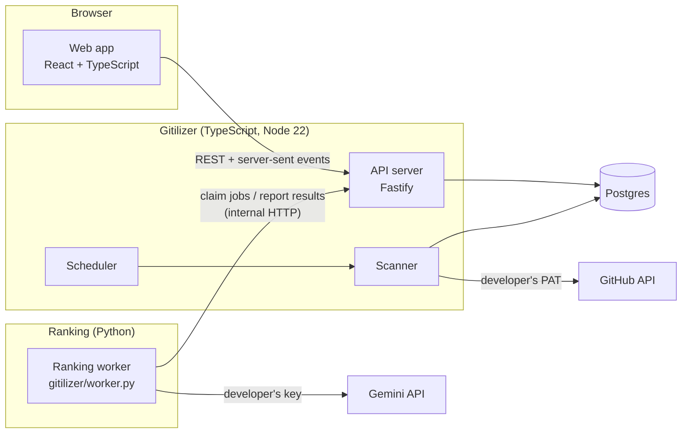

# Gitilizer design

| | |
|---|---|
| **Status** | Draft, with a working prototype of the end-to-end slice (see [Prototype status](#prototype-status)). The prototype follows the 2026-11-01 PRD except where [Changes from the 2026-11-01 PRD](#changes-from-the-2026-11-01-prd) says otherwise. |
| **Author** | brian@sweetapp.com (drafted with Claude) |
| **Last updated** | 2026-11-01 (answers to D-1 to D-4: live-update streams, a load balancer with its costs, `us-east4`, an OAuth app) |
| **Address** | [gitilizer.com](https://gitilizer.com) |
| **Google Cloud project** | `gitilizer` |
| **Source** | [github.com/brianquinlan/gitilizer](https://github.com/brianquinlan/gitilizer) |
| **Requirements** | [PRD](PRD.md) |
| **Design** | [Gitilizer Figma file](https://www.figma.com/design/J94JKJLNCcFUovvwfaFaqb/Gitilizer?node-id=0-1) |

This document explains how Gitilizer is built. It refers to requirements in the [PRD](PRD.md) by ID (for example `LIST-4`) and to the PRD's questions by number (for example [Q-28](PRD.md#q-28)). The decisions this design depends on are summarized in [PRD decisions](#prd-decisions). The PRD's one open question, [Q-78](PRD.md#q-78), came from building the prototype, which follows its suggested answer.

Questions about the design itself are marked the same way as in the PRD. **OPENQUESTION:** marks missing information. **CONFIRM:** marks a choice this design has made that the owner should confirm. Each links to a row in [Open questions](#open-questions), numbered D-1, D-2 and so on so they can't be confused with the PRD's.

## Contents

1. [Scope](#scope)
2. [PRD decisions](#prd-decisions)
3. [Architecture](#architecture)
4. [Reused code](#reused-code)
5. [Hosting on Google Cloud](#hosting-on-google-cloud)
6. [Sign-in and sessions](#sign-in-and-sessions)
7. [Repository layout](#repository-layout)
8. [Data model](#data-model)
9. [HTTP API](#http-api)
10. [Live updates](#live-updates)
11. [Web app](#web-app)
12. [Scanner](#scanner)
13. [Scheduler](#scheduler)
14. [Ranking worker](#ranking-worker)
15. [Notifications](#notifications)
16. [Security](#security)
17. [Scale](#scale)
18. [Testing](#testing)
19. [Prototype status](#prototype-status)
20. [Changes from the 2026-11-01 PRD](#changes-from-the-2026-11-01-prd)
21. [Findings from the prototype](#findings-from-the-prototype)
22. [Local development](#local-development)
23. [Open questions](#open-questions)

---

## Scope

The design covers the whole product in the PRD. The prototype implements an end-to-end slice of it (see [Prototype status](#prototype-status)): sign-in through a development stub, credentials and settings, scanning, ranking with the existing agent, the Prioritized list and Icebox with live updates, and notifications.

Not designed here: a full cost estimate for the hosting. The domain's cost is estimated in [Hosting on Google Cloud](#hosting-on-google-cloud); the live-update streams are the main cost risk, with polling as the fallback.

---

## PRD decisions

The product owner's answers to the PRD questions this design depends on. The PRD has the full list.

| PRD question | Decision |
|---|---|
| [Q-2](PRD.md#q-2) Scale | 10,000 developers with the app visible, up to 100,000 accounts, up to 1,000 items each (`NFR-1`). |
| [Q-1](PRD.md#q-1) Hosting | Google Cloud; best performance in North America and Western Europe; at most US$200 a month; served at `gitilizer.com`. |
| [Q-3](PRD.md#q-3) Metrics | Users, users who completed setup, daily/weekly/monthly actives (`METRIC-1`), and system health (`METRIC-3`). |
| [Q-8](PRD.md#q-8) Warm Welcome | Until both credentials have been entered once; afterwards, notifications. |
| [Q-9](PRD.md#q-9), [Q-11](PRD.md#q-11) Accounts and sessions | One account per sign-in provider account; 30-day sliding sessions; signing out ends only the current session (`AUTH-7` to `AUTH-9`). |
| [Q-17](PRD.md#q-17) Thresholds | Short-lived problems are retried for 15 minutes, then shown as warnings; stale-list error after 3 hours; expiry warning 7 days ahead. |
| [Q-21](PRD.md#q-21), [Q-65](PRD.md#q-65) Inclusion | Personal review requests, assigned, mentioned by name, created, commented on, additional repositories; drafts and bot items included; archived repositories, team reviews and team mentions excluded. |
| [Q-22](PRD.md#q-22), [Q-67](PRD.md#q-67) Reason precedence | Review requested, Assigned, @handle, Created, Commented, repository name. |
| [Q-27](PRD.md#q-27), [Q-66](PRD.md#q-66) List size | The 1,000 most recently updated items, Prioritized list only; no notice; dropped items slide off the bottom. |
| [Q-28](PRD.md#q-28), [Q-29](PRD.md#q-29) First sync and Sync now | Pulsing skeleton rows; unranked items hidden; failed items at the end with "–"; Sync now spins for any sync, is never disabled and isn't throttled. |
| [Q-35](PRD.md#q-35), [Q-72](PRD.md#q-72) Icebox return | A separate Icebox check prompt decides, leaning toward bringing items back. The developer can't see or change that prompt (`ICE-14`). |
| [Q-39](PRD.md#q-39), [Q-74](PRD.md#q-74) Model | Gitilizer chooses the models (`GITILIZER_MODELS`, default `gemini-3.8-flash,gemini-3.5-flash-lite,gemini-3.1-flash-lite`, the first being the primary) with the lowest thinking level each allows, for cost (`RANK-11`); Settings doesn't show it. |
| [Q-40](PRD.md#q-40) Token kinds | Fine-grained and classic tokens, one per developer; no organization permissions needed. |
| [Q-44](PRD.md#q-44) Default prompt | `prompts/v4.md`, at most 20,000 characters, new defaults followed automatically. |
| [Q-45](PRD.md#q-45), [Q-64](PRD.md#q-64), [Q-71](PRD.md#q-71) Saving | "Save changes", "Save and re-rank" and "Cancel"; both saves cover credentials; a successful save returns to the list; leaving with unsaved changes asks first. Cancel also returns to the list, or Warm Welcome before setup is complete (`NAV-9`). |
| [Q-46](PRD.md#q-46) Deletion | Immediate, after a simple confirmation; backups kept for 6 months (`PRIV-4`). |
| [Q-47](PRD.md#q-47) Background scans | Every 2 hours for developers seen in the last 7 days; otherwise only on the next visit. |
| [Q-48](PRD.md#q-48), [Q-49](PRD.md#q-49) Re-ranking | Every item re-ranked at least every 24 hours; a change also re-ranks the items it links to. |
| [Q-51](PRD.md#q-51) Concurrency | 4 Gemini calls at once per developer. |
| [Q-57](PRD.md#q-57) Additional repositories | "keep an eye on", not "responsible for"; the agent's wording changes to match (`SET-31`). |
| [Q-41](PRD.md#q-41) Repositories | `owner/name` or a GitHub URL; duplicates and bad formats are errors; at most 25; prioritization prompts up to 500 characters and not editable. Access states "Checking…", "Access confirmed", "Archived" and "Can't access", with the reason on hover (`SET-8`). |
| [Q-52](PRD.md#q-52), [Q-68](PRD.md#q-68) Item data | No privacy note in Settings; an item's data is deleted 30 days after no developer has it (`PRIV-5`). The documentation's privacy section covers storage, deletion and what is sent to Gemini (`FOOT-4`). |
| [Q-58](PRD.md#q-58), [Q-37](PRD.md#q-37), [Q-38](PRD.md#q-38) Validate | Checks the typed value; disabled when the field is empty, including for a saved credential; the result states in `SET-28`; saving doesn't validate (`SET-29`). |
| [Q-63](PRD.md#q-63), [Q-75](PRD.md#q-75) Free tier | Must work on the free tier, falling back through the models in `RANK-13` as each one's daily quota runs out; items waiting for quota shown at the end with "–"; one item per call; scores from different models share the list; the primary model's quota goes to new and changed items first; the backup-model warning shows for as long as a backup model is in use. |
| [Q-70](PRD.md#q-70) Alerts | Email alerts to the owner from Cloud Monitoring (`METRIC-4`). |
| [Q-73](PRD.md#q-73) Settings errors | Red border and a message under the field; saving disabled while errors show (`SET-27`). |
| [Q-50](PRD.md#q-50), [Q-53](PRD.md#q-53) to [Q-56](PRD.md#q-56) Other | Ties as in `RANK-4`; 2 s to a usable list, 100 ms sorts, 99.5% availability; latest two versions of Chrome, Edge, Firefox and Safari at 1024 px and wider, no touch; WCAG 2.2 AA; English and a light theme only. |

---

## Architecture



| Component | Language | Responsibility |
|---|---|---|
| Web app | TypeScript, React, Vite | All screens. Holds the developer's whole list in memory, so sorting and paging are instant (`LIST-10`, `LIST-13`), and applies live updates under the PRD's holding and animation rules. |
| API server | TypeScript, Fastify | Sign-in, sessions, settings, credentials, list queries, server-sent events, and the internal endpoints the ranking worker uses. |
| Scheduler | TypeScript | Decides when each developer is due a scan (`SCAN-5`, `SCAN-6`) from presence reported by the web app. |
| Scanner | TypeScript, Octokit | Finds items, fetches snapshots of new and changed items, detects removals, applies the 1,000-item limit, classifies GitHub errors into notifications, and queues ranking jobs. |
| Ranking worker | Python | Claims ranking jobs, scores each item with the existing agent (`gitilizer/prioritizer.py`, pointwise), reports scores and classified Gemini errors. Holds no state and no database connection. |
| Database | Postgres | All state. The job queue is a table (`rank_jobs`) claimed with `FOR UPDATE SKIP LOCKED`. |

**Why the worker talks HTTP instead of reading the database.** The worker is the part most likely to be rewritten (in TypeScript, or for another model provider). Keeping it behind four small HTTP endpoints means it needs no database driver or schema knowledge, can run anywhere that can reach the API, and can be replaced without touching the rest of the system.

**Why snapshots are fetched in TypeScript.** All GitHub access (and so all GitHub error handling and notifications) stays in one place, and the worker never sees the developer's PAT. The scanner produces snapshots in the same JSON format as `eval/fixtures/`, so the evaluation harness and the production worker read identical input. A contract test checks this ([Testing](#testing)).

In production the API server and the scheduler/scanner run as separate deployments of the same TypeScript package (`gitilizer-server api` and `gitilizer-server scanner`), so scanning load doesn't affect request latency. The prototype runs them in one process.

---

## Reused code

The backend reuses the ranking agent that already exists:

| Path | Used for |
|---|---|
| `gitilizer/prioritizer.py` | The agent. The worker uses `system_instruction()`, `GeminiLLM` and the `ItemAssessment` output schema (`actionable`, `next_action`, `priority`, `reasoning`). Scoring is *pointwise*: one call per item, so a change to one item re-scores only that item. |
| `gitilizer/context.py` | `build_context()` turns a snapshot into the text the agent reads, with derived signals (roles, who acted last, review state, mentions, draft state). `UserSettings` holds the login, additional repositories (still the `interested_repos` field, each `{repo, filter}`, where `filter` carries the prioritization prompt) and collaborators. Its `review_teams` field is always empty, because team reviews are out of scope ([Q-43](PRD.md#q-43)). |
| `prompts/v4.md` | The default ranking prompt. |
| `gitilizer/snapshot.py` | The snapshot format (schema version 2) that the TypeScript scanner reproduces. |
| `gitilizer/evaluate.py`, `eval/` | The evaluation harness and its 36 hand-ranked items. Any change to the default prompt or model is measured here first (PRD `RANK-7`). |

New Python code is `gitilizer/worker.py` and the Icebox check (`gitilizer/icebox_check.py`, with its prompt in `prompts/icebox_check_v1.md` and labelled examples in `eval/icebox/`; see [Ranking worker](#ranking-worker)). Adding another model provider means a new `LLM` implementation in the worker; nothing else changes, because the job tells the worker which model to use ([non-goals](PRD.md#non-goals)).

**Prompt changes the PRD now asks for.** Two changes to the agent's text, each measured with the evaluation harness before it ships (`RANK-7`):

- **Additional repositories mean "keep an eye on"** (`SET-31`). `prompts/v4.md` describes them as "repositories I am responsible for", where "I am the default reviewer", and the "About me" block written by `context.py` introduces them the same way. Both change to "repositories I follow", and the scoring that rewards "repositories I'm responsible for" moves to the per-repository prioritization prompt ("I'm responsible for this one"). The eval's ground truth (`eval/ground_truth.yaml`) assumed the old meaning, so some labels may need revisiting.
- **Drafts score lower** (`RANK-8`). v4 already scores the developer's own drafts at 0.15–0.35. Extend that to other people's draft PRs, whose review isn't wanted yet. `context.py` already exposes `draft`.

---

## Hosting on Google Cloud

Everything runs in the Google Cloud project `gitilizer`.

| Component | Google Cloud service | Notes |
|---|---|---|
| API server and web app | Cloud Run service | Serves the built web app as static files and the API at `https://gitilizer.com`. Server-sent events are ordinary long requests; Cloud Run ends a request after at most 60 minutes, and the browser's `EventSource` reconnects and replays from `Last-Event-ID`. |
| Scheduler and scanner | Cloud Run service with minimum 1 instance and always-allocated CPU | Same TypeScript package started as `scanner`. |
| Ranking worker | Cloud Run worker pool (or a service with always-allocated CPU) | Python; scales with the queue length. |
| Database | Cloud SQL for PostgreSQL | Smallest shared-core tier to start. Automated daily backups kept for 180 days (`PRIV-4`); Cloud SQL allows up to 365. |
| Secrets | Secret Manager for `WORKER_TOKEN` and the OAuth client secrets; Cloud KMS for the credential key | |
| Metrics (`METRIC-1`, `METRIC-2`) | Looker Studio dashboard on Cloud SQL, plus Cloud Monitoring for operations | User counts come from `users` and the `user_activity` table (one row per developer per day with a visit), so daily, weekly and monthly actives are available for past days. The internal `GET /internal/metrics` endpoint returns the same numbers. |

**Monitoring (`METRIC-3`, `NFR-6`).** Cloud Run already records request latency and response codes for every request, so API latency by endpoint and status codes for page loads and API calls come from Cloud Monitoring without extra code. Browser-side load time can't be seen from the server: the web app measures the time from navigation to a usable list (and the standard web vitals) and sends it to `POST /api/telemetry`, which writes it as a structured log line that a log-based metric turns into a distribution. Scan and ranking durations, and error and notification counts, are custom metrics from the scanner and worker. One Cloud Monitoring dashboard shows them all. Alerting policies email the owner (`METRIC-4`) when an uptime check on `https://gitilizer.com` fails, when more than 5% of API calls fail for 10 minutes, or when no scan has finished for 30 minutes.

**Region.** `us-east4` (Northern Virginia), decided in [D-3](#d-3). One region in the eastern United States is the best single choice for North America and Western Europe together (`PLAT-3`). A second region in Europe would double the fixed cost.

**Domain (`PLAT-5`).** `gitilizer.com` (the apex, with `www.gitilizer.com` redirecting to it) points at the API service. The OAuth redirect URLs ([Sign-in and sessions](#sign-in-and-sessions)) and the session cookie are tied to this domain, so preview deployments sign in with the development stub.

`gitilizer.com` reaches Cloud Run through a **global external Application Load Balancer** with a Google-managed certificate and a serverless network endpoint group for the API service, decided in [D-2](#d-2). It is Google's recommended way to put a custom domain in front of Cloud Run, and unlike Firebase Hosting it doesn't cut requests off at 60 seconds, which the live-update stream needs.

| Charge | Price | Estimate |
|---|---|---|
| Forwarding rules | US$0.025 an hour for the first 5 together | Two rules (HTTPS, and HTTP redirecting to HTTPS): about **US$18.25 a month**, whatever the traffic |
| Data processed | US$0.008 per GiB in, and per GiB out | A few cents a month for a few dozen developers; about **US$8–16 a month** at the scale in `NFR-1` (roughly 1–2 TiB, mostly presence reports, live-update keepalives and list downloads) |
| Google-managed certificate (Certificate Manager) | Free for the first 100 certificates in a project | US$0 |
| Serverless network endpoint group | No separate charge | US$0 |
| **Total** | | **About US$18–20 a month** at small scale, **about US$30–40 a month** at full scale |

Internet egress to browsers is charged the same with or without the load balancer, so it isn't counted here. Prices are from [Cloud Load Balancing pricing](https://cloud.google.com/load-balancing/pricing) and [Certificate Manager pricing](https://cloud.google.com/certificate-manager/pricing) as of 2026-11-01. The other options were a Cloud Run domain mapping (no cost, but a Preview feature that Google doesn't recommend for production) and Firebase Hosting (little or no cost, but its 60-second limit would make the live-update stream reconnect every minute).

**Budget (`PLAT-4`) is the main design risk.** US$200 a month has to cover Cloud SQL, the always-on scanner and worker, the domain, and enough API instances to hold 10,000 open event streams.

**Live-update streams stay, for now** ([D-1](#d-1)). The web app keeps one server-sent event stream open per tab ([Live updates](#live-updates)), which meets the 5-second target in `LIVE-23`.

> **Cost risk.** Cloud Run bills an instance for as long as a request is open, so 10,000 open streams keep API instances running all the time. The streams are mostly idle, but an instance holds at most 1,000 requests at once (Cloud Run's concurrency limit), so 10,000 tabs need at least 10 instances running around the clock. This may be the largest single cost. If it does, the fallback is polling: the web app asks `GET /api/list?since={version}` every 15–30 seconds, the stream and its keepalives go away, and instances run only while answering. Polling still updates the list without a page reload, but changes take up to 30 seconds to appear, so `LIVE-23` would have to change. Only the transport changes: the browser's update rules ([Live updates](#live-updates)) stay the same.

---

## Sign-in and sessions

| | Google | GitHub |
|---|---|---|
| Protocol | OpenID Connect, authorization code flow with PKCE | OAuth app (not a GitHub App), authorization code flow with PKCE |
| Scopes | `openid email profile` | `user:email` only, to read a private primary email. No repository scopes (`AUTH-5`). |
| Redirect URL | `https://gitilizer.com/api/auth/google/callback` | `https://gitilizer.com/api/auth/github/callback` |
| Account key | `sub` | Numeric user `id` |

GitHub sign-in uses an OAuth app with only the `user:email` scope, decided in [D-4](#d-4). GitHub now recommends GitHub Apps for new integrations, and a GitHub App can also sign people in, but its user tokens expire after 8 hours and it adds an app installation concept that sign-in doesn't need. Since Gitilizer discards the token right after sign-in and never uses it to read items (`AUTH-5`), the simpler OAuth app is enough.

- **Accounts (`AUTH-3`, `AUTH-7`).** `users` has a unique index on `(provider, provider_user_id)`. Email is stored for display only and is never used to merge accounts, so the same person signing in with both providers gets two accounts. `METRIC-1` counts them as two users.
- **Provider tokens.** The callback reads the profile (name, email, avatar) and then discards the provider's tokens. Gitilizer keeps no Google or GitHub sign-in token, which is why revoking access at the provider doesn't sign the developer out ([Q-11](PRD.md#q-11)).
- **Sessions (`AUTH-8`).** A random 32-byte session ID in a `__Host-gitilizer_session` cookie (`HttpOnly`, `Secure`, `SameSite=Lax`, no `Domain`). `sessions.expires_at` is 30 days after the last use; to avoid a write on every request, it is pushed forward only when less than 29 days remain, so at most once a day.
- **Sign out (`ACCT-3`, `AUTH-9`).** Deletes the current session row only. Deleting the account deletes every session.
- **Failed sign-in (`AUTH-10` to `AUTH-14`).** The callback sorts every failure into one of four categories and redirects to `/sign-in?error={cancelled|provider_unavailable|expired|gitilizer_error}`:
  - `cancelled`: the provider returned `error=access_denied`;
  - `provider_unavailable`: the provider returned `server_error` or `temporarily_unavailable`, or the code exchange or profile request timed out or returned 5xx;
  - `expired`: the `state` value is missing, unknown or older than 10 minutes, or the PKCE verifier cookie is missing (often blocked cookies);
  - `gitilizer_error`: anything else, including other provider error codes and Gitilizer's own failures.

  The provider's `error`, `error_description` and `error_uri`, and any exception, are logged with the category; none of them reach the page. The sign-in page reads `error`, shows the matching message in the notice above the buttons (grey for `cancelled`, red for the others, `AUTH-15`), and removes the parameter with `history.replaceState`, so a reload shows the plain page (`AUTH-13`). An unknown value is treated as `gitilizer_error`.

---

## Repository layout

```
gitilizer2/
├── docs/                 PRD.md, design.md, local-development.md, and the user documentation (FOOT-3, FOOT-4)
├── scripts/local.mjs     npm run local: the whole app on one computer (Local development)
├── .local/               local mode's databases and keys (gitignored)
├── gitilizer/            Python: agent, eval harness, and worker.py (new)
├── prompts/              ranking prompts; v4.md is the default
├── eval/                 eval set and fixtures
├── tests/                Python tests
├── package.json          npm workspaces root
└── app/
    ├── shared/           types and zod schemas used by server and web
    ├── server/           API, scheduler, scanner
    └── web/              React app
```

The footer's "Documentation" link (`FOOT-2`) points at the user documentation in `docs/` on GitHub, for example `docs/user-guide.md`. It has to be written before launch (`FOOT-3`), including the token instructions from [Q-40](PRD.md#q-40).

---

## Data model

Postgres. Times are `timestamptz`. IDs are text UUIDs unless stated.

| Table | Key columns | Notes |
|---|---|---|
| `users` | `id`, `provider`, `provider_user_id`, `name`, `email`, `avatar_url`, `github_login`, `created_at`, `last_seen_at`, `setup_completed_at`, `ranking_paused_until` | Unique on `(provider, provider_user_id)` (`AUTH-7`). `github_login` comes from the PAT (`GET /user`), not from sign-in (`AUTH-5`). `last_seen_at` drives [Q-47](PRD.md#q-47). `setup_completed_at` decides Warm Welcome ([Q-8](PRD.md#q-8)). |
| `user_activity` | `user_id`, `day` | One row per developer per day with a visit, for `METRIC-1`. |
| `sessions` | `id` (random 32 bytes, base64url), `user_id`, `expires_at` | Sliding 30-day expiry ([Sign-in and sessions](#sign-in-and-sessions)). |
| `credentials` | `user_id`, `kind` (`github_pat`, `gemini_key`), `ciphertext`, `nonce`, `expires_at`, `token_login`, `token_type` | AES-256-GCM ([Security](#security)). Saved without being checked (`SET-29`). `expires_at` from GitHub's `GitHub-Authentication-Token-Expiration` header (`SET-6`). The scanner fills in `token_login` (the PAT's account) and `token_type` (`classic` or `fine-grained`, from the token's prefix). The status chip (`SET-30`) isn't stored: it comes from the shown notifications. |
| `settings` | `user_id`, `custom_prompt` (null = default), `sort_prioritized`, `sort_icebox` | |
| `additional_repos` | `user_id`, `full_name`, `prioritization_prompt`, `access` (`checking`, `ok`, `not_found`, `sso_required`, `token_type_blocked`, `archived`), `position` | `access` drives the state and hover text in `SET-8`. Called `interested_repos`, with a `filter` column, in the prototype. |
| `collaborators` | `user_id`, `login`, `status` (`ok`, `not_found`, `unknown`), `avatar_url`, `checked_at`, `position` | Added without a check (`SET-18`); the scanner looks each one up (`GET /users/{login}`) and records the result for `SET-19`. |
| `items` | `key` (`owner/repo#number`), `kind`, `title`, `html_url`, `state`, `draft`, `archived`, `updated_at`, `snapshot` (jsonb), `snapshot_fetched_at` | Shared by every developer who has the item; `PRIV-3` limits retention. |
| `user_items` | `user_id`, `item_key`, `reasons` (text[]: `review_requested`, `assigned`, `mentioned`, `created`, `commented`, `additional_repo`), `mention_handle`, `status` (`active`, `iceboxed`, `gone`), `iceboxed_at`, `score`, `actionable`, `next_action`, `reasoning`, `ranked_at`, `ranked_model`, `ranked_updated_at`, `rank_error`, `gone_reason`, `gone_at` | One row per developer and item. **Rank is not stored**: it is the position when active items are ordered by `score DESC, items.updated_at DESC, item_key` (`RANK-3`, `RANK-4`). Storing ranks would mean rewriting many rows whenever one item moves. `gone_reason` is `closed`, `merged`, `no_longer_matches` or `over_limit` (`LIST-19`); `gone_at` starts the 30 days in `PRIV-5`. |
| `scans` | `user_id`, `started_at`, `finished_at`, `kind` (`full`, `incremental`), `trigger`, `outcome`, `error_code` | One running scan per developer (`SCAN-4`), enforced by a partial unique index on unfinished rows. |
| `rank_jobs` | `id`, `user_id`, `item_key`, `kind` (`rank`, `icebox_check`), `reason` (`new`, `changed`, `linked`, `rerank`, `ageing`, `restore`), `priority`, `batch_id`, `state` (`queued`, `leased`, `done`, `failed`), `lease_expires_at`, `attempts`, `model`, `item_updated_at` | One open job per developer, item and kind (unique index on queued and leased rows), so repeated changes coalesce; a more urgent job takes over a queued bulk one and leaves its batch. `batch_id` groups the jobs of one bulk re-rank (`LIVE-24`). `priority` orders the queue when quota is short ([Ranking worker](#ranking-worker)). `item_updated_at` is the item's `updated_at` when the job was claimed; it becomes `ranked_updated_at`, so a change made while the job runs is ranked again by the next scan. |
| `rank_batches` | `id`, `user_id`, `reason` (`first_sync`, `rerank`, `ageing`), `created_at`, `finished_at` | One row per bulk re-rank (`LIVE-24`). When its last job is done or failed, a `rerank` or `ageing` batch publishes every row at once; a `first_sync` batch publishes as it goes. |
| `notifications` | `user_id`, `code`, `subject` (org, repo or empty), `params` (jsonb), `first_detected_at`, `shown`, `seen_at` | Severity comes from `code`. For short-lived codes, `first_detected_at` is when the problem started and `shown` flips after 15 minutes (`NOTIF-21`). `seen_at` is set when the developer opens the popover (`NOTIF-17`). |
| `list_versions` | `user_id`, `version` (bigint) | Incremented on every change to the developer's list; carried in every live-update event. |
| `gemini_quota` | `user_id`, `model`, `exhausted_until` | Set when Gemini reports a per-day quota for that model (`RANK-13`): `exhausted_until` is the next midnight Pacific time, or the time the error gives. The model used for a job is the first in `GITILIZER_MODELS` that isn't exhausted. Quotas belong to the key's Google Cloud project, so the rows are cleared when a new key is saved. |
| `deleted_users` | `id`, `deleted_at` | Only the IDs of deleted accounts. After a backup is restored, every account in this table deleted after the backup was taken is deleted again (`PRIV-4`). The table itself must be copied out before the restore and put back afterwards. |

---

## HTTP API

JSON over HTTPS. Every request and response body is defined by a zod schema in `app/shared`, used for validation on the server and for types in the web app. Browser endpoints need the session cookie; internal endpoints need `Authorization: Bearer $WORKER_TOKEN`.

| Method and path | Purpose |
|---|---|
| `GET /api/auth/{google,github}/start`, `GET /api/auth/{google,github}/callback` | Sign-in ([Sign-in and sessions](#sign-in-and-sessions)). |
| `POST /api/auth/dev` | Development and preview deployments only: sign in as a named test user. |
| `POST /api/auth/logout` | "Sign out" (`ACCT-3`). Ends the current session. |
| `GET /api/me` | Account, which screen to show (`NAV-1`), whether the first sync has finished. |
| `GET /api/list` | Every active, iceboxed and recently gone item for the developer, plus `version`. The web app sorts and pages locally. |
| `POST /api/items/icebox`, `POST /api/items/restore` | `LIST-18`, `ICE-5`. Body `{ key }` (keys contain `/` and `#`, so they aren't path segments). Return the new `version`. |
| `POST /api/sync` | `LIST-16`. Always returns 202; a request while a sync runs joins it (`LIST-28`). |
| `POST /api/presence` | `{ visible: boolean }` from each tab on load, on `visibilitychange` and every 60 s ([Scheduler](#scheduler)). |
| `GET /api/events` | Server-sent events ([Live updates](#live-updates)). |
| `GET /api/notifications` | Shown notifications, with `seen`. |
| `POST /api/notifications/seen` | The popover was opened: sets `seen_at` on every shown notification, which stops the bell swinging on all of the developer's devices (`NOTIF-17`). |
| `GET /api/settings`, `PUT /api/settings` | Additional repositories with prioritization prompts, collaborators with their status and avatar, ranking prompt, sort preferences. `PUT` takes everything on the page, `{ …, credentials?: { github_pat?, gemini_key? }, rerank: boolean }`: "Save changes" sends `rerank: false`, "Save and re-rank" sends `true`, which queues a full re-rank (`SET-15`). Credentials are stored without being validated (`SET-29`). Returns per-field errors for anything that breaks the rules in `SET-27`, which keep the developer on Settings (`NAV-8`). |
| `PUT /api/sort` | Saves one view's sort order (`LIST-9`). |
| `POST /api/repos/check`, `POST /api/collaborators/check` | Look up a repository (`{ access, fullName, tokenType }`) or a collaborator (`{ status, avatarUrl }`) as soon as it is added in Settings, before saving, with the saved PAT. Nothing is stored; the scan after saving records the same results ([D-6](#d-6)). |
| `POST /api/credentials/:kind/check` | Check a typed value without saving it (`SET-2`, `SET-28`). Returns `{ ok, code, login?, expires_at?, permission? }`, where `code` selects the message. For a GitHub token: `GET /user` (login, expiry header) and one search, which shows a missing permission through `X-Accepted-GitHub-Permissions`. For a Gemini key: `GET /v1beta/models/{model}`, which checks the key and access to the model without using the developer's request quota. |
| `DELETE /api/account` | `SET-17`. Sent after the confirmation dialog; requires `{ confirm: true }` so a stray request can't delete an account. |
| `POST /api/telemetry` | Browser timings for `METRIC-3` (time to a usable list, web vitals). Accepts small JSON bodies only, rate-limited per session. |
| `POST /internal/rank-jobs/claim` | Worker: lease up to N jobs. |
| `POST /internal/rank-jobs/:id/result` | Worker: report a score. |
| `POST /internal/rank-jobs/:id/error` | Worker: report a classified failure. |
| `GET /internal/metrics` | `METRIC-1` counts. |
| `POST /api/dev/fixtures/touch`, `…/close`, `POST /api/dev/notify` | Fixture mode only: simulate GitHub activity, a closed item or a notification. |

---

## Live updates

The server pushes changes; the web app decides when to show them.

**Transport.** Server-sent events on `GET /api/events`. They are one-way, work through proxies and reconnect automatically, which is all the list needs. Each event carries the developer's list `version`:

| Event | Payload |
|---|---|
| `list` | `{ version, bulk: boolean, upserts: ItemRow[], removals: { key, reason }[] }`, where `reason` is `closed`, `merged`, `iceboxed`, `restored`, `no_longer_matches` or `over_limit`. |
| `notifications` | The full list of shown notifications. |
| `sync` | `{ running: boolean, lastFinishedAt }`, for the Sync now button (`LIST-17`). |

The browser sends `Last-Event-ID` on reconnect. If the server can't replay from that version (the gap is too old, or the server restarted), it sends `{ resync: true }` and the web app fetches `GET /api/list` again. With one API process the event fan-out is in memory; with several, the API servers subscribe to Postgres `LISTEN/NOTIFY` on channel `list_<user_id>`. A ranked change is published as soon as its result is stored, which keeps within the 5-second target (`LIVE-23`).

**Bulk re-ranks (`LIVE-24`).** The first sync, "Save and re-rank" and the daily ageing pass queue their jobs with one `batch_id`. Results with a `batch_id` are stored but not published one by one. When the batch's last job is done or failed, the server sends one `list` event with `bulk: true` and every changed row. Changes caused by GitHub activity during the batch still publish normally. The first sync is the exception: its rows are published as they are ranked, so the table fills in (`LIST-15`), but with `bulk: true`, so they appear without indicators.

**Applying updates in the browser.** `app/web/src/live/` holds a pure, unit-tested state machine with two lists: `shown` (what is on screen) and `latest` (the server's current state). Incoming events update `latest` and append to a queue. A separate controller drains the queue under the PRD's rules:

- hold while the pointer is over the table, until it has been outside for 1 s (`LIVE-4`); while focus is in the table (`LIVE-5`); while the tab is hidden or the Icebox is shown (`LIVE-6`);
- the developer's own actions skip the queue and apply to both lists at once (`LIVE-7`);
- play one queued change at a time, 0.4 s each (`LIVE-8`); more than 5 waiting play as one step (`LIVE-9`); a `bulk` event always plays as one step, without indicators (`LIVE-24`);
- after each step, compute the rows on the current page from `shown`, which keeps every page except the last full (`LIVE-3`), and move to the last page if the current one no longer exists (`LIVE-2`);
- compare each visible row's rank before and after to produce the "↑5", "↓3" and "New" indicators for 3 s (`LIVE-18`);
- show the leave label for each removal reason (`LIVE-25`): `closed` → "Closed", `merged` → "Merged", `iceboxed` → "Moved to Icebox", `no_longer_matches` → "No longer yours"; an `over_limit` removal has no label and animates like a move to a later page (`LIVE-26`).

Animation uses the FLIP technique on table rows (measure, apply the new order, animate the difference). With reduced motion it is replaced by a 150 ms cross-fade (`LIVE-22`). The Icebox uses the same leave animation, without the holding rules (`ICE-9`).

---

## Web app

React 18 with Vite. No component library: the Figma file is the design system, so colors, type and spacing are CSS custom properties taken from it (Inter, accent `#315BDE`, error `#B74439`, warning `#D4A017`, borders `#E2E6EB`). Routes follow `NAV-3`.

The app keeps one store per signed-in developer: the account, the full item list, notifications and sync state, fed by `GET /api/me`, `GET /api/list` and the event stream. Screens are thin views over that store. "Can't connect to Gitilizer" (`NOTIF-12`) is raised by the store when the event stream has been disconnected for 30 s and `GET /api/me` fails.

Details that need more than markup:

- **Ranks** are plain numbers, never padded ([Columns](PRD.md#columns)).
- **Repository names cut off at the start** (`LIST-23`). The cell uses `direction: rtl; text-align: left; white-space: nowrap; overflow: hidden; text-overflow: ellipsis`, with a left-to-right mark appended to the name so trailing punctuation stays in place, and `title` holds the full name. Titles are cut off at the end in the usual way.
- **Settings links** (`NOTIF-9`, `LIST-14`). Every control that can fix a problem has a stable `id` (`github-pat`, `gemini-key`, `add-repository`, `repo-{owner}-{name}`, `ranking-prompt`, and so on). Each notification carries its target `id`, its Settings link goes to `/settings#{id}`, and Settings scrolls to that element and focuses it. The section fragments (`#connections` and the rest) work the same way.
- **Bell.** Swings while any shown error has no `seen_at`; opening the popover calls `POST /api/notifications/seen` (`NOTIF-17`). Amber and still when there are only warnings (`NOTIF-5`).
- **Sync now** is never disabled, and spins whenever the `sync` event says `running` (`LIST-17`, `LIST-28`).
- **Saving Settings.** A successful save navigates to `/` (`NAV-8`); per-field errors keep the page open and are shown under their fields, and the save buttons are disabled while any error shows (`SET-27`). Duplicate and format checks run in the browser as well, so most errors appear before saving. "Cancel" discards changes and also navigates to `/` (`NAV-9`). Leaving with unsaved changes asks first, through the router and `beforeunload` (`SET-26`).
- **Checking what was just added.** A repository or collaborator is looked up as soon as it is added, so its access state or avatar shows before saving.

  > **CONFIRM: [D-6](#d-6)** Two check endpoints use the saved PAT and store nothing; the scan after saving records the same results. Without a saved PAT the row shows "Checking…" until then.

- **Credentials.** Saved credentials are shown as dots; "Validate" is disabled until something is typed, and the eye icon shows only typed text (`SET-21`).
- **Account menu.** Closes on a click outside, on Esc and when an item is chosen (`ACCT-4`). The action is "Sign out" everywhere (`ACCT-5`).
- **Delete account.** A simple confirmation dialog, then `DELETE /api/account` and a redirect to `/sign-in` (`SET-17`).
- **Screens and browsers.** Layouts are for 1024 px and wider; there are no touch handlers (`PLAT-6`). Everything meets WCAG 2.2 AA (`NFR-10`); the Playwright run includes an automated accessibility check.
- **First sync.** Three skeleton rows whose placeholders pulse with a CSS opacity animation (0.8 s each way), turned off under `prefers-reduced-motion` (`LIST-15`).

---

## Scanner

There are two kinds of scan. A **full** scan reads every matching item and can detect every kind of removal. An **incremental** scan reads only what changed since the last scan, which usually takes one request per search. The scheduler decides which to run ([Scheduler](#scheduler)).

A scan for one developer:

1. **Load context.** Decrypt the PAT. Refresh `github_login` if it is older than a day, and look up any collaborator whose status is older than a day.
2. **Discover.** Run these GitHub searches. Each is sorted by `updated` (newest first) and reads 100 results per page:
   - `is:open archived:false user-review-requested:{login}` (personal review requests only; no team requests, [Q-43](PRD.md#q-43));
   - `is:open archived:false` with each of `assignee:{login}`, `mentions:{login}`, `author:{login}` and `commenter:{login}`;
   - `is:open archived:false repo:{owner}/{name}` for each additional repository. Before the search, `GET /repos/{owner}/{name}` checks access (`SET-8`): a 404 means `not_found`, a 403 with `X-GitHub-SSO` means `sso_required`, a 403 naming the token type means `token_type_blocked`, and `archived: true` means `archived`. GitHub follows renames, so the response's `full_name` replaces the stored name, which keeps `repo:` searches working.

   > **CONFIRM: [D-7](#d-7)** A search can answer `X-GitHub-SSO: partial-results; organizations={ids}`, naming organizations only by ID. The suggestion is to look the names up with `GET /organizations/{id}` for the "Your token isn't authorized for {org}" notification. The prototype doesn't handle this header yet.

   Each result contributes a reason to that item. Team mentions (`team:`) are not searched ([Q-65](PRD.md#q-65)). For mentions the scanner records the handle `@{login}`, or none ("@-mentioned") when it can't tell.

   - **Full scan:** each search reads until it runs out of results or has read 1,000. That is always enough: any item among the developer's 1,000 most recently updated is among the first 1,000 results of every search it matches (`SCAN-1`). No search is ever split.
   - **Incremental scan:** the same searches without `is:open`, plus `updated:>={since}`, where `since` is the start of the last successful scan minus 2 minutes. Because closing an item updates it, closed and merged items show up here too. Paging stops at the first result older than `since`.
3. **Apply the limit (`LIST-19`).** Merge the results with the developer's current active items, order by `updated_at` (newest first) and keep the first 1,000. Icebox items don't count (`LIST-19`).
4. **Diff.** Compare with the developer's `user_items`:
   - not seen before, and within the limit → insert, fetch a snapshot, queue a `new` job;
   - `updated_at` later than `ranked_updated_at` → fetch a snapshot, queue a `changed` job;
   - closed or merged (seen in an incremental scan, or checked directly with `GET /repos/{o}/{r}/issues/{n}` after a full scan) → `gone` with reason `closed` or `merged`;
   - pushed past the 1,000 → `gone` with reason `over_limit`;
   - previously active, still open, but not found by a full scan → `gone` with reason `no_longer_matches`. Only a full scan can tell this (an unassignment, a removed repository, an archived repository).
5. **Icebox (`ICE-6`, `ICE-11`).** An iceboxed item that changed gets an `icebox_check` job, not a ranking job ([Ranking worker](#ranking-worker)). An iceboxed item that is closed, merged or no longer matches is removed from the Icebox.
   **Linked items (`RANK-10`).** For each changed item, the scanner reads the issues and PRs its snapshot links to (closing references, cross-references and the PR stack) and queues a `linked` ranking job for each one that is active in the developer's list and wasn't itself changed.
6. **Snapshot.** A TypeScript port of `gitilizer/snapshot.py`, producing schema version 2 with the same keys, plus two limits the Python version lacks:
   - the PRs stacked *above* are looked up only when the head branch is in the same repository, which fixes the bug that made `dart-lang/http#579` a 20 MB snapshot ([Findings](#findings-from-the-prototype));
   - `timeline`, `comments` and `files` are capped (first 50 and last 250 entries), with a `fetch_warnings` entry when they are cut.

   Snapshots are stored once per item and reused for every developer who has it, while younger than the item's `updated_at`.
7. **Finish.** Record the scan. Clear notifications whose condition is gone; raise or keep those observed ([Notifications](#notifications)).

**Search budget.** GitHub's search allows 30 requests a minute per token. A full scan makes about 5 + (number of additional repositories) searches, plus a page for every further 100 results, up to 10 pages per search. An incremental scan usually makes one request per search. Full scans therefore run less often (see [Scheduler](#scheduler)), and a full scan that would go over the limit waits for the next minute rather than failing.

**Octokit.** `@octokit/core` with the `paginate-rest`, `retry` and `throttling` plugins. The throttling plugin retries secondary rate limits; primary rate limits end the scan with `rate_limited` and a `reset_at`, which the scheduler respects.

---

## Scheduler

Each web app tab reports presence (`POST /api/presence`) on load, on every `visibilitychange` and every 60 s. A developer is **visible** if any tab reported `visible: true` within the last 90 s, and **open** if any tab reported anything within that time.

| State | Interval (`SCAN-5`) |
|---|---|
| Visible | 5 minutes |
| Open, not visible | 30 minutes |
| Neither | 2 hours for developers seen in the last 7 days; otherwise none until the next visit (`SCAN-5`) |

A scan is **full** if it is the developer's first, if Sync now or saving Settings started it, or if the last full scan finished more than 1 hour ago; otherwise it is **incremental**. Removals that only a full scan can see (`no_longer_matches`) therefore reach the list within about an hour, or at once after Sync now.

> **CONFIRM: [D-5](#d-5)** A full scan at most once an hour, with incremental scans in between. More often makes "No longer yours" removals appear sooner, but a full scan can use many of the 30 search requests a minute that GitHub allows each token, which other tools using the same token share.

A Sync now or a save while an incremental scan is running joins it (`SCAN-4`), and a full scan follows as soon as it finishes.

A presence report that changes the developer to visible starts a scan at once if the last one finished more than 5 minutes ago (`SCAN-6`). The scheduler loop runs every 10 s: `SELECT … WHERE next_scan_at <= now() … FOR UPDATE SKIP LOCKED LIMIT n`, so several scanner processes can share the work. A daily pass queues an `ageing` batch for every active item not ranked in the last 24 hours (`RANK-9`).

---

## Ranking worker

`gitilizer/worker.py` is a long-running Python process. It needs `GITILIZER_API` and `WORKER_TOKEN`, nothing else.

```
loop:
  jobs = POST /internal/rank-jobs/claim {max: 8, lease_seconds: 120}
  for each job (4 at a time per developer):
      settings = job.user              # UserSettings: login, additional repos + prioritization prompts, collaborators
      guidance = job.prompt or prompts/v4.md
      item     = Item(id, job.snapshot)
      scored   = prioritize([item], settings, "pointwise", GeminiLLM(api_key=job.gemini_key, model=job.model), guidance, now=job.now)
      POST …/result {priority, actionable, next_action, reasoning, usage}
      or  POST …/error {code, message, retry_after}
```

A claim response carries everything needed for one item: the snapshot, the developer's settings, the custom prompt (or null), the Gemini key and the model. The key is sent over the internal network only, and only to the worker; see [Security](#security). Ranking uses the lowest thinking level the model allows (`RANK-11`).

**Icebox check (`ICE-6`, `ICE-12`).** An `icebox_check` job carries the snapshot and the time the item was iceboxed. The worker sends a short, fixed prompt (`prompts/icebox_check_v1.md`) that describes what happened since then and asks whether it should bring the item back, with the output `{ bring_back: boolean, reason: string }`. The prompt tells the agent to answer yes unless the change is clearly unimportant (a bot's comment, a label or milestone edit, a CI result), and to treat the developer's own changes like anyone else's. Only the events since the item was iceboxed are sent, so the call is small. On `bring_back: true`, or if the job fails after its retries, the server makes the item active again and queues a `changed` ranking job. On `false`, the item stays in the Icebox and `ranked_updated_at` is advanced. Changes to the prompt are measured against the labelled examples in `eval/icebox/` (`ICE-13`).

**Spending quota well (`RANK-12` to `RANK-16`).** The claim query takes a developer's jobs in this order: Icebox checks, then `new` and `changed` items (most recently updated first), then `linked`, then `rerank` and `ageing` batches, so the primary model's small quota goes to the work most likely to matter (`RANK-17`). Each claim response names the model to use: the first in `GITILIZER_MODELS` without a current `gemini_quota` row. The score is stored with that model (`ranked_model`, `RANK-16`).

**Running out of quota.** The worker reads the `quotaId` in each 429's error details. A per-minute quota (`…PerMinute…`) means wait and retry on the same model (`RANK-14`). A per-day quota (`…PerDay…`) is reported as `daily_quota` with the model: the server writes a `gemini_quota` row and puts the job back in the queue, and the next claim gets the next model. While the primary model is exhausted and a backup isn't, the server raises the `gemini_backup_model` warning naming the model in use. When every model is exhausted, it pauses the developer's queue until the earliest reset and raises the `gemini_daily_quota` error. At reset, the rows expire, the next claim gets the primary model again and both notifications clear. Items still waiting are shown at the end of the list with "–" (`LIST-30`). Every call scores one item (`RANK-18`).

**Error codes.** The worker classifies every Gemini failure, using the status codes in the PRD's catalogue: `key_invalid`, `key_leaked`, `permission_denied`, `credits_exhausted`, `billing_required`, `daily_quota`, `rate_limited`, `unavailable`, `model_not_found`, `blocked` (safety, recitation), `invalid_output`, `unknown`. Key-level codes (`key_*`, `permission_denied`, `credits_exhausted`, `billing_required`, `model_not_found`) make the server pause that developer's other jobs until the key changes or `retry_after` passes, instead of failing every item one by one. `daily_quota` is per model and handled as above.

**Leases.** A claimed job is leased for 120 s. If no result arrives, it returns to the queue; after 3 attempts it is marked failed and the item shows "–" ([Q-28](PRD.md#q-28)).

---

## Notifications

Each catalogue row in the PRD has a `code`, and each code has a fixed severity. The scanner and the worker report observations (`raise(code, subject, params)` and `clear(code, subject)`); the notification service stores them:

- a **persistent** problem (invalid token, leaked key) is shown at once, as an error;
- a **short-lived** problem (`github_rate_limited`, `github_unavailable`, `gemini_rate_limited`, `gemini_unavailable`) is stored with `first_detected_at` and shown only after 15 minutes, as a **warning** (`NOTIF-21`). The popover shows `first_detected_at`, so a warning that has just appeared says "15 min ago";
- saving a credential clears every notification with that credential's codes immediately (`NOTIF-13`);
- the stale-list check ("Your issues haven't updated since {time}", 3 hours) and the PAT expiry warning (7 days ahead, `NOTIF-22`) run in the scheduler loop;
- every notification carries the `id` of the Settings control that fixes it, for the link in its body (`NOTIF-9`).

`gemini_backup_model` is a warning naming the model in use, and `gemini_daily_quota` is an error raised only when every model is exhausted; both give the reset time and the time left (`RANK-13`, `RANK-15`). The codes added in the third PRD revision are `github_permission_missing`, `github_sso_required`, `github_unexpected`, `repo_inaccessible`, `gemini_permission_denied`, `gemini_model_unavailable`, `gemini_unexpected`, `items_unranked` (a warning) and `scan_failed`. A collaborator who doesn't exist is not a notification; Settings shows it (`SET-19`).

Changes are pushed to the browser as `notifications` events.

---

## Security

- **Credentials.** AES-256-GCM, with a random 96-bit nonce per value and the user ID as associated data, so a ciphertext can't be moved to another user. The key-encryption key comes from `CREDENTIAL_KEY` (32 bytes, base64) in the prototype and from a cloud KMS in production. Values are decrypted only in the scanner (PAT) and when building a claim response (Gemini key) (`PRIV-1`).
- **Tokens that can write.** A classic PAT with the `repo` scope can write to every repository the developer can reach ([Q-40](PRD.md#q-40)). Gitilizer only ever sends `GET` requests and searches with it, and the Octokit wrapper rejects any other method, so a bug can't turn into a write.
- **Worker channel.** The internal endpoints are on a separate port that isn't exposed to the internet, need a bearer token, and must use TLS between hosts.
- **Sessions.** See [Sign-in and sessions](#sign-in-and-sessions). State-changing requests also need an `X-Gitilizer: 1` header, which a cross-site form can't send.
- **Logging.** Request logging redacts `authorization`, cookies and credential bodies.

---

## Scale

At 10,000 visible developers scanning every 5 minutes there are about **33 scans a second**, most of them incremental. An incremental scan makes about 5–25 GitHub search calls with the developer's own token, usually one page each, plus 10–20 calls per changed item. GitHub limits are per token, so they don't add up across developers. Gitilizer's own load is:

| Load | Estimate | Handled by |
|---|---|---|
| Scan jobs | ~33 a second, mostly waiting on GitHub | Scanner processes; ~200 concurrent scans each |
| Snapshot writes | Only changed items; typically 0–3 per scan | Postgres; snapshots are deduplicated across developers |
| Ranking | One Gemini call per changed item | Worker processes; Gemini limits are per developer key |
| Event streams | 10,000+ open connections | 2–4 API processes; Node handles tens of thousands of idle SSE connections each |
| Storage | 100,000 accounts × up to 1,000 items (`LIST-19`), typical snapshot 100 KB, heavily shared | Up to about a hundred GB of snapshots; move snapshots to object storage if Postgres size becomes a problem |

---

## Testing

| Layer | What | Tool |
|---|---|---|
| Live-update state machine | Every PRD case: holding, pairs, page disappearing, batching above 5, bulk re-ranks, indicators, other sort orders | Vitest, pure functions |
| Scanner | Discovery, the 1,000-item limit, full and incremental scans, removal reasons, the Icebox return rule, against a fake GitHub | Vitest |
| Snapshot contract | The TypeScript snapshotter's output for a recorded item has the same shape as the Python one, and `build_context()` accepts it | Python test over a TypeScript-produced file |
| Worker | Claim/result loop, Gemini error classification, queue order when quota is short, the Icebox check's handling of failures | pytest with fakes |
| Icebox check quality | Labelled examples of changes to iceboxed items, each marked "bring back" or "keep", in `eval/icebox/`. The harness reports how many "bring back" cases were missed, which matters more than false returns (`ICE-12`). | New, alongside the existing harness |
| End to end | **Fixture mode**: `GITHUB_MODE=fixtures` serves `eval/fixtures/` as the developer's GitHub, and `--fake-llm` scores without Gemini. The web app, API, scanner and worker run together with no external access. | Playwright |
| Ranking quality | Unchanged: `python -m gitilizer.evaluate`. Run before and after the prompt changes in [Reused code](#reused-code). | Existing harness |

---

## Prototype status

The prototype implements the slice end to end, following the PRD as revised on 2026-11-01. It runs on one machine with no external services in **fixture mode**: `eval/fixtures/` stands in for GitHub (as @brianquinlan, with search qualifiers, sorting and `updated:>=` evaluated against the snapshots), and a fake model gives deterministic scores and Icebox answers. Drop `--fixtures` and `--fake-llm` to use real GitHub and Gemini. [local-development.md](local-development.md) explains how to run it.

| Area | Status |
|---|---|
| Sign-in | Development stub only ("Continue with Google/GitHub" both open it). No OAuth. The sign-in page shows the four failure notices for `/sign-in?error=…` (grey for `cancelled`, red otherwise) and removes the parameter. |
| Warm Welcome, screen selection | Done. |
| App bar, account menu, footer | Done: "Sign out" in red with icons, real Documentation and GitHub URLs. |
| Notifications | The whole catalogue (28 codes) with its severities; short-lived problems become warnings after 15 minutes; the backup-model warning and the all-models error; `seen_at`, so the bell swings only for unseen errors and stops on every device once the popover opens; amber, still bell for warnings; links that open Settings and focus the control (`github-pat`, `gemini-key`, `repo-{owner}-{name}`, `ranking-prompt`, `add-repository`); focus moves into the popover and back to the bell. |
| Prioritized list | Columns with unpadded ranks and "–" for unranked items; repository names cut off at the start; full dates on hover; inclusion reasons with the PRD's precedence and repository names; "{N} issues and PRs"; pages with "…"; the empty state's link to "Add repository"; the first-sync state as in Figma (three pulsing skeleton rows and "Scanning your issues and PRs…"); Sync now never disabled, turning for any sync. |
| Live updates | Holding rules (pointer, focus, hidden tab, Icebox), one at a time and batches above 5, bulk events in one step without indicators, page boundaries, leave labels, FLIP animations, row indicators, reduced-motion cross-fade, screen-reader announcements ("3 issues changed rank"). **Not done:** the fade toward the top or bottom for rows moving to another page (`LIVE-12`, `LIVE-13`, and the over-limit removal in `LIVE-26`); those rows disappear instead. |
| Icebox | View, Restore (keeps the score unless the item changed), the Icebox check job and prompt (`prompts/icebox_check_v1.md`), automatic return with the leave animation, removal of ineligible items. **Not done:** the labelled examples in `eval/icebox/` (`ICE-13`). |
| Settings | Rebuilt from Figma: sections 01–04, the account panel and Delete account panel in the left column, credential cards with chips, Validate (typed values only) with the `SET-28` messages, repositories by name or URL with prioritization prompts and the four access states, collaborators with avatars and the not-found icon, the 20,000-character prompt with its count, inline errors (in the browser, and from the server's 422 response), the three save buttons, and a confirmation before leaving with unsaved changes. |
| Scanner | Full and incremental scans; the five personal searches plus one per repository, newest first, up to 1,000 results each; the 1,000-item limit with `over_limit`; closed, merged and no-longer-matching removals; repository access states and renames; collaborator lookups; linked-item re-ranks; Icebox checks; the GitHub error classification for the whole catalogue. **Not done:** `X-GitHub-SSO: partial-results` on searches ([D-7](#d-7)). |
| Scheduler | Presence, intervals, scan on becoming visible, the 7-day background cut-off, full scans at most hourly (and for Sync now and saving Settings, including after a running incremental scan), the stale-list check, the daily re-rank as one bulk batch per developer, quota resets, and the 30-day clean-up (`PRIV-5`). Simplified to one loop over all developers. |
| Ranking worker | One item per call at the "low" thinking level; claims in queue order with at most 4 jobs per developer; model fallback (`gemini_quota`, `ranked_model`); key-level pauses; retries and failure after 3 attempts; Icebox checks. Not yet run against real Gemini. |
| Account deletion | Simple confirmation; `{ confirm: true }`; the account's ID kept in `deleted_users`. |
| Metrics | `user_activity`, `GET /internal/metrics`, and `POST /api/telemetry`, which logs the time to a usable list. **Not done:** the dashboard and alerts (`METRIC-3`, `METRIC-4`). |
| Documentation | [user-guide.md](user-guide.md): getting started, GitHub tokens (the "Learn more" page), Gemini keys, every notification, and the privacy section (`FOOT-3`, `FOOT-4`). |
| Upgrades | A database made by an earlier prototype (for example in `.local/`) is upgraded in place when the server starts: `interested_repos` becomes `additional_repos`, and new columns are added. |

**Tests.** 14 web tests (the live-update state machine, including bulk events, waiting and failed items, over-limit removals and the Icebox return), 32 server tests (error classification, snapshot limits, discovery, the Settings rules, quota resets, local mode, a full scan → rank → change → close → Icebox → over-limit → bulk re-rank → quota fallback → key-failure cycle on in-memory Postgres, and the HTTP API for Settings, Validate, Sync now, notifications and deletion) and 44 Python tests (the original 25, 18 for the worker and 1 for the snapshot fix). A browser run in fixture mode covered the list, the first-sync state, notifications and their Settings links, the Settings rules and errors, Validate, saving, Delete account's dialog, the account menu and the sign-in notices.

---

## Changes from the 2026-11-01 PRD

What the prototype had to change to match the third PRD revision, and where each change stands.

| Area | Change | PRD | Status |
|---|---|---|---|
| Terminology | Interested repositories are additional repositories, with a prioritization prompt; the inclusion label is the repository's name. | `LIST-3`, `SET-9` | Done |
| Inclusion | `user-review-requested:` and `commenter:`; no team searches; the new order of precedence. | `LIST-1`, `LIST-21` | Done |
| List size | Searches sorted by `updated`, the 1,000-item cap, `over_limit`, incremental scans. | `LIST-19`, `SCAN-1` | Done |
| List | Unpadded ranks; "{N} issues and PRs"; repository names cut off at the start; "You can choose more repositories in the settings." | `LIST-12`, `LIST-14`, `LIST-23`, `LIST-27` | Done |
| Sync now | No throttle and no disabled state; turns for automatic syncs too. | `LIST-17`, `LIST-28` | Done |
| Bulk re-ranks | `batch_id`, `rank_batches` and `bulk` list events. | `LIVE-24` | Done |
| Icebox | The Icebox check job and prompt; ineligible items removed. | `ICE-6`, `ICE-11` to `ICE-13` | Done, except the labelled examples (`ICE-13`) |
| Notifications | Warnings for short-lived problems, the quota notifications, the still amber bell, `seen_at`, the nine new codes, links that focus controls. | `NOTIF-5`, `NOTIF-9`, `NOTIF-17`, `NOTIF-21`, `RANK-13` | Done. A short-lived Gemini warning clears on the first success, not after 15 minutes without 429s. |
| Settings | The three save buttons returning to the list; Validate states and chips; saving without validating; repository URLs and the limits; inline errors; collaborators with avatars; the Delete account panel; the section order; Validate only for typed values. | `SET-14` to `SET-31`, `NAV-8`, `NAV-9` | Done |
| Account menu | "Sign out". | `ACCT-5` | Done |
| First sync | Pulsing skeleton rows and the message; items hidden until ranked. | `LIST-15`, `LIST-30` | Done |
| Ranking | Linked-item re-ranks; queue order; at most 4 at a time per developer. | `RANK-10` to `RANK-13` | Done |
| Scheduler | Background scans only for developers seen in the last 7 days. | `SCAN-5` | Done |
| Monitoring | Telemetry endpoint, dashboard and email alerts. | `METRIC-3`, `METRIC-4` | Endpoint done; dashboard and alerts need the hosting |
| Live updates | No hold after a tap. | `LIVE-5` | Done |
| Ranking model | Low thinking; model fallback with `gemini_quota` and `ranked_model`. | `RANK-11`, `RANK-13` to `RANK-16` | Done |
| Deletion | `deleted_users`; 180-day backups. | `PRIV-4` | Table done; backups need the hosting |
| Sign-in | Real Google and GitHub OAuth; sliding 30-day sessions; the four failed-sign-in messages. | `AUTH-7` to `AUTH-15` | Sessions and messages done; OAuth needs the OAuth apps and the domain |
| Footer | Real URLs; the user documentation with its privacy section. | `FOOT-2` to `FOOT-4` | Done |
| Prompt | "Keep an eye on" wording for additional repositories; lower scores for drafts. | `SET-31`, `RANK-8` | Not done: both need measuring with the evaluation harness against real Gemini first (`RANK-7`) |
| Hosting | The `gitilizer.com` domain (through a load balancer, [D-2](#d-2)) and the OAuth redirect URLs. | `PLAT-5` | Not done |

---

## Findings from the prototype

Building the slice turned up these gaps. Those that need a product decision are questions in the PRD.

| # | Finding | Where it goes |
|---|---|---|
| F1 | **Validate before save.** Figma's Validate button sits beside the input, but nothing said whether it checks the typed value or the saved one. The API needed a separate check-only endpoint. | Decided: `SET-2`, `SET-28` |
| F2 | **Real titles and repository names are long.** Figma uses short ones; `googleapis/google-cloud-dart` wrapped onto two lines. | Decided: `LIST-23` |
| F3 | **Bulk re-ranks are noisy.** The first sync, a settings save and the daily ageing pass each change most ranks at once, which the live-update rules turn into a long run of animations and "New"/"↑n" indicators. | Decided: `LIVE-24` |
| F4 | **A bell that swings for days** likely fails WCAG 2.2.2 (Pause, Stop, Hide) if WCAG 2.2 AA is the standard. | Decided: `NOTIF-17` |
| F5 | **"N issues" includes PRs.** | Decided: `LIST-27` |
| F6 | **Gemini quota.** One call per item means a first sync or a full re-rank of up to 1,000 items can use up a free-tier daily quota in minutes. | Decided: fall back to cheaper models as each model's daily quota runs out (`RANK-13` to `RANK-18`) |
| F7 | **Snapshot bug in `snapshot.py`.** For a PR whose head branch is in a fork, the "stacked above" lookup returns every PR in the repository that targets the same branch name (usually `master`). That is why `dart-lang/http#579` is a 20 MB fixture, 17.8 MB of it in `stack.above`. Fixed in both scanners (`snapshot.py` now has a test for it), and `limitSnapshot()` drops the entries from existing fixtures. Refresh that fixture with `--force` to shrink it. | Fixed |
| F8 | **The agent needs real "now".** `prioritize()` uses the snapshot's `fetched_at` as the current time, which suits the eval but would stop scores from ageing in production. The worker passes the real time. | Done in `worker.py` |
| F9 | **Key-level failures must pause, not fail.** An invalid or exhausted Gemini key would otherwise fail every queued item one by one and mark them all "–". The server pauses the developer's queue and shows one notification. | Done; [Ranking worker](#ranking-worker) |
| F10 | **Timestamps have one-second precision.** Two changes within a second look like one. That's harmless for real GitHub activity, but tests must step the clock. | Done in the fixture store |
| F11 | **Credentials can't be removed**, only replaced, so the "No GitHub token is set" error can happen only through a fault. | Noted in PRD `NOTIF-16` |
| F12 | **Hosting cost.** Holding 10,000 event streams on Cloud Run within US$200 a month needs a cost estimate before the design is approved. | [Hosting on Google Cloud](#hosting-on-google-cloud) |
| F13 | **"First sync finished"** needed a definition (scan done and every queued item ranked or failed) before the empty state could be chosen. | Decided: `LIST-32` |
| F14 | **Item data is shared between developers** (one `items` row per GitHub item), so deleting an account (`PRIV-3`) leaves items another developer still has. A daily clean-up job deletes `items` rows, and `gone` `user_items` rows, once no developer has had the item as active or iceboxed for 30 days (`PRIV-5`). | Designed; to do |
| F15 | **The 1,000-item limit makes search splitting unnecessary**, and sorting by `updated` makes incremental scans cheap. A full scan is still needed now and then to see items that stop matching without being closed. | [Scanner](#scanner) |
| F16 | **An expired token can't be recognized before it is saved.** GitHub answers 401 "Bad credentials" for an expired token and sends the expiry date only on success, so Validate can't show "This token expired on {date}" for a typed token. | PRD [Q-78](PRD.md#q-78) |
| F17 | **Waiting for quota would keep Sync now turning for hours** under `LIST-32`. Items waiting for quota now count as finished. | Decided: `LIST-32` ([Q-79](PRD.md#q-79)) |
| F18 | **No leave label for an automatic return from the Icebox** (`LIVE-25`). The row shows "Back in your list". | Decided: `LIVE-25` ([Q-77](PRD.md#q-77)) |
| F19 | **A change while an item is being ranked** would be lost if the job stored the item's current `updated_at`. Jobs record `item_updated_at` when claimed. | Done; [Data model](#data-model) |
| F20 | **Sync now during an incremental scan** would only join it and so miss "No longer yours" removals. A full scan follows straight after. | Done; [Scheduler](#scheduler) |
| F21 | **React development mode runs state initializers twice**, which made the sign-in notice read and remove `?error=` on the first run and find nothing on the second. The page reads it once per page load. | Done in `Simple.tsx` |


---

## Local development

Developers run the whole application on their own computer with one command; [local-development.md](local-development.md) is the how-to. The choice of approach:

| Option | Notes |
|---|---|
| **Embedded Postgres (PGlite), chosen** | Real Postgres compiled to WebAssembly and stored in a folder, so it runs with no install, keeps data between runs and uses exactly the production SQL. It has one connection at a time, which is fine for one developer. |
| Docker Compose with Postgres | Docker Desktop needs WSL 2 on Windows, hot reload through mounted folders is slow there, and dependency changes mean rebuilding images. Worth adding later for CI. |
| Postgres installed locally | One more service to install and run, with no gain over PGlite for one developer. Still supported through `DATABASE_URL`. |
| SQLite | The schema relies on `jsonb`, `text[]`, `timestamptz`, `FOR UPDATE SKIP LOCKED`, partial unique indexes and `LISTEN/NOTIFY`. A second SQL dialect would hide bugs until production. |

**`npm run local`** (`scripts/local.mjs`, plain Node with no extra packages) starts three processes in one terminal and stops them all on Ctrl+C:

1. the API server (`app/server/src/main.ts --local`, through `tsx`), with `LOCAL_MODE=1`, `PGLITE_DIR=.local/{real|fixtures}/db`, `AUTO_SCAN=off` (unless `--scheduler`) and a `CREDENTIAL_KEY` generated once and kept in `.local/{real|fixtures}/credential-key`;
2. the ranking worker (`python -m gitilizer.worker`, using `.venv` if it exists), once the API's ports accept connections;
3. the Vite dev server for the web app on port 5173, which proxies `/api` to the API.

`--fixtures` adds `--fixtures` to the server and `--fake-llm` to the worker, and keeps its data in a separate folder. `--reset` deletes the mode's data folder first.

**Local mode in the server** (`config.localMode`, `app/server/src/local.ts`):

- There is one account, provider `local`. The session hook signs any request without a session in as that account, and `POST /api/auth/dev` always signs in as it, so signing out and in again returns to the same account.
- At startup, any credential the account doesn't have is saved from `LOCAL_GITHUB_TOKEN` and `LOCAL_GEMINI_API_KEY`, which the launcher fills from `.env` (`GITHUB_TOKEN`, `GEMINI_API_KEY`), or with placeholder values in fixture mode. A saved credential is never replaced, so Settings stays in charge after the first run. If this completes setup, the first sync starts (`SET-5`).
- With `config.autoScan` off, the scheduler still reaps job leases and promotes short-lived notifications, but doesn't start scans on its own, doesn't scan when a tab becomes visible, and skips the daily re-rank and the stale-list check. Only Sync now and saving Settings scan.

Nothing changes outside local mode: production never sets `LOCAL_MODE`, and `AUTO_SCAN` defaults to on. Tests in `app/server/test/local.test.ts` cover automatic sign-in, seeding (once, never overwriting), and scanning with `autoScan` on and off.
---

## Open questions

Questions about the design itself. The PRD's own open question is [Q-78](PRD.md#q-78). **Kind** says whether information is missing (OPENQUESTION) or a choice needs the owner's confirmation (CONFIRM).

| ID | Area | Question | Suggested answer | Kind |
|---|---|---|---|---|
| <a id="d-5"></a>D-5 | Scanning | How often does a full scan run? | At most once an hour, plus Sync now and saving Settings. | CONFIRM |
| <a id="d-6"></a>D-6 | Settings | Should a repository or collaborator be looked up as soon as it is added, before saving, so its access state or avatar shows at once (`SET-8`, `SET-19`)? | Yes, with `POST /api/repos/check` and `POST /api/collaborators/check`, which use the saved PAT and store nothing. Without a saved PAT the row shows "Checking…" until the scan after saving. | CONFIRM |
| <a id="d-7"></a>D-7 | Scanning | A search can return `X-GitHub-SSO: partial-results; organizations=…`, which names organizations by numeric ID only. How does the "Your token isn't authorized for {org}" notification get the name? | Look each ID up with `GET /organizations/{id}` (public), and cache the name. Not done in the prototype. | CONFIRM |

### Answered design questions

| ID | Question | Decision |
|---|---|---|
| <a id="d-1"></a>D-1 | Does the design fit in US$200 a month, or should the web app poll instead of holding event streams? | Keep the event streams for now, noting the cost risk and the polling fallback ([Hosting on Google Cloud](#hosting-on-google-cloud)). |
| <a id="d-2"></a>D-2 | How does `gitilizer.com` reach Cloud Run? | A global external Application Load Balancer, about US$18–20 a month at small scale and US$30–40 at full scale. |
| <a id="d-3"></a>D-3 | Which region? | `us-east4`. |
| <a id="d-4"></a>D-4 | OAuth app or GitHub App for GitHub sign-in? | An OAuth app with the `user:email` scope only. |
